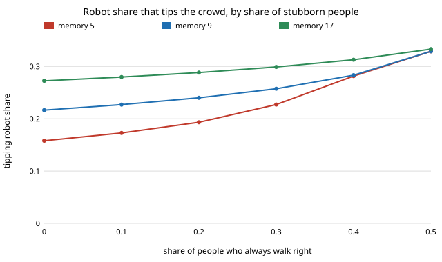

# society-stubborn: how many robots does it take to change a crowd's walking side when some people never adapt?

`society-robotnorms` found that committed robots tip a crowd's passing side once they are 16–32%
of it. Its people all adapt. Real crowds contain people who keep their side whatever others do.
**With a share `s` of stubborn people (always walk right), the mean-field tipping share for
people who remember 9 partners rises from 0.217 at `s = 0` to 0.240 at 0.2, 0.283 at 0.4 and
0.329 at 0.5. Short-memory crowds are hit hardest: memory 5 goes from 0.158 to 0.329, so at `s = 0.5`
memory 5 and 9 tip at the same share. Simulation (200 people, 12 seeds, grid step 0.02) agrees within 0.02 at every `s` when
"tipped" means a majority of adaptive people on L; demanding 90% on L instead shows a
partial-flip regime at `s ≥ 0.4`.** Stubborn people do not change what robots cost: committed
robots at 20% of the crowd still give 0.23–0.27 conflicts per human meeting, adaptive robots 0.020.
Produced with AI assistance (Claude). Next step from `society-twinfidelity` in research track 17
(`society`, `PROJECTS.md`). Every result is about simulated people following a stated rule, not real crowds.

**Live page:** https://duncan-haywood.github.io/oss-monorepo/research/society-stubborn/

## Why this question

`society-twinfidelity` found that a 30% stubborn share changed the plaza conclusions and listed
"rerun `society-robotnorms`' 1D questions with the stubborn share as a parameter" as a next step.
This is that rerun, with an exact mean-field prediction. Stubborn walkers also stand for a
robot-free analogue of committed minorities (Xie et al. 2011; Centola et al. 2018): a robot fleet
must out-vote not only habit but a fixed opposing block.

## Builds on

`society-robotnorms` (same memory rule and tipping definition; the `s = 0` row reproduces its
published 0.158 and 0.217); Young (1993), *Econometrica* 61(1):57–84; Xie et al. (2011), *Phys. Rev. E*
84:011130; Centola et al. (2018), *Science* 360(6393):1116–1119. **Lab tags:** HIRO and CAIRO only in the loose
sense of `society-robotnorms`; no method of theirs is used.

## Model

As `society-robotnorms`, well-mixed. People are a share `s` stubborn (always R, apart from error
`ε = 0.02`) and `1 − s` adaptive (majority of their last `M` partners). Committed robots (share `ρ`
of everyone) walk L. A random partner walks L with probability
`q = ρ + (1−ρ)[(1−s)(x(1−ε)+ε/2) + sε/2]`, `x` being the share of adaptive people whose memory
majority is L; `F(x) = P(Bin(M,q) ≥ (M+1)/2)`; `ρ_c` is the least `ρ` at which iterating `F` from 0
passes 1/2. Simulation: `N = 200`, 500 rounds, 12 seeds per cell. Tipping is judged on adaptive people.

## Results

From `experiments/results.txt` (`experiments/run.py`, seeded).

**A. Mean field.** `ρ_c` rises with `s` for every memory and the memory effect shrinks:

| s | M=5 | M=9 | M=17 |
|---|---|---|---|
| 0.0 | 0.158 | 0.217 | 0.273 |
| 0.2 | 0.193 | 0.240 | 0.288 |
| 0.4 | 0.282 | 0.283 | 0.313 |
| 0.5 | 0.329 | 0.329 | 0.333 |



**B–C. Simulation (M = 9).** Least grid robot share (step 0.02) at which at least half of the 12
crowds end with a majority of adaptive people on L: 0.22, 0.24, 0.24, 0.26, 0.30, 0.34 for
`s` = 0 … 0.5, against mean field 0.217, 0.227, 0.240, 0.257, 0.283, 0.329. Demanding
90% of adaptive people on L instead gives 0.36 and 0.46 at `s` = 0.4 and 0.5, because with half
the partners stubborn the flipped crowd is a partial flip (mean final share about 0.27 at
`ρ = 0.30`, `s = 0.5`, a mix of flipped and unflipped crowds). The mean-field "tipped" criterion
is the state passing 1/2, so the 0.5 column is the comparable one.

**D. Cost.** Conflicts per human meeting at `M = 9`: adaptive robots 0.020 at every `s`; committed
robots 0.119 at `ρ = 0.10` for every `s`, and 0.272, 0.252, 0.234 at `ρ = 0.20` for `s` = 0, 0.2, 0.5
(falling only because some crowds tip or stubborn walkers already walk R).

## Limitations

Stylised: no geometry or speed; stubborn people are a fixed R block with no adaptation at all; the
partial-flip regime at high `s` is short of a long-run equilibrium; 12 seeds. 200 people. Results
about simulated walkers, not real people.

## Reproduce

```
cd research/society-stubborn
python3 -m unittest discover -s tests            # 9 tests, ~1 s
PYTHONPATH=src python3 experiments/run.py        # writes results.txt (~3 min)
python3 experiments/figure.py
```

## Next steps

1. Stubborn people on the robots' side (a pro-robot block) and mixed blocks.
2. Stubborn share in the ring/placement model of `society-robotnorms`.
3. Fit `s` to measured pedestrian side preference (Moussaïd et al. 2009) rather than sweeping it.

## Owner steps

None.

## Outside dependencies

None: Python standard library only.
