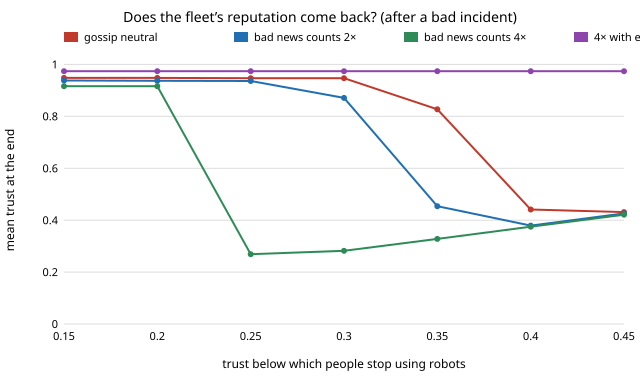
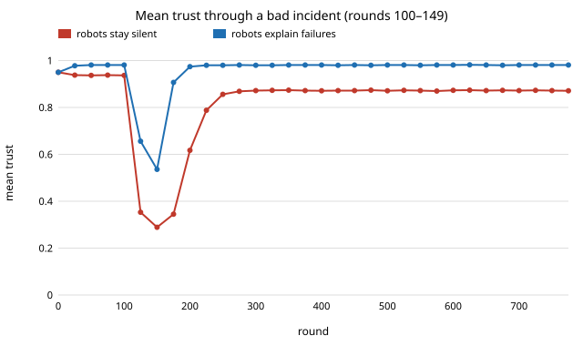

# society-trust: can a robot fleet's reputation survive one bad incident?

When people's trust in robots is shaped by their own encounters and by gossip, how bad does
one incident have to be before the fleet's reputation does not come back, and does having
robots explain their failures help? On a stylised model: **trust that is only ever dented
recovers in every case tried, because people keep meeting robots. What sinks a reputation is
avoidance: if people stop using robots once their trust falls below a threshold, the same
incident (error rate 0.8 for 50 rounds) leaves the reputation recovering in all 20 crowds at a
threshold of 0.30 when gossip is neutral, in 18 of 20 when bad news counts twice as much, and
in none when it counts four times as much (final mean trust 0.947, 0.871 and 0.282). Raising
the threshold to 0.40 leaves 2 of 20 crowds recovering even with neutral gossip. Robots that
explain a failure, so it hurts trust 0.3× as much, recovered in all 20 crowds in every
setting tried (final mean trust 0.974–0.984).** Produced with AI assistance (Claude). Third project of
research track 17 (`society`, `PROJECTS.md`, milestone 3). Every result is about simulated
people following a stated rule, not about real trust in real robots.

**Live page:** https://duncan-haywood.github.io/monorepo-projects/research/society-trust/

## Why this question

Fleets share a reputation: a person who sees one delivery robot fail tends to judge the next
one by it. Research on trust in human-robot interaction finds that a robot's performance, and
in particular its failures, is the strongest measured driver of trust (Hancock et al. 2011).
Trust also spreads between people, and bad news is often shared more readily than good. The
track's question is whether a fleet that coordinates and is deployed at scale is exposed to
one unit's bad day.

## Builds on

- Hancock, Billings, Schaefer, Chen, de Visser and Parasuraman (2011), *Human Factors*
  53(5):517–527: meta-analysis of factors in trust in human-robot interaction; robot
  performance and failures dominate. Used only to motivate making failures the main driver
  here; the update sizes below are not fitted to their effect sizes.
- Young (1993), *Econometrica* 61(1):57–84, and Centola et al. (2018), *Science*
  360(6393):1116–1119: how conventions spread from local interaction. The gossip step is the
  same kind of local averaging, applied to a continuous trust level.
- Park et al. (2023), UIST: generative agents, for the later `society-llmtown` milestone; not
  used here.

Full entries are in `paper/whitepaper.md`. This project reproduces none of these papers. **Lab
tags:** HIRO (social intelligence) and CAIRO (human-robot collaboration) in the loose sense that
the simulated people are a behavioural twin that a robot policy (explain failures or stay
silent) is evaluated against; no method of theirs is used.

## Model

- `N = 100` simulated people each hold trust `t` in the robot fleet (one shared reputation;
  they do not tell robots apart). Start: the steady value for the baseline error rate 0.05.
- **Experience.** A person relies on a robot with probability `t`, if `t ≥ θ`; below `θ` they
  avoid robots and learn nothing first-hand. A success moves `t` up by `0.1(1 − t)`. A failure
  moves it down by `0.1·w·t`, with `w = 1` for silent robots and `w = 0.3` for robots that
  explain the failure. Without gossip and with `θ = 0`, trust settles at
  `t* = (1 − e)/((1 − e) + e·w)` for error rate `e`.
- **Gossip.** Each round people are paired at random and exchange trust. Hearing a lower value
  moves `t` toward it by `β·g` of the gap, a higher value by `g` (`g = 0.05`; `β = 1` is neutral,
  `β > 1` is a negativity bias).
- **Incident.** The error rate is 0.05 except for 50 rounds (100–149), when it is `e_bad`.
- "Recovered" means mean trust back within 0.05 of the baseline 0.95; 800 rounds, 20 seeds.

## Results

All numbers are from `experiments/results.txt` (`experiments/run.py`, seeded).

**A. The update matches its fixed point.** With no gossip and no incident the simulated
trust is within 0.045 of `t*` at every error rate tried (0.947 against 0.950 at `e = 0.05`;
0.255 against 0.300 at `e = 0.70`, where the shortfall is not analysed here), for both
silent and explaining robots.

**B. Without avoidance, every incident is recovered.** For `e_bad` from 0.2 to 0.8 and
`β` from 1 to 4, all 20 crowds are back within 0.05 of baseline before the run ends. Harder
incidents sink trust further (lowest mean trust 0.79 at `e_bad = 0.2` down to 0.27 at 0.8 for
`β = 1`) and take longer (median 13 to 41 rounds after the incident ends). A negativity bias
makes the dip deeper and the recovery slower (0.20 and 69 rounds at `e_bad = 0.8`, `β = 4`),
and ends slightly below baseline (0.915). Plain recovery always comes: people who trust a
little still meet robots and see them work.

**C. Explanations soften and shorten the dip.** With `w = 0.3`, the lowest mean trust at
`e_bad = 0.8` is 0.56 (`β = 1`) rather than 0.27, recovery takes a median 22 rounds rather
than 41, and final trust is higher (0.98) because the baseline failures cost less too.

**D–E. Gossip and incident length.** Stronger gossip with a 2× negativity bias deepens the
dip (lowest 0.414 with no gossip, 0.324 at `g = 0.2`) and slows recovery (36 to 56 rounds).
Length matters more: at `e_bad = 0.6` a 10-round incident bottoms out at 0.62 and a 100-round
one at 0.34 for silent robots (0.85 and 0.65 with explanations).

**F–G. Avoidance is the trap.** When people stop using robots below `θ`, those who fall below
it only recover through gossip with people who still trust (a negativity bias weakens that
too). For an incident at `e_bad = 0.8`:

| θ | neutral gossip | bad news 2× | bad news 4× | 4× with explanations |
|---|---|---|---|---|
| 0.15 | 0.948 | 0.938 | 0.916 | 0.974 |
| 0.25 | 0.947 | 0.936 | 0.269 | 0.974 |
| 0.30 | 0.947 | 0.871 | 0.282 | 0.974 |
| 0.35 | 0.827 | 0.454 | 0.328 | 0.974 |
| 0.40 | 0.441 | 0.379 | 0.375 | 0.974 |

(final mean trust). The cliff is sharp: reputation either recovers or settles near 0.3–0.45.
At `θ = 0.30` and `β = 2`, 90% of crowds recover and the other 10% do not (section F); at
`β = 4` none does. Explained failures keep trust above every threshold tried, because trust
never dips low enough to reach it (lowest 0.49 at `β = 4`, `e_bad = 0.8`).





## What this does and does not show

- It shows that, in this model, whether a reputation survives is decided by whether bad news
  can push people into avoiding the fleet, not by how long the dip lasts or how many robots
  are involved. A fleet designer should worry about the threshold at which people stop
  trying robots and about negativity in what people pass on, and robot failures that come
  with an explanation are the cheap lever.
- It does not show that real people have a trust threshold of 0.3, that explanations cost
  trust 0.3× as much (a modelling choice, not a fitted effect), or that real gossip has the
  stated asymmetry. The cliff's location is a property of the model's parameters; its
  existence follows from avoidance cutting off evidence.
- Explaining failures is a transparency policy; nothing here is a design for managing
  people's trust against their interest. A robot that explains a failure dishonestly would
  be deception, and is out of scope.

## Limitations

Stylised: one shared reputation instead of per-robot trust; one trust number per person; no
differences between people or robots; the same error rate for every robot; random pairing of
gossip partners; avoidance as a hard threshold; 20 seeds, one gossip rate (`g = 0.05`) except
section D, `N = 100`. No real data and no human subjects were used.

## Reproduce

```
cd research/society-trust
python3 -m unittest discover -s tests      # 10 tests, under 1 s
PYTHONPATH=src python3 experiments/run.py  # about 1 minute, writes results.txt
python3 experiments/figure.py              # writes the two SVGs from results.txt
```

Stdlib only (Python 3.9+).

## Next steps

1. Per-robot trust: people who can tell robots apart, so one bad unit sinks only itself. Does
   word of mouth then still spread to the fleet?
2. Heterogeneous thresholds and gossip partners drawn from a social network.
3. Trust that feeds back on the passing-side convention of `society-robotnorms`.

## Outside dependencies

None: the model, simulation and figures use only the Python standard library.
