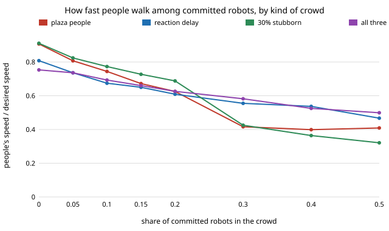
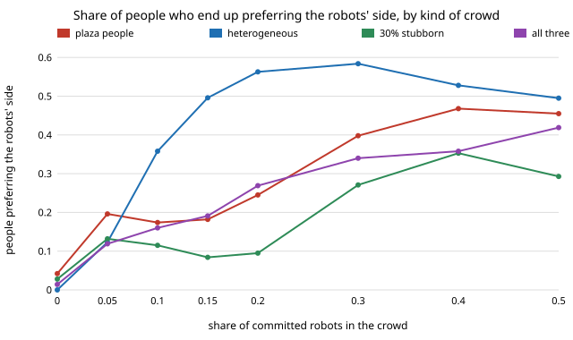

# society-twinfidelity: does the robots-in-a-corridor conclusion survive a more humanlike crowd?

`society-plaza` found that robots holding one passing side slow a simulated crowd and do not flip
it, while robots that follow the local convention are free. Those people were idealised: near-equal
speeds, instant reactions, everyone willing to switch side. Do the conclusions hold when the
simulated people are made messier in three humanlike ways? **Two hold in every crowd tried: adaptive
robots cost nothing (people's speed within 0.03 of each crowd's own no-robot value at robot shares
0.2 and 0.5), and committed robots never produce a clean flip (at most 0.58 of people prefer the
robots' side, in any crowd, at any share up to 0.5). Two do not transfer: the size of the speed
cost (at 30% committed robots people lose 0.49 of desired speed in the plaza crowd but 0.17 in the
crowd with all three changes) and the personal-space cost (0.03 of agent time in the plaza crowd,
0.35 with reaction delay and variety, and already 0.09 with no robots at all).** Produced with AI
assistance (Claude). Milestone 6 of research track 17 (`society`, `PROJECTS.md`). Every result is
about simulated walkers following stated rules, not real crowds.

**Live page:** https://duncan-haywood.github.io/monorepo-projects/research/society-twinfidelity/

## Why this question

The people in these simulations are a behavioural twin of human walkers, so a conclusion about
robots is only as good as the twin. This project is the track's twin-fidelity test. It reruns
`society-plaza` with people altered in three ways that real pedestrians plausibly differ from the
idealised ones, and asks which conclusions change. It does **not** use track 11's imitators or
published trajectory data (none is available offline here, and the imitators are not wired to a
crowd simulator), so these are hand-chosen perturbations, not a fit to anyone's measurements.

## Builds on

`society-plaza` (same corridor, same force model, same robots, same measures; its code is copied
here with the options below added, and with default options reproduces its results exactly, which a
test checks). Helbing and Molnár (1995), *Phys. Rev. E* 51:4282–4286 (social force model);
Moussaïd et al. (2009), *Proc. R. Soc. B* 276(1668):2755–2762 (side preference in avoidance).
Reaction time of about 0.4 s is a stylised round value in the range commonly assumed for
pedestrian models, not a measurement made here. No lab's method is reproduced; HIRO (social
intelligence) and CAIRO (simulated human models) are the loosely related groups.

## The crowds

All have 60 agents, 30 m × 6 m periodic corridor, memory M = 9, robots committed to the left.

| crowd | what changes for the people |
|---|---|
| plaza | nothing: `society-plaza`'s people (speed ±8%, sideways-push weight 0.6) |
| hetero | speed spread ±25%; sideways-push weight drawn per person from N(0.6, 0.3), clipped to 0–1.5 |
| delay | people react to where others were 0.4 s ago (robots see current positions) |
| stubborn | 30% of people never change the side they keep (right) |
| humanlike | all three together |

## Results

All numbers are from `experiments/results.txt` (`experiments/run.py`, seeded; 10 seeds per cell,
300 s, second half measured; standard errors over seeds are in block F, mostly 0.005–0.04 for
speed and 0.01–0.08 for the flip share).

People's speed over desired, committed robots:

| robot share | plaza | hetero | delay | stubborn | humanlike |
|---|---|---|---|---|---|
| 0 | 0.91 | 0.85 | 0.81 | 0.91 | 0.75 |
| 0.05 | 0.81 | 0.77 | 0.74 | 0.82 | 0.74 |
| 0.20 | 0.63 | 0.51 | 0.61 | 0.69 | 0.63 |
| 0.30 | 0.42 | 0.53 | 0.56 | 0.43 | 0.58 |
| 0.50 | 0.41 | 0.52 | 0.47 | 0.32 | 0.50 |



People preferring the robots' side (last quarter of the run):

| robot share | plaza | hetero | delay | stubborn | humanlike |
|---|---|---|---|---|---|
| 0 | 0.04 | 0.00 | 0.06 | 0.03 | 0.01 |
| 0.10 | 0.17 | 0.36 | 0.32 | 0.12 | 0.16 |
| 0.20 | 0.25 | 0.56 | 0.34 | 0.10 | 0.27 |
| 0.30 | 0.40 | 0.58 | 0.39 | 0.27 | 0.34 |
| 0.50 | 0.46 | 0.50 | 0.47 | 0.29 | 0.42 |



**Which conclusions of `society-plaza` survive**

1. *Adaptive robots are free: survives.* At robot shares 0.2 and 0.5 people's speed is 0.906/0.902
   (plaza), 0.844/0.810 (hetero), 0.813/0.836 (delay), 0.907/0.907 (stubborn) and 0.763/0.781
   (humanlike), against no-robot values of 0.907, 0.851, 0.808, 0.911 and 0.753; the preferring-left
   share stays at most 0.07. (Hetero at share 0.5 is 0.04 below its baseline, about three standard
   errors; the cost is small next to committed robots'.)
2. *No clean flip: survives.* No crowd exceeds 0.58 preferring the robots' side at any share up
   to 0.5 and none reaches a majority-and-stay pattern. The route differs: the heterogeneous crowd
   moves toward the robots' side much earlier (0.50 at share 0.15, against 0.18 in the plaza crowd), while
   stubborn people hold it back (0.09 at 0.15; 0.29 at 0.5).
3. *Committed robots slow people: survives in direction, not in size.* Every crowd loses speed
   as committed robots are added, but at 30% the loss from each crowd's own baseline is 0.49 (plaza),
   0.32 (hetero), 0.25 (delay), 0.49 (stubborn) and 0.17 (humanlike). The plaza crowd's slowdown
   was the largest of the five, and it was the crowd with the least variety and no reaction delay.
4. *Personal-space intrusions: does not transfer.* In the plaza crowd another agent is inside
   0.9 m for at most 0.033 of agent time. With reaction delay it is 0.087 with **no robots** and up to
   0.27, and in the humanlike crowd 0.085 with no robots and 0.36 at share 0.2. So the plaza figure
   mostly measures that crowd's perfect reactions, not the robots.
5. *Lanes.* Lane separation falls with committed robots in every crowd (2.74 m → 1.34 m in the plaza
   crowd at 0.3), but the heterogeneous crowd loses its lanes almost entirely (0.12 m at 0.3).

## What this does and does not show

- The qualitative recommendation of `society-robotnorms` and `society-plaza` (robots should follow
  the local convention, not impose one) held in every one of the five simulated crowds.
- Any quantity that depends on how precisely simulated people react (intrusions, the size of the
  slowdown) moved by a factor of up to 10 between crowds, so those numbers from the idealised twin
  should not be quoted as findings about robots.
- It does not show which of these crowds, if any, resembles real pedestrians. The three
  perturbations are simple choices; delay also lowers the no-robot speed and raises its intrusions,
  so part of its effect is the crowd being worse at avoidance generally rather than interacting
  with robots. Separating those would need no-robot baselines as the controls, which block B and D
  report at share 0.

## Limitations

Stylised; hand-chosen parameters (±25%, N(0.6, 0.3), 0.4 s, 30%), one corridor and density, one
memory length (9), 10 seeds per cell, standard errors reported but no tests for significance.
Robots keep exactly the people's speed and body. Heterogeneity and delay are applied to people only.
Track 11's imitators and real trajectory data are the proper next step and were not used.
Deliberately shifting how people behave raises consent questions: this reports costs; it is not a
recipe for steering crowds.

## Reproduce

```
cd research/society-twinfidelity
python3 -m unittest discover -s tests          # 6 tests, ~5 s (needs ../society-plaza for one check)
PYTHONPATH=src python3 experiments/run.py      # ~25 min on 4 cores, writes results.txt
python3 experiments/figure.py                  # writes the two SVGs from results.txt
```

Stdlib only (Python 3.9+).

## Next steps

1. Replace the hand-chosen perturbations with track 11's imitators or published trajectory data.
2. Rerun `society-robotnorms`' 1D questions with the stubborn share as a parameter (mean-field
   prediction for a population with a non-adapting fraction).
3. Separate delay's general avoidance cost from its robot-specific interaction by adding
   robots with the same delay.

## Outside dependencies

None: Python standard library only.
