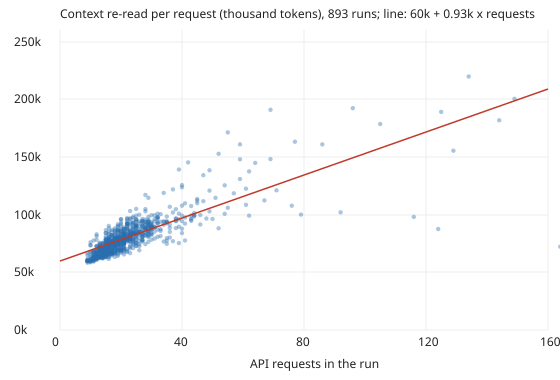

# Where does an agent run's cost go, and why does it grow faster than its tool calls? Cache reads and cache writes are 86% of the cost (preliminary)

Pure Python standard library. This follows up the "Next steps" of `swe-callcost`, which found that cost rises with a log-log slope of 1.22 against tool calls, not 1. It asks whether the per-token-kind usage the run records keep explains that. Why it seemed worth doing: the answer says where a cheaper run would have to save tokens. Produced with AI assistance (Claude). Builds on none of the labs in `prompt.md`.

**Live page:** https://duncan-haywood.github.io/oss-monorepo/research/swe-cachecost/

All numbers are from `experiments/results.txt`: 893 of 1,659 records in `prompts/runs/` carry `usage.totals` (per-kind tokens, complete), a positive cost and tool calls, dated 2026-10-16 to 2026-10-20. Costs are API-equivalent dollars recomputed here from `prompts/pricing.json`.

- **Where the dollars go (median run):** cache reads 45%, 1-hour cache writes 41%, output (including thinking) 13%, fresh input and 5-minute writes about 0%. Reads are 95.8% of input-side tokens.
- **A starting context re-read every request explains the shape.** Cache-read tokens per request fit as about 60,000 at the start plus about 1,900 for every further request (bootstrap 95% interval 1,500 to 2,200). At the median run (20 requests) the starting context is 76% of what each request re-reads.
- **Why the slope is not 2:** if context grew from zero, total reads would grow with requests squared. With a large fixed start it is 1.36 for reads (1.33 to 1.40), 0.63 for cache writes (the start is written once), and 1.16 for total cost against requests (1.11 to 1.20). Tool calls track requests closely (1.11 calls per request).
- **Long runs cost more per request:** median cost per request is $0.034 for 11 to 25 requests, $0.036 for 26 to 60 and $0.059 for 61 or more (26 runs).
- **Output grows fastest** (slope 1.36 against requests, 1.61 against tool calls) but is only 13% of the cost.

## Method

`src/swe_cachecost/cc.py`. Keep records with complete `usage.totals`, positive cost and tool calls, and a price row for `usage.primary_model`. Component dollars are tokens times the model's per-million rates; shares are within the run. Slopes are ordinary least squares on logs with a percentile bootstrap (1,000 resamples). The context model regresses cache-read tokens per request on the request count; the intercept is the starting context and twice the slope is the growth per request. Reproduce: `python3 experiments/run.py > experiments/results.txt && python3 experiments/figure.py`; tests: `python3 -m unittest discover tests`.

## Limitations

- **API-equivalent, not a bill.** Runs are on a subscription; shares depend on the list prices of 2026-10-06, and cache-read pricing differs by model.
- **The context model is crude:** R² 0.31 for the per-request fit. Runs differ in their starting context, compaction and subagents; a single linear growth rate hides that. It says what dominates, not a law.
- **Cache writes are 1-hour only here** (5-minute writes are zero), a property of this harness's setup, so the 41% share may not carry to other setups.
- **One repository, five days,** mostly one model (`claude-sonnet-5-5`); no model split was made.
- Records change after merge; this reads the checkout of 2026-10-20. Cause is not tested by intervention: nothing here shows that a smaller starting context would lower cost by the fitted amount.

## Next steps

Split the starting context by what is in it (the `CLAUDE.md` chain, system prompt, tool schemas) from a transcript to see what a leaner brief could remove; check how `tool_calls` and `requests` treat subagents.

## Owner steps

None.

## Outside dependencies

None (standard library only). No language-model proposer was used.

MIT.
