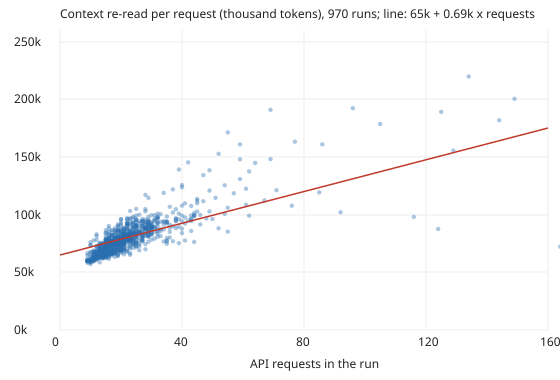

# Where does an agent run's cost go, and why does it grow faster than its tool calls? One-hour cache writes and cache reads are about 80% of the cost (preliminary)

Pure Python standard library. This follows up the "Next steps" of `swe-callcost`, which found that cost rises with a log-log slope of 1.22 against tool calls, not 1. It asks whether the per-token-kind usage the run records keep explains that. Why it seemed worth doing: the answer says where a cheaper run would have to save tokens. Produced with AI assistance (Claude). Builds on none of the labs in `prompt.md`.

**Live page:** https://marisstella.app/research/swe-cachecost/

All numbers are from `experiments/results.txt`: 970 of 1,780 records in `prompts/runs/` dated up to 2026-10-20 carry `usage.totals` (per-kind tokens, complete), a positive cost and tool calls, dated 2026-10-16 to 2026-10-20. Component shares (section A) are API-equivalent dollars recomputed here from `prompts/pricing.json`; sections B to D use each record's stored `cost_usd`. Corrected 2026-11-25: the shares first published (cache reads 45%, writes 41%, output 13%) used a Sonnet 5.5 cache-read price of $0.20 per million tokens; Anthropic's list price is $0.10 ([quality audit](../../portfolio/quality/audits/2026-11-19-swe-cachecost.json)).

- **Where the dollars go (median run):** 1-hour cache writes 52%, cache reads 29.5%, output (including thinking) 17%, fresh input and 5-minute writes about 0%. Reads are 95.8% of input-side tokens but, at 0.05x the input price, under a third of the cost; the 2x premium on one-hour writes is the largest single line.
- **A starting context re-read every request explains the shape.** Cache-read tokens per request fit as about 65,000 at the start plus about 1,400 for every further request (bootstrap 95% interval 900 to 2,100). At the median run (20 requests) the starting context is 83% of what each request re-reads.
- **Why the slope is not 2:** if context grew from zero, total reads would grow with requests squared. With a large fixed start it is 1.35 for reads (1.32 to 1.39), 0.63 for cache writes (the start is written once), and 1.12 for total cost against requests (1.05 to 1.18). Tool calls track requests closely (1.11 calls per request).
- **Long runs cost more per request:** median cost per request is $0.034 for 11 to 25 requests, $0.035 for 26 to 60 and $0.059 for 61 or more (27 runs).
- **Output and cache reads grow fastest** (slopes 1.33 and 1.35 against requests, intervals overlapping; 1.61 and 1.59 against tool calls); output is 17% of the cost.

## Method

`src/swe_cachecost/cc.py`. Keep records with complete `usage.totals`, positive cost and tool calls, and a price row for `usage.primary_model`. Component dollars are tokens times the model's per-million rates; shares are within the run. Slopes are ordinary least squares on logs with a percentile bootstrap (1,000 resamples). The context model regresses cache-read tokens per request on the request count; the intercept is the starting context and twice the slope is the growth per request. Reproduce: `python3 experiments/run.py > experiments/results.txt && python3 experiments/figure.py`; tests: `python3 -m unittest discover tests`.

## Limitations

- **Corrected price, slightly different sample** (2026-11-25). The first version priced Sonnet 5.5 cache reads at $0.20 per million tokens (`prompts/pricing.json`, fixed in the same PR); 853 of its 895 runs were Sonnet 5.5. `run.py` now reads only records dated up to 2026-10-20 (`--until` moves it), so the result no longer drifts as runs are added; that window now holds 970 usable records rather than 893, because records were added or completed after the first run. Token-based numbers moved by at most a few percent; the cost split moved because of the price.

- **API-equivalent, not a bill.** Runs are on a subscription; shares depend on the list prices in `prompts/pricing.json` (as of 2026-11-12), and cache-read pricing differs by model.
- **The context model is crude:** R² 0.25 for the per-request fit. Runs differ in their starting context, compaction and subagents; a single linear growth rate hides that. It says what dominates, not a law.
- **Cache writes are 1-hour only here** (5-minute writes are zero), a property of this harness's setup, so the 52% share may not carry to other setups.
- **One repository, five days,** mostly one model (`claude-sonnet-5-5`); no model split was made.
- Records change after merge; this reads the checkout of 2026-10-20. Cause is not tested by intervention: nothing here shows that a smaller starting context would lower cost by the fitted amount.

## Next steps

Split the starting context by what is in it (the `CLAUDE.md` chain, system prompt, tool schemas) from a transcript to see what a leaner brief could remove; check how `tool_calls` and `requests` treat subagents.

## Owner steps

None.

## Outside dependencies

None (standard library only). No language-model proposer was used.

MIT.
