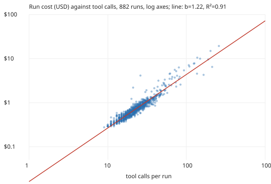

# How well does a run's tool-call count predict what it costs? 882 priced run records: a median error of 9% on held-out runs, and cost per call is about $0.03 (preliminary)

Pure Python standard library. A new question for track 10 (the software-engineering loop), not a variation of an earlier result: `swe-runcost` described what runs cost, and `swe-fieldfill` showed that 46% of records carry no cost at all. This project asks how much of a run's cost is already explained by a field every transcript has, the number of tool calls, and whether cost per call grows as a run gets longer (every call re-reads the context). Produced with AI assistance (Claude). Builds on none of the labs in `prompt.md`.

**Live page:** https://duncan-haywood.github.io/monorepo-projects/research/swe-callcost/

All numbers are from `experiments/results.txt` (882 of 1,638 records in `prompts/runs/` carry both a positive `cost_usd` and `tool_calls`, dated 2026-10-16 to 2026-10-20).

- **Cost per call is nearly constant:** median $0.031, 10th to 90th percentile $0.026 to $0.038. The median run makes 22 calls and costs $0.68.
- **A log-log fit explains 91% of the variance** (R² = 0.908). Predicting each run's dollars from its tool calls on held-out folds (5-fold cross-validation) misses by a median of 9% (90th percentile 25%).
- **The pooled slope is 1.22 (bootstrap 95% interval 1.18 to 1.26),** so a run twice as long costs about 2.3 times as much. Part of that is mixing groups: within a model the slope is 1.10 (`claude-sonnet-5-5`, n = 843, 1.07 to 1.13) or 0.96 (`claude-opus-5-5`, n = 38, 0.74 to 1.15, an interval that includes 1). Within track it runs from 0.68 (review, n = 24) and 0.85 (redteam) to 1.29 (process).
- **A plain cost-per-call multiplier does as well as the fit** (median 9%, 90th percentile 26%), so for budgeting "calls times three cents" is enough on this data.
- **It cannot fill the gaps in the ledger:** none of the 756 records without a cost has a tool-call count either (both come from the same transcript measurement), so this is a check on the measurement and a planning rule for new runs, not an imputation.

## Method

`src/swe_callcost/cc.py`. Keep records with positive `cost_usd` and `tool_calls`. Ordinary least squares of log cost on log calls, with a percentile bootstrap (2,000 resamples, 1,000 per subgroup) for the slope. Held-out error: 5 folds, fit on four, predict dollars on the fifth, absolute percentage error. The comparison model predicts cost as the training folds' median cost per call times calls. Subgroups under 20 runs are not shown. Reproduce: `python3 experiments/run.py > experiments/results.txt && python3 experiments/figure.py`; tests: `python3 -m unittest discover tests`.

## Limitations

- **Cost is API-equivalent, computed from tokens** by `prompts/runcost.py`, not a bill, and tool calls and tokens come from the same transcript. The tight relation partly reflects how the cost is built, not a causal law of agents.
- **Only 2026-10-16 onward** carries cost; older runs cannot be checked. The slope may change with the model, the brief or the harness.
- **Subagent calls** may or may not be counted in `tool_calls`; I did not check how the field is built per record.
- Opus runs are few (38) and the intervals wide; the Sonnet/Opus slope difference is not established.
- Records change after merge; this reads the checkout of 2026-10-20.

## Next steps

Done in [`swe-cachecost`](../swe-cachecost): the records do keep cache reads, and a starting context re-read on every request explains the slope above 1. Still open: how `tool_calls` treats subagents.

## Owner steps

None.

## Outside dependencies

None (standard library only). No language-model proposer was used.

MIT.
