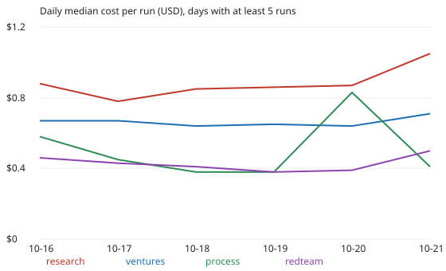

# Is an agent run getting more expensive day by day? Research runs grew about 5% a day in cost and tool calls; other tracks did not (preliminary)

Pure Python standard library. A new question for track 10 (the software-engineering loop): `swe-runcost` and `swe-callcost` describe what a run costs at one moment, and this asks whether that is stable. Produced with AI assistance (Claude). **Preliminary: six calendar days, observational, cost is an API-equivalent estimate.**

**Live page:** https://duncan-haywood.github.io/monorepo-projects/research/swe-costdrift/

All numbers are from `experiments/results.txt` (1,053 records in `prompts/runs/` with positive `cost_usd` and `tool_calls` and a `started` time, 2026-10-16 to 2026-10-22).

- **Pooled, cost per run rises 3.4% a day** (Theil-Sen on log cost, 95% bootstrap interval +1.2 to +5.1).
- **It is a research-track effect.** Research runs (n=456) rise 4.9% a day in cost (+2.8 to +7.0) and 5.7% a day in tool calls (+3.9 to +7.8). Their cost per call is flat (-0.5%/day, -1.1 to +0.1): they take more steps, not pricier ones. Median research cost per run by day: $0.88, 0.78, 0.85, 0.86, 0.87, then $1.05 on the partial 21 October.
- **Ventures show no drift** (cost +0.0%/day, -2.3 to +3.0). Process, red-team, explore and review intervals all include zero for cost per run; their cost per call falls 1 to 3% a day, which is small and may be a change in cache behaviour that this data cannot identify.
- **Budget reading:** if the research trend continued, a research run would cost about 1.6 times as much after ten days. Six days cannot support an extrapolation; this says only that the cost should be watched.



```bash
cd research/swe-costdrift
python3 -m unittest discover -s tests -v   # 5 tests
python3 experiments/run.py > experiments/results.txt   # about 3 minutes (pairwise slopes, 300 bootstraps)
python3 experiments/figure.py
```

## Motivation

Throughput per subscription-week depends on cost per run. A cost that creeps up, for instance because the repository, the briefs and the docs a run must read all grow, would reduce throughput without any single run looking wrong.

## Builds on

`swe-runcost`, `swe-callcost` (cost and its link to tool calls). Theil (1950) and Sen (1968), "Estimates of the regression coefficient based on Kendall's tau", *JASA* 63, for the slope; Efron (1979), *Annals of Statistics* 7(1), for the bootstrap. No lab's work is built on.

## Method

`src/swe_costdrift/cd.py`. Keep records with `cost_usd`, `tool_calls` and `started`. The x-axis is the UTC calendar day of `started`. The slope is the median of all pairwise slopes of log value on day (pairs on the same day are skipped), converted to percent per day as 100(exp(b)-1). The interval resamples runs with replacement 300 times (seed 1). Tests check the slope on an exact line, its outlier robustness, recovery of a known 10% daily growth, that a flat series has an interval covering zero, and the daily-median filter.

## Limitations

- **Six days**, the last partial; a trend of days is also a trend of whichever hours the routines happened to fire.
- **Observational.** Rising research cost could come from a longer brief, bigger repository, harder milestones or a changed task mix; I did not separate them.
- **Cost is API-equivalent** from tokens (`prompts/runcost.py`), not a charge.
- **Runs are not independent** (concurrent runs share a day and a repository state), so the intervals are probably too narrow.
- Records without a cost are excluded and may differ systematically.

## Next steps

Re-run in two weeks on more days; test whether research runs' extra calls come from longer reading (context size) or longer building; control for milestone type.

## Outside dependencies

None. No language-model proposer was used.

MIT.
