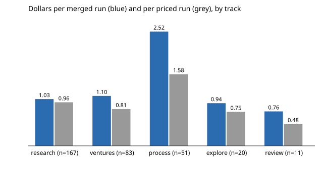

# What does an agent run cost per merged pull request? 366 priced runs joined to main's merge history, by track (preliminary)

Pure Python standard library. A follow-up to `swe-runcost`, whose next steps asked for cost to be joined to merged outcome. Part of track 10 (the software-engineering loop). Produced with AI assistance (Claude). **Preliminary: five days, one model, and the join only sees runs whose record names a pull request.**

**Live page:** https://duncan-haywood.github.io/monorepo-projects/research/swe-costpermerge/

- **Of 366 priced runs, 273 (75%, Wilson 70% to 79%) name a pull request that is on `main`; 1 names one that is not; 92 name none.** All numbers are from `experiments/results.txt`.
- **A merged run costs $1.26 on average (bootstrap 1.08 to 1.49), against $0.94 per priced run.** That is total spend ($344) over merged runs, so it charges the 19% of spend that sits on runs without a merged PR on record to the ones that have one. It is an upper bound: runs with no PR on record may have landed.
- **The 92 are mostly a recording gap, not failed work.** All 34 red-team runs name no PR and list no commits, yet red-team pull requests are on `main` (for example "redteam: close 7 escaped mutants ... (#7950)"). So the red-team row (0% merged) measures how its records are filled in, not how often it lands. Excluding red team, 273 of 332 (82%) join.
- **By track (merged runs, $ per merged run):** research 157 (1.03, bootstrap 0.90 to 1.20), ventures 61 (1.10, 0.91 to 1.36), explore 16 (0.94), review 7 (0.76), process 32 (2.52, 1.38 to 4.16). Process runs cost about 2.4 times a research run per merged run, and also name no PR more often (19 of 51), so their figure is the least certain.
- **Cost per merged run is not value per merged run.** A research run that merges a variation of last week's project and one that lands a listed milestone count the same here; `swe-value` scores that.



```bash
cd research/swe-costpermerge
PYTHONPATH=src python3 -m unittest discover -s tests -v    # 6 tests, under a second
python3 experiments/run.py > experiments/results.txt       # a second
python3 experiments/figure.py                              # writes experiments/cost_per_merged.svg
python3 experiments/snapshot.py                            # regenerates the snapshot; needs a full clone (git fetch --unshallow origin main)
```

## Motivation

`swe-runcost` priced runs but could not say what a dollar bought, because the records' `merged` field is mostly null. Track 10's metric is valuable correct work per unit of compute, and "merged" is the cheapest term of that to get from git rather than from a run's own report.

## Builds on

`swe-runcost` (the cost fields). Wilson (1927), "Probable inference, the law of succession, and statistical inference", *JASA* 22(158), for the proportion intervals; Efron (1979), *Annals of Statistics* 7(1), for the bootstrap. No lab's work is built on, and no lab is affiliated with or endorses this project.

## Method

`src/swe_costpermerge/join.py`. `experiments/snapshot.py` reads every record in `prompts/runs/` with a non-null `cost_usd`, takes the pull-request number from its `pr` field (an integer or a URL ending in the number), and checks it against the numbers named by the subject lines of `origin/main`'s first-parent commits (`... (#N)` for squash merges, `Merge pull request #N`). A run is `merged`, `no_pr` (the record names none) or `not_found`. `experiments/costs_merge_snapshot.jsonl` is that join, committed so the analysis reruns without a full clone. Cost per merged run is total spend over merged runs, with a percentile bootstrap over runs (2,000 resamples, seed 1).

## Limitations

- **Merged is read from commit subjects**, so a pull request merged with a message that omits its number is missed, and a number quoted in an unrelated subject would count (the pattern anchors on the end of the subject to limit this). No pull request's CI state or later revert is checked.
- **Records that name no PR are unknown, not unmerged.** 92 of 366; 34 are red team, which the records never link. Treat $/merged as an upper bound and $/run as the lower bound.
- A record is committed in its own pull request, so a record naming PR N is on `main` iff that PR merged; runs whose work never reached a PR leave no `pr` and so look like the gap above.
- Five days, one model, and only runs that followed the cost step (366 of about 990).
- Cost is `prompts/runcost.py`'s API-equivalent estimate, not a bill.

## Next steps

Have the red-team prompt write `pr` (and `commits`) into its record, then rerun; join each merged PR to its changed files to weigh by project count or lines; add `swe-audit`'s correctness result and `swe-value`'s score so the denominator is valuable correct merges rather than merges.

## Owner steps

None.

## Outside dependencies

`git` and this repository's full history (for `snapshot.py` only). No language-model proposer was used.

MIT.
