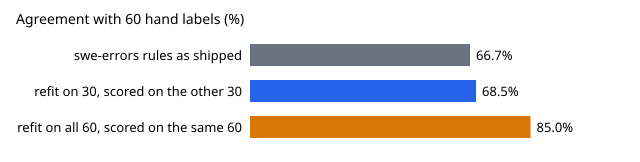

# Can the swe-errors keyword rules be improved on 30 hand labels and still help on the other 30? (preliminary, small)

**Live page:** https://duncan-haywood.github.io/monorepo-projects/research/swe-errfix/

Pure Python standard library. Track 10 (the software-engineering loop), a follow-up that `swe-errlabel` listed under its next steps: refit the `swe-errors` keyword rules without tuning them on their own test set. Produced with AI assistance (Claude). **Preliminary: one labeller, 60 entries, and a refit this small mostly shows how little 30 labels can teach a keyword list.**

- **Fitted on half the labels and scored on the other half, the refit rules agree with the hand label on 68.5% of entries on average (41.1 of 60), against 66.7% (40 of 60) for the rules as shipped.** That is +1.1 entries (about +1.8 points) averaged over 200 random splits, with a range of -4 to +7 entries per split; the refit beat the shipped rules in 125 splits, tied in 29 and lost in 46.
- **The same procedure fitted on all 60 labels and scored on the same 60 reaches 51 of 60 (85%).** The gap between 85% in-sample and 68.5% held-out is what `swe-errlabel`'s next-step warning was about: most of an apparent improvement from editing rules against a 60-entry sample is the rules memorising it.
- **What the procedure keeps choosing.** Putting `ci-or-tooling` ahead of `collision`, adding "first" to `own-mistake` and "failed" to `ci-or-tooling` recur across folds (the all-60 fit is in `experiments/results.txt`). That is the direction `swe-errlabel` suggested by hand. Some picks are noise: "above" in the seed-0 fold is not a meaningful keyword.
- Read together: a modest, unproven gain, not enough to change `swe-errors`' published shares. A cheap fix is more hand labels from a second labeller, not more rule tuning.



```bash
cd research/swe-errfix
python3 -m unittest discover -s tests -v
python3 experiments/run.py > experiments/results.txt   # about a minute
python3 experiments/figure.py
```

## Method
- **Data.** The 60 blind-sampled entries and hand labels in `research/swe-errlabel/data/` (read, not copied), classes `collision`, `timeout`, `environment`, `ci-or-tooling`, `own-mistake`, `other`.
- **Folds.** Runs are shuffled with a seed and split into two folds of 30 entries; entries from the same run (for example `112.0`, `112.1`) stay in one fold. Each fold in turn is the fitting set, and the other fold is scored. Both directions are pooled, so all 60 entries are scored once per split. 200 seeds.
- **Refit procedure** (`src/swe_errfix/__init__.py`), fit on the fitting fold only: (1) try all 120 orderings of the five `swe-errors` rules and keep the most accurate, breaking ties toward the original order; (2) up to six times, append to one rule the single word (occurring in at least two fitting entries) that gains at least two correct entries. No regex is hand-written.
- **Baseline.** `swe-errors`' own `RULES`, unchanged, on the same entries; they are fit on no fold.

## Limitations
- **One labeller, 60 entries.** Same caveats as `swe-errlabel`: the labels are one pass by the session agent. A split-level spread of -4 to +7 entries on 60 is the noise floor; the mean gain of +1.1 entries is small against it, and the 200 splits reuse the same 60 entries, so they are not 200 independent trials.
- **Folds of 30 are small.** Per-class counts in a fold are often under five, so the ordering search can pick on a handful of entries.
- **A greedy keyword search is one procedure.** A different learner (a bag-of-words classifier) could do better or worse; this does not claim a ceiling.
- The refit rules were not adopted: `swe-errors` is unchanged.

## Next steps
Label 60 more entries (ideally by a second labeller, blind) and repeat the held-out check with fitting and scoring sets of 60 each; compute inter-labeller kappa; apply the same check to `swe-orgs`' failure classes.

## Owner steps
None.

## Builds on
`swe-errlabel` (labels, and the next step this carries out), `swe-errors` (the rules). No lab's work is built on, and no lab endorses this project.

## Outside dependencies
None.
