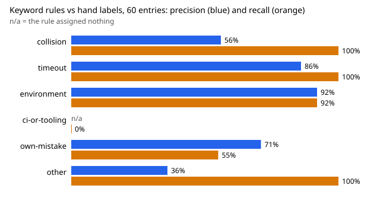

# Do the swe-errors keyword rules sort run-record errors correctly? A 60-entry hand-labelled check

**Live page:** https://duncan-haywood.github.io/monorepo-projects/research/swe-errlabel/

Pure Python standard library. Track 10 (the software-engineering loop), a new question rather than a listed milestone: `swe-errors` and `swe-orgs` both turn the free-text `errors` field of run records into categories with keyword rules, and the first limitation of each is that the rules were never checked against a human reading. This checks `swe-errors`' rules. Produced with AI assistance (Claude). **Preliminary: one labeller, 60 entries, and the labeller is the same kind of model that wrote the run records.**

- **The rules agree with the hand label on 40 of 60 entries (66.7%; Wilson 95% 54.1% to 77.3%; Cohen's kappa 0.59).** Moderate agreement, not the kind a headline percentage should lean on.
- **The `ci-or-tooling` rule never wins.** The hand labels put 9 of 60 entries in that class (a repository check, CI job or generator failing or misbehaving), and the rule assigned none: earlier rules in the ordered list (`collision`, `environment`, `own-mistake`) match first, or no keyword fires. So `swe-errors` reports no such category, and its other shares are inflated or deflated by the entries that went elsewhere.
- **`own-mistake` has recall 55%.** 22 entries were hand-labelled as the run's own mistake; the rules found 12. Seven fell into `unclassified` (for example a stray line in a concatenated file, a project overwritten and caught before commit, a launch without a thread limit), which is why `unclassified` has precision of only 36%.
- **The clearer classes hold up.** `environment` (precision 92%, recall 92%), `timeout` (86%, 100%) and `collision` (56%, 100%; three `ci-or-tooling` entries that mention a "conflict" or "stale" check were read as collisions). These are small counts: 13, 6 and 5 hand-labelled entries.
- Read together: the error shares in `swe-errors` (environment 28%, own mistake 21%, collision 17%) are about right in kind for environment and timeout, but the tooling class is missing and own-mistake is undercounted, so treat that table as a lower bound on those two, not a measurement.



```bash
cd research/swe-errlabel
PYTHONPATH=src python3 -m unittest discover -s tests -v
python3 experiments/sample.py > data/to_label.tsv   # the blind sample (seeded; already committed)
python3 experiments/run.py > experiments/results.txt
python3 experiments/figure.py
```

## Method

- `experiments/sample.py` flattens the 222 error entries in `swe-errors/experiments/errors_snapshot.jsonl` (1,027 run records, snapshot of 2026-10-17), shuffles them with a fixed seed (`20261018`) and keeps 60, printed with no keyword label. That is `data/to_label.tsv`.
- The labeller read each entry once and wrote one label to `data/labels.tsv` before running the rules on the sample. Labels, with the primary cause when an entry has two: `collision` (another session's work, duplicates, a claim race), `timeout` (a tool or time limit hit), `environment` (interpreter, packages, clone depth, proxy, network, sandbox), `ci-or-tooling` (a repository check, CI job, generator or script failing or misbehaving), `own-mistake` (the run's own error, caught by it), `other`. These mirror the six names `swe-errors` uses, with its `unclassified` bucket called `other`.
- `src/swe_errlabel/__init__.py` imports `swe-errors`' own `classify` unchanged, then computes the confusion matrix, agreement with a Wilson interval, Cohen's kappa (Cohen 1960) and per-class precision and recall. `experiments/results.txt` lists every disagreement with its text.

## Limitations

- **One labeller, and not independent.** The labels are one pass by the session agent, the same kind of model that wrote the entries. The agent had read the rules' keyword lists earlier in the session (not their output on the sample), so it is not blind to the scheme. A second, independent labeller would give a real agreement score between humans and rules.
- **Primary cause is a judgement.** Many entries have two causes ("slow/incorrect eigenvalue selection", a conflict in a generated mirror). A different tie-break moves some entries between classes.
- **Sixty entries.** The interval on overall agreement is 54% to 77%, and per-class precision and recall rest on 5 to 22 entries each, so they are indications only. Pairs from the same run (`112.0`, `112.1`) are treated as independent.
- **Self-reported errors.** This checks the sorting of what runs wrote, not whether what they wrote is complete. Runs that failed silently, or did not write the error down, are not in the sample.
- `swe-orgs` uses a different set of keyword classes (`FAILURE_PATTERNS`); this does not check those.

## Next steps

Re-sort with rules fixed on a separate half of the sample (ordering `ci-or-tooling` before `collision`, adding "check", "test", "mirror", "first" patterns) and score on the held-out half so the fix is not tuned on its own test; have a second labeller relabel the 60 blind and compute kappa between labellers; label a sample of `swe-orgs`' classes the same way.

## Owner steps

None.

## Builds on

`swe-errors` (the rules and the error snapshot), `swe-orgs` (whose failure classes motivate the check). Cohen (1960), "A coefficient of agreement for nominal scales", *Educational and Psychological Measurement* 20(1): 37&ndash;46. Wilson (1927), "Probable inference, the law of succession, and statistical inference", *JASA* 22(158): 209&ndash;212. No lab's work is built on, and no lab endorses this project.

## Outside dependencies

None. The error snapshot is committed in `swe-errors`.
