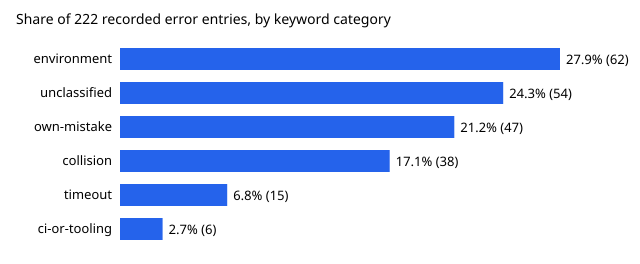

# What do agent runs record going wrong, and does it relate to partial outcomes or cost?

Pure Python standard library. Track 10 (the software-engineering loop), a new question rather than a listed milestone: the run records' `errors` field (222 entries across 1,027 records) had not been read as a dataset. Produced with AI assistance (Claude). **Preliminary: keyword classification, self-reported errors, and the cost comparison rests on 30 priced runs with an error.**

- **17.0% of runs record at least one error** (175 of 1,027; 95% Wilson 14.9% to 19.5%). Research runs record them far more than any other track: 24.5% (131 of 534) against 12.4% for ventures and under 9% for process, red-team, explore and review. That gap is probably partly a recording habit, not only a difference in what goes wrong.
- **Four kinds of failure account for most entries.** By keyword rules: environment and tooling (pip or interpreter mismatch, shallow clones, missing packages) 27.9%; the run's own mistake caught before commit 21.2%; collisions with a parallel run (duplicate slug, stale branch, conflict) 17.1%; tool timeouts 6.8%. 24.3% match no rule.
- **Runs that record an error are twice as likely to end `partial`**: 12.6% against 6.0% (95% intervals 8.5% to 18.3% and 4.6% to 7.8%). Where a cost is recorded they also cost more, median $1.29 against $0.64 (difference +$0.59, bootstrap +$0.30 to +$0.89, 30 versus 362 runs). This is an association: a run that struggles is likelier to both record why and cost more, and the direction cannot be read from the log.
- **Environment errors fell and timeouts rose** between the halves split at 2026-10-15 (environment 39 to 23 entries, timeouts 2 to 13), but the late half holds more records, so these are counts, not rates; see `experiments/results.txt`.



```bash
cd research/swe-errors
PYTHONPATH=src python3 -m unittest discover -s tests -v
python3 experiments/run.py > experiments/results.txt
python3 experiments/figure.py
# refresh the data (repo root): python3 research/swe-errors/experiments/snapshot.py
```

## Motivation

Failures that repeat are cheap to remove at the source: a pip mismatch that costs ten runs a few minutes each is a one-line fix in the setup docs. `swe-friction` reads where the documentation hurts; this reads what actually broke.

## Builds on

`swe-friction` (same ledger, a different field), `swe-schedule` and `swe-pickmix` (the collision category), `swe-runcost` (cost). Intervals: Wilson (1927) for proportions; the percentile bootstrap follows Efron (1979), *Annals of Statistics* 7(1). No lab's work is built on, and no lab endorses this project.

## Limitations

The classifier is an ordered list of regular expressions in `src/swe_errors/__init__.py`, not a validated coder; a different order moves entries between categories, and no second rater checked it. `errors` is self-reported by each run, empty means none recorded, not none occurred, and recording practice differs by track and over time. 392 records carry a cost, 30 of them with an error. Records imported from the former research repository carry no cost. Three entries were structured objects, flattened to their `what` text.

## Next steps

Have two independent passes label a sample of entries and report kappa, as `swe-value` does; then test the largest category directly (for example whether setup docs that name `python3 -m pip` remove the environment entries).

## Owner steps

None.

## Outside dependencies

None beyond the Python standard library. No language-model proposer was used.

MIT.
