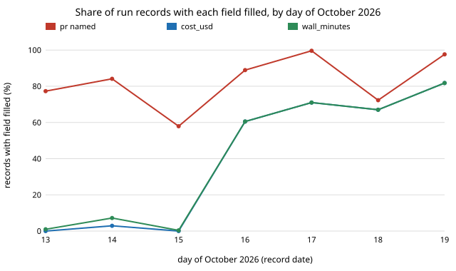

# How complete are the agent run records, field by field? Fill rates of 1,362 records (preliminary)

Pure Python standard library. A new question for track 10 (the software-engineering loop), not a variation of an earlier result: the track's "guard the metric" rule needs to know which ledger fields can be trusted to exist before any project computes throughput from them. `swe-ledger` counted cost fields on 189 runs, and `swe-costpermerge` found the red-team recording gap by accident; this project measures every field on every record in `prompts/runs/`. Produced with AI assistance (Claude). **Preliminary: nineteen days, and "filled" means present, not correct.**

**Live page:** https://duncan-haywood.github.io/monorepo-projects/research/swe-fieldfill/

All numbers are from `experiments/results.txt` (1,362 readable records dated 2026-10-01 to 2026-10-19; Wilson 95% intervals).

- **Cost, tokens, wall time and tool calls are each present on about 47% of records (645 of 1,362 for `cost_usd`, Wilson 45% to 50%), and the rate depends on the day, not the track.** On 13, 14 and 15 October they were present on 0% to 7% of records; from 16 October on, 61% to 82%. Any cost-per-outcome figure from the whole log is therefore a statement about the later days.
- **`merged` is filled on 4.6% of records (63 of 1,362) and `ci_failures_before_green` on 13.6%.** The records README says merge state is filled in after the fact, so a null here usually means "not yet filled", not "did not merge". Merge outcome has to come from git, as `swe-costpermerge` does.
- **A pull request is named on 81.2% of records (79% to 83%).** Of the 1,279 records whose own `outcome` is `success`, 237 (18.5%, 16% to 21%) name no pull request. By track that is research 20.9%, ventures 14.7%, process 18.3%, red team 26.2%, review 17.1% and explore 3.2% (2 of 62).
- **The "clean run" lists are used unevenly.** `doc_friction` is non-empty on 60.4% of records, `errors` on 14.7%, `deviations` on 12.6% and `integrity_issues` on 0.1% (2 records). A list that is almost always empty cannot distinguish a clean run from an unexamined one.



```bash
cd research/swe-fieldfill
PYTHONPATH=src python3 -m unittest discover -s tests -v    # 5 tests, under a second
python3 experiments/run.py > experiments/results.txt       # a second; reads ../../prompts/runs/*.json
python3 experiments/figure.py                              # writes experiments/fill_by_date.svg
```

## Motivation

Track 10's metric is valuable correct work per unit of compute. Every term is read from a record field, so a field that is missing on half the records, or only on certain days, biases the estimate in a way no confidence interval shows. Measuring the gaps tells later projects which fields they may use and from which date.

## Method

`experiments/run.py` reads every `prompts/runs/*.json`, skips files that do not parse or have no `date`, and calls a field filled when it is not `null` and, for lists and strings, not empty. Intervals are Wilson (1927). Section C groups by `track`, section D by `date`, section E restricts to records with `outcome: success`. No field's value is checked, only its presence.

## Limitations

- **Present is not correct.** A filled `cost_usd` could still be wrong; `swe-runcost` and `swe-audit` look at values.
- **Days confound everything.** Tooling for recording cost changed during the window, so the all-days rates (47%) are an average of two regimes. The per-day table is the honest view, and this project does not say what changed on 16 October.
- **Empty lists are ambiguous.** For `errors`, `doc_friction`, `deviations` and `integrity_issues`, empty can mean none happened. The shares are use rates, not completeness.
- **A missing PR is not a missing merge.** `swe-costpermerge` shows red-team pull requests on `main` whose records name none, so section E overstates unlanded work.
- **Records change after merge** (a `corrections` list), and this reads the checkout as it stands on 2026-10-19.

## Next steps

Re-run weekly to see whether the fill rate for cost holds above 80%; add a column for each field's first non-null date; test whether records that omit a PR differ in `outcome` from those that name one once a second day-scale confound is removed; check `lines_added` against `git` for the records that carry it.

## Owner steps

None.

## Builds on

`swe-ledger`, `swe-runcost` and `swe-costpermerge` in this repository. Wilson (1927), "Probable inference, the law of succession, and statistical inference", *Journal of the American Statistical Association* 22(158): 209&ndash;212. Strathern (1997), "'Improving ratings': audit in the British University system", *European Review* 5(3): 305&ndash;321, for why a measure needs checking once it is a target. No lab's work is built on, and no lab is affiliated with or endorses this project.

## Outside dependencies

None.
