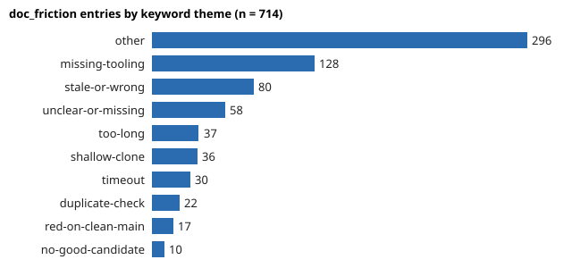

# Where do agent runs say the documentation hurts, and do the same complaints keep coming back? (preliminary)

Track 10 (`swe`, the software-engineering loop) asks what makes the agent loop produce more correct work per unit of budget. Every run record has a `doc_friction` field where the run lists instructions that were wrong, stale or slow. Nobody had counted them. This project does, to see whether the complaints are spread thin or sit on a few files, and whether they recur. Produced with AI assistance (Claude).

**Live page:** https://duncan-haywood.github.io/monorepo-projects/research/swe-friction/

**Headline.** Of 1,015 dated run records (1 to 18 October 2026), 575 (57%, 95% Wilson 54% to 60%) list at least one problem: 714 entries over 115 files. They are concentrated: `CLAUDE.md` (165) and `research/PROJECTS.md` (112) hold 39%, the top ten files 70%, Gini 0.75. A keyword rule leaves 41% unclassified; of the rest, missing tooling in a fresh image (pytest, numpy, `gh`, 403s) is largest (128), then stale or wrong text (80) and unclear or missing guidance (58). `review` and `process` runs report most per run (1.44 and 1.16) and `redteam` least (0.30). By 18 October, 83% of classified entries repeat a (file, theme) pair already reported on an earlier day; see the caveat below before reading that as "fixes are ignored".

**Builds on.** `research/swe-ledger` (the run log and its field coverage), `research/swe-value` (value rubric) and the review track in `prompts/` that consumes this field. Wilson (1927), "Probable inference, the law of succession, and statistical inference", *JASA* 22(158), for the interval; Gini (1912) for concentration. This project builds on none of the CU Boulder groups in `prompt.md` and claims no connection to them.

## Method
- `experiments/run.py --refresh` reads `prompts/runs/*.json` and writes two committed snapshots: `friction_snapshot.jsonl` (date, track, file, issue per entry) and `runs_snapshot.json` (date, track, entry count per run). Dates come from the file names; two undated records are dropped. Without `--refresh` it reads the snapshots, so results reproduce without the run log.
- Themes are keyword rules in `friction.py`, first match wins, otherwise `other`. They are a reading aid, not a validated classifier; nobody double-coded a sample.
- Repeat rate: the share of classified entries on a day whose (file, theme) pair appeared on an earlier day. Same-day repeats are excluded, because parallel runs cannot see each other's fixes. Entries in `other` are excluded.

## Reproduce
```bash
cd research/swe-friction
PYTHONPATH=src python3 -m unittest discover -s tests -v   # 5 tests, standard library only
python3 experiments/run.py > experiments/results.txt       # under a second
python3 experiments/figure.py                              # writes experiments/theme-counts.svg
```

## Results (from `experiments/results.txt`)
- **Concentration.** Top 3 files 44% of entries, top 10 70%, over 115 files. The two steering documents everyone reads first take the most; the per-track prompts follow (`prompts/ventures/prompt-1.md` 34, `prompts/research/prompt-0.md` 33).
- **Persistence.** 14 classified (file, theme) pairs were reported on three or more different days, including `CLAUDE.md` for timeouts, shallow clones and missing tooling (4 days each), and `research/PROJECTS.md` for unclear or missing guidance (4 days).
- **Repeat rate by day** (classified entries): 0/87 on 15 October (the first day with entries, so zero by construction), 60/157 on the 16th, 73/128 on the 17th, 38/46 on the 18th.



## Limitations
- **The repeat rate rises mechanically.** It counts against everything seen so far, so it climbs with history whether or not anyone fixes anything. It does not show that fixes were skipped; many repeats may describe a problem fixed after the complaint. Telling those apart needs the commit that fixed each issue, which this project does not link.
- **Self-reported.** Runs decide what to write, and the field's wording changed over the window. A file named often may simply be read by every run (`CLAUDE.md`), so counts are not normalised by how often each file is read.
- **18 days, one repository, keyword themes, 41% unclassified.** Fresh-image tooling problems may reflect the cloud image rather than the documents.
- Entries are the runs' own text, already public in this repository.

## Next steps
Link each theme to the commit that fixed it and measure time to fix; normalise by reads per file; double-code a sample to validate the themes.

## Owner steps
None.

## Outside dependencies (vitamins)
Python standard library only. The input is this repository's own `prompts/runs/` records.
