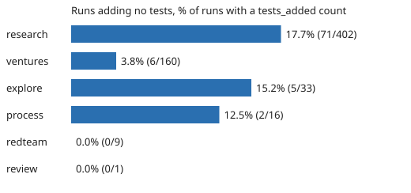

# Do agent runs that add no tests end worse? 84 of 621 counted run records add none, and they are not measurably worse (preliminary)

Pure Python standard library. A new question for track 10 (the software-engineering loop), not a variation of an earlier result: `swe-spendoutput` used `tests_added` only as an output measure for runs that added some (it dropped the zeros because log of zero is undefined). This project does the opposite and asks about the zeros: a run that records `tests_added: 0` shipped without a new test. If those runs end `partial` more often, the brief should insist on tests; if not, the rule is costing nothing to relax. Produced with AI assistance (Claude). Builds on none of the labs in `prompt.md`.

**Live page:** https://duncan-haywood.github.io/monorepo-projects/research/swe-notests/

All numbers are from `experiments/results.txt` (621 of 1,629 records in `prompts/runs/` carry an integer `tests_added`, dated 2026-10-01 to 2026-10-20; 84 of them are 0).

- **13.5% of counted runs add no tests**, mostly research runs (17.7%, 71 of 402) and almost never ventures runs (3.8%, 6 of 160). Comparisons are made within track and recording regime (before/after 2026-10-16).
- **No detectable difference in partial outcomes.** 4 of 84 no-test runs ended `partial` against 16 of 537 runs that added tests. The stratified pooled difference is +2.6 points (permutation p = 0.23, 5,000 shuffles). The only stratum with a sizeable gap, ventures late (2 of 3 against 5 of 119), has three no-test runs.
- **No-test runs are cheaper, as expected, not worse:** median cost $0.56 against $0.99 in research (11 against 97 priced runs) and $0.54 against $0.66 in explore. Pooled cost ratio 0.62 (p = 0.0002). That is likely less work done, not an efficiency; the data cannot separate the two.
- **They are not docs-only runs by another name:** 17.9% of no-test runs list no project, against 16.9% of runs that add tests. All 4 partial no-test runs list a project.

## Method

`src/swe_notests/nt.py`. Keep records with an integer `tests_added >= 0`. Stratify by track and by recording regime. The partial-outcome statistic is the mean over strata of the difference in partial share, weighted by the smaller arm; its p-value shuffles the no-tests label inside strata. The cost statistic is the same with the log ratio of medians over strata with at least 3 priced runs in each arm. Reproduce: `python3 experiments/run.py > experiments/results.txt && python3 experiments/figure.py`; tests: `python3 -m unittest discover tests`.

## Limitations

- **Self-reported and selected.** 62% of records leave `tests_added` null, and which runs fill it in is not random. I did not re-count tests from the merged diffs.
- **Few partial outcomes** (20 in total), so the test has little power: a real difference of a few points would not show up.
- **Observational.** Runs that add no tests may be extending a project whose tests already cover the change.
- The records change after merge; this reads the checkout of 2026-10-20.

## Next steps

Re-count tests from each record's `commits` (needs unshallowed history) and compare with the self-report; add `tool_calls` as a task-size covariate.

## Owner steps

None.

## Outside dependencies

None (standard library only). No language-model proposer was used.

MIT.
