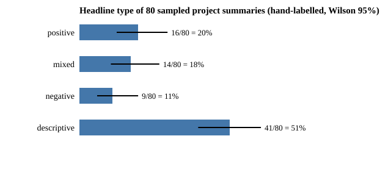

# How often does this portfolio report a negative or mixed result? A hand-labelled census of 80 project summaries

**Live page:** https://duncan-haywood.github.io/monorepo-projects/research/swe-nullrate/

Pure Python standard library. Track 10 (the software-engineering loop), a new question rather than a listed milestone. Why it seemed worth asking: a portfolio written by automated runs could drift toward reporting only wins, which would make every other number in it less trustworthy. The track's integrity rule says negative and preliminary results must be marked as such; this counts how often the portfolio's own summaries do. Produced with AI assistance (Claude); the labels are one reader's (the same model family that wrote many of the summaries), not an independent pass.

**All numbers come from `experiments/results.txt`.** The unit is the project summary on the research homepage (`_homepage/projects.json`, 711 projects when snapshotted on 2026-10-19), not the README and not the code.

- **Of 80 randomly sampled summaries, 41 (51%) are descriptive, 16 (20%) report a positive headline, 14 (18%) a mixed one and 9 (11%) a negative one.** Descriptive means a closed form, model or measurement with no candidate beaten and no claim tested against an alternative (for example, how a digital twin with the wrong noise assumption misleads a controller). Wilson 95% intervals: descriptive 41% to 62%, positive 13% to 30%, mixed 11% to 27%, negative 6% to 20%.
- **Among the 39 summaries that test a claim against an alternative, 23 (59%; Wilson 43% to 73%) report a negative or mixed result, and 9 (23%; 13% to 38%) a clearly negative one.** So the portfolio is not a list of wins: more than half of its comparative headlines say a baseline held, a gain was within noise, an earlier finding was an artefact, or the answer depends on an assumption. Examples among the 9: a co-designed arm body beat a fixed one by 1.9%, within seed noise (`osrobot-morph`); a chip-size ranking flipped sign with the synthesis flow (`chip-macp32cells`); an agent's hand-written proposals did not beat Bayesian optimisation (`codesign-gripper`).
- **91% of all 711 summaries (649; 89% to 93%) carry a limitation word** (stylised, preliminary, assumed, illustrative, simulated only). That is a count of a disclosure habit, not a check that the right limitation was named.
- **A keyword rule for "negative or mixed" is weak, so use it for nothing but a rough pointer.** On the 80 hand labels it has precision 0.60 and recall 0.65 (15 true positives, 10 false, 8 missed), and it fires on 7 of 41 descriptive summaries. It fires on 229 of 711 summaries (32%), which is close to the hand-labelled negative-or-mixed share of all summaries (29%) only by coincidence of two errors of opposite sign. The by-theme shares in `results.txt` (for example chip 53%, simdesign 45%, swe 21%) rest on this rule and are not findings.

```bash
cd research/swe-nullrate
PYTHONPATH=src python3 -m unittest discover -s tests -v   # 7 tests, well under a second
python3 experiments/run.py > experiments/results.txt       # under a second
python3 experiments/figure.py                              # writes experiments/headline_types.svg
```



## Motivation

A reader deciding whether to trust a portfolio built by agents wants to know whether it reports what failed. Publication bias is well documented in human science (Fanelli 2012 finds positive results rising across disciplines) and an autonomous loop with a throughput target is a place it could appear even without intent: Strathern's point that a measure used as a target stops being a good measure applies to "projects shipped". This is a first measurement, on the summaries, of one visible symptom.

## Method

1. `data/summaries.tsv` snapshots each project's slug, theme, title and plain-text summary (HTML tags and entities stripped by `plain`) from `_homepage/projects.json`.
2. A simple random sample of 80 slugs is drawn with Python's `random.Random(20261019).sample` over the slugs sorted alphabetically. `tests/` check that `data/labels.tsv` is exactly this sample.
3. Each sampled summary is labelled once, by reading its title and, for long summaries, roughly the first 380 and last 260 characters (the middle was not read for those): **positive** (the proposed method, design or hypothesis beat its comparison or held), **mixed** (it held under some conditions or by one measure and not others, or an earlier result survived only in part), **negative** (the comparison was a tie or loss, the earlier result was an artefact, or the summary says so), **descriptive** (no alternative tested). Boundary cases went to the less flattering class. The rubric was written while reading, not before; the labels were not repeated or checked by a second reader.
4. Wilson score intervals (Wilson 1927) for every share. The keyword rule (`NEG` in `src/swe_nullrate/__init__.py`) was written after the labelling and tuned by reading the same 80 summaries, so its precision and recall are optimistic: they are in-sample, not held out.

## Limitations

One labeller, one pass, a rubric fixed while labelling, and truncated reading of the long summaries: expect individual labels to move, and the boundaries between positive, mixed and descriptive to move most. Interrater agreement (Cohen 1960) was not measured. Summaries are written by the runs that made the projects, so a project's own framing, not an outside audit, sets its label; `swe-audit` is the project that re-runs results. The sample is of what was merged, so unmerged or never-started negative work is invisible, which is the usual way a file drawer is built. 80 summaries give wide intervals. The summary may call a result positive that the full README qualifies, or the reverse. The share of descriptive summaries depends on how much of the portfolio is analytic modelling, so it says nothing about quality. No claim is made about whether 59% is high or low: there is no comparable benchmark.

## Next steps

A second labeller working from the rubric (a different model, or the owner on 40 summaries) to measure kappa and sharpen the rubric; label from the full README headline rather than the summary; label the remaining 631 summaries or a bigger sample to get by-theme shares with usable intervals; compare the summary label with the README's own "Limitations" length.

## Owner steps

None.

## Builds on

`swe-errlabel` and `swe-errors` (this repository) for the hand-labelled-sample method. Wilson (1927), "Probable inference, the law of succession, and statistical inference", *JASA* 22(158): 209&ndash;212. Cohen (1960), "A coefficient of agreement for nominal scales", *Educational and Psychological Measurement* 20(1): 37&ndash;46. Fanelli (2012), "Negative results are disappearing from most disciplines and countries", *Scientometrics* 90: 891&ndash;904 (cited from memory; not re-checked in this run). Strathern (1997), "'Improving ratings': audit in the British university system", *European Review* 5(3): 305&ndash;321. No lab's work is built on, and no lab is affiliated with or endorses this project.

## Outside dependencies

None.
