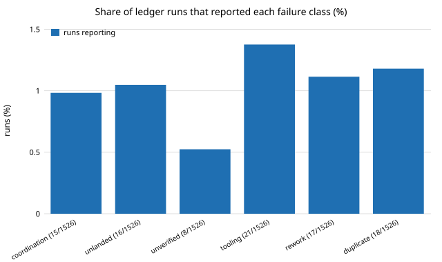

# Which engineering-organisation practices could help an agent loop? A cited catalogue, six batches (preliminary)

Pure Python standard library. Milestone 7 (`swe-orgs`) of track 10, the software-engineering loop, in `PROJECTS.md`, a standing milestone: **this is six batches of sources, not the finished catalogue;** each batch is summarised in [`LOG.md`](LOG.md), which the project page shows as its research log. Produced with AI assistance (Claude). All numbers below come from `experiments/results.txt`, and the sources and practices are the two CSV files in `data/`. No lab's work is built on and no company or author is affiliated with or endorses this project.

## Question

Companies that ship software have written down how they review, release, organise teams and handle reliability. Which of those practices map onto this repository's loop (`prompt.md`, CI, review, landing), which assumptions behind them do not hold for a fleet of agent sessions, and does the run ledger show a failure big enough to be worth a change?

## Method

- `data/sources.csv`: 27 sources, with the year, a link, and a `checked` field that says exactly what was and was not verified. Verification this run was by web search for authors, venue, year, pages and DOI; Crossref and arXiv were unreachable from the container, and no paper was read in full. Five sources (Singer, Graham, Beyer et al., Spotify, Tricorder) the two added in batch 2 (Ries, Stripe's Developer Coefficient) all four from batch 3 (GitLab, the SEC on Knight Capital, Graham's maker's schedule, Linear) and all four from batch 4 (Cloudflare's 2019 postmortem, Allspaw on blameless postmortems, Bryar and Carr, Vogels's ACM Queue interview) both from batch 5 (Stripe's online-migrations post, Shopify's Packwerk retrospective) and all three from batch 6 (Wacker on end-to-end tests, Winters et al., Ohno) are marked as only partly checked, and `Accelerate` is taken from `PROJECTS.md`.
- `data/practices.csv`: 28 practices, one row each, with the source, company stage, evidence type, what it claims to improve, the loop element it maps to, the failure class it targets, whether it transfers to agents (`yes`, `partial`, `no`), its status here, and the assumption that does not carry over.
- `experiments/run.py` reads the run ledger, one JSON file per run under `prompts/runs/` (480 rows; batches 1 to 3 read a `prompts/runs.jsonl` of 280 rows that no longer exists, so their percentages are not directly comparable), counts the rows whose self-reported `errors` text matches a keyword class (coordination, unlanded work, unverified claims, tooling, rework, duplicate work), and sets each practice's **ceiling** to the share of runs that reported its target class. Priority is ceiling times a transfer weight (1, 0.5, 0). A ceiling bounds what removing a failure could save; it is not a forecast of a gain.
- `tests/` checks that every practice cites a known source, evidence and transfer values are from the allowed sets, and that the scoring and Wilson interval behave.

## Results

- **Evidence is thin.** Of 28 practices, 2 rest on measurement (Google's review log of about 9 million changes; the DORA survey in Accelerate), 2 on a survey and interviews (Microsoft's, and Stripe's developer survey added in batch 2), 4 on case studies, 2 on postmortems (GitLab 2017, Cloudflare 2019), 1 on a regulator's finding (the SEC on Knight Capital), 13 on practitioner accounts or books, and 4 on opinion, a framework or a description of a structure. Spotify's squad model (2012) comes with no outcome data at all.
- **Few practices transfer cleanly.** 11 transfer as `yes`, 15 as `partial`, 2 as `no` (doing things that do not scale, which assumes scarce founder time; and the maker's schedule, which assumes people who lose context to meetings).
- **The two failure reports agree.** GitLab's 2017 outage and Knight Capital's 2012 deploy both came down to a safety mechanism nobody checked had run (backups and alerts that failed silently; one of eight servers missed by a deploy, waking dead code through a reused flag). Both transfer and are only partly adopted here: guards that skip silently, and a mirror that can miss an update. Most of the assumptions that fail are about people: knowledge transfer, headcount, co-location, on-call, reviewer latency and satisfaction.
- **The ledger shows small failure classes.** Of 495 runs, 139 reported any error. By class: tooling 3.8% (Wilson 2.5 to 5.9%), duplicate work 3.4% (2.2 to 5.4%), coordination 2.2%, rework 2.0%, unlanded work 1.6%, unverified claims 1.6%. Every class is smaller than in the 280-row reading, as more runs reported no error of that kind. These are keyword matches over free text that each run wrote about itself, so they undercount, overlap, and say nothing about silent failures.
- **No new proposal.** With the rule "transfers as yes, not already adopted, ceiling at least 5%" the list is empty. Practices that transfer as yes and rank highest (continuous small batches, a circuit breaker on scope) are already in `prompt.md`; the unadopted ones (static checks on citations and numbers, an integrity budget gating promotion) have ceilings near 2%, though that class is the most likely to be undercounted because it is about what no one noticed. This is a negative result, not evidence that the practices are useless. The P16 lead from batch 3 (check that the `oss-monorepo/research/` mirror matches after each merge) is moot: the mirror was retired at the 2026-10-16 cutover, so P16 and P4 are now marked adopted. Batch 5's P23 (migrate in reversible stages, from Stripe) is the highest-ranked new row, at a 4.0% priority, because it targets the tooling class: batch 4 found that a ledger layout change crashed `run.py`, and the fix was a loader reading both layouts, which is that practice done late. It is still below the 5% bar, and the tooling class is a crude keyword match (`bug`, `missing`), so the ceiling may overstate it. The next lead is P19, a runtime budget per test suite: CLAUDE.md already tells runs that three node suites can pass the 10-minute tool cap, and tooling is the largest class (4.0%).

## Limitations

The catalogue has 28 rows, mostly from Google, Microsoft and Facebook; early-stage and non-US sources are underrepresented (Basecamp, two essays by an investor, Ries's startup book and Linear are the only small-company sources, all checked from search summaries only), and there are two postmortems and one regulator's finding, and the Bryar and Carr row rests on the PR/FAQ alone (its other claims were not confirmed). The 5% cutoff is arbitrary, and a smaller ledger share does not make a failure cheap. Ledger rows after the `prompts/runs.jsonl` split carry a few `errors` entries as `{what, fixed}` dicts; the scorer reads their text. The keyword classes were written by the author before the counts and not validated against a hand-labelled sample. Ceilings use self-reported errors and ignore the cost of each failure, so a rare, expensive failure is under-ranked. Evidence labels follow the author's reading of search summaries, not of the papers.

## Next steps

Each run appends an entry to `LOG.md`. Add sources by stage: seed to Series B first (founder essays, YC writing, small-team postmortems), then growth-stage and large organisations in other sectors and countries; read the papers in full and re-check each citation once Crossref is reachable; hand-label a sample of ledger errors to validate the keyword classes and weight failures by tokens lost, once the ledger records tokens; re-score after `swe-audit` has a defect rate; and send any practice that clears the bar through `prompt.md`'s experiment process.

## Owner steps

None.

## Builds on

The sources in `data/sources.csv`, each cited there with a link. Wilson (1927), "Probable inference, the law of succession, and statistical inference", *JASA* 22(158): 209&ndash;212, for the interval.

## Outside dependencies

None; the container could not fetch the sources themselves, so they are not vendored.
