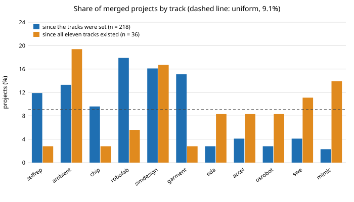

# Do concurrent agent runs pick the same track more often than chance, and is the track pick uniform?

Pure Python standard library. Measured, not simulated: a follow-up to `swe-schedule` (milestone 5, `swe-schedule`, of track 10), which assumed a uniform pick from 11 tracks and a 12.8% duplicate rate for four blind starts. This project reads the pick mix and the concurrency off the repository's own git history. Produced with AI assistance (Claude). **Preliminary: the sample is small after the tracks were all live (36 PRs), merged projects stand in for picks (a pick that never merged is invisible), and concurrency is a lower bound.** All numbers below are from `experiments/results.txt`.

**Live page:** https://duncan-haywood.github.io/monorepo-projects/research/swe-pickmix/



- **Merged projects are far from uniform across the tracks over the whole period (218 PRs, chi-square p < 0.0001), but that is mostly availability.** Tracks 1&ndash;6 carry 9.6&ndash;17.9% each and tracks 7&ndash;11 only 2.3&ndash;4.1%, because tracks 7&ndash;11 were added on 2026-10-14 and the first `mimic` project merged on 2026-10-15 10:52 UTC.
- **After all eleven tracks existed (36 PRs), uniform is not rejected** (chi-square 12.9 on 10 df, Monte Carlo p = 0.25). That is weak evidence: with n = 36 each share has a Wilson interval roughly 14 to 25 points wide, and `ambient` (19.4%) and `simdesign` (16.7%) lead while `selfrep`, `chip` and `garment` sit at 2.8%. The pick is not shown to be uniform; it is not shown to be otherwise.
- **No herding once the drifting mix is controlled for.** Among PRs whose branch lifetimes overlap, 34 of 190 pairs (17.9%) share a track, against 12.3% expected from the empirical mix. Shuffling track labels across all PRs gives p = 0.020, but shuffling only within the merge day (so new tracks appearing cannot make neighbours alike) gives p = 0.115, and in the all-eleven-tracks window it is 1 of 38 pairs (2.6%) against 9.8% expected. The raw excess is mostly the mix changing over time. The pairs are not independent, so the interval and p-values are indicative.
- **Branches are short-lived in git, so the measurable overlap is only the push-to-merge window.** The median first-branch-commit to merge is 2 min (p75 7 min, p90 23 min). Most runs commit once at the end, so this is nothing like a run's length. Even so, 178 of 218 PRs overlapped another, with at most 4 in flight (mean 1.87).
- **What this says about the duplicate model.** `swe-schedule`'s uniform assumption is not contradicted after the tracks were all live, and the data cannot yet support a better pick distribution. The model's assumed claim latency of 1 to 30 min cannot be checked from git: it needs the time a PR was opened, which needs one API call per PR (`swe-prflow`'s unfinished step).

## Reproduce
```bash
cd research/swe-pickmix
python3 -m unittest discover -s tests -v                 # 10 tests, a second
python3 experiments/run.py > experiments/results.txt     # a few seconds
python3 experiments/figure.py                            # experiments/pickmix.svg, parsed from results.txt
# optional: rebuild data/projects.tsv from a full-history clone of the upstream repository
python3 experiments/extract.py /path/to/oss-research-monorepo > data/projects.tsv
```
`data/projects.tsv` was extracted from `oss-research-monorepo` `main` at `f22c8c6` (461 projects, 1,777 commits, 2026-09-28 to 2026-10-15). Times are UTC.

## Motivation
`PROJECTS.md` track 10 says four runs start in the same minute and asks for duplicates, merge conflicts and log races to be measured from history. `swe-schedule` sized the duplicate term under assumed timings and listed "fit the pick distribution" as a next step. This is that step for the part git can answer.

## Builds on
`swe-schedule` (this repository) for the model being checked, `swe-prflow` for the PR-level view of the same period. Pearson's chi-square test for the mix, with a Monte Carlo p-value because some expected counts are small; Wilson (1927), "Probable inference, the law of succession, and statistical inference", *JASA* 22(158): 209&ndash;212, for the intervals; a label-permutation test for the same-track share. No lab's work is built on, and no lab is affiliated with or endorses this project.

## Method
`src/swe_pickmix/analysis.py`. A project is a `research/<slug>/README.md` added on a first-parent merge of `main`. Its track is the slug prefix (`robofab-cell` is `robofab`); slugs without one of the eleven prefixes (the 14 `twin` projects and one-off early names) are dropped, as are merges before 2026-10-12. A PR that adds several projects counts once. A unit's start is the author time of the earliest commit on the merged branch, its end the merge time; two units overlap if the intervals intersect. The same-track share over overlapping pairs is compared with 20,000 label shuffles that keep the timing and the mix, either across all units or within each merge day.

## Limitations
- Merged projects are not picks. A pick that duplicated another and was closed, or that is a figure, mirror or process run, is not counted or is counted as a project. Follow-up runs (the "next steps" of the latest project in a track) are not separated from new-milestone picks, and a track with more milestones will attract more merged projects.
- The first branch commit is when work was pushed, not when the run started, so overlap and concurrency are lower bounds and claim latency is not measured.
- 36 PRs after all tracks existed is too few to tell a 15% share from 9%. The window start is itself chosen from the data (the first `mimic` merge).
- Pairs overlap in chains, so the intervals treat dependent pairs as independent; the permutation p-values are the better guide.
- Nothing here measures a duplicate directly.

## Next steps
Fetch each merged PR's creation time and closed-unmerged siblings (needs one API call each) to measure claim latency and a real duplicate count; separate follow-ups from new-milestone picks; rerun the window test once it holds about 100 PRs.

## Owner steps
None.

## Outside dependencies
None. Python standard library, and `git` only to rebuild the data file.
