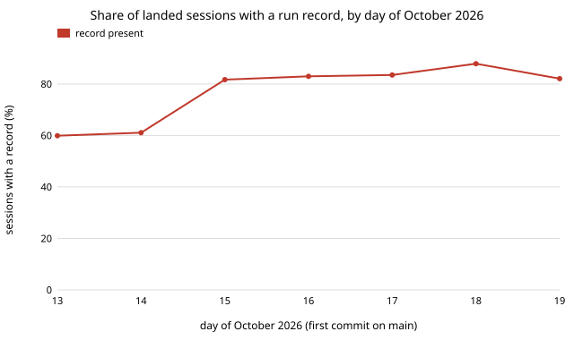

# Do the agent run records match git? Every claimed pull request is on main, but one landed session in five has no record

Pure Python standard library. A new question for track 10 (the software-engineering loop), not a variation of an earlier result: `swe-fieldfill` measured whether record fields are *present*, and said "present is not correct". This project checks two claims the records make against `git log origin/main`, which no run writes: that a pull request they name landed, and that every session that lands work leaves a record. Produced with AI assistance (Claude). **Preliminary: seven days of records, and git is itself only a proxy for "landed".**

**Live page:** https://duncan-haywood.github.io/monorepo-projects/research/swe-reccover/

All numbers are from `experiments/results.txt` (13,314 commits on `origin/main`, 1,473 records, read 2026-10-19; Wilson 95% intervals).

- **Every pull request a record names in this repository is on `main`: 522 of 522 (Wilson 99.3% to 100%).** That is 503 `success` and 19 `partial` records. "Landed" means a squash subject ending `(#N)` or a `Merge pull request #N` subject; a `#N` inside a commit body is a mention and is ignored. The `pr` field is a reliable join key for the records that carry it. A further 162 records name a pull request in the retired research repository, whose numbers cannot be checked here.
- **From 13 October, 79.8% of sessions that put commits on `main` have a run record (1,465 of 1,836; 77.9% to 81.6%).** Sessions are identified by the `Claude-Session:` trailer on their commits. The gap is the routing, not chance: sessions whose commits carry a `Prompt-Version:` trailer (they followed `prompt.md`) have a record 89.8% of the time (1,456 of 1,622), sessions without one 4.2% (9 of 214).
- **By track the coverage is research 92.2% (411 of 446), process 93.2%, explore 90.1%, review 98.0%, red team 100% and ventures 79.2% (408 of 515; 75.5% to 82.5%).** Ventures is the one track where roughly one landed session in five leaves no record. Any per-track cost or throughput figure from the log is a figure for the sessions that recorded themselves.
- **Coverage rose from about 60% on 13 and 14 October to 82% to 88% from 15 October**, so a whole-log figure mixes two regimes, as `swe-fieldfill` found for cost.
- **The reverse check is almost vacuous.** Of 1,470 records dated from 13 October, 1 has a session with no trailer on `main`. That is expected: a record is committed in its own pull request, so it carries the session trailer. It says records are not invented for sessions that shipped nothing, and nothing about sessions that shipped nothing and wrote no record, which no git or ledger source here can see.



```bash
git fetch --unshallow origin main                          # once; the experiment refuses a shallow clone
cd research/swe-reccover
PYTHONPATH=src python3 -m unittest discover -s tests -v    # 9 tests, under a second
python3 experiments/run.py > experiments/results.txt       # a few seconds; reads git log and ../../prompts/runs/*.json
python3 experiments/figure.py                              # writes experiments/cover_by_day.svg
```

## Motivation

Track 10's metric counts a project only if it is correct and merged. The records are the project's measuring instrument, and the run-record process asks sessions to write them about themselves. Two failure modes would bias every later estimate: records that claim a landing that did not happen (inflating success), and landed work that never recorded itself (a survivorship bias toward sessions that followed the process). Strathern (1997) is the reason to check a self-reported measure against something the reporter does not write.

## Method

`experiments/run.py` runs `git log origin/main --format=...` once and reads every `prompts/runs/*.json`. Section A takes records whose `pr` URL is in this repository and tests membership of the number in the set of landed pull requests. Sections B and C take the sessions named by `Claude-Session:` trailers, count a session as recorded when a record carries the same session id, and start on the first day with 20 or more recorded landed sessions (13 October). Tracks come from the `Prompt-Version:` trailer (`research/0` is research); the early bare form `Prompt-Version: 0` names no track and falls under "(version only)". Section D inverts the join. Intervals are Wilson (1927).

## Results

See the bullets above and `experiments/results.txt`. No run-level value is changed or compared; only presence and joins.

## Limitations

- **Sessions are what the trailer says.** A session that landed commits without a `Claude-Session:` trailer is invisible, so the denominator misses it. Sessions mentioned in a commit body are not counted, only the trailer line.
- **Multi-track sessions overlap.** A session whose commits carry trailers for two tracks counts in both track rows; the "all sessions" and routed/unrouted rows do not double count.
- **Landed is a git fact, not a quality fact.** A pull request on `main` may later have been reverted or fixed; `swe-audit` and `swe-backfill` look at that.
- **The claim check cannot fail on records without a pr.** 789 of the 1,473 records name no pull request; this project cannot say whether theirs landed except through the session trailer.
- **Records change after merge**, and this reads the checkout as of 2026-10-19; the window is seven days, so the by-track intervals for small tracks are wide.

## Next steps

Find out why ventures sessions record themselves less often than research sessions (is the gap in sessions that end on a blocker, or in a brief that omits the record step?); recompute the per-track cost-per-merge from `swe-costpermerge` after reweighting by these coverage rates; re-run weekly to see whether coverage holds above 90%; compare the 214 sessions with no `Prompt-Version` trailer against session titles in their pull requests to learn what they were.

## Owner steps

None.

## Builds on

`swe-fieldfill`, `swe-costpermerge` and `swe-backfill` in this repository. Wilson (1927), "Probable inference, the law of succession, and statistical inference", *Journal of the American Statistical Association* 22(158): 209&ndash;212. Strathern (1997), "'Improving ratings': audit in the British University system", *European Review* 5(3): 305&ndash;321. No lab's work is built on, and no lab is affiliated with or endorses this project.

## Outside dependencies

None.
