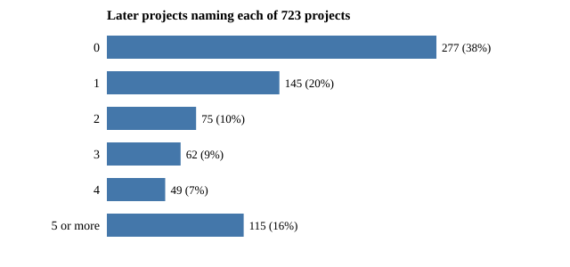

# Do later projects build on earlier ones? A reference graph of 723 research READMEs

**Live page:** https://duncan-haywood.github.io/oss-monorepo/research/swe-reuse/

Pure Python standard library plus `git` history. Track 10 (the software-engineering loop), a new question rather than a listed milestone. Why it seemed worth asking: the track's metric counts a project as *useful* if it ships something usable or "a later project builds on it", and no project here had measured the second half. Produced with AI assistance (Claude). Builds on none of the labs in `prompt.md`.

**All numbers come from `experiments/results.txt`**, computed from two committed snapshots in `data/` (so the run needs no git history). `experiments/collect.py` regenerates them from the full history of `main`; the snapshot was taken on 2026-10-20.

- **61.7% of 723 projects (Wilson 95% 58.1% to 65.2%) are named in the README of at least one later project;** 277 are named by none, 115 by five or more. Inbound counts are very uneven (Gini 0.69): the most-named, `workcell-twin`, is named by 50 later READMEs and `selfrep-closure` by 41.
- **Building on is overwhelmingly within a track.** 71.1% of the 1,807 backward references (69.0% to 73.2%) join two projects with the same slug prefix, and in most tracks 93% to 100% of the inbound references to a track's projects come from the same track. A crude null in which every project cites uniformly among all earlier projects expects 3.4% same-prefix, so the gap is large, but that null is too weak to be informative: follow-up projects name their parent by design.
- **References reach far back and quickly.** The median reference points 39 projects back in creation order (quartiles 11 and 124) and 11.8 hours back; 17.2% of projects (14.6% to 20.1%) name no earlier project at all.
- **A weak signal for the metric, not a score.** A README naming another project does not show the later work needed it (see limitations), so this is an upper bound on "built on" and a lower bound on nothing. It does say that roughly a third of projects, by this reading, have not yet been picked up.

```bash
cd research/swe-reuse
PYTHONPATH=src python3 -m unittest discover -s tests -v   # 7 tests, well under a second
python3 experiments/run.py > experiments/results.txt       # under a second
python3 experiments/figure.py                              # writes experiments/inbound.svg
python3 experiments/collect.py                             # optional: re-snapshot data/ (needs full history of main)
```



## Method

1. `collect.py` lists every directory under `research/` with a `README.md` (names starting `_` or `.` skipped). A project's creation time is the author time of the earliest commit that added `research/<slug>/README.md`. Five projects have no such commit under that path (likely added by rename) and are excluded.
2. A project *names* another if the other's slug appears as a whole token in its README (`../swe-ledger`, `` `swe-ledger` `` and prose all count; `swe-ledger2` does not match `swe-ledger`). Self-mentions are dropped.
3. A *backward edge* is a reference from a project to one created strictly earlier. 77 forward references (a README later edited to name a newer project) and one same-second pair are dropped from the counts and reported.
4. The same-prefix null (`expected_same_prefix`) gives each citing project the share of earlier projects that share its prefix, times its number of references.

## Limitations

- **Naming is not using.** A README may list a project in a table, a "see also" or a comparison without building on it; `swe-orgs`-style catalogues and index pages inflate in-degree. Only the graph is measured, not whether code or results were reused. Inspecting a random sample of edges by hand would be the next check.
- **A README can be edited after creation**, so a reference may have been added long after the project began; creation time is that of the README's first commit, not of the reference.
- **Exposure differs.** Older projects have had more time to be named, and 46.7% of the 244 projects at least 7 days old are named, against 61.7% overall, so the headline share is not a clean rate per project-week.
- Slug prefixes are used as tracks; a few prefixes (`free`, `twin`, `scoring`) are themes older than the 18 tracks, and some projects were renamed.
- One snapshot, one reader, no hand labels.

## Next steps

Hand-label a random sample of 60 edges as *built on* (code, data or a stated result is reused), *compared with* or *listed*, then report the share of each and re-score the headline; add the time to first inbound reference with censoring, which answers how quickly a project is picked up.

## Owner steps

None.

## Outside dependencies

None. Python standard library and `git`.

MIT.
