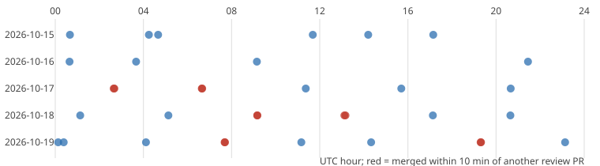

# Do parallel review sessions duplicate each other? Six pairs of review pull requests merged within minutes

Pure Python standard library. A new question for track 10 (the software-engineering loop), not a milestone from the list: `swe-schedule` simulated duplicate starts under assumed timings and `swe-startslot` could not see duplicates in the run records, so this project measures them for one kind of run from git, where they are visible: the review track, which `prompt.md` says one run claims by opening a pull request titled `prompts: review`. Produced with AI assistance (Claude). **Preliminary and descriptive: six days, one repository, 35 review pull requests, and merge time stands in for start time.** All numbers are from `experiments/results.txt` (13,360 commits on `origin/main`, read 2026-10-20).

**Live page:** https://duncan-haywood.github.io/monorepo-projects/research/swe-reviewdup/



- **35 review pull requests merged from 14 to 19 October; 6 of them (17.1%, Wilson 8.1% to 32.7%) are the second member of a pair** merged within 10 minutes of another review PR. The count is 5 at a 2-minute window and 8 (22.9%) at 30 or 60 minutes, so it does not hinge on the window. All six pairs merged 0.4 to 2.5 minutes apart: these are sessions that started together, not a review that followed another.
- **The second review is not an empty copy.** Each extra PR changed files outside `prompts/` run records (none was record-only), and several added their own drift report or edit. What the pairs share is the generated and log files: in 5 of 6 pairs both PRs edited `prompts/derived/runs.json` or `prompts/experiments.md`, so the later merge had to resolve a conflict on a file the earlier one had just changed. Whether the second review's changes were worth their tokens is not something git can say.
- **The pairs do not look rarer after the claim rule.** Pairs appear on 16, 17, 18 (twice) and 19 October (twice). Reviews per distinct cluster ran 4 to 8 a day; the median gap between distinct clusters is 4.0 hours (28 gaps, 0.2 to 12.3 hours).
- **Cost is mostly unmeasured.** Only 3 of the 35 review PRs have a run record that names them and carries `cost_usd` (total $1.47; 1 of the 6 duplicates, $0.57), so the cost of the duplication cannot be stated. At the roughly $0.4 to $0.6 per review that the priced review records on other days show, six extra reviews would be a few dollars, but that is an estimate from other records, not a measurement.

## Reproduce
```bash
git fetch --unshallow origin main          # once; the experiment refuses a shallow clone
cd research/swe-reviewdup
PYTHONPATH=src python3 -m unittest discover -s tests -v   # 6 tests
python3 experiments/run.py > experiments/results.txt      # seconds; reads git log --name-only and ../../prompts/runs/*.json
python3 experiments/figure.py                             # writes experiments/reviews_timeline.svg
```

## Motivation
Review sessions improve the prompts for everyone, so two of them on the same morning either find different things or spend the budget twice and collide on the same generated files. `prompt.md` tells a run to route again with `--skip-review` when an open PR titled `prompts: review` exists; that check cannot see a session that starts in the same minute and has not opened its PR.

## Builds on
`swe-schedule` (the duplicate-start model), `swe-startslot` (the records cannot show it) and `swe-prflow`/`swe-sharedfiles` (merge-time collisions on shared files). Wilson (1927), "Probable inference, the law of succession, and statistical inference", *JASA* 22(158): 209-212, gives the intervals. No lab's work is built on, and no lab is affiliated with or endorses this project.

## Method
`src/swe_reviewdup/reviews.py`. A review PR is a squash commit on `origin/main` since 2026-10-13 whose subject matches `prompts: review ... (#N)`. Consecutive review merges at most *w* minutes apart form a cluster; the "extra" PRs are all but the first of each cluster of two or more. The default window is 10 minutes. Files changed exclude `prompts/runs/`. Tests cover the subject pattern (a commit without a PR number, as in the early direct pushes, is excluded), clustering at several windows, shared-file detection and mixed UTC offsets.

## Limitations
- Merge time is the committer time of the squash commit, not the start of the session. Reviews that took different times to finish would not pair even if they started together, so the count is a lower bound on simultaneous starts; reviews that merged close by chance could pair falsely, but at a 4-hour median gap that is rare (a 10-minute window).
- Some reviews up to 16 October (about 20:00 UTC) were pushed directly to `main` without a PR number and are not counted; 35 is the PR-era count, not every review.
- "Not an empty copy" is read from file lists, not from reading each diff for value.
- Cost joins only where a record names its PR with the same repository path; 3 of 35 do.
- Descriptive, six days: no test of whether the claim rule changed the rate.

## Next steps
Put the claim before the work (a review run opens its draft `prompts: review` PR as its first action, as the research track already does), then re-run this over the following week; record `started` and the PR number on every review record so cost joins; read the six extra diffs and score what each added.

## Owner steps
None.

## Outside dependencies
None. Python standard library and `git`.

MIT.
