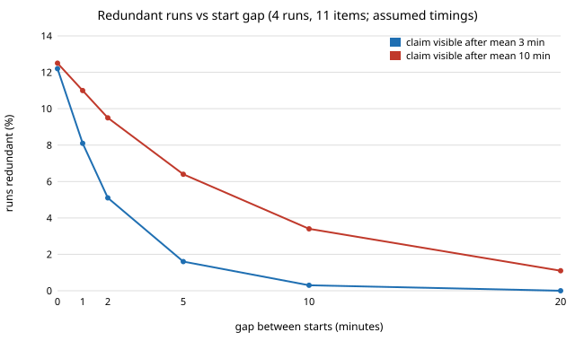

# How many parallel agent runs duplicate each other when they start in the same minute, and what removes the waste?

Pure Python standard library. First, partial step of milestone 5 (`swe-schedule`) of track 10, the software-engineering loop: only the **duplicate-work** part of the milestone, a start-time collision model. Usage-limit queueing, merge conflicts on `README.md` and `site/projects.json`, and run-log races are not modelled. Produced with AI assistance (Claude). **Stylised and preliminary: every timing constant (read time, claim-visibility latency, start jitter) is an assumption, not a measurement of this repository, and the pool of 11 is the track count, not a measured list of free milestones.** All numbers below are from `experiments/results.txt`.

**Live page:** https://duncan-haywood.github.io/monorepo-projects/research/swe-schedule/



- **Blind simultaneous starts waste about an eighth of runs.** When four runs pick one of 11 tracks uniformly with no information about each other, 12.8% of runs hold an item another run also holds (simulation and closed form agree to the printed digit), and 45.9% of such batches contain at least one duplicate pair. With six runs it is 20.2%, with eight 26.6%.
- **Claim-checking alone barely helps when starts are simultaneous.** If a run's claim becomes visible after an exponential delay with mean 1, 3, 10 or 30 minutes, the redundant share is 11.2%, 12.3%, 12.6% and 12.6%: all four runs read the repository before any of them has pushed.
- **A bigger pool helps in proportion.** At four runs: 25.2% redundant with 5 items, 12.3% with 11, 6.1% with 22 and 3.2% with 44.
- **Staggering works once the gap passes the claim latency.** With mean latency 3 min, gaps of 1, 2, 5 and 10 min give 8.1%, 5.1%, 1.6% and 0.3% redundant. With mean latency 10 min the same gaps give 11.0%, 9.5%, 6.4% and 3.4%, so the gap needed scales with how fast a claim is pushed. The price is a start spread of three gaps for four runs.
- **Scheduler-assigned slots remove the waste with no waiting.** If the scheduler hands run *i* the item (offset + *i*) mod 11, up to 11 simultaneous runs never collide; 14 runs, more than there are items, leave 21.4% redundant (3 of 14, exact). That needs a scheduler that knows how many runs started together, which today's independent cron-style triggers do not.
- Net, per batch of four: 3.51 runs of useful work for blind simultaneous starts, 3.94 with a 5 min stagger (latency 3 min) and 4.00 with slots.

**What this does not show.** `swe-prflow` (this repository) found that PRs opened within 10 seconds of another merged 60.0% of the time against 92.0% for the rest. This model predicts about 13% of runs lost to duplication for batches of four, so duplicates can account for part of that gap at most, and the gap's causes (mirror experiments, bulk runs, closure for other reasons) are not separated in that data. Nothing here is fitted to it; the comparison is a plausibility check only. The real pool is also not uniform: runs may favour the same early milestone, which would make collisions likelier than the model says.

## Reproduce
```bash
cd research/swe-schedule
PYTHONPATH=src python3 -m unittest discover -s tests -v   # 6 tests, a few seconds
python3 experiments/run.py > experiments/results.txt      # about a minute
python3 experiments/figure.py                             # experiments/stagger.svg, parsed from results.txt
```

## Motivation
`PROJECTS.md` track 10 notes that four runs start in the same minute, so duplicate projects cost budget. Duplicates are one term of the throughput metric (a duplicate scores zero). This project sizes that term under simple assumptions and compares three fixes before anyone changes the schedule.

## Builds on
Little (1961), "A proof for the queuing formula: L = λW", *Operations Research* 9(3), 383–387, as the framing for work in progress (not used quantitatively here). The collision count is the classical birthday problem, with the closed form checked against the simulation in the tests. `swe-prflow` (this repository) supplies the burst observation. No lab's work is built on, and no lab is affiliated with or endorses this project.

## Method
`src/swe_schedule/sim.py`. A batch of *n* runs shares a pool of items. Under `uniform` every run starts within a jitter window of 0.5 min; under `stagger` run *i* starts *i*·gap later; under `slots` the scheduler assigns distinct items. A run reads state 2 min after it starts and picks uniformly among items whose claim it can see; its own claim becomes visible after an exponential (or fixed) latency. A run's item is redundant if another run holds it. The reported share is the mean over 40,000 batches, with the standard error of that mean. Tests check the closed forms, blind starts against the closed form, zero collisions for slots up to the pool size, zero for a gap beyond a fixed latency, and monotone behaviour in gap and pool size.

## Limitations
- All timing constants are assumed. The 2 min read time, 0.5 min jitter and the latency means are round numbers, not estimates from history.
- The pool of 11 is the number of tracks. A run really picks a track and then the next free milestone, with unequal appeal, so the uniform assumption is optimistic.
- A duplicate is assumed to waste a whole run, and a cheap early merge by the first run is not credited. Real duplicates sometimes differ enough to keep both.
- Staggering costs wall time and the model does not price it; usage-limit windows, queueing, merge conflicts and the run-log race are future work for this milestone.
- Simulated only; no claim about the real scheduler or any measured duplicate rate.

## Next steps
Measure claim latency (first push to PR open) and duplicate rate from git history, fit the pick distribution, add the usage-limit window (5 hours, weekly) as a queue, model README and `projects.json` merge conflicts, and test a slot-assignment claim protocol in a live trial as `PROJECTS.md` requires before adopting it.

## Owner steps
Slot assignment or staggered triggers would change how the scheduled routines are configured; that is the owner's decision.

## Outside dependencies
None. Python standard library only.

MIT.
