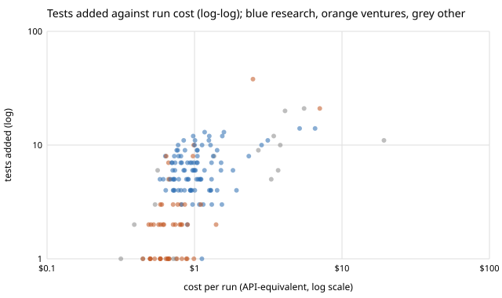

# Does a bigger agent run buy more output? Cost against tests added in 157 run records (preliminary)

Pure Python standard library. A new question for track 10 (the software-engineering loop), not a variant of an earlier result: `swe-runcost` and `swe-costpermerge` price runs, and this asks whether price tracks output. Produced with AI assistance (Claude). **Preliminary: tests added is a crude output proxy, only 21% of priced records fill it in, and the records are self-reported.**

**Live page:** https://duncan-haywood.github.io/oss-monorepo/research/swe-spendoutput/

- **Pooled across tracks, runs that cost more add more tests (Spearman rho +0.57, bootstrap 95% interval +0.44 to +0.68, n = 157 runs that added tests).** All numbers are from `experiments/results.txt`.
- **Inside a track the link is much weaker for research, and unclear for ventures.** Research runs: rho +0.19 (−0.02 to +0.39, n = 94), elasticity +0.33 (+0.10 to +0.46). Ventures: rho +0.39 (+0.11 to +0.64, n = 46), elasticity +1.19 (+0.48 to +1.88). Elasticity is the slope of log(tests) on log(cost), so a research run that costs twice as much adds about 26% more tests (2^0.33), where ventures' point estimate says more than double (the interval is wide). The pooled figure is partly the track mix, since the two tracks differ in typical cost and typical test counts.
- **Tests per dollar do not rise with spend.** Splitting the 157 into cost terciles: 5.4 tests per dollar in the cheapest third ($0.32 to $0.74), 6.0 in the middle, 3.7 in the dearest ($1.03 to $19.24). The dearest third is the least efficient on this proxy, in line with `swe-runcost`'s finding that cost grows faster than the work (context re-read at each step).
- **Runs that record zero tests are cheaper** (median $0.56, n = 17) than runs that add tests (median $0.88), so some cost is simply the cost of writing tests; the zero group is too small to say more.



```bash
cd research/swe-spendoutput
PYTHONPATH=src python3 -m unittest discover -s tests -v    # 8 tests, under a second
python3 experiments/snapshot.py                            # regenerates runs_snapshot.jsonl from prompts/runs/
python3 experiments/run.py > experiments/results.txt       # a few seconds
python3 experiments/figure.py                              # writes experiments/cost_vs_tests.svg
```

## Motivation

Track 10 asks for valuable correct work per unit of compute. `swe-runcost` measured the compute side and `swe-costpermerge` the merged side; neither asks whether a run that spends more produces more. If output barely rises with spend, capping a run's tool calls costs little; if it rises in proportion, caps cost output. Tests added is the only numeric output field the records carry in volume (`lines_added` and `commits` are filled in about 2 records).

## Builds on

`swe-runcost` (the cost field and the log-log method) and `swe-costpermerge` (bootstrap by run). Spearman (1904) rank correlation, "The proof and measurement of association between two things", *American Journal of Psychology* 15(1); Efron (1979), *Annals of Statistics* 7(1), for the bootstrap. No lab's work is built on, and no lab is affiliated with or endorses this project.

## Method

`experiments/snapshot.py` copies track, date, `cost_usd`, `tool_calls`, `tests_added` and the length of `projects` from every record in `prompts/runs/` with a non-null `cost_usd` (822 on 2026-10-20) into `experiments/runs_snapshot.jsonl`. `experiments/run.py` keeps records that fill in `tests_added` (174) and, for the correlations, those with `tests_added > 0` (157), because log of zero is undefined and a recorded zero is a different event (a run that shipped no tests). Per track and pooled it reports Spearman's rho and the log-log slope, each with a 2,000-resample percentile bootstrap over runs (seed 1), plus tests per dollar by cost tercile. Tracks with fewer than 15 positive-test runs are not estimated.

## Limitations

- **Tests added measures one kind of output.** A run that ships a dataset, a figure or a doc fix adds none. It also rewards test-heavy projects, and a test count says nothing about whether a project is valuable or correct (`swe-value`, `swe-audit`).
- **Selection.** 79% of priced records leave `tests_added` null, and which ones fill it in is not random (research and ventures runs mostly). The result does not describe process, red-team or review runs.
- **Self-reported counts.** `tests_added` is written by the run itself, and I did not re-count it from the merged diff.
- **Cost is `prompts/runcost.py`'s API-equivalent estimate**, not a bill, and it includes work that is not test writing (reading, planning, review).
- **Correlation, not a dose-response.** Harder projects may cost more and need more tests; the data cannot separate that from spend buying output. The pooled figure mixes tracks.
- Five days of data, one model for almost all runs, no multiple-comparison correction across the tracks shown.

## Next steps

Re-count tests from each merged PR's diff in place of the self-reported field; add a second output measure (files or lines added per project, from `swe-backfill`'s history reader); fit cost against output with a track term to separate the track mix from spend; then take it to `swe-allocate`, whose value model currently treats a run's output as independent of its cost.

## Owner steps

None.

## Outside dependencies

None beyond this repository's `prompts/runs/` records. No language-model proposer was used.

MIT.
