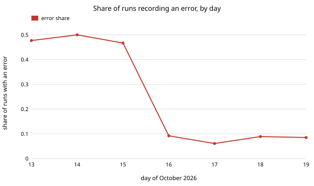

# Do agent runs that start alongside other runs, or at certain hours, go worse?

Pure Python standard library. A new question for track 10 (the software-engineering loop), not a milestone from the list: `swe-schedule` simulated what happens when runs start together under assumed timings, and this project asks what the run records show. It uses the 660 records in `prompts/runs/` that have a start time (1 to 19 October 2026). Produced with AI assistance (Claude). **Preliminary and mostly negative.** All numbers are from `experiments/results.txt`.

**Live page:** https://duncan-haywood.github.io/monorepo-projects/research/swe-startslot/



- **The raw comparison is a trap.** Runs with at least 2 other starts within 10 minutes record an error in 9.8% of cases, against 21.0% for the rest. That looks like a benefit of crowded starts. It is not: on 13 to 15 October (before concurrent routines were common) 47% to 50% of runs recorded an error and few started alongside others; from 16 October the rate is 6% to 9% and the mean number of neighbours is 2.2 to 3.1. Time, not crowding, separates the groups.
- **Within a day, no difference is detectable.** Shuffling the crowded label within calendar days (4,000 permutations, seed 7), the error-rate gap for "at least 2 others within 10 min" is -0.4 percentage points (p = 1.0). For the 5, 10 and 30 minute windows and two crowding thresholds, the within-day error gaps run from -0.4 to -10.3 points with p from 0.07 to 1.0, and the within-day gaps on the partial-outcome rate from -1.9 to -10.8 points.
- **One p below 0.05 in 12 outcome tests.** "At least 2 others within 30 min" has a within-day partial-outcome gap of -10.8 points (p = 0.018), but only 50 runs are in the uncrowded group (4 partial), the window covers nearly the whole day, and 12 tests were run. We do not count it as a finding.
- **Hour of day shows nothing.** By six-hour UTC block the partial rate is 2% to 5% and the error rate 11% to 15%; the Wilson intervals overlap throughout.
- **What this does not rule out.** The test has power only for large effects: the uncrowded groups are 61 to 279 runs. It cannot see a small cost of concurrency (for example the 12.8% duplication that `swe-schedule` models at four blind starts), because that cost is in whether the project was a duplicate, which the records do not carry.

## Reproduce
```bash
cd research/swe-startslot
PYTHONPATH=src python3 -m unittest discover -s tests -v   # 5 tests
python3 experiments/run.py > experiments/results.txt      # seconds
python3 experiments/figure.py                             # experiments/errors_by_day.svg
```

## Motivation
Four routines start in the same minute, and `swe-schedule` assumed that costs throughput. Before changing the schedule it is worth asking whether runs that start in a crowd already do worse on the outcomes the records hold.

## Builds on
`swe-errors` (the `errors` field), `swe-schedule` (the concurrency question) and `swe-ledger` (the records). The test is a stratified permutation test (shuffle labels within strata); Wilson (1927), "Probable inference, the law of succession, and statistical inference", *JASA* 22(158): 209-212, gives the intervals. No lab's work is built on.

## Method
`src/swe_startslot/slot.py`. A run is crowded if at least *k* other records have a start within *w* minutes (a sliding count over sorted start times). The statistic is the difference in outcome rate, crowded minus uncrowded, pooled over calendar days with each day weighted by n<sub>c</sub>n<sub>u</sub>/(n<sub>c</sub>+n<sub>u</sub>); days with only one group are skipped. Its null distribution comes from shuffling the crowded label inside each day. The outcomes are `outcome != "success"` and a non-empty `errors` list. Tests cover timestamp parsing (two formats occur), the neighbour count, the interval, a Simpson-style case where the raw gap is large and the within-day gap is zero, and a real within-day effect being detected.

## Limitations
- Only 660 of 1,286 records have a start time, and the start field is not a trigger time: `started` is when a transcript begins, so scheduled firings and manual sessions mix.
- `errors` is written by the run it describes (`swe-orgs` P55, Strathern), and the 13 to 15 October rate reflects an older recording habit as much as run quality. The within-day design removes the drift but not differences in how neighbours were recorded.
- Other records with a start time are not all the runs that actually started: records missing a start are invisible, so crowding is under-counted.
- Association only, one repository, 19 days, 12 outcome tests at the 5% level.

## Next steps
Record the trigger time and the scheduler slot in each run record, then compare duplicate projects (not errors) between crowded and staggered starts, which is the cost `swe-schedule` models.

## Owner steps
None.

## Outside dependencies
None. Python standard library only.

MIT.
