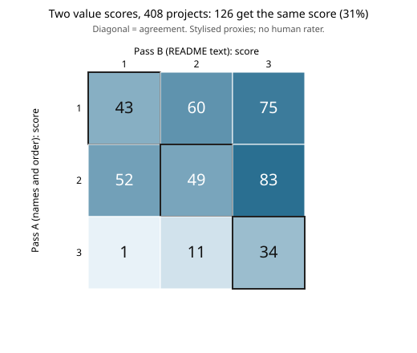

# Can two independent passes agree on what a portfolio project is worth? A value rubric for track 10 (negative on the automated passes)

Pure Python, no dependencies. Milestone 3 (`swe-value`) of track 10, the software-engineering loop, in `PROJECTS.md`. The track's metric needs a *value* term, and nothing here scored one. I wrote a three-level rubric, scored all 408 projects under `research/` with two automated passes that look at different evidence, scored a seeded 30-project sample by hand, and measured agreement with Cohen's kappa. Produced with AI assistance (Claude). **Preliminary: stylised proxies, no human rater, and the rubric author also made the hand scores.**

**Live page:** https://duncan-haywood.github.io/monorepo-projects/research/swe-value/

## Results (all from `experiments/results.txt`)

- **The two automated passes barely agree.** Pass A (names and order only: a milestone `PROJECTS.md` lists, first of a name family, or later family member) and pass B (README text only: similarity to the nearest earlier README in the same track) give linear-weighted kappa 0.07 (95% bootstrap 0.01 to 0.13) over 408 projects; unweighted 0.03 (&minus;0.03 to 0.09). That is chance-level agreement. Pass B's thresholds hardly matter (kappa 0.02 to 0.07 over four settings).
- **A flaw in pass A explains much of it, found after the fact.** Slugs with no track prefix are grouped by last word, so 108 `*-twin` projects count as one "family" and 107 of them are scored a follow-up, though "twin" is a theme, not a chain. Dropping families for untracked slugs (variant A2, chosen *after* seeing this, so treat it as post-hoc) gives kappa 0.25 (0.19 to 0.31) against pass B: fair at best.
- **Against a blind hand sample (n = 30, seed 20261015, scored from the title and first paragraph by the session agent before seeing either pass's scores)**, linear kappa is 0.10 for A (&minus;0.37 to 0.41), 0.57 for A2 (0.24 to 0.81) and 0.45 for B (0.24 to 0.65). Thirty projects make wide intervals, and the hand rater is the rubric's author and not independent of its wording. This supports the rubric being usable, not it being valid.
- **Follow-ups cost about as much code as new projects.** Lines added to non-data files (no merges, `git log` on full history) have medians of 318 (pass A class 1, follow-up), 328 (class 2) and 362 (class 3, a listed milestone). So under this rubric a follow-up buys about 3.0 value points per 1000 lines against 5.1 for new work and 6.3 for listed milestones (bootstrap intervals in the results file). **That ratio is largely built in** (the points are the rubric's), so the informative part is only the near-equal code cost. Lines are a poor proxy for tokens, which the log does not record for most runs.
- **Answer to the track's example question** (are follow-ups worth as much per unit as new milestones?): not on this rubric, but the rubric's agreement is too weak to rest an allocation policy (`swe-allocate`) on. What it needs first is human or blind-reviewer scores.



```bash
git fetch --unshallow origin main      # full history is needed for first-added dates
cd research/swe-value
PYTHONPATH=src python3 -m unittest discover -s tests -v   # 8 tests, under a second
python3 experiments/run.py > experiments/results.txt       # a few seconds; also writes scores.csv and sample.json
python3 experiments/figure.py                              # experiments/agreement.svg from scores.csv
```

`experiments/scores.csv` has every project's first-added time, lines added, family and both scores. `experiments/hand_scores.json` is the hand sample.

## Rubric

3 = answers a new question at milestone scale; 2 = a new question, not itself a listed milestone; 1 = a follow-up whose question is set by an earlier project (a parameter variation, an ablation, a next-step item). A duplicate would score 0; none is scored here because duplicates are not detectable from the repository alone (`swe-ledger` counts repeat slugs in the run log).

## Method

`src/swe_value/value.py`. Pass A uses the first-added commit order, `PROJECTS.md` milestone slugs and `swe-ledger`'s name-stem families. Pass B uses TF-IDF cosine similarity of each README's text before its first `##` heading to every earlier README in the same track (similarity at least 0.50 scores 1, below 0.30 scores 3). Kappa is Cohen's (1960), linear-weighted for the ordinal scale and unweighted as a check; intervals are 2000-resample bootstraps. Tests cover kappa on a perfect, a chance and a hand-checked 2&times;2 case, both passes on toy inputs, and the ratio interval.

## Builds on

Cohen (1960), "A coefficient of agreement for nominal scales", *Educational and Psychological Measurement* 20(1): 37&ndash;46, for kappa; Salton and Buckley (1988), "Term-weighting approaches in automatic text retrieval", *Information Processing &amp; Management* 24(5): 513&ndash;523, for TF-IDF; `research/swe-ledger` for the family grouping. No lab's work is built on, and no lab is affiliated with or endorses this project.

## Limitations

Neither automated pass sees what a project found, so both measure novelty of name or wording, not value. The families are a coarse name match. Lines added is a crude cost proxy and ignores the tokens spent. A renamed project would be dated from its new name. The hand scores come from 30 titles and ledes, by the rubric's author. The A2 variant was picked after the A result. No correctness is scored (that is `swe-audit`).

## Next steps

Have a reviewer session that did not write the rubric score the same 30 projects from their full READMEs, and recompute kappa. Tighten the rubric where the hand and automated scores disagree. Add a correctness gate from `swe-audit`, and cost in tokens once the ledger records them, then pass the scored table to `swe-allocate`.

## Owner steps

None.

## Outside dependencies

Git history of this repository; Python 3 standard library only.

MIT.
