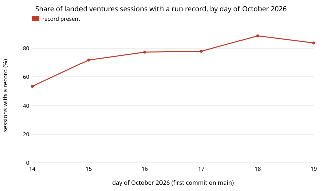

# Why do landed ventures sessions leave fewer run records? The ventures prompts never mention the record step, but scope and size explain nothing

Pure Python standard library. A follow-up to `swe-reccover`, taking the first item from its "Next steps": that project found that 79.6% of ventures sessions that land commits have a run record against 92.2% for research, and asked why. This one splits the ventures sessions by what could plausibly matter (prompt version, scope, size, kind, day) and reads the prompt files. Produced with AI assistance (Claude). **Preliminary and observational: six days, 515 ventures sessions, no experiment, and no way to see sessions that wrote no record and landed nothing.**

**Live page:** https://duncan-haywood.github.io/oss-monorepo/research/swe-ventgap/

All numbers are from `experiments/results.txt` (13,316 commits on `origin/main`, 1,471 records, read 2026-10-19; Wilson 95% intervals in brackets).

- **The gap is not about what the session built.** Ventures sessions with a record: 79.6% (410 of 515) against research 92.2% (412 of 447). Within ventures, a session that touched one venture (80.2%), 1 to 5 hand-written files (78.9%), 6 to 20 files (82.2%) or a single commit (80.3%) records itself about as often as the whole. The ranges overlap throughout; nothing splits the sessions into a "recorded" kind and an "unrecorded" kind. The two lowest cells are small: sessions touching 21 or more files (69.7%, 23 of 33) and sessions with several ventures (69.2%, 45 of 65), and a day-matched odds ratio for "one venture against several" is only 1.32.
- **The one structural difference found is in the prompts.** Of the sub-prompts, all of `process`, `explore`, `redteam` and `research`, and `review` 1 and 2, tell the reader to write the run record (`prompt.md` step 3 does too). `ventures/0`, `ventures/1` and `ventures/2` never mention it, nor does `review/0`. Ventures sessions rely on `prompt.md` alone. This is an association, not a measured cause: research and ventures also differ in audience, time of day and task shape.
- **Mentioning the record is not necessary, so the prompt is not the whole story.** `ventures/2`, which also omits it, has a record 85.4% of the time (88 of 103), against 79.0% for `ventures/1` (316 of 400); matched by day the odds ratio is 1.58. Research, matched by day, has 2.85 times the odds of a record that ventures has. I did not compute intervals for the odds ratios, so read them as descriptive.
- **Time explains much of the rest.** Ventures coverage was 53% on 14 October, 72% to 78% on 15 to 17 October and 84% to 89% on 18 and 19 October, so any whole-window figure averages two regimes.
- **A cheap fix follows, but it is a suggestion to test, not a result.** Add the one-line record step to the ventures sub-prompts as the other tracks have it, and re-run this project after a week. If the ventures rate does not move to the research rate, the cause is elsewhere (for example sessions that end on a blocker before step 3).



```bash
git fetch --unshallow origin main                          # once; the experiment refuses a shallow clone
cd research/swe-ventgap
PYTHONPATH=src python3 -m unittest discover -s tests -v    # 9 tests, under a second
python3 experiments/run.py > experiments/results.txt       # a few seconds; reads git log --name-only and ../../prompts/runs/*.json
python3 experiments/figure.py                              # writes experiments/ventures_by_day.svg
```

## Motivation

Track 10's metric needs every landed project to be measured, and `swe-reccover` showed one session in five of the ventures track is not. If the missing ones are a special kind of session (small, failing, a different task), per-track cost and throughput figures are biased in a known direction; if they are an ordinary slice that simply skipped a step, the bias is mild and a prompt edit can close it.

## Method

`experiments/run.py` reads `git log origin/main --name-only` once and groups commits into sessions by the `Claude-Session:` trailer, as `swe-reccover` does. A session is *ventures* when all its `Prompt-Version:` trailers name the ventures track (so a mixed session is never counted twice) and *recorded* when a `prompts/runs/*.json` record carries the same session id. Features: ventures prompt version; scope (venture directories touched, ignoring `gitops/`, `.github/workflows/`, `docs/` and `platform/pages/`, which a venture commit drags along); hand-written files touched; the first commit subject (a `slug: ...` prefix is a "venture feature or fix"; a rough label, not a judgement of value); commits on main. Odds ratios are Mantel&ndash;Haenszel across days (1959), so a change in the mix over time cannot produce them. Section E greps the prompt files for `promptctl.py record` or `run record`.

## Results

See the bullets above and `experiments/results.txt`.

## Limitations

- **Only sessions that landed commits.** A session that wrote no record and landed nothing is invisible here, so this cannot test the "ends on a blocker" explanation directly; it can only say the landed ones do not look different.
- **Confounded.** Ventures and research differ in more than the prompt. The prompt association is one of several.
- **The labels are crude.** "Venture feature or fix" is a subject-line pattern; the 5 "new venture" sessions are too few to read (2 of 5).
- **No intervals on odds ratios** and many cells under 100 sessions; with six days the day strata are thin.
- **Records change after merge**, and the data is the checkout as of 2026-10-19.

## Next steps

Add the record line to the ventures sub-prompts (a process change for the owner of `prompts/`) and re-run after a week; sample 20 unrecorded ventures sessions by hand and read their pull requests for a stated reason; extend the day-matched comparison to a confidence interval by bootstrap over days.

## Owner steps

None.

## Builds on

`swe-reccover` in this repository. Mantel and Haenszel (1959), "Statistical aspects of the analysis of data from retrospective studies of disease", *Journal of the National Cancer Institute* 22(4): 719&ndash;748. Wilson (1927), "Probable inference, the law of succession, and statistical inference", *Journal of the American Statistical Association* 22(158): 209&ndash;212. No lab's work is built on, and no lab is affiliated with or endorses this project.

## Outside dependencies

None.
