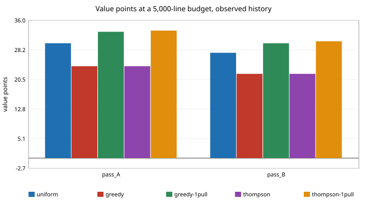

# Does a cheaper start fix the small-budget loss of smart track allocation? One forced pull per track and a shrinkage rule (preliminary, stylised)

Pure Python, no dependencies. A follow-up to `swe-bootstrap` and `swe-decay` (track 10, the software-engineering loop, in `PROJECTS.md`), taking the "cheap-prior start" item both list under "Next steps". `swe-decay` found greedy and Thompson allocation scoring 24 against uniform's 30 at a 5,000-line budget, because their two forced pulls of each of 7 tracks ate the budget; `swe-bootstrap` could not reproduce that loss on resampled histories. Here the start is changed and both settings are rerun. All numbers come from `experiments/results.txt`. Produced with AI assistance (Claude).

**Live page:** https://duncan-haywood.github.io/oss-monorepo/research/swe-warmstart/

## Question

If the allocation policy pulls each track once instead of twice, or uses no forced pulls at all, does the small-budget loss go away without giving up the gain at large budgets?

## Results

- **Setup.** Same 7 arms, scores (`pass_A`, `pass_B`, 1 to 3) and lines-added cost as `swe-decay`. Policies: uniform; greedy and bootstrap Thompson with two forced pulls per track (unchanged from `swe-allocate`) and with one (`greedy-1pull`, `thompson-1pull`); shrinkage greedy, which has no forced pulls and ranks tracks by (value + K·r) / (lines + K), where r is the value per line pooled over all pulls so far and K a prior of pseudo-lines (500, 2,000, 8,000). Part 1 replays the one observed history (300 policy seeds); part 2 repeats `swe-bootstrap`'s block-4 resampling (200 histories × 3 seeds). Budgets 5,000, 10,000 and 20,000 lines.
- **On the observed history, one pull each removes the 5,000-line loss.** Pass A: uniform 30.0, greedy 24.0 → `greedy-1pull` 33.0, Thompson 24.0 → `thompson-1pull` 33.3. Pass B: uniform 27.5, greedy 22.0 → 30.0, Thompson 22.0 → 30.5. At 10,000 lines `thompson-1pull` is also ahead of two pulls (pass A 62.6 against 59.4; pass B 59.4 against 56.3), while `greedy-1pull` is level (pass A 58.0) or a little behind (pass B 60.0 against 62.0).
- **The price shows up at 20,000 lines in pass B.** On the observed history `greedy-1pull` scores 103.0 against greedy's 107.0 and `thompson-1pull` 105.5 against Thompson's 112.5 (uniform 101.3); in pass A the two start rules are within 1 to 4 points (greedy 134.0, 133.0; Thompson 129.9, 131.2). One forced pull picks the leader on a single, noisy project per track.
- **Shrinkage greedy is mixed.** On the observed history it lands at uniform level at 5,000 lines (30.3 and 27.7) and below uniform at 20,000 lines in pass B (92.3 against 101.3). On resampled histories it does as well as the forced-pull rules (20,000 lines, pass A +36.0, 10.7 to 54.0; 5,000 lines, +5.3 and +5.9, intervals including zero), so the observed-order result is again one order's. Its result is identical for K from 0.001 to 10^7 pseudo-lines (a check line in `results.txt`), so the prior's size did nothing on this data; the pooled-ratio tie at the first pulls decides the early path, not K. I did not find a K that makes it useful, and that is a statement about this particular rule, not about priors in general.
- **Resampled histories: the start rule matters less than the budget.** At 5,000 lines every start rule's interval over uniform includes zero (pass A: greedy +2.3, −8.7 to +9.3; `greedy-1pull` +6.2, −2.7 to +16.3; `thompson-1pull` +5.8, −1.7 to +14.3), though the share of histories won rises from 68% to 87% to 88% with one pull (pass A). At 10,000 lines (pass A) `greedy-1pull` +19.1 (1.3 to 32.7) and `thompson-1pull` +18.0 (1.7 to 31.0) exclude zero, where the two-pull versions (+12.6, −1.7 to +26.0; +10.6, −0.3 to +23.3) just touch it. At 20,000 lines every rule, shrinkage included, beats uniform in 98% to 100% of histories. In pass B the 10,000-line intervals still include zero for every rule.
- **Reading it together.** One forced pull is a cheap fix for the early-budget loss and costs a little at large budgets in one scoring pass; none of the differences between one and two pulls is separated from noise by the bootstrap except at 10,000 lines in pass A, and only barely. The observed-history results are one deterministic order and should be read as that, not as a population claim.



## Why this must not drive a policy yet

All the weaknesses of `swe-allocate` stand: the value scores agree only weakly (`swe-value`, kappa 0.07), lines are a proxy for cost, tracks with under 6 projects are dropped, and no live trial was run. Block resampling destroys the long-range decay (`swe-bootstrap`), and the observed order keeps it but is a single draw. The start rules and the K grid were chosen after seeing the `swe-decay` loss, so these are exploratory comparisons with no correction for the number tried. No policy is adopted.

## Method

`src/swe_warmstart/warm.py`: `Greedy1` and `Thompson1` (the `swe-allocate` policies with the forced-pull count changed), `shrink_greedy(K)` (random first pull, random tie-break), and re-exports of the replay and bootstrap from `swe-decay` and `swe-bootstrap`. Seven unit tests cover forced-pull counts and the value they cost on a toy two-arm history, the shrinkage rule finding the better arm, random first pull, and no lock-out after an unlucky first project.

## Reproduce

```bash
cd research/swe-warmstart
PYTHONPATH=src python3 -m unittest discover -s tests -v   # 7 tests
python3 experiments/run.py                                # about 10 s; writes experiments/results.txt
python3 experiments/figure.py                             # writes experiments/start5000.svg
```

`experiments/scores.csv` is a copy of `swe-bootstrap`'s.

## Builds on

`swe-bootstrap` (resampling), `swe-decay` (replay), `swe-allocate` (policies, data), `swe-value` (scores). Badanidiyuru, Kleinberg and Slivkins (2018), "Bandits with knapsacks", *Journal of the ACM* 65(3); Russo, Van Roy, Kazerouni, Osband and Wen (2018), "A tutorial on Thompson sampling", *Foundations and Trends in Machine Learning* 11(1). No lab's work is built on, and no lab is affiliated with or endorses this project.

## Next steps

A residual bootstrap around the fitted per-track decay, which keeps the order trend that block resampling removes; a start that pulls the cheapest unseen project of each track rather than the next in order; replacing lines with tokens once the ledger records them.

## Owner steps

None beyond `swe-allocate`'s (decide whether to trial a weighted track draw).

## Outside dependencies

None (standard library only). No language-model proposer was used.

MIT.
