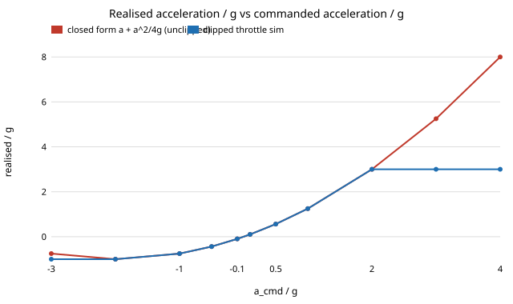

# Thrust twin: a controller inverts a linear-thrust twin, what does the real quadratic thrust curve do to the step response?

Pure Python, no dependencies. Free-choice run (`PROJECTS.md`, Picking work): a small question about a very common twin simplification, thrust modelled as linear in throttle around hover, that none of the other `*-twin` projects asks. Produced with AI assistance (Claude). Stylised: 1-D altitude, unit mass, noiseless, a simulated "real" system with an assumed `T = k u²` thrust curve and no field data.

**Live page:** https://duncan-haywood.github.io/monorepo-projects/research/thrust-twin/

**Setup.** Vehicle `ẍ = T(u) − g`, throttle `u`. Twin: thrust linearised at hover. Controller designed in the twin: `a_cmd = kp (x₀ − x) − kd v`, `u = u_h + a_cmd/(2 k u_h)` (the twin's exact inverse), so the twin obeys `ẍ = a_cmd`. Real thrust `T = k u²` (`k u_h² = g`).

**Closed form.** Substituting, the real vehicle realises `ẍ = a_cmd + a_cmd²/(4g)`: it depends only on `a_cmd/g`. The quadratic term is always positive, so climb commands over-deliver (×1.25 at `a_cmd = g`, ×1.5 at `2g`), descent commands under-deliver (×0.75 at `−g`), and the throttle floor `u = 0` is reached at `a_cmd = −2g` (free fall, `ẍ = −g`). With throttle limited to `2u_h` (assumed), acceleration caps at `3g`. The step response then depends on `p = ωn²|x₀|/g` only (tested).

## Reproduce
```bash
cd research/thrust-twin
PYTHONPATH=src python3 -m unittest discover -s tests -v   # 8 tests, under a second
PYTHONPATH=src python3 experiments/run.py > experiments/results.txt   # seconds
python experiments/figure.py                              # writes experiments/accel.svg
```

## Results (from `experiments/results.txt`; RK4, dt = 1 ms)
- Unclipped simulation equals the closed form at every tested command (test `test_closed_form_matches_unclipped_throttle`).
- ζ = 0.7, ωn = 1 (twin overshoot 0.0460, 2% settling 5.98 s). The step direction matters once `p` is not small. Overshoot, climb / descent: `p = 0.05`: 0.0463 / 0.0456; `p = 1`: 0.0540 / 0.0396; `p = 2`: 0.0644 / 0.0344; `p = 4`: 0.0949 / 0.0265 (clipped). Settling time moves little: 6.42 s climbing and 6.25 s descending at `p = 4` against 5.98 s.
- ζ = 1 (twin overshoot 0): the real vehicle stays at zero overshoot in these cases, but settling is asymmetric at `p = 4`: 5.40 s climbing, 6.58 s descending, against 5.83 s in the twin.
- Without the throttle clip, a descent command below `−2g` would give a negative throttle and an unphysical upward acceleration (`u²` positive); the table's "no clip" column at `p = 4`, descent (overshoot 0) is that artifact, not a result. Keep the clip.
- Descents of about `2g/ωn²` (19.6 m at ωn = 1, 1.2 m at ωn = 4) already reach the floor, where the controller can no longer brake the fall as planned.



## Limitations and next steps
Stylised: one axis, static thrust map with no motor lag (see `lag-twin`), no drag (`drag-twin`), no battery sag (`sag-twin`), assumed throttle ceiling `2u_h`. The result is a few-percent effect for gentle manoeuvres (`p` ≲ 0.5: under 1.1 points of overshoot) and matters for aggressive ones. Next: gain-schedule the inverse (`u = sqrt((g + a_cmd)/k)`) and measure what the exact inverse buys; add motor lag to test whether the Routh limit of `lag-twin` moves (gain scaling alone does not change it, since both PD terms scale together; not tested here).

**Builds on.** The digital-twin simulation-fidelity and sim-to-real direction of ARPG (<https://arpg.colorado.edu/>), the Autonomous Systems IRT (<https://www.colorado.edu/irt/autonomous-systems/>) and RECUV (<https://www.colorado.edu/recuv/>, UAV simulation); no specific paper from those groups is reproduced and nothing here is affiliated with or endorsed by them. Companion to `lag-twin`, `saturation-twin`, `groundeffect-twin` and `drag-twin` in this repository. No external citations are used; the quadratic thrust curve is a standard textbook model assumed, not fitted. MIT.
