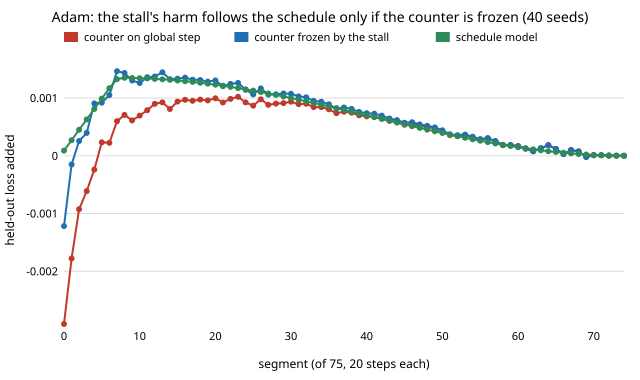
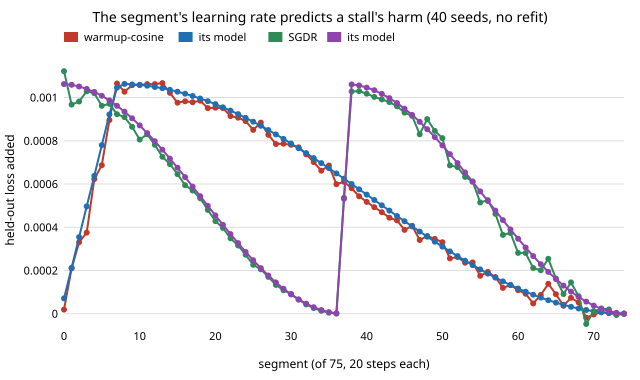
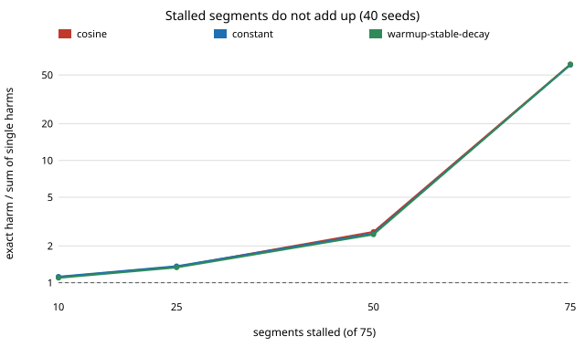
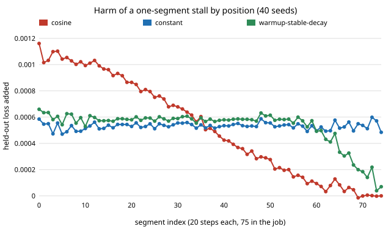
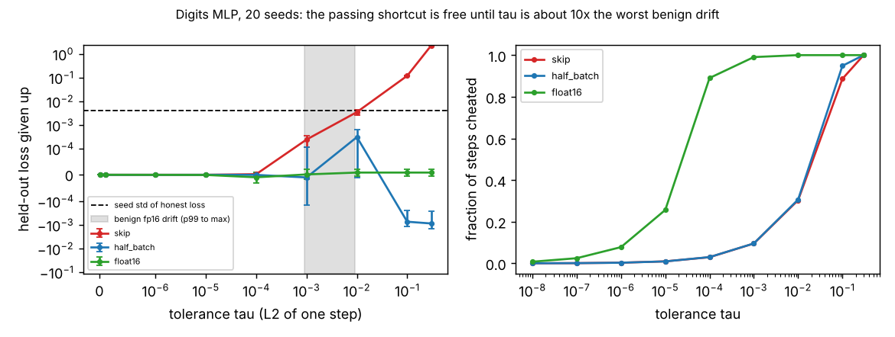
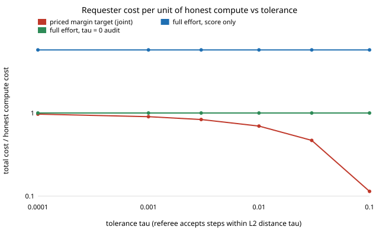

# Verifiable training mechanisms: what is the cheapest payment-and-audit protocol that makes honest ML training an equilibrium?

**Status: open research programme, milestones 2 to 92 in progress (latest: 92, committing the Kahan compensation buffer closes plain SGD's last blind zone).** Results on H1 to H6 (below); a paper skeleton is in `paper/`. This directory is where
the work toward one publishable paper accumulates across sessions; it consolidates about 60
small scoring, audit and verifier projects in this repository into one question (see
[`PROPOSAL.md`](PROPOSAL.md)).

**Live page:** https://marisstella.app/research/verifiable-training-mechanisms/

**The question.** A requester pays untrusted workers to train a model. Cheating is cheap (skip
steps, use less data, lower precision, copy a peer) and the weights cannot be checked without redoing
the work. The programme asks for the cheapest protocol that makes full effort an equilibrium when the
available checks are a refereed re-execution of one step, a noisy proper score on held-out data and
agreement between redundant workers, and when honest workers themselves differ by floating-point drift.

**Why it is open.** Refereed delegation, scoring rules, peer prediction and contract theory each
assume the others away. The programme prices the drift tolerance as a cheating margin, proves a cost
frontier for the joint contract, bounds collusion on a shared shortcut, and measures all of it on real
small-model training.

- [`PROPOSAL.md`](PROPOSAL.md): question, related work (17 checked references), gap, hypotheses
  H1 to H6, method, evaluation, milestones, target venue.
- [`src/vtm/`](src/vtm): the unified library (stdlib only): a 2x2 equilibrium solver, the inspection
  game from payoff matrices, audit thresholds, bribery floors and the Brier effort-rent law.
  `PYTHONPATH=src python3 -m pytest tests` runs 33 tests (numpy and scipy needed for 11) (14 reproduce the closed
  forms of `verification-game`, `audit-allocation`, `verifier-bribery` and `effort-elicitation` and
  agree with those projects' own code, 5 test the numpy harness `src/vtm/margin.py`).
- [`experiments/optimizer_replay/`](experiments/optimizer_replay): **milestone 86, does the replay referee still catch a stalled segment under momentum and Adam? (H1/H4).** Yes for the full stall: over 1,280 honest runs (40 calibration and 40 test seeds, four schedules, plain SGD, momentum 0.9 and Adam at mean learning rate 1e-3 and 4e-3), every one of the 48,000 fully stalled test segments is flagged by the fp16 replay and convicted by the float32 arbiter, so milestone 85's assumed d = 1 is measured. Partial skips are harder under Adam: the weight check needs 2 to 10 skipped steps of 20 to catch 90% of segments (plain SGD 1, momentum 1 to 2), because Adam's honest fp16 tail is 1.5 to 4.2 times the step against 0.24 to 0.44 under SGD; also checking the committed first moment catches one skipped step in 79% to 100% of segments (post hoc). Correction found on the way: milestones 80 to 84's workers ran with float64 weights (numpy promotion from a float64 learning rate); with true float32 weights the arbiter's honest maximum is 4.8e-4 to 2.0e-2, against 2.9e-7 to 7.8e-6 in milestone 80, mostly in the tiny-step tail, so its threshold should be zoned. Figure: [`replay_detection.svg`](experiments/optimizer_replay/replay_detection.svg). One MLP on digits, CPU numpy as all three parties.
- [`experiments/compensated_arbiter/`](experiments/compensated_arbiter): **milestone 92, does committing the Kahan compensation buffer of plain-SGD weights close the float32 arbiter's last blind zone? (H1/H4).** Mostly. Pre-registered on 40 fresh seeds (640 jobs, each seed trained with plain and Kahan-compensated float32 SGD; milestone 91's rule unchanged): comparing the compensated weights w - c convicts one forged float16 step in every one of segments 0 to 73 in every seed under all four schedules, where plain SGD's weights convict it in as few as 5% of the last segments; the worst zone rises from 0.19 to 0.34 to 0.84 to 0.85 under the decaying schedules. The only remaining miss is the run's final segment, whose last step runs at 0.7% of the segment's mean learning rate (two forged steps there: always convicted). 3 honest convictions in 12,000, held-out loss unchanged (0.003%), cost one float32 buffer per weight. Kahan weights alone, without committing c, reach only 0.54 to 0.76. 6 of 8 predictions held (the 0.95 worst-zone target and the 5x floor size were refuted). Builds on compensated summation (Kahan 1965, [doi:10.1145/363707.363723](https://doi.org/10.1145/363707.363723)) as used for low-precision weight updates (Zamirai et al. 2020, [arXiv:2010.06192](https://arxiv.org/abs/2010.06192)). Figure: [`compensated_arbiter.svg`](experiments/compensated_arbiter/compensated_arbiter.svg).
- [`experiments/arbiter_threshold/`](experiments/arbiter_threshold): **milestone 91, which float32 arbiter threshold closes milestone 90's blind zones without convicting honest workers? (H1/H4).** 60 pre-registered threshold rules (zone maximum, quantile and robust log-scale, 40 or 80 calibration seeds), one selected on milestone 90's seeds by its worst-zone conviction, then tested on 40 fresh holdout seeds (2,560 runs): 10x the zone's 0.95 honest quantile (80 seeds) convicts one forged float16 step in every segment of every zone in all 12 momentum and Adam cells, where milestone 90's 10x-maximum rule left whole zones at 0 (momentum cosine) and 0.095 (Adam 1e-3 sgdr), with 13 honest convictions in 48,000. Plain SGD's last zone stays partly blind (0.22 to 0.36). All 8 predictions held. Figure: [`arbiter_threshold.svg`](experiments/arbiter_threshold/arbiter_threshold.svg).
- [`experiments/arbiter_audit/`](experiments/arbiter_audit): **milestone 90, does the zoned float32 arbiter, run alone, catch precision forgeries on fresh seeds, and which audit catches more per unit of audit compute? (H1/H4).** Pre-registered on 40 never-analysed test seeds (1,280 runs, milestone 89's forgers): the float32 arbiter with thresholds zoned by five segments, run on every segment, convicts one float16 step in 93% to 100% of momentum and Adam segments (78% to 91% under plain SGD), one bfloat16 step in 82.5% to 100%, and 1 of 48,000 honest segments; the two-stage fp16-referee audit catches five forged float16 steps in at most 15%. Priced in float32-replay units with H100 datasheet ratios, a random sample of float32 replays at the two-stage audit's own cost has a better worst case over five forgers in all 16 cells (0.06 to 0.10 against 0.00 to 0.08 when an fp16 replay costs 0.068 of a float32 one; 0.42 to 0.53 against 0.00 to 0.08 at 0.5); the fp16 referee wins only against sub-batch shaving. A 95% quantile fp16 threshold sees whole bfloat16 segments (91% to 98%) but flags up to 11.7% of honest segments, 2.3x its nominal rate. Remaining misses are whole zones whose arbiter threshold one honest calibration outlier sets. Figure: [`arbiter_audit.svg`](experiments/arbiter_audit/arbiter_audit.svg). One MLP on digits; precision simulated by rounding operands on CPU; costs are datasheet ratios.
- [`experiments/precision_forgery/`](experiments/precision_forgery): **milestone 89, can a worker compute its last steps in float16 or bfloat16 without the replay referee noticing? (H1/H4).** Yes. Over milestone 86's 1,280 runs, a forger who uses the referee's own float16 rounding for the last q of a segment's 20 steps is caught (zoned weight-or-moment referee, float32 arbiter) in at most 1.7% of segments at every q, including a whole segment, which commits the referee's replay exactly; a whole bfloat16 segment is caught in 17% to 35% under momentum and Adam. That is up to 50% of a segment's compute against a TF32 tensor step (93% against FP32 vector; H100 datasheet ratios), against milestone 88's 0.4% for sub-batches. Flagging values *below* the honest minimum as well catches a whole float16 segment in 95% to 100% of momentum and Adam cells but not 10 of 20 steps. The cheat is harmless here: whole float16 and bfloat16 runs end within 0.38% and 0.74% of the honest held-out loss. Post hoc, the float32 arbiter with zoned thresholds, applied to every segment, convicts one float16 step in 78% to 100% of segments and at most 2 of 3,000 honest ones. Figure: [`precision_detection.svg`](experiments/precision_forgery/precision_detection.svg). One MLP on digits; precision simulated by rounding operands on CPU.
- [`experiments/proxy_forgery/`](experiments/proxy_forgery): **milestone 88, how much compute can a worker save by computing skipped steps' gradients on a sub-batch before the replay referee catches it? (H1/H4).** Almost none. Over milestone 86's 1,280 runs, a forger who uses b of 64 rows for the last q of a segment's 20 steps is caught (zoned weight-or-moment referee, float32 arbiter) in at least 97.7% of segments for b <= 32 under every optimiser and schedule; the largest saving caught in at most half of segments is 0.08% to 0.16% of the segment's compute under momentum and Adam at lr 1e-3, 0.16% to 0.39% under Adam 4e-3 and 0.39% under plain SGD. Milestone 87's global thresholds leave a 2x to 8x larger gap (up to 3.1% under Adam 4e-3), so zoned thresholds are what make the check tight. No honest segment convicted. Figure: [`proxy_detection.svg`](experiments/proxy_forgery/proxy_detection.svg). One MLP on digits; row sub-sampling is the only proxy tested.
- [`experiments/adaptive_forgery/`](experiments/adaptive_forgery): **milestone 87, can a worker who skips steps forge the committed moments without computing gradients? (H1/H4).** No. Two zero-gradient forgeries of the last q of a segment's 20 steps, *stale* (re-apply the last gradient) and *coast* (use the first moment as the gradient), over milestone 86's 1,280 runs: against a weight-only referee coast hides one or two skipped steps (Adam: caught in at most 1.3% of segments at two skipped steps), but checking the committed first moment as well catches both forgeries at one skipped step in 80% to 100% of segments and at two in at least 95.4%, with no honest segment convicted. The only weak cell is Adam's warmup at mean lr 4e-3; thresholds zoned by five segments (post hoc) catch one skipped step in 98.6% to 100% everywhere at a cost of 0.9% to 1.8% of honest segments sent to the arbiter. Figure: [`forgery_detection.svg`](experiments/adaptive_forgery/forgery_detection.svg). One MLP on digits, CPU numpy as all three parties; a proxy-gradient forger is untested.
- [`experiments/optimizer_harm_model/`](experiments/optimizer_harm_model): **milestone 85, does a skipped segment's harm still follow the learning-rate schedule under momentum and Adam? (H1/H4).** With momentum SGD (EMA form, 0.9; 12,000 stalled runs over 40 seeds, four schedules), yes, unchanged: correlation 0.995 to 0.998 with the segment's summed learning rate, and plain SGD's constant 2.66e-4 per unit of learning rate predicts the summed harm to within 1% to 2% (error 5% to 7%), not refitted. With Adam the pre-registered model failed (correlation 0.24 to 0.61). After the run: at Adam's best rate on this task (mean 4e-3) a one-segment stall costs less than seed noise (per-seed spread 3 to 7x the mean harm), and at the standard 1e-3 the profile is reliable but bent by the bias-correction counter. A stall that freezes Adam's moments while the counter keeps counting under-corrects the second moment, so the next ~1,000 steps run up to 1.4x larger and early stalls can even lower the loss. With the counter frozen too, the schedule model holds under Adam (correlation 0.95 to 0.995). So a referee can plan spot checks from the schedule under momentum as under SGD, but under Adam only if the committed counter is checked or bias correction has decayed. One MLP on digits, detection assumed.
  
- [`experiments/schedule_harm_model/`](experiments/schedule_harm_model): **milestone 84, how much harm does a skipped training segment do? Read it off the learning-rate schedule (H1/H4).** On four schedules not measured before (step, linear, warmup-cosine and SGDR restarts; 12,000 stalled runs over 40 seeds), stalling one 20-step segment costs a fixed 2.7e-4 held-out loss per unit of the learning rate it skipped, wherever the segment sits: correlation 0.996 to 0.997 with the segment's summed learning rate, and 5% to 7% RMS error with the constant taken from a different schedule, not refitted. The remaining learning rate ("early steps matter most") predicts far worse (correlation 0.51 to 0.97): the first warmup segments cost a fifth of the peak, and the last segments before an SGDR restart cost almost nothing. So a referee can weight its sampling against a saboteur from the published schedule alone, and that matches or beats coverage estimated from 1,500 trained cheats per schedule (1.1x to 1.4x lower worst case than uniform at 5 opened segments, 1.6x to 2.0x at 20), with 96% to 100% of the oracle's gain against a fined worker. Plain SGD on one MLP; momentum and Adam untested.
  
- [`experiments/job_level_forfeit/`](experiments/job_level_forfeit): **milestone 83, a job-level bond, and what large stall sets really cost (H1/H4).** Measured exactly over 40 seeds and three schedules, stalled segments do not add: 10 random segments cost 1.1x the sum of their single harms, 25 cost 1.35x, 50 cost 2.5x, and all 75 cost 60x (+2.41 held-out loss). That corrects milestone 82's game B: the uniform worker's response costs 14.9x what it reported, and covering a subset at the deterrence level beats uniform 7x to 167x, not 1.4x to 16x. With a job-level forfeit instead (one caught segment forfeits everything), the worker's payoff is convex in how many segments it stalls, so it works honestly or stalls everything (proved; checked at 4.6 million grid points): uniform random sampling then needs the least bond of any design, g N / (1 - (1-d)^k), which at d = 1 is the job's compute for any k, and any segment never opened is free to stall. [`theory.py`](experiments/job_level_forfeit/theory.py) has the formulas.
  
- [`experiments/harm_weighted_sampling/`](experiments/harm_weighted_sampling): **milestone 82, where to open segments when a cheat's harm depends on its position (H1/H4).** Stalling one 20-step segment, measured at all 75 positions over 40 seeds under three schedules with the same summed learning rate: under cosine the held-out loss added falls from +1.2e-3 at the start to zero over the last ten segments; under a constant rate it is about +5.3e-4 everywhere; under warmup-stable-decay it is flat, then halves over the cooldown. Every stall is flagged and convicted, and harms add (5-segment sets: 1.03x to 1.04x the sum). Weighting coverage by harm lowers a saboteur's worst case 1.2x to 1.3x at 5 opened segments (cross-fitted; about 2x at 20), on cosine only: on the flat schedules it fits noise. Against a rational worker whose stake is too small for uniform sampling to deter, covering a subset of segments at the deterrence level cuts expected harm 1.4x to 2.8x on every schedule, and choosing that subset by harm takes it to 2.4x to 16x under cosine. A referee that cannot deter everywhere should deter somewhere. One MLP, one cheat shape, an additive worker.
  
- [`experiments/mixed_protocol/`](experiments/mixed_protocol): **milestone 81, the mixed protocol against a worker who knows both checks (H1/H4).** Opening k fp16 referee segments plus m float32 arbiter segments, against the same budget of shrink (E = 30 step-units) packed into windows of 20 to 760 steps: every window segment is convicted, and the fp16 referee flags every segment of every window down to a 3.9% shrink, so detection is set by sampling alone. The early 20-step stall is the cheat caught least in all 370 protocols tried, at exactly (segments opened)/75, and it costs 1.6x the held-out loss of the uniform 2% shrink. Adding arbiter segments never helps between 0.05 and 0.4 T of a job (the best protocol always has m = 0); post hoc it pays only near a full replay at a 2x float32 price. The same windows placed late cost nothing measurable, so the next lever is harm-weighted sampling and the stake. 20 test seeds, one MLP, three window positions.
- [`experiments/dispute_arbiter/`](experiments/dispute_arbiter): **milestone 80, the dispute step: one flagged segment replayed at float32 (H1/H4).** An arbiter that replays only the flagged 20-step segment from the worker's committed checkpoint, in its own float32 reduction order, never convicts an honest worker (0 of 1,500 held-out segments at 10x the honest maximum, which is 12,000x below the fp16 referee's) and convicts every segment of every uniform shrink down to 1e-4 of each step (floor 3e-5; 3e-6 with a float64 arbiter). So a dispute costs s r steps, not a re-run: the fp16 two-stage protocol catching a uniform 2% shrink in 79% of jobs costs 8.1% of a job's compute with FP32 at the H100's 15x rate penalty. The referee is now the bottleneck: one full-precision segment (20% of a job at r = 15) catches every uniform shrink of 1e-4 or more, many fp16 segments are better against a concentrated cheat. 40 calibration and 20 test seeds, one MLP, CPU BLAS standing in for cross-device nondeterminism.
- [`experiments/quantile_budget/`](experiments/quantile_budget): **milestone 79, a false-flag budget instead of a max-of-honest tolerance (H1/H4).** Setting the fp16 segment-drift threshold at the honest 99% or 98% quantile per zone, and paying for the false disputes, catches a uniform 2% shrink of every step at 5 opened segments in 44% or 79% of jobs (zoned maximum: 9%), with honest jobs sent to dispute 3.6% or 6.8% of the time. If a dispute costs one re-execution, 79% catch costs 13% of a job's compute; if it costs ten, the false disputes make a 90% catch dearer than replication. The tail-zone maximum was set by one honest segment and was hiding a 10% shrink of the last 300 steps (4% caught, 68% under a quantile). Analysis of milestone 78's run, 40 calibration and 20 test seeds, one MLP.
- [`experiments/noise_probe_tolerance/`](experiments/noise_probe_tolerance): **milestone 78, normalise fp16 segment drift by a referee-measured noise probe (H1/H4).** Dividing drift by lr(t0) times the gradient rounding error on one batch (one float32 gradient per segment) does not stabilise a max-of-honest tolerance: its maximum moves 1.67x between two 20-seed halves (step-norm rule 2.14x) and it catches a uniform 2% shrink at 5 opened segments in 8% of jobs, no better than milestone 77's zoned rule (9%). The honest drift is heavy-tailed between seeds at the same step (max 66x to 81x the median for every normalisation), so no smooth scale removes the tail. With 40 seeds the zoned rule's main-zone maximum is stable (1.04x) and catches a 10% shrink of 300 mid-training steps in 69% of jobs (other rules 0% to 11%).
- [`experiments/lr_zoned_tolerance/`](experiments/lr_zoned_tolerance) (data from [`experiments/concentrated_shrink/`](experiments/concentrated_shrink)): **milestone 77, a drift tolerance split at the low-learning-rate tail (H1/H4).** The largest honest fp16 ratio moves 2x between two 10-seed halves of the calibration set (0.307 against 0.156); the maximum over segments with lr >= 10% of lr0 moves 1.12x (0.174 against 0.156), so the tail is what makes a max-of-honest tolerance drift. Zoning raises the catch of a uniform 2% shrink from 0.7% to 9% of jobs at k = 5 opened segments (35% at k = 20) and leaves concentrated cheats unchanged; 10 seeds per half are too few to pin even the main-zone threshold (0.8% false flags when fitted on the lower half). The underlying run also replicates milestone 76's max-rule result at a second budget (E = 30).
- [`experiments/shrink_concentration/`](experiments/shrink_concentration): **milestone 76, spread or concentrate a shrink against sampled fp16 segment replay (H1/H4).** A drift tolerance set at the maximum honest ratio grows with the calibration sample: 40 honest seeds give 0.655 at s = 20 against 0.227 from 600 segments, set by one late, near-zero-learning-rate segment, and under it a 5% shrink of every step is caught in 0.3% of jobs at a 100-step replay budget. At the 99.9th percentile (post-hoc) it is caught in 26% to 34%. Concentrating the same budget in a 75-step stall pays at s = 20 (twice the harm, caught 25%) and not at s = 5 (caught 66%), so segment spacing trades replay cost against detection. Harm is at most +0.0044 held-out loss; one MLP, seven cheat shapes.
- [`experiments/transformer/`](experiments/transformer): **milestone 11, the margin on a small transformer (H1).** A 2-layer, d=32 character-level transformer on 87 kB of real text, 10 seeds, plain SGD. Float32 reorder drift is at most 1.5e-7 against update norms of 0.004 to 0.22. Skipping steps below tau costs +0.0017 held-out loss at 1e-2 (16% of steps skipped, 0.2 seed std), +0.0085 at 3e-2 (1.0 std) and +0.062 at 0.1 (7.4 std); it never helps. Code: `src/vtm/margin_tf.py` (needs torch).
- [`experiments/transformer_cheats/`](experiments/transformer_cheats): **milestone 19, two more cheats on the transformer (H1).** A quarter-batch gradient ("subsample") and a reused gradient ("stale") against the same reorder referee, 10 seeds. Both are accepted on 12 to 14% of steps at tau = 1e-2. Subsample costs at most 0.3 seed std up to tau = 0.1 (a free saving); stale costs +0.0177 at 1e-2 (2.1 std, CI excludes zero) and +1.55 at 0.1, so the narrow H1 margin holds for skip and subsample but is refuted for stale. Predictions on acceptance rates were wrong (log).
- [`experiments/splits/`](experiments/splits): **milestone 9, the margin with the data split resampled (H1).** Same two setups, each of 20 seeds also drawing its own 70/30 split. Breast cancer: skipping still lowers held-out loss at tau = 1e-2 (-0.0098, CI -0.0135 to -0.0063; better on 19 of 20 splits) and 3e-2, and hurts only at 0.1 (+0.054), so the milestone 8 gain was not a one-split artefact. Digits: +0.0016 at 1e-2 (CI 0.0006 to 0.0027), +0.028 at 0.1.
- [`experiments/setups/`](experiments/setups): **milestone 8, the margin on other tasks (H1).** The skip shortcut on a 64-128-64-10 MLP (digits) and a 30-32-2 MLP (breast cancer), 20 seeds. Digits: 0.6 seed std given up at tau = 1e-2, 1.7 std at 3e-2. Breast cancer: skipping *improves* held-out loss up to tau = 3e-2 and hurts (5.7 std) only at 0.1. The threshold is task-dependent, so the margin should be stated relative to the update-norm distribution. Code: `src/vtm/margin_gen.py`.
- [`experiments/margin/`](experiments/margin): **milestone 3, the hidden margin on real training (H1).** A 64-64-10 MLP
  on the real scikit-learn digits data, 20 seeds. A referee that re-executes one step and accepts within L2 distance tau
  passes a worker that skips, subsamples or lowers precision whenever that is cheap. Benign float16 drift is at most 9e-3
  (median 3e-5); the skip cheat passes 30% of steps at tau = 1e-2 and loses less than one seed std of held-out loss, and loses
  30 stds only at tau = 0.1, about 10x the worst benign drift. So the margin at drift-sized tolerances is saved work, not a worse model.
  
- [`experiments/frontier/`](experiments/frontier): **milestone 4, single-check frontiers and a first look at H2.** The measured skip family becomes the
  worker's action set and `src/vtm/contract.py` solves the cheapest contract as a linear programme (checked against the closed form and a brute-force grid).
  With a tolerance above benign drift, audit-only cannot implement full effort at any stake (a free cheaper action exists); score-only costs 5.8x the compute
  at 540 test examples; the joint contract beats both in 4 of 45 cells (ratio 0.72 to 0.81, only with 5,000 test examples). If the requester instead
  buys the quality the tolerance sanctions, one audited step deters and the cost is the effort plus 1/1500.
  
- [`experiments/joint/`](experiments/joint): **milestone 5, peer agreement (H3) and a lower bound (H5).** `src/vtm/peer.py` solves the two-worker contract by linear programme. An agreement term between redundant workers lowers the cost when cheats cannot coordinate, but across 1,349 random instances where cheats share one trajectory and copying is excluded it never beats the audit. A one-sided resolution bound `max(C, g/p - S)` is proved and holds in 2,755 random instances (exact in 2,410), but H5's "within a constant factor" fails (worst ratio 2,093) and the bound is vacuous for a Gaussian score.
- [`experiments/agreement/`](experiments/agreement): **milestone 31, measured agreement probabilities for H3.** Along the honest transformer trajectory (10 seeds), honest pairs always agree (delta 0), a quarter-batch cheat agrees with the honest gradient with probability alpha = 0.04 to 0.43 (tau 1e-3 to 1e-1) and two independent such cheats with kappa = 0.03 to 0.35, always lower. Fed to the H3 contract with copying excluded, agreement saves 12 to 14% over audit-only in one cell group only (tau 1e-1, audit rate 0.1) and nothing elsewhere; shared-quarter and stale cheats (kappa = 1) get no saving.
- [`experiments/auditor/`](experiments/auditor): **milestone 34, a bribable auditor (H4).** Adds the auditor to the coalition game: a catch reward cannot deter it, a bond forfeited on meta-audit exposure can, and the bond needed grows about linearly with the number of workers (closed form matches brute force in 440 instances).
- [`experiments/collusion/`](experiments/collusion): **milestone 6, collusion on a shared trajectory (H4).** `src/vtm/coalition.py` searches all coalition deviations by brute force
  for m = 1 to 7 replicated workers, one shared cheap trajectory and one audit. A coalition of floor(m/2)+1 escapes replication; the stake that deters it,
  max(0, g/p - 1), matches brute force in all 140 cells and does not fall with m, so the proposal's 1/m law is refuted for a per-job audit (it belongs to the bribery
  setting). A model check, not a discovery: pure strategies, one shared cheat, majority rule, swept parameters.
- [`experiments/h6/`](experiments/h6): **H6, predicted against measured degradation.** Two predictors fitted on honest runs only (first-order forgone descent; honest training for fewer steps) are compared with the measured skip degradation. Both overshoot by 3x to 100x wherever the degradation is above seed noise (the ratio is in [0.5, 2] in 1 of 9 settings, a trivial one), so H6 is refuted for these models.
- [`experiments/h6_pathlength/`](experiments/h6_pathlength): **H6 revisited with a path-length predictor (milestone 24).** Train an honest worker for the share of *path length* (not of steps) that skipping leaves. No fitted parameter. On the rows where skipping costs more than seed noise it lands at 0.6x to 1.0x of measured on both the digits MLP and the transformer (the step-share predictor was 2.4x to 6.7x over); at small tau it undershoots by 2x to 10x or more. Holds on half of the detectable rows, so H6 is partly supported, not settled.
- [`paper/`](paper): **milestone 7, paper skeleton** in ACM EC format with the abstract, nine references and a one-command figure script; sections are stubs, not for submission.
- [`LOG.md`](LOG.md): the research log. Hypotheses are written down before experiments are run.
- How runs work on a programme: [`../PROGRAMMES.md`](../PROGRAMMES.md).

Produced with AI assistance (Claude Code). It builds on published work it cites and implies no
affiliation with or endorsement by any author or lab.

## Owner steps

- Submitting the paper (publishes under a name).

## Outside dependencies

None yet. Planned: a public dataset and an open-source ML framework for the real-training
experiments, probed for reachability first.
