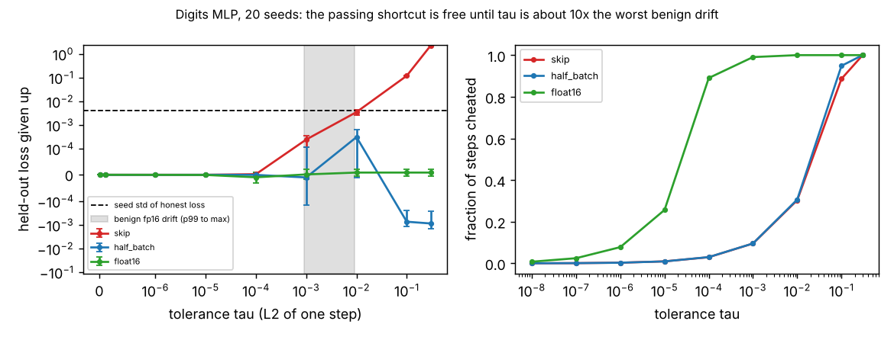
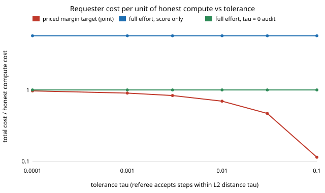

# Verifiable training mechanisms: what is the cheapest payment-and-audit protocol that makes honest ML training an equilibrium?

**Status: open research programme, milestones 2 to 6 and the H6 test done.** Results on H1 to H6 (below); a paper skeleton is in `paper/`. This directory is where
the work toward one publishable paper accumulates across sessions; it consolidates about 60
small scoring, audit and verifier projects in this repository into one question (see
[`PROPOSAL.md`](PROPOSAL.md)).

**Live page:** https://duncan-haywood.github.io/oss-monorepo/research/verifiable-training-mechanisms/

**The question.** A requester pays untrusted workers to train a model. Cheating is cheap (skip
steps, use less data, lower precision, copy a peer) and the weights cannot be checked without redoing
the work. The programme asks for the cheapest protocol that makes full effort an equilibrium when the
available checks are a refereed re-execution of one step, a noisy proper score on held-out data and
agreement between redundant workers, and when honest workers themselves differ by floating-point drift.

**Why it is open.** Refereed delegation, scoring rules, peer prediction and contract theory each
assume the others away. The programme prices the drift tolerance as a cheating margin, proves a cost
frontier for the joint contract, bounds collusion on a shared shortcut, and measures all of it on real
small-model training.

- [`PROPOSAL.md`](PROPOSAL.md): question, related work (17 checked references), gap, hypotheses
  H1 to H6, method, evaluation, milestones, target venue.
- [`src/vtm/`](src/vtm): the unified library (stdlib only): a 2x2 equilibrium solver, the inspection
  game from payoff matrices, audit thresholds, bribery floors and the Brier effort-rent law.
  `PYTHONPATH=src python3 -m pytest tests` runs 33 tests (numpy and scipy needed for 11) (14 reproduce the closed
  forms of `verification-game`, `audit-allocation`, `verifier-bribery` and `effort-elicitation` and
  agree with those projects' own code, 5 test the numpy harness `src/vtm/margin.py`).
- [`experiments/transformer/`](experiments/transformer): **milestone 11, the margin on a small transformer (H1).** A 2-layer, d=32 character-level transformer on 87 kB of real text, 10 seeds, plain SGD. Float32 reorder drift is at most 1.5e-7 against update norms of 0.004 to 0.22. Skipping steps below tau costs +0.0017 held-out loss at 1e-2 (16% of steps skipped, 0.2 seed std), +0.0085 at 3e-2 (1.0 std) and +0.062 at 0.1 (7.4 std); it never helps. Code: `src/vtm/margin_tf.py` (needs torch).
- [`experiments/transformer_cheats/`](experiments/transformer_cheats): **milestone 19, two more cheats on the transformer (H1).** A quarter-batch gradient ("subsample") and a reused gradient ("stale") against the same reorder referee, 10 seeds. Both are accepted on 12 to 14% of steps at tau = 1e-2. Subsample costs at most 0.3 seed std up to tau = 0.1 (a free saving); stale costs +0.0177 at 1e-2 (2.1 std, CI excludes zero) and +1.55 at 0.1, so the narrow H1 margin holds for skip and subsample but is refuted for stale. Predictions on acceptance rates were wrong (log).
- [`experiments/splits/`](experiments/splits): **milestone 9, the margin with the data split resampled (H1).** Same two setups, each of 20 seeds also drawing its own 70/30 split. Breast cancer: skipping still lowers held-out loss at tau = 1e-2 (-0.0098, CI -0.0135 to -0.0063; better on 19 of 20 splits) and 3e-2, and hurts only at 0.1 (+0.054), so the milestone 8 gain was not a one-split artefact. Digits: +0.0016 at 1e-2 (CI 0.0006 to 0.0027), +0.028 at 0.1.
- [`experiments/setups/`](experiments/setups): **milestone 8, the margin on other tasks (H1).** The skip shortcut on a 64-128-64-10 MLP (digits) and a 30-32-2 MLP (breast cancer), 20 seeds. Digits: 0.6 seed std given up at tau = 1e-2, 1.7 std at 3e-2. Breast cancer: skipping *improves* held-out loss up to tau = 3e-2 and hurts (5.7 std) only at 0.1. The threshold is task-dependent, so the margin should be stated relative to the update-norm distribution. Code: `src/vtm/margin_gen.py`.
- [`experiments/margin/`](experiments/margin): **milestone 3, the hidden margin on real training (H1).** A 64-64-10 MLP
  on the real scikit-learn digits data, 20 seeds. A referee that re-executes one step and accepts within L2 distance tau
  passes a worker that skips, subsamples or lowers precision whenever that is cheap. Benign float16 drift is at most 9e-3
  (median 3e-5); the skip cheat passes 30% of steps at tau = 1e-2 and loses less than one seed std of held-out loss, and loses
  30 stds only at tau = 0.1, about 10x the worst benign drift. So the margin at drift-sized tolerances is saved work, not a worse model.
  
- [`experiments/frontier/`](experiments/frontier): **milestone 4, single-check frontiers and a first look at H2.** The measured skip family becomes the
  worker's action set and `src/vtm/contract.py` solves the cheapest contract as a linear programme (checked against the closed form and a brute-force grid).
  With a tolerance above benign drift, audit-only cannot implement full effort at any stake (a free cheaper action exists); score-only costs 5.8x the compute
  at 540 test examples; the joint contract beats both in 4 of 45 cells (ratio 0.72 to 0.81, only with 5,000 test examples). If the requester instead
  buys the quality the tolerance sanctions, one audited step deters and the cost is the effort plus 1/1500.
  
- [`experiments/joint/`](experiments/joint): **milestone 5, peer agreement (H3) and a lower bound (H5).** `src/vtm/peer.py` solves the two-worker contract by linear programme. An agreement term between redundant workers lowers the cost when cheats cannot coordinate, but across 1,349 random instances where cheats share one trajectory and copying is excluded it never beats the audit. A one-sided resolution bound `max(C, g/p - S)` is proved and holds in 2,755 random instances (exact in 2,410), but H5's "within a constant factor" fails (worst ratio 2,093) and the bound is vacuous for a Gaussian score.
- [`experiments/agreement/`](experiments/agreement): **milestone 31, measured agreement probabilities for H3.** Along the honest transformer trajectory (10 seeds), honest pairs always agree (delta 0), a quarter-batch cheat agrees with the honest gradient with probability alpha = 0.04 to 0.43 (tau 1e-3 to 1e-1) and two independent such cheats with kappa = 0.03 to 0.35, always lower. Fed to the H3 contract with copying excluded, agreement saves 12 to 14% over audit-only in one cell group only (tau 1e-1, audit rate 0.1) and nothing elsewhere; shared-quarter and stale cheats (kappa = 1) get no saving.
- [`experiments/auditor/`](experiments/auditor): **milestone 34, a bribable auditor (H4).** Adds the auditor to the coalition game: a catch reward cannot deter it, a bond forfeited on meta-audit exposure can, and the bond needed grows about linearly with the number of workers (closed form matches brute force in 440 instances).
- [`experiments/collusion/`](experiments/collusion): **milestone 6, collusion on a shared trajectory (H4).** `src/vtm/coalition.py` searches all coalition deviations by brute force
  for m = 1 to 7 replicated workers, one shared cheap trajectory and one audit. A coalition of floor(m/2)+1 escapes replication; the stake that deters it,
  max(0, g/p - 1), matches brute force in all 140 cells and does not fall with m, so the proposal's 1/m law is refuted for a per-job audit (it belongs to the bribery
  setting). A model check, not a discovery: pure strategies, one shared cheat, majority rule, swept parameters.
- [`experiments/h6/`](experiments/h6): **H6, predicted against measured degradation.** Two predictors fitted on honest runs only (first-order forgone descent; honest training for fewer steps) are compared with the measured skip degradation. Both overshoot by 3x to 100x wherever the degradation is above seed noise (the ratio is in [0.5, 2] in 1 of 9 settings, a trivial one), so H6 is refuted for these models.
- [`experiments/h6_pathlength/`](experiments/h6_pathlength): **H6 revisited with a path-length predictor (milestone 24).** Train an honest worker for the share of *path length* (not of steps) that skipping leaves. No fitted parameter. On the rows where skipping costs more than seed noise it lands at 0.6x to 1.0x of measured on both the digits MLP and the transformer (the step-share predictor was 2.4x to 6.7x over); at small tau it undershoots by 2x to 10x or more. Holds on half of the detectable rows, so H6 is partly supported, not settled.
- [`paper/`](paper): **milestone 7, paper skeleton** in ACM EC format with the abstract, nine references and a one-command figure script; sections are stubs, not for submission.
- [`LOG.md`](LOG.md): the research log. Hypotheses are written down before experiments are run.
- How runs work on a programme: [`../PROGRAMMES.md`](../PROGRAMMES.md).

Produced with AI assistance (Claude Code). It builds on published work it cites and implies no
affiliation with or endorsement by any author or lab.

## Owner steps

- Submitting the paper (publishes under a name).

## Outside dependencies

None yet. Planned: a public dataset and an open-source ML framework for the real-training
experiments, probed for reachability first.
