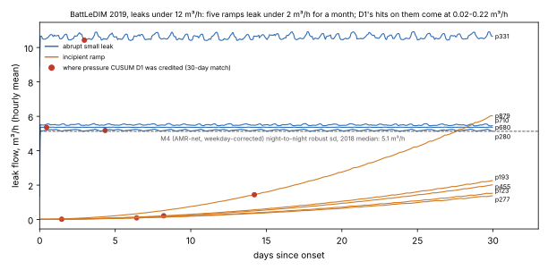
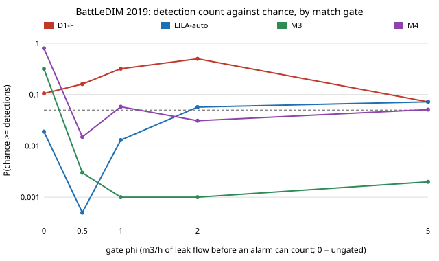
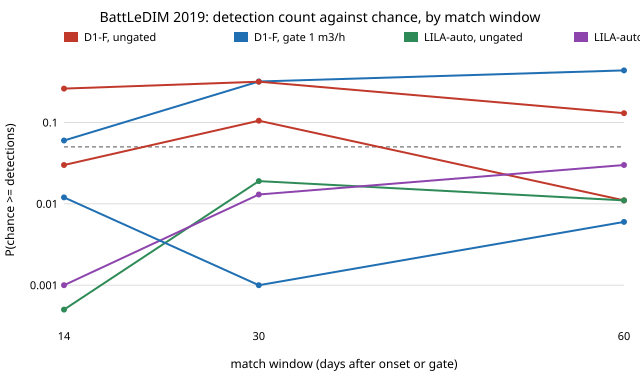
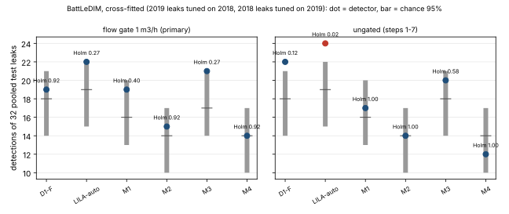
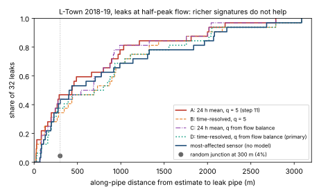
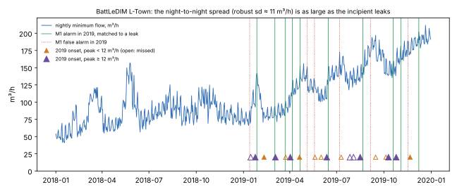
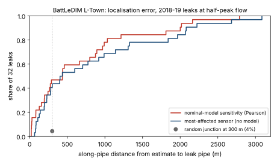

# water-leaks: does a water-leak detector on the BattLeDIM benchmark beat random alarms?

A research programme ([`PROPOSAL.md`](PROPOSAL.md), [`LOG.md`](LOG.md)) on leak detection and localisation in water distribution networks, run on the real **BattLeDIM 2020 L-Town benchmark**: 33 pressure sensors, 3 inlet flows and a tank level at 5-minute steps for 2018 and 2019, and the published leak schedule (Vrachimis et al. 2022; dataset on Zenodo, CC-BY-4.0). Track 21 (`infra`); it picks up the L-Town milestone that [`infra-waterloss`](../infra-waterloss) had to run on Net3 because the data host was unreachable then.

**Live page:** https://marisstella.app/research/water-leaks/

**Headline (steps 1 and 2, 2026-11-12; a simulated benchmark network, not a utility).** Two data-driven detectors with no hydraulic model, each tuned on 2018 only and scored once on 2019, raise 26 alarms over the two years. Our residual CUSUM (D1) detects **13 of the 19 leaks that start in 2019 with 2 false alarms**; an automatic reimplementation of the published **LILA** method (Daniel et al. 2022) detects **14 with 1 false alarm**. **The same 26 alarms placed at random detect a median 11** (95% range 8 to 13): D1's count is within chance (P = 0.105) and LILA's just outside it (P = 0.019), but a disclosed change of LILA's tie-break rule puts it back inside (13 of 19 with 28 alarms, P = 0.265), and only 2 of the 13 LILA settings with 20 or more alarms clear P < 0.05. Where both clearly beat chance is location: the sensor that raises the alarm is within 300 m of the leak along the pipes for **5 of 13 (D1) and 7 of 14 (LILA), against a chance median of 0** (P < 0.001 in every one of the 27 LILA settings). On L-Town, a detection count says little; the location-aware score is the one that separates methods from luck.

**Step 6 (2026-11-13): minimum night flow does not catch the small leaks earlier.** The leakage engineer's standard statistic for slow, incipient leaks, the night's minimum district inflow (p227 + p235 less the tank's storage change), tuned on 2018 the same way, **detects only 3 of the 9 leaks of 2019 under 12 m³/h, against 7 for the pressure CUSUM D1 and 7 for LILA**, and is earlier than D1 on 1 of the 9 (pre-registered H4 refuted). The reason is in the data: the nightly minimum moves by a robust sd of about **11 m³/h** from one night to the next, as large as the leaks themselves. It finds 10 of all 19 with 6 false alarms (chance with 25 alarms: median 11, P = 0.80). On L-Town, the 33 pressure sensors carry the small-leak signal; the district meter alone does not.

**Step 7 (2026-11-13): fixing night flow's noise does not fix it, and the small leaks pressure "found" were luck.** Correcting the nightly minimum for its weekday pattern and subtracting the 82 smart (AMR) meters' night use halves its spread, from 10.7 to **5.1 m³/h**, yet the corrected statistic (M4, declared primary) still **detects 3 of the 9 small leaks**, earlier than the pressure CUSUM on 2 (H4 refuted again; the AMR-only variant finds 6 of 9 but with a median delay of 473 h). The ground-truth leak flows say why: **five of the nine are slow ramps that leak under 0.5 m³/h at night for their first week and 1.3 to 6 m³/h by day 30**, below any district-meter statistic inside the 30-day matching window. And the pressure detectors' credited hits on those ramps came when the leak was carrying **0.01 to 0.22 m³/h**: chance matches, not detections. A detection-only score on L-Town should credit an alarm only once the leak's own flow passes a stated level.



**Step 8 (2026-11-13): credit an alarm only once the leak is real, and the ranking flips.** Rescoring every detector so far under a pre-registered **flow-gated match** (an alarm counts for a leak only from the hour the leak's own flow reaches 1 m³/h, and within 30 days of that), the pressure CUSUM D1 falls to **11 of 19, P = 0.32 against chance**, while the smart-meter-corrected **night flow (M3) rises to 15 of 19 with 3 false alarms, P = 0.001**, below 0.005 at every gate from 0.5 to 5 m³/h. LILA stays above chance at 1 m³/h (13 of 19, P = 0.013) but not at 2 or 5 (P = 0.057, 0.072). Two of three predictions written before the run failed. The swing is two or three leaks out of 19: D1-F loses the ramps it was credited with while they leaked under 0.25 m³/h, and three night-flow alarms that were false under the old rule now fall in a ramp's window. That small a swing is the whole gap between "at chance" and "beats chance" here, so which detector "wins" on L-Town depends on a scoring choice no paper states.



**Step 9 (2026-11-13): the verdict depends on the scoring rule, and no two detectors can be told apart.** Rescoring the same six detectors under six matching rules (a 14, 30 or 60-day window, with and without the 1 m³/h flow gate), with chance recomputed under each, **three of six detectors switch between "beats chance" and "at chance"** depending on the rule: the pressure CUSUM D1 beats chance (P &lt; 0.05) under 2 of the 6 rules, night flow M1 under 4, the smart-meter-corrected night flow M3 under 3 (all three gated ones). LILA is below 0.05 under all 6, but after a Holm correction across the six detectors under only 2. And on the 19 test leaks **no pair of detectors differs** at the primary rule: the smallest Holm-adjusted sign-test P over 15 pairs is 0.59, and M3's 4-leak lead over D1 has a bootstrap interval of 0 to +8. Three of four predictions written before the run held; the fourth (D1 never beats chance) failed at the 14- and 60-day ungated windows. The 300 m location score beats chance (P &lt; 0.001) under every rule.



**Step 10 (2026-11-13): tune on one year, test on the other, and nothing survives.** Swapping the years (thresholds chosen on 2019, scored once on 2018's 13 leaks) and pooling with the forward fold gives **32 held-out leaks**. Under the primary flow-gated rule **no detector's pooled count beats chance after a Holm correction** (smallest 0.27; LILA 22 of 32 and smart-meter night flow M3 21 of 32, both P &asymp; 0.05 unadjusted). **M3's step-8 lead does not carry over**: it finds 15 of 19 leaks in 2019 but 6 of 13 in 2018, against 8 for the pressure CUSUM and 9 for LILA. Five of six thresholds move when the tuning year changes. Only LILA under the old ungated rule survives (24 of 32, Holm P = 0.024), and on 32 leaks still no pair of detectors differs (smallest Holm P 0.86).



**Step 11 (2026-11-13): where is the leak? Ten times better than chance, no better than the obvious sensor.** Leak localisation with WNTR sensitivities on the nominal L-Town model (782 junctions simulated, correlation with the pressure residual) puts **31% (D1-F) and 36% (LILA) of the detected 2019 leaks within BattLeDIM's 300 m**, and 47% of all 32 leaks when localised at half-peak flow; a random junction manages about 4%. But naming the sensor whose pressure fell most does as well (13 of 32, median error 420 m against the model's 436 m; paired P = 0.75). Pre-registered H3 is inconclusive; an uncalibrated nominal model adds nothing on this benchmark ([step 11](#step-11-model-based-localisation-on-the-nominal-model-srcwater_leakslocalisepy-experimentsstep11-localise)).

**Step 12 (2026-11-14): richer leak signatures make localisation worse.** Two textbook fixes to step 11's localiser, a time-resolved (hour-by-hour) signature and a leak size estimated from the inflow balance, put **12 of 32 leaks within 300 m** (step 11's 24 h mean: 15; the most-affected sensor: 13). Under the pre-registered primary method, H3 is **refuted** (23% and 29% of detected 2019 leaks). The inflow balance sizes only 12 of 32 leaks within a factor of 2, and the nominal model's pump control adds a 0.9 m artefact at one hour of the day. Along the way, a rounding defect in step 11's scoring is fixed; no step 11 count changes ([step 12](#step-12-time-resolved-and-size-matched-signatures-experimentsstep12-timesize)).



We also found that **the released LILA identification code is not a blind detector**: its notebook writes in, for each known 2019 leak, the pipe, its most affected sensor and the calibration windows, and then dates that one leak (it prints a 0 h delay for p523). Our automatic version runs LILA's identification over a whole year without those inputs; we know of no earlier such run.


## Why this question

Every L-Town result we could read reports true-positive rates and false-alarm counts (Melnikov 2025, Table 2, gathers the top BattLeDIM teams: 43 to 74% of 23 leaks, 1 to 4 false alarms) and none a chance level. L-Town's 2019 has 23 leaks, many running for months, so a generous matching window covers much of the year. The competition's own rule needed a reported pipe within 300 m, which is what gives its score teeth; our step 1 measures how much. The programme then asks for a detector whose false-alarm rate is fixed before the year is seen (an e-process threshold), and for localisation on the nominal model ([`PROPOSAL.md`](PROPOSAL.md), H1 to H4).

**Builds on.** The BattLeDIM benchmark (Vrachimis et al. 2022, [doi:10.1061/(ASCE)WR.1943-5452.0001601](https://doi.org/10.1061/(ASCE)WR.1943-5452.0001601); data [doi:10.5281/zenodo.4017659](https://doi.org/10.5281/zenodo.4017659)); the data-driven entries LILA (Daniel et al. 2022, [doi:10.1061/(ASCE)WR.1943-5452.0001535](https://doi.org/10.1061/(ASCE)WR.1943-5452.0001535)) and SICAMS (Melnikov 2025, [arXiv:2512.15685](https://arxiv.org/abs/2512.15685)), whose leak-onset table our ground truth matches; Page's (1954) CUSUM ([doi:10.1093/biomet/41.1-2.100](https://doi.org/10.1093/biomet/41.1-2.100)). LILA's released identification code ([SWN-group-at-TU-Berlin/LILA](https://github.com/SWN-group-at-TU-Berlin/LILA), GPL-3.0), read for step 2. Our own [`infra-waterloss`](../infra-waterloss) and [`infra-leakpdd`](../infra-leakpdd). Full related work: [`PROPOSAL.md`](PROPOSAL.md).

## Method (step 1)


- **Data (`src/water_leaks/data.py`).** Fetched from Zenodo record 4017659 (or, when Zenodo is unreachable, from two public GitHub copies pinned to a commit, accepted only if the SHA-256 matches Zenodo's) into a cache (`$WATER_LEAKS_CACHE`, default `~/.cache/water-leaks`), checked by SHA-256; not copied into the repository. Hourly means of the 5-minute data.
- **Ground truth (`score.py`).** A leak's onset is the first non-zero flow in `<year>_Leakages.csv` (it matches the onsets in Melnikov 2025's appendix table; the configuration file's start times differ for incipient leaks). The four leaks running from 2018 into 2019 (p257, p427, p654, p810) keep their 2018 onset, so 2019 has 19 new leaks.
- **Detector D1 (`detect.py`).** For each pressure sensor and day, least squares on 48 hour-of-day × weekday/weekend indicators, the tank level and (variant F) the three inlet flows, fitted on the days [d − 21, d − 7) so a new leak is not absorbed for a week; residuals standardised by the window's residual sd; a one-sided CUSUM per sensor on the negative residuals (k = 0.5); an alarm resets every CUSUM and re-anchors the window at the alarm day, so the declared leak becomes baseline, and scoring resumes once the window holds 7 days (14 days blind after an alarm).
- **Tuning.** On 2018 only: the threshold h with the most 2018 detections at no more than 2 false alarms (13 values from 10 to 480). 2018's labels are used, which BattLeDIM's competitors did not have (they had repair times).
- **Matching.** An alarm counts for the running, unmatched leak with the latest onset if it falls within 30 days of that onset; any other alarm is false. Detection only: no pipe is reported, so this is not the competition's score.
- **Chance level.** The same number of alarms over the same 2018-19 period, at random hours at least 14 days apart (D1's blind time; drawn uniformly over such spaced sets), each from a random sensor, scored identically; 1,000 seeded draws.
- **Distances (`network.py`).** From the alarming sensor's node to the leak pipe's midpoint, straight and along the pipe graph (pumps and valves as zero-length links), from `L-TOWN.inp`.

## Results (`experiments/step1-baseline/results.txt`; deterministic)

| 2019, 19 new leaks | D1-F (with flows, h = 240) | chance, same 26 alarms: median (95%) | P(chance ≥ D1) |
|---|---|---|---|
| detected (30-day window) | 13 | 11 (8 to 13) | 0.105 |
| false alarms | 2 | 2 (0 to 4) | 0.778 |
| detected within 72 h | 4 | 2 (0 to 5) | 0.145 |
| alarming sensor ≤ 300 m along pipes | 5 | 0 (0 to 2) | < 0.001 |
| both | 3 | 0 (0 to 1) | < 0.001 |

- **Per leak.** The first big burst is caught within a day (p523, 28 m³/h peak, at +22 h by n506, 86 m away), and the small abrupt p680 (5.4 m³/h) at +11 h by a sensor 288 m away. The second burst, p827 (26 m³/h), starts 9 days after p523's alarm, inside the 14-day blind time the re-anchoring costs, and is caught only at +146 h: the price of that design, and a target for the next one. Median delay over the 13 is 104 h (11 to 341). Missed: p277, p586, p653, p710, p721, p762 (5.6 to 20.5 m³/h peak). Full table in `results.txt`.
- **On BattLeDIM's 23-leak count**, adding the 3 of 4 carried-over leaks D1 found in 2018: 16 of 23 detected, without localisation. The published 15 to 17 of 23 (Steffelbauer et al. 2022, SICAMS, Barros et al. 2025, as tabulated by Melnikov 2025) required a pipe within 300 m, so they are not comparable with this number.
- **Without flows (variant L, h = 80):** 10 of 19 with 3 false alarms, below chance on the count (P = 0.878) but 6 within 300 m (P < 0.001).
- **Water.** 64% of the 2019 new leaks' volume (285,791 of 444,340 m³) flows after D1's alarms: the share an instant repair on alarm would save. An upper bound on value, since repairs take days.
- **Pre-registered H1-step1** (at least 9 of 19 with at most 4 false alarms): held, and is uninformative, since chance alone reaches 11. Logged in [`LOG.md`](LOG.md) with the design change made after a first look at 2019.

### Checks (`tests/`, 20)
Decimal-comma SCADA parsing; leak list from the configuration file; hourly means; weekday/weekend columns; a synthetic 10-sd step on one of three sensors gives residuals below −5 and one alarm within a day (and the old hold-off version alarms twice); CUSUM ignores upward shifts; matching picks the latest onset and closes the 30-day window; carried-over leaks keep their 2018 onset; graph and straight distances on a three-link network. Step 2: pairwise models reconstruct leak-free data and predict each sensor itself exactly; a 1 m drop at one sensor gets every model's vote, while other sensors tie with it in more than half the steps and the norm tie-break finds it every time; automatic LILA raises one alarm for a step, at that sensor, within a day; a sensor rarely the MAS keeps a finite sd. Step 6: the water balance removes the tank's storage change; the night minimum uses hours 00 to 05 only; a 5-sd step in synthetic night minima alarms once within three nights and is then absorbed. Step 7: weekday offsets recover a planted weekly pattern and ignore nights outside the training set.

## Step 2: LILA, automatic (`src/water_leaks/lila.py`, `experiments/step2-lila/`)

**Method.** LILA's leakage identification (Daniel et al. 2022) reimplemented under MIT from the paper and from reading the authors' GPL-3.0 code (no code copied): LI-1, for every ordered pair of the 33 pressure sensors, a regression of p<sub>j</sub> on p<sub>i</sub> and the main inlet flow PUMP_1; LI-2, at each hour the most affected sensor (MAS) is the one the most models find lower than predicted, and its reconstruction error (MRE) is the norm of its errors; LI-3, Montgomery's tabular CUSUM on each sensor's MRE with slack delta/2 sd and threshold C_thr sd. To run it blind, the reference period is D1's trailing window (two weeks ending a week back, re-anchored after each alarm). One change from the released code, fixed before any score: a sensor rarely the MAS in its window gets the median sd, not NaN, which would switch it off for good. Grid: delta in {1, 2, 4} by C_thr in {3 ... 300} and the 2018 selection rule of step 1, written in [`LOG.md`](LOG.md) before any score was seen.

**Results** (`experiments/step2-lila/results.txt`, deterministic). Chosen on 2018: delta = 1, C_thr = 20 (2018: 11 of 13, 0 false alarms).

| 2019, 19 new leaks | LILA-auto | D1-F (step 1) | chance, 26 alarms: median (95%) | P(chance ≥ LILA) |
|---|---|---|---|---|
| detected (30-day window) | 14 | 13 | 11 (8 to 13) | 0.019 |
| false alarms | 1 | 2 | 2 (0 to 4) | 0.964 |
| detected within 72 h | 3 | 4 | 2 (0 to 5) | 0.341 |
| alarming sensor ≤ 300 m along pipes | 7 | 5 | 0 (0 to 2) | < 0.001 |
| both | 2 | 3 | 0 (0 to 1) | 0.005 |

- **Per leak.** p523 (28 m³/h) and p680 (5.4 m³/h) at +2 h, each with the MAS within 300 m; median delay 138 h (2 to 301). Missed: p123, p142, p193, p586, p653 (9 to 27 m³/h). On BattLeDIM's 23-leak count, 16 of 23 with the 2 carried-over leaks found in 2018, the same as D1 and, again, without a reported pipe.
- **H1 (pre-registered) is refuted on its letter**: the 2018-chosen LILA setting raises 26 alarms and its detection count has P = 0.019. The refutation is thin. Across the grid, 2 of the 13 settings with 20 or more alarms have P < 0.05 (300 draws each), and the margin is one leak above chance's 97.5th percentile.
- **LI-2's vote ties often.** In 46% of the hours from 15 January to 14 February 2018, more than one sensor has the top vote count: the inlet flow drives every sensor, so all models agree on the sign of a sensor's own noise. The pre-registered rule takes the lowest sensor index (an argmax). **Ablation added after seeing 2019:** breaking ties by the largest error norm, same grid and 2018 rule, gives 13 of 19 with 2 false alarms and 28 alarms, P = 0.265 on the count, 6 within 300 m (P < 0.001). The count's significance depends on a tie-break; the location result does not.

## Step 6: minimum night flow (`src/water_leaks/mnf.py`, `experiments/step6-mnf/`)

Plan, set before any night-flow series was computed: [`LOG.md`](LOG.md), 2026-11-13.

**Question (H4).** For incipient leaks, does a minimum-night-flow (MNF) statistic on the district water balance detect sooner than pressure CUSUM? MNF is how water-loss practitioners track leakage between surveys: at night, legitimate use is lowest, so a rise in the minimum flow is read as new leakage.

**Method.** From `L-TOWN.inp`: reservoirs R1 and R2 feed the network through the metered pipes p227 and p235, and PUMP_1 lifts water into tank T1 (16 m diameter), which drains back into the network, so the pump flow is internal. District demand plus leakage is Q = p227 + p235 − 201.06 · dL/dt (hourly means). Each night's statistic is the least hourly Q from 00:00 to 06:00, time-stamped 06:00. Detector M1 standardises it by the median and 1.4826 × MAD of D1's trailing window (two weeks ending a week back, re-anchored after an alarm) and runs an upward CUSUM (k = 0.5) with threshold h from {1, 2, 3, 5, 8, 12, 20, 30, 50}, chosen on 2018 by step 1's rule. The incipient set is the 9 new 2019 leaks with peak under 12 m³/h (the leak-type list in the configuration file was unreachable). Misses count as infinite delay.

**Results** (`experiments/step6-mnf/results.txt`, deterministic). Chosen on 2018: h = 3 (8 of 13, no false alarm).

| 2019, 9 leaks under 12 m³/h | M1 (MNF) | D1-F (pressure CUSUM) | LILA-auto |
|---|---|---|---|
| detected | 3 | 7 | 7 |
| median delay (misses infinite) | missed | 154 h | 142 h |
| M1 earlier / later / both missed | | 1 / 6 / 2 | 1 / 6 / 2 |

- **H4 refuted.** M1's median delay on the 9 is a miss; a bootstrap over the leaks puts it below D1's in 0.3% of 2,000 resamples. Its one win is p331 (11 m³/h): 20 h against D1's 71 h.
- **Why.** The nightly minimum's robust sd over a two-week window is 10.7 m³/h at the median in 2018 (5 to 95%: 5.6 to 20.5), so a 5 m³/h leak is half a standard deviation and a 10 m³/h leak about one. Rough CUSUM arithmetic (not a measurement): at a shift of k = 0.5 sd the statistic has no drift, so the 5 m³/h leaks are not expected to be found at all, and at 1 sd it gains about 0.5 a night and needs about 6 full-size nights to pass h = 3. **Diagnostic, after the 2019 scores** (`experiments/step6-mnf/weekly.py`, 2018 only): the nightly minimum has a strong weekday pattern. Against a 7-night running median, Friday and Saturday early mornings sit +9.6 and +14.6 m³/h higher and Monday to Thursday 3 to 6 m³/h lower; removing the weekday means takes the spread from 10.1 to 7.1 m³/h. M1's median baseline does not model this, so that is the first fix to try, though 7 m³/h is still larger than the smallest leaks.
- **All 19 new leaks.** 10 detected, 6 false alarms, 25 alarms over both years; chance with 25 alarms detects a median 11 (P = 0.80), and its false-alarm count is above chance's (P = 0.003). On the 10 leaks of 12 m³/h and above, M1 finds 7 (median 211 h), D1 6 (134 h), LILA 7 (229 h).
- **Without the tank term** (ablation declared in the plan): the spread rises to 13.9 m³/h, the 2018 rule picks h = 5, and it detects 7 of 19 with 3 false alarms and the same 3 of the 9 small leaks. The tank correction is needed but does not rescue MNF.



## Step 7: weekday and AMR-net night flow (`experiments/step7-mnf2/`)

Plan, set before either variant was computed and before any AMR value was read: [`LOG.md`](LOG.md), 2026-11-13 (step 7). It was written after step 6's 2019 scores and its post-hoc weekday diagnostic had been seen; 2019 has now been looked at through four night-flow detectors, and the results say so.

**Method.** Three series, each into step 6's detector, grid and 2018 selection rule unchanged. M2: the nightly minimum less weekday offsets fixed from 2018 (`mnf.weekday_offsets`: each night minus the median of the 7 nights centred on it, averaged by weekday). M3: the night balance net of the 82 AMR demands of `<year>_SCADA_Demands.csv` (hourly means, L/h to m³/h; a units check fixed in the plan: their 2018 median must be below the district balance's, and it is, 17.9 against 216.6 m³/h, 8.2%). M4: both, declared primary. Both Demands files came from Zenodo (reachable this time; the GitHub mirrors do not carry them) and are checked by SHA-256.

**Results** (`experiments/step7-mnf2/results.txt`, deterministic; reran byte-identical apart from one relabelled line).

| | M1 (step 6) | M2 weekday | M3 AMR-net | **M4 both** | D1-F | LILA-auto |
|---|---|---|---|---|---|---|
| night-to-night robust sd, 2018 median (m³/h) | 10.7 | 6.43 | 9.48 | **5.13** | | |
| h chosen on 2018 | 3 | 12 | 3 | 3 | | |
| 9 leaks < 12 m³/h detected | 3 | 2 | 6 | **3** | 7 | 7 |
| median delay on the 9 (misses infinite) | missed | missed | 473 h | **missed** | 154 h | 142 h |
| all 19: detected / false alarms | 10 / 6 | 7 / 1 | 13 / 5 | 10 / 4 | 13 / 2 | 14 / 1 |
| P(chance ≥ detected) | 0.80 | 0.56 | 0.32 | 0.80 | 0.105 | 0.019 |

- **H4 refuted for all three**, M4 by the pre-registered test (bootstrap: M4's median below D1-F's in 7.4% of resamples). Three tries were made; none held.
- **Why (post-hoc, `visible.py`, using the leak flows; not a detector).** Five of the nine are incipient ramps (p123, p193, p277, p455, p879): their own night flow is 0.1 to 0.5 m³/h a week in and 1.3 to 6.0 m³/h at day 30, so the largest step a trailing-baseline detector can see inside the 30-day window is 0.07 to 0.39 of M4's local spread. The four abrupt ones (p280, p331, p680, p710, 5.3 to 10.9 m³/h) are 0.3 to 2.4 local spreads; M4 finds two of them, D1-F three, LILA all four.
- **The comparator's hits on the ramps are luck.** At the hour they were credited, the leak carried 0.10 (p123), 0.22 (p193) and 0.02 m³/h (p455) for D1-F, and 0.21 (p277) and 0.01 (p455) for LILA: far below anything a pressure sensor resolves on a network drawing 200 m³/h. D1-F's 154 h median on the 9 rests on them. Under a 30-day match, the incipient leaks of BattLeDIM reward chance, which is the programme's H1 in miniature.

## Step 8: flow-gated matching (`experiments/step8-gated/`)

Plan, set before any gated score was computed: [`LOG.md`](LOG.md), 2026-11-13 (step 8). Detectors are not re-tuned; this step changes only how alarms are scored.

**Method.** For each leak, the gate g(&phi;) is the first hour its hourly-mean flow in `<year>_Leakages.csv` reaches &phi; m³/h (`score.gate_events`); an alarm at t can match the leak only if g(&phi;) &le; t &le; min(end, g(&phi;) + 30 d), greedy as before; years are still assigned by the true onset (`harness.evaluate(..., onsets=)`). Primary &phi; = 1 m³/h, sweep 0, 0.5, 2, 5. Every detector's full 2018-19 alarm list is regenerated at its own step's 2018 setting, and the 2019 part is checked equal to that step's `alarms.tsv` before scoring (all six equal). The chance level uses the same gated rule. The gate is 0 to 1 h after onset for the abrupt leaks and 107 to 603 h for the ramps (p123 573 h, p193 463 h, p277 603 h, p455 497 h, p879 280 h at &phi; = 1).

**Results** (`experiments/step8-gated/results.txt`, deterministic). 2019 new leaks detected of 19 / false alarms, and P(chance &ge; detected), 1,000 draws:

| detector (alarms) | &phi; = 0 (steps 1-7) | 0.5 | **1 (primary)** | 2 | 5 |
|---|---|---|---|---|---|
| D1-F (26) | 13/2, 0.105 | 12/3, 0.160 | **11/4, 0.319** | 10/5, 0.498 | 12/3, 0.072 |
| LILA-auto (26) | 14/1, 0.019 | 15/0, 0.000 | **13/2, 0.013** | 12/3, 0.057 | 12/3, 0.072 |
| M1 night flow (25) | 10/6, 0.796 | 13/3, 0.015 | **13/3, 0.013** | 12/4, 0.031 | 11/5, 0.189 |
| M2 weekday (15) | 7/1, 0.570 | 7/1, 0.441 | **8/0, 0.131** | 8/0, 0.110 | 8/0, 0.110 |
| M3 AMR-net (29) | 13/5, 0.317 | 15/3, 0.003 | **15/3, 0.001** | 15/3, 0.001 | 15/3, 0.002 |
| M4 both (25) | 10/4, 0.796 | 13/1, 0.015 | **12/2, 0.058** | 12/2, 0.031 | 12/2, 0.051 |

- **Pre-registered predictions.** (a) D1-F and LILA-auto drop to 5 or fewer of the 9 small leaks: D1-F 7 &rarr; 5, LILA-auto 7 &rarr; 7, **failed** (LILA's ramp hits were re-matched by later alarms). (b) LILA-auto not below chance under the gate: P = 0.013, **failed**. (c) H4 still refuted (median delay from the gate on the 9 small leaks: M4 689 h against D1-F 115 h; M4 earlier on 3, later on 4; bootstrap 0.24): **held**.
- **The ranking flips.** Ungated, the pressure detectors led and no night-flow variant beat chance. Gated, D1-F is never below 0.05 at any &phi;, while M3 is below 0.005 at every &phi; &gt; 0 (six detectors at one &phi; is six tests; M3's 0.001 survives a Bonferroni factor of 6, LILA's 0.013 does not). Why, alarm by alarm (`gated.tsv`): at &phi; = 1 D1-F loses p123 and p193 (alarms 154 and 197 h after onset, before the gate) and p426 (its alarm now goes to p455, whose gate is later), and gains p721. M3's 2019-08-11 alarm moves from p721 to p586 (whose gate is now later), and 2019-09-08, false before, takes p721 36 days after its onset; 2019-10-26 moves from p426 to p455, and 11-10, false before, takes p426; 11-24 now falls before p879's gate and 12-08, false before, takes it. Net: two more leaks and two fewer false alarms. The gate moves each ramp's window to when it leaks; it also reshuffles which of two overlapping leaks an alarm credits, and on 19 leaks a reshuffle of two or three decides the P value.
- **What does not change.** Location: the alarming pressure sensor is within 300 m for 5 to 8 detected leaks against a chance median of 0 at every &phi; (P &lt; 0.001). Speed: M3 detects slowly (median 160 h from the gate on the 9 small leaks, D1-F 115 h; within 72 h of the gate: 5 of 19, P = 0.052).
- **Caveat.** The gate uses ground-truth leak flows, so it is a scoring rule, not something a detector sees; &phi; = 1 m³/h is a round figure (about 0.5% of L-Town's mean inflow), and the conclusion for M3 and D1-F holds over 0.5 to 5. The detectors were tuned on 2018 under the ungated rule; re-selecting under the gate is next.

## Step 9: matching-window ablation and paired tests (`experiments/step9-windows/`)

Plan, set before any windowed or paired score was computed: [`LOG.md`](LOG.md), 2026-11-13 (step 9). Scoring only; the six alarm lists are regenerated and checked equal to each step's `alarms.tsv` (all equal), and the 30-day cells reproduce step 8's numbers exactly.

**Method.** Match window w &isin; {14, 30, 60} days (`harness.evaluate(..., window=)`, default unchanged) &times; flow gate &phi; &isin; {0, 1} m³/h; chance under the same rule (1,000 draws, seed 0, alarms 14 days apart). P values Holm-adjusted across the six detectors within each rule. At the primary rule (30 d, &phi; = 1), per-leak detection for every pair of detectors, an exact two-sided sign (McNemar) test on the discordant leaks, Holm across the 15 pairs (`stats.sign_test`, `stats.holm`), and a bootstrap over the 19 leaks of the detection difference (2,000, seed 9).

**Results** (`experiments/step9-windows/results.txt`, `cells.tsv`, deterministic). 2019 new leaks detected of 19 / false alarms, P(chance &ge; detected):

| detector (alarms) | 14 d, ungated | 30 d, ungated | 60 d, ungated | 14 d, gated | **30 d, gated** | 60 d, gated | rules with P &lt; 0.05 |
|---|---|---|---|---|---|---|---|
| D1-F (26) | 12/3, 0.030 | 13/2, 0.105 | 15/0, 0.011 | 10/5, 0.060 | **11/4, 0.319** | 12/3, 0.437 | 2 |
| LILA-auto (26) | 14/1, 0.000 | 14/1, 0.019 | 15/0, 0.011 | 12/3, 0.001 | **13/2, 0.013** | 14/1, 0.030 | 6 (Holm: 2) |
| M1 night flow (25) | 7/9, 0.825 | 10/6, 0.796 | 14/2, 0.048 | 10/6, 0.045 | **13/3, 0.013** | 14/2, 0.013 | 4 |
| M2 weekday (15) | 7/1, 0.137 | 7/1, 0.570 | 8/0, 0.395 | 7/1, 0.052 | **8/0, 0.131** | 8/0, 0.327 | 0 |
| M3 AMR-net (29) | 11/7, 0.261 | 13/5, 0.317 | 15/3, 0.130 | 12/6, 0.012 | **15/3, 0.001** | 16/2, 0.006 | 3 (Holm: 2) |
| M4 both (25) | 10/4, 0.186 | 10/4, 0.796 | 13/1, 0.213 | 9/5, 0.174 | **12/2, 0.058** | 13/1, 0.084 | 0 |

Chance medians: 7 to 9 leaks at 14 days, 10 to 12 at 30, 11 to 13 at 60 (M2, with 15 alarms, 4 to 7).

- **Pre-registered predictions.** (a) M3 below 0.05 gated at every window (0.012, 0.001, 0.006): **held**. (b) D1-F never below 0.05: **failed** (0.030 at 14 d and 0.011 at 60 d ungated; with the gate it is never below 0.05). (c) No pair separable at Holm 0.05: **held** (smallest adjusted P 0.586, M2 against M3, 1 against 8 discordant leaks, raw P = 0.039). (d) Chance medians rise with the window: **held**.
- **Paired.** D1-F against M3: D1-F alone finds 1 leak, M3 alone 5 (P = 0.219); bootstrap of TP(M3) &minus; TP(D1-F) +4, 95% interval 0 to +8. LILA-auto against D1-F: +2 (&minus;3 to +7). The per-leak table is in `results.txt`: p762 is missed by all six; p331, p455, p514, p800 are found by all six.
- **What it means for the paper.** On 19 leaks, a detection count under one matching rule cannot rank these detectors, and a "beats chance" verdict for three of six flips with the rule. A chance-corrected protocol has to report the window and gate it used, the chance level under that rule, a multiplicity correction across the methods compared, and a paired test before claiming one method beats another. Under that protocol, LILA-auto and M3 are the two that survive Holm under some rule; nothing is shown to beat anything else.
- **Caveat.** Thresholds were still chosen on 2018 under the 30-day ungated rule; this step asks how the scores move with the rule, not what each detector would do tuned for it. Six rules were reported, not chosen among; the primary was fixed in step 8.

## Step 10: cross-fitted thresholds and pooled tests (`experiments/step10-crossfit/`)

Plan, set before any reverse-fold score was computed: [`LOG.md`](LOG.md), 2026-11-13 (step 10).

**Method.** Forward fold: each detector at the setting its own step chose on 2018, scored on 2019's 19 new leaks (alarm lists checked against each step's `alarms.tsv`). Reverse fold: the same grids (D1-F 13 values of h; LILA-auto 3 &times; 9; M1 to M4 9 values of h, M2 and M4's weekday offsets from 2019 nights), the same rule with the years swapped (most 2019 detections at &le; 2 2019 false alarms, ungated 30-day match), scored once on 2018's 13 leaks that start after the first scored hour. Pooled over 32 leaks: chance per fold with that fold's alarm count (1,000 draws, seeds 0 and 1), summed draw by draw; Holm across the six detectors; per-leak sign tests for the 15 pairs (Holm) and a bootstrap of the detection difference (2,000, seed 9).

**Results** (`experiments/step10-crossfit/results.txt`, `grid.tsv`, `pooled.tsv`; deterministic). Detected / false alarms:

| detector | forward setting &rarr; reverse | 2019 (fwd), gated | 2018 (rev), gated | **pooled, gated** (chance median; P; Holm) | pooled, ungated (P; Holm) |
|---|---|---|---|---|---|
| D1-F | h 240 &rarr; 240 | 11/19, 4 | 8/13, 2 | **19/32** (18; 0.307; 0.921) | 22/32 (0.023; 0.115) |
| LILA-auto | &delta; 1, C 20 &rarr; &delta; 2, C 10 | 13/19, 2 | 9/13, 3 | **22/32** (19; 0.049; 0.270) | 24/32 (0.004; **0.024**) |
| M1 | h 3 &rarr; 5 | 13/19, 3 | 6/13, 2 | **19/32** (16; 0.099; 0.396) | 17/32 (0.451; 1.000) |
| M2 | h 12 &rarr; 3 | 8/19, 0 | 7/13, 2 | **15/32** (14; 0.337; 0.921) | 14/32 (0.506; 1.000) |
| M3 | h 3 &rarr; 8 | 15/19, 3 | 6/13, 1 | **21/32** (17; 0.045; 0.270) | 20/32 (0.145; 0.580) |
| M4 | h 3 &rarr; 30 | 12/19, 2 | 2/13, 0 | **14/32** (14; 0.504; 0.921) | 12/32 (0.916; 1.000) |

- **Pre-registered predictions.** (a) M3 pooled beats chance at Holm 0.05: **failed** (0.270). (b) D1-F pooled P &ge; 0.05: **held** (0.307). (c) No pair separable at Holm 0.05: **held** (smallest 0.861, LILA-auto vs M4, 11 vs 3 discordant). (d) The reverse fold changes the setting of at least three detectors: **held** (five).
- **Paired.** TP(M3) &minus; TP(D1-F) +2 (95% &minus;4 to +8); TP(LILA-auto) &minus; TP(D1-F) +3 (&minus;3 to +9). p427, p654 (2018, both carried into 2019) and p762 (2019) are missed by all six.
- **What it means for the paper.** A detection-only ranking on BattLeDIM from one tuning year does not survive swapping the years: thresholds move, and the step-8 winner falls to the bottom half on the other year. The protocol needs a cross-fit clause next to the rule, chance level, multiplicity correction and paired test.
- **Caveat.** Cross-fitting removes label use from the thresholds only. The detector designs (M2 to M4 especially) were made after 2019 scores were seen, and 2018's tuning counts were printed by every earlier step.

## Step 11: model-based localisation on the nominal model (`src/water_leaks/localise.py`, `experiments/step11-localise/`)

Plan, set before any simulation or localisation was computed: [`LOG.md`](LOG.md), 2026-11-13 (step 11).

**Question.** Once a detector alarms, can the leak be placed within BattLeDIM's 300 m using the nominal hydraulic model `L-TOWN.inp`, and does that beat simply naming the sensor whose pressure fell most?

**Method.** WNTR 1.5.0 (Klise et al. 2017) runs EPANET on `L-TOWN.inp` for 24 h, once as given and once per junction (782) with a constant extra demand q at that junction; the signature is the 24 h mean pressure change at the 33 sensor nodes (q = 5 m³/h primary; 1 and 20 as a linearity check). The observed residual is each sensor's mean (pressure &minus; prediction) over the 24 h from the localisation hour, the prediction being step 1's regression without flows fitted on days [d &minus; 21, d &minus; 7). The estimate is the junction whose signature has the highest Pearson correlation with the residual (cosine as a secondary). Error is the along-pipe distance to the leak pipe; chance is a uniformly drawn junction (exact Poisson-binomial tail over the leaks' own 300 m shares, median 4.3%). Baseline without a model: the most-affected sensor (most negative residual). Localisation hours: (i) each 2019 leak's alarm from D1-F (step 1) and LILA-auto (step 2), for H3; (ii) every scored leak of both years at the first hour its flow reaches half its peak (oracle timing, 32 leaks).

**Results** (`experiments/step11-localise/results.txt`, `leaks.tsv`; deterministic):

| leaks localised | nominal model, within 300 m (P chance) | median error | most-affected sensor, within 300 m | median error | chance expects |
|---|---|---|---|---|---|
| D1-F's 13 detected (at alarm) | **4/13, 31%** (0.002) | 573 m | 5/13 (0.0001) | 705 m | 0.57 |
| LILA-auto's 14 detected (at alarm) | **5/14, 36%** (0.0002) | 468 m | 5/14 (0.0002) | 731 m | 0.59 |
| all 32 scored leaks (oracle, half-peak) | **15/32, 47%** (&lt; 0.0001) | 436 m | 13/32 (&lt; 0.0001) | 420 m | 1.40 |



- **H3 is inconclusive**: 31% and 36% of detected 2019 leaks within 300 m, inside the proposal's 30 to 50% band. Both are about ten times chance.
- **The model does not beat the sensor.** On the 32 oracle-timed leaks, model-only hits 6, sensor-only 4 (sign test P = 0.75); the model's median error is 436 m against 420 m. LILA's own alarming sensor (its MAS) is within 300 m for 7 of its 14.
- **Pre-registered predictions.** (a) H3 not held: **held**. (b) Oracle-timed localisation beats chance: **held**. (c) Model's median error below the sensor's: **failed**. (d) Same junction for q = 1, 5, 20 on &ge; 80% of leaks: **failed** (12%): signatures grow faster than q (largest 0.04, 0.32, 2.8 m) and neighbouring junctions look alike at 33 sensors, so the argmax moves between neighbours.
- **Where it works and where it does not.** Of the 15 leaks that reach half their peak within an hour of onset, 10 are localised within 300 m (p523 22 m, p673 22 m, p426 25 m, p183 31 m); the slow ramps (p193, p277, p455, p123, p654) are 0.6 to 2.8 km off for every method.

## Step 12: time-resolved and size-matched signatures (`experiments/step12-timesize/`)

Plan, set before any new signature or localisation was computed: [`LOG.md`](LOG.md), 2026-11-14 (step 12).

**Question.** Step 11's localiser averaged the leak signature over 24 h and assumed a 5 m³/h leak, and its argmax moved with the assumed size. Does keeping the signature hour by hour, or sizing the leak from the flow balance, put more leaks within 300 m?

**Method.** As step 11, with each junction's pressure change at the 33 sensors kept for each of the 24 hours, at q = 1, 2, 5, 10, 20, 30 m³/h (4,692 EPANET runs). Time-resolved scoring correlates the 24 &times; 33 residual with each 24 &times; 33 signature, aligned by hour of day, each hour centred across sensors. Leak size q&#770;: the 24 h mean residual of the two reservoir inflows (p227 + p235) under the same regression, rounded to the nearest grid size in log scale. Methods: A (step 11: 24 h mean, q = 5), B (time-resolved, q = 5), C (24 h mean, q&#770;), **D (time-resolved, q&#770;; primary)**. A gate required A to reproduce step 11.

**Results** (`experiments/step12-timesize/results.txt`, `leaks.tsv`; deterministic):

| leaks localised | A | B | C | **D** | most-affected sensor | chance expects |
|---|---|---|---|---|---|---|
| D1-F's 13 detected (at alarm) | 4 | 2 | 3 | **3 (23%)** | 5 | 0.57 |
| LILA-auto's 14 detected (at alarm) | 5 | 3 | 4 | **4 (29%)** | 5 | 0.59 |
| all 32 scored leaks (oracle, half-peak) | 15 | 11 | 14 | **12** | 13 | 1.40 |
| median error on the 32 | 437 m | 712 m | 613 m | 746 m | 420 m | |

- **H3 refuted under D** (below the 30% line for both detectors); inconclusive under A, as in step 11. No method separates from the most-affected sensor (smallest Holm-adjusted sign-test P 1.000 in every set).
- **Pre-registered predictions.** (a) q&#770; within a factor of 2 of the leak's flow for &ge; 70% of the 32: **failed** (12 of 32; q&#770; is negative for 6, because day-to-day inflow noise is the size of the leaks). (b) D beats A: **failed** (12 against 15). (c) No method beats the sensor: **held**. (d) H3 not held under D: **held**.
- **Why** (after-the-run diagnostic, `diag_switch.txt`). In the nominal model PUMP_1 switches on tank T1's level. A leak at any of 92 junctions shifts the switch by an hour, which puts up to 0.87 m on sensor n54 at hour 17 even for a 1 m³/h leak (every other hour: at most 0.10 m). Leaving hours 15 to 17 out lowers B's and D's median errors to 581 and 563 m but not their 300 m hits (10 and 12). The rest is demand timing: the real network's hours do not follow the nominal patterns, and the 24 h mean averages that mismatch out.
- **Scoring fix.** Junction n111's signature is a uniform shift at every sensor, so its Pearson score is undefined, and float32 rounding (~1e-5 m) decided it. `localise.scores` now scores signatures below 1e-4 m RMS as 0. Step 11 reruns with every count unchanged; only its D1-F stability-in-q line moves (23% to 31%). The first run is kept as `results_firstrun.txt`.

## Reproduce

```bash
pip install numpy matplotlib pytest
cd research/water-leaks
python -m pytest -q tests                                    # no network, no WNTR
PYTHONPATH=src python experiments/step1-baseline/run.py      # downloads ~75 MB once; about 4 min (the chance draws)
python experiments/step1-baseline/figure.py                  # experiments/step1-baseline/chance.svg
PYTHONPATH=src python experiments/step2-lila/run.py          # about 5 min
python experiments/step2-lila/figure.py                      # experiments/step2-lila/lila_vs_chance.svg
PYTHONPATH=src python experiments/step6-mnf/run.py           # under a minute
python experiments/step6-mnf/figure.py                       # experiments/step6-mnf/night_flow.svg
PYTHONPATH=src python experiments/step7-mnf2/run.py          # downloads the 2 x 56 MB AMR files once (Zenodo); about a minute after
PYTHONPATH=src python experiments/step7-mnf2/visible.py      # post-hoc: each small leak's visible step and its flow when credited
PYTHONPATH=src python experiments/step7-mnf2/figure.py       # experiments/step7-mnf2/small_leaks.svg
PYTHONPATH=src python experiments/step8-gated/run.py         # every detector rescored under the flow gate; about 3 min
python experiments/step8-gated/figure.py                     # experiments/step8-gated/gated_chance.svg
PYTHONPATH=src python experiments/step9-windows/run.py       # 3 windows x 2 gates x 6 detectors, paired tests; about 5 min
python experiments/step9-windows/figure.py                   # experiments/step9-windows/window_chance.svg
PYTHONPATH=src python experiments/step10-crossfit/run.py     # reverse-fold grids, pooled chance and paired tests; about 5 min
python experiments/step10-crossfit/figure.py                 # experiments/step10-crossfit/pooled_chance.svg
pip install wntr==1.5.0                                      # steps 11 and 12 only
PYTHONPATH=src python experiments/step11-localise/run.py     # 2,346 EPANET runs, about 6 min on 4 cores (cached after)
python experiments/step11-localise/figure.py                 # experiments/step11-localise/localisation_error.svg
PYTHONPATH=src python experiments/step12-timesize/run.py     # 4,692 EPANET runs, about 4 min on 4 cores (cached after)
PYTHONPATH=src python experiments/step12-timesize/diag_switch.py  # after-the-run pump-switch diagnostic
python experiments/step12-timesize/figure.py                 # experiments/step12-timesize/localisation_error.svg
```

## Limitations

- L-Town is a **simulated** network with simulated leaks and sensor noise; nothing here is a field result or an operational recommendation (drinking-water decisions need licensed engineers and the operator).
- Localisation (steps 11 and 12) uses the uncalibrated nominal model with its T1/PUMP_1 control and 1 h hydraulic steps; step 12 tried hourly signatures and a flow-balance leak size, neither of which helped; LILA's own model-based localisation (LL-1 to LL-3) is not reimplemented. The 300 m rule is along pipes to the leak pipe's midpoint, our reading of BattLeDIM's rule.
- LILA-auto is our automation of LILA's identification, not the authors' procedure, which used per-leak inputs; its numbers are not the paper's. Hourly means, not 5-minute data. The paper's own 2019 figures were not read (paywalled), so this step does not check against them.
- One tuning rule (2018, 30-day ungated match). Step 9 shows the chance level and three detectors' verdicts move with the window and gate; each detector's threshold has not yet been re-chosen under the rule it is scored by. Step 10 cross-fits thresholds across the two years (32 test leaks), still too few to separate detectors by a paired test.
- MNF (steps 6 and 7) is tested with a two-week median/MAD baseline, a fixed 2018 weekday profile and the 82 AMR meters; other baselines (seasonal, regression on temperature) are untried. The H4 comparison is on 9 leaks, defined by peak flow, not the configuration file's leak types, and 2019 has now been seen through four night-flow detectors. The step-7 diagnosis of why uses the ground-truth leak flows and was done after the scores.
- 2019 results were seen once before the re-anchoring fix (`LOG.md`); the fix came from a unit test, and its one new parameter (7-day minimum window) was not tuned.

## Next steps

H4 is closed for this network as stated, under both rules. Steps 8 and 9 show that the detection-only verdict on L-Town turns on the matching rule and that 19 leaks cannot rank the detectors; next in the harness: re-select each detector's threshold under the rule it is scored by, and pool evidence across more leaks than BattLeDIM's 32 (step 10 cross-fitted both years and still could not separate any pair), with simulated leak years from `L-TOWN_Real.inp`, so a paired test has power. Milestone 2 continues with SICAMS (Melnikov 2025; arXiv was unreachable from earlier sessions). Then localisation on the nominal model with the 300 m confusion matrix as BattLeDIM scored it, and leak-free simulated years for an e-process threshold ([`PROPOSAL.md`](PROPOSAL.md), Milestones). H1 should be restated as a protocol claim: a detection-only count is reported with its rule, its chance level and a multiplicity correction; location-aware counts beat chance under every rule tried.

AI-assisted research (Claude); no affiliation with the BattLeDIM organisers is implied. Code MIT; BattLeDIM data CC-BY-4.0 (Vrachimis et al.), not redistributed here.
