# water-leaks: does a water-leak detector on the BattLeDIM benchmark beat random alarms?

A research programme ([`PROPOSAL.md`](PROPOSAL.md), [`LOG.md`](LOG.md)) on leak detection and localisation in water distribution networks, run on the real **BattLeDIM 2020 L-Town benchmark**: 33 pressure sensors, 3 inlet flows and a tank level at 5-minute steps for 2018 and 2019, and the published leak schedule (Vrachimis et al. 2022; dataset on Zenodo, CC-BY-4.0). Track 21 (`infra`); it picks up the L-Town milestone that [`infra-waterloss`](../infra-waterloss) had to run on Net3 because the data host was unreachable then.

**Live page:** https://marisstella.app/research/water-leaks/

**Headline (steps 1 and 2, 2026-11-12; a simulated benchmark network, not a utility).** Two data-driven detectors with no hydraulic model, each tuned on 2018 only and scored once on 2019, raise 26 alarms over the two years. Our residual CUSUM (D1) detects **13 of the 19 leaks that start in 2019 with 2 false alarms**; an automatic reimplementation of the published **LILA** method (Daniel et al. 2022) detects **14 with 1 false alarm**. **The same 26 alarms placed at random detect a median 11** (95% range 8 to 13): D1's count is within chance (P = 0.105) and LILA's just outside it (P = 0.019), but a disclosed change of LILA's tie-break rule puts it back inside (13 of 19 with 28 alarms, P = 0.265), and only 2 of the 13 LILA settings with 20 or more alarms clear P < 0.05. Where both clearly beat chance is location: the sensor that raises the alarm is within 300 m of the leak along the pipes for **5 of 13 (D1) and 7 of 14 (LILA), against a chance median of 0** (P < 0.001 in every one of the 27 LILA settings). On L-Town, a detection count says little; the location-aware score is the one that separates methods from luck.

**Step 6 (2026-11-13): minimum night flow does not catch the small leaks earlier.** The leakage engineer's standard statistic for slow, incipient leaks, the night's minimum district inflow (p227 + p235 less the tank's storage change), tuned on 2018 the same way, **detects only 3 of the 9 leaks of 2019 under 12 m³/h, against 7 for the pressure CUSUM D1 and 7 for LILA**, and is earlier than D1 on 1 of the 9 (pre-registered H4 refuted). The reason is in the data: the nightly minimum moves by a robust sd of about **11 m³/h** from one night to the next, as large as the leaks themselves. It finds 10 of all 19 with 6 false alarms (chance with 25 alarms: median 11, P = 0.80). On L-Town, the 33 pressure sensors carry the small-leak signal; the district meter alone does not.

**Step 7 (2026-11-13): fixing night flow's noise does not fix it, and the small leaks pressure "found" were luck.** Correcting the nightly minimum for its weekday pattern and subtracting the 82 smart (AMR) meters' night use halves its spread, from 10.7 to **5.1 m³/h**, yet the corrected statistic (M4, declared primary) still **detects 3 of the 9 small leaks**, earlier than the pressure CUSUM on 2 (H4 refuted again; the AMR-only variant finds 6 of 9 but with a median delay of 473 h). The ground-truth leak flows say why: **five of the nine are slow ramps that leak under 0.5 m³/h at night for their first week and 1.3 to 6 m³/h by day 30**, below any district-meter statistic inside the 30-day matching window. And the pressure detectors' credited hits on those ramps came when the leak was carrying **0.01 to 0.22 m³/h**: chance matches, not detections. A detection-only score on L-Town should credit an alarm only once the leak's own flow passes a stated level.

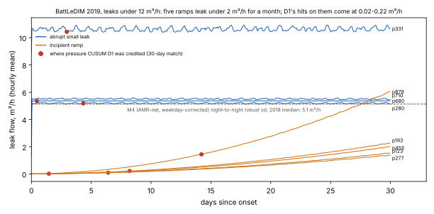

**Step 8 (2026-11-13): credit an alarm only once the leak is real, and the ranking flips.** Rescoring every detector so far under a pre-registered **flow-gated match** (an alarm counts for a leak only from the hour the leak's own flow reaches 1 m³/h, and within 30 days of that), the pressure CUSUM D1 falls to **11 of 19, P = 0.32 against chance**, while the smart-meter-corrected **night flow (M3) rises to 15 of 19 with 3 false alarms, P = 0.001**, below 0.005 at every gate from 0.5 to 5 m³/h. LILA stays above chance at 1 m³/h (13 of 19, P = 0.013) but not at 2 or 5 (P = 0.057, 0.072). Two of three predictions written before the run failed. The swing is two or three leaks out of 19: D1-F loses the ramps it was credited with while they leaked under 0.25 m³/h, and three night-flow alarms that were false under the old rule now fall in a ramp's window. That small a swing is the whole gap between "at chance" and "beats chance" here, so which detector "wins" on L-Town depends on a scoring choice no paper states.

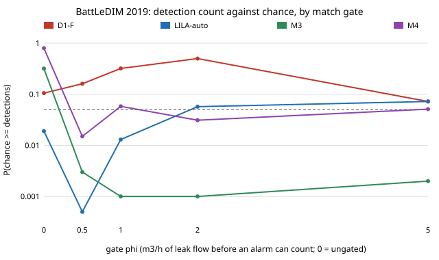

**Step 9 (2026-11-13): the verdict depends on the scoring rule, and no two detectors can be told apart.** Rescoring the same six detectors under six matching rules (a 14, 30 or 60-day window, with and without the 1 m³/h flow gate), with chance recomputed under each, **three of six detectors switch between "beats chance" and "at chance"** depending on the rule: the pressure CUSUM D1 beats chance (P &lt; 0.05) under 2 of the 6 rules, night flow M1 under 4, the smart-meter-corrected night flow M3 under 3 (all three gated ones). LILA is below 0.05 under all 6, but after a Holm correction across the six detectors under only 2. And on the 19 test leaks **no pair of detectors differs** at the primary rule: the smallest Holm-adjusted sign-test P over 15 pairs is 0.59, and M3's 4-leak lead over D1 has a bootstrap interval of 0 to +8. Three of four predictions written before the run held; the fourth (D1 never beats chance) failed at the 14- and 60-day ungated windows. The 300 m location score beats chance (P &lt; 0.001) under every rule.

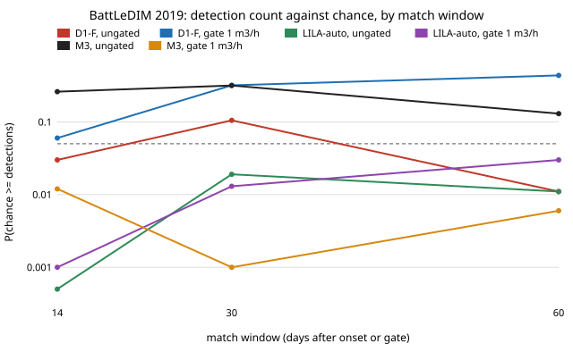

**Step 10 (2026-11-13): tune on one year, test on the other, and nothing survives.** Swapping the years (thresholds chosen on 2019, scored once on 2018's 13 leaks) and pooling with the forward fold gives **32 held-out leaks**. Under the primary flow-gated rule **no detector's pooled count beats chance after a Holm correction** (smallest 0.27; LILA 22 of 32 and smart-meter night flow M3 21 of 32, both P &asymp; 0.05 unadjusted). **M3's step-8 lead does not carry over**: it finds 15 of 19 leaks in 2019 but 6 of 13 in 2018, against 8 for the pressure CUSUM and 9 for LILA. Five of six thresholds move when the tuning year changes. Only LILA under the old ungated rule survives (24 of 32, Holm P = 0.024), and on 32 leaks still no pair of detectors differs (smallest Holm P 0.86).

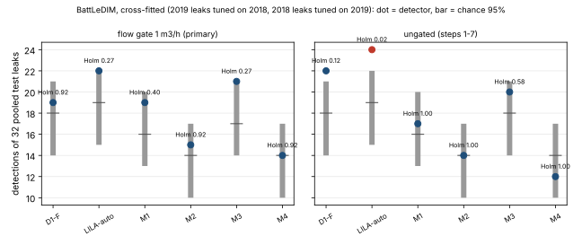

**Step 11 (2026-11-13): where is the leak? Ten times better than chance, no better than the obvious sensor.** Leak localisation with WNTR sensitivities on the nominal L-Town model (782 junctions simulated, correlation with the pressure residual) puts **31% (D1-F) and 36% (LILA) of the detected 2019 leaks within BattLeDIM's 300 m**, and 47% of all 32 leaks when localised at half-peak flow; a random junction manages about 4%. But naming the sensor whose pressure fell most does as well (13 of 32, median error 420 m against the model's 436 m; paired P = 0.75). Pre-registered H3 is inconclusive; an uncalibrated nominal model adds nothing on this benchmark ([step 11](#step-11-model-based-localisation-on-the-nominal-model-srcwater_leakslocalisepy-experimentsstep11-localise)).

**Step 12 (2026-11-14): richer leak signatures make localisation worse.** Two textbook fixes to step 11's localiser, a time-resolved (hour-by-hour) signature and a leak size estimated from the inflow balance, put **12 of 32 leaks within 300 m** (step 11's 24 h mean: 15; the most-affected sensor: 13). Under the pre-registered primary method, H3 is **refuted** (23% and 29% of detected 2019 leaks). The inflow balance sizes only 12 of 32 leaks within a factor of 2, and the nominal model's pump control adds a 0.9 m artefact at one hour of the day. Along the way, a rounding defect in step 11's scoring is fixed; no step 11 count changes ([step 12](#step-12-time-resolved-and-size-matched-signatures-experimentsstep12-timesize)).

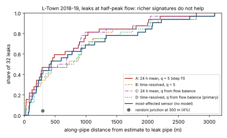

**Step 13 (2026-11-14): the published SICAMS detector, reimplemented and chance-corrected.** SICAMS (Melnikov 2025: Hotelling's T&sup2; on whitened sensor vectors, PELT change points, a hysteresis filter) reports the best 2019 detection of any L-Town paper with per-leak times: 14 of 19 new leaks (70% true-positive rate, 1 false alarm). **Replaying the paper's own published detection times on this harness, the count beats random alarms only thinly: 13 of 19 at 27 alarms (chance median 10, P = 0.057), or 14 at P = 0.026 when its one stated false alarm is added** (under the 30-day match, that alarm happens to land in another leak's window). Its timeliness is real: 9 of 19 within 72 h against a chance median of 2 (P &lt; 0.001). An **automatic reimplementation** (training hours and settings chosen by rule on 2018, no hand retraining) finds **13 of 19 with 26 false alarms, P = 0.82**: one 2018 false alarm at the chosen setting becomes 26 in 2019, as the statistic's daily swing grows with the year's pile-up of leaks. Its alarming sensor is within 300 m for 5 of the 13 (chance median 0, P &lt; 0.001). All four pre-registered predictions held, (b) only under its primary specification ([step 13](#step-13-sicams-reimplemented-and-its-published-times-chance-corrected-srcwater_leakssicamspy-experimentsstep13-sicams)).

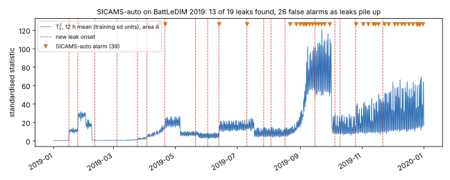

**Step 14 (2026-11-14): the same network with no leaks. The pressure detectors go silent; the night-flow detectors do not.** BattLeDIM's organisers published `L-TOWN_Real.inp`, the model their data were generated from, without leaks. Simulated over 2018-19 in EPANET, it reproduces the published pressures to the 0.01 m they are rounded to (99.6% of the first week's 5-minute readings exactly), so **the benchmark's SCADA data are model output plus leaks, with no sensor noise**, and the simulation is its exact no-leak counterfactual. On it, with every threshold frozen at its 2018 setting, the pressure CUSUM D1 raises **0 alarms in 716 days** and LILA **1**, against 26 each on the real data. The night-flow detectors raise as many as before (M1 28 against 25, M3 31 against 29), and **scored against the real leak list, M3's leak-free alarms are credited with 14 of the 19 new 2019 leaks**, one more than its real alarms and the same as random alarms (median 13). So the pressure detectors' near-chance counts come from matching alarms to overlapping leaks, not from false alarms, and steps 6 to 10's night-flow scores, step 8's P = 0.001 included, carry no evidence of detection. Two of four pre-registered predictions failed ([step 14](#step-14-leak-free-l-town-from-l-town_realinp-and-the-frozen-detectors-on-it-srcwater_leakssimulatepy-experimentsstep14-leakfree)).

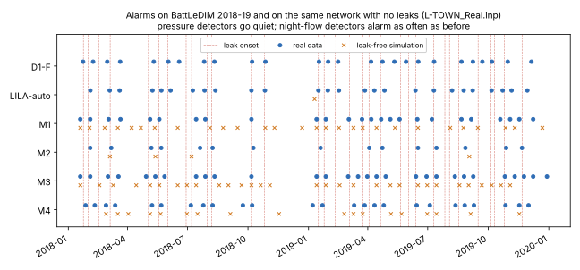

**Step 15 (2026-11-15): give the localiser a perfect residual, and it finds one more leak.** Because the published pressures are the organisers' model plus leaks (step 14), published minus leak-free pressure is the exact effect of the leaks: the best residual any detector could have. Localising the 32 leaks with the same nominal-model signatures on it puts **16 of 32 within 300 m, against 15 with step 11's regression residual** (paired P = 1.0) and 14 for the most-affected sensor (P = 0.73). The signatures fit the true leak effect closely (median correlation 0.97) yet miss half the leaks, because junctions hundreds of metres apart look alike at 33 sensors. So the nominal model, not the residual, limits localisation on L-Town (withdrawn by step 16: the exact model does no better, and the residual of the slow leaks is what fails). Detection is the other way round: every leak shows at some sensor within a median **0 h** of onset (at most 20 h), while the pressure CUSUM's alarms came a median **104 h** after onset and LILA's 138 h. All four pre-registered predictions held ([step 15](#step-15-localisation-on-the-oracle-residual-experimentsstep15-oracle)).

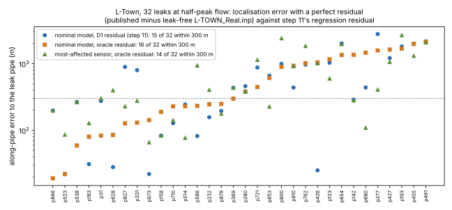

**Step 16 (2026-11-15): the exact hydraulic model does not localise leaks better; the slow leaks' residual is what fails.** Leak signatures from the organisers' own generating model, `L-TOWN_Real.inp`, restarted on each leak's day with its true tank and pump state and the leak's true size, put **15 of 32 leaks within 300 m**, against 16 for the nominal model and 14 for the sensor whose pressure fell most (paired P = 1.0 for both). All five pre-registered predictions failed, including the main one (at least 24 of 32). A post-hoc split shows where the loss is: **abrupt leaks localise 11 of 15 with any method, incipient leaks 4 of 17**. A slow leak reaches half its peak a median five weeks after onset, and by then the other leaks' flows have changed by 2.7 times its own, so its residual is mostly other leaks. This corrects step 15's reading: on L-Town the nominal model is not what limits localisation ([step 16](#step-16-the-generators-model-on-each-leaks-day-experimentsstep16-realday)).

**Step 17 (2026-11-15): take the other leaks out of the residual, and localisation goes from 15 to 27 of 32 leaks within 300 m.** Replaying every other leak through the organisers' generating model (each leak pipe split at its midpoint, drawing its published flow) reproduces the published pressures exactly (median difference 0.0000 m), so published minus that replay is one leak's own pressure effect. On it, the generator's-model localiser puts **27 of 32 leaks within 300 m** (median error 56 m; step 16 on the old residual: 15; paired P = 0.004), the **slow, incipient leaks 14 of 17** (step 16: 4), and even the uncalibrated nominal model **28 of 32**; naming the sensor whose pressure fell most manages 20 (P = 0.065 against the model). Four of five pre-registered predictions held. On L-Town the limit on leak localisation is the residual (other leaks' changes in it), not the hydraulic model and not the 33 sensors. Every input here is an oracle, so it is an upper bound; the open problem is a residual a utility could compute that removes the other leaks ([step 17](#step-17-a-per-leak-oracle-residual-the-other-leaks-replayed-srcwater_leaksreplaypy-experimentsstep17-replay)).

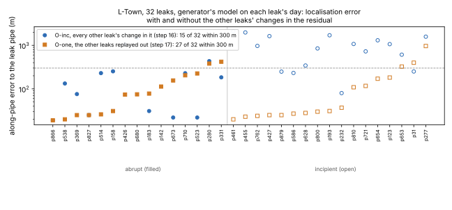

**Step 18 (2026-11-15): a residual a utility could compute, the change against the same hours a week earlier, finds only 12 of 32 leaks within 300 m.** With no model and no leak list in the residual (published pressure over a day minus the same hours a week before), the nominal-model localiser puts **12 of 32 within 300 m, slow leaks 4 of 17**: no better than step 11's regression residual (15; paired P = 0.45) or naming the sensor whose pressure fell most (12), and 16 leaks short of step 17's oracle (28). Removing week-to-week demand change with the leak-free model does not help (11), and no lag from 24 h to two weeks does better than 12. Three of five pre-registered predictions failed. The leak flows say why: over a week the other leaks' flows change by about as much as a slow leak's own (median 2.7 against 2.3 m³/h), and only a third of the slow leak's own growth is left in the window. On L-Town the other leaks have to be modelled, not differenced away ([step 18](#step-18-a-lagged-tracking-baseline-with-no-leak-list-experimentsstep18-lagged)).

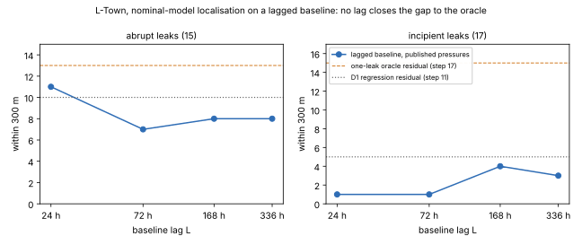

**Step 19 (2026-11-16): model the other leaks instead of differencing them away, and the slow leaks show up in the fit but the localiser still misses them.** A joint fit of the network's leak effect (published minus leak-free pressure, a demand oracle with no leak list) as a non-negative sum of the nominal model's leak signatures, refitted a week later from the same atoms, with the leak placed at the junction whose fitted flow rose most, puts **11 of 32 leaks within 300 m, slow leaks 1 of 17**: the same as step 18's lagged difference (11; paired 4 against 4) and below D1's regression residual (15). Four of five pre-registered predictions failed. The fit is good (it leaves a median 4.6% of the signal), and after the run we found that its atom set has an atom within 300 m of **10 of the 17 slow leaks** against 5.5 expected if as many atoms were drawn at random (P = 0.016). The largest-rise rule picks only 1 of those 10, because a slow leak is already in last week's fit and barely grows inside a week. Finding the slow leak is not the problem on L-Town; telling which fitted source is new is ([step 19](#step-19-a-joint-multi-source-fit-experimentsstep19-joint)).

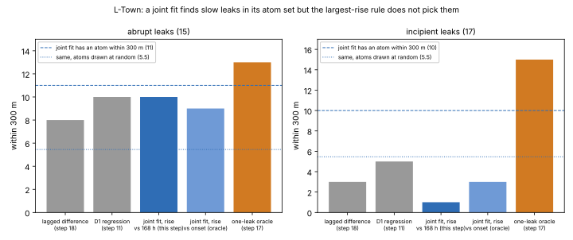

**Step 20 (2026-11-16): tracking every fitted leak source day by day and picking the newest one localises fewer leaks, not more.** On a residual a utility could compute from its own SCADA data (pressure minus a regression frozen on the first two weeks of 2018; no hydraulic model, no leak list), a daily tracker refits the network's leak effect each day from the previous day's sources, dates each source by the day it entered, and places a new leak at the active source with the latest onset. It puts **8 of 32 leaks within 300 m, slow leaks 2 of 17**, against **14 for step 19's two-window rule on the same residual** (paired 3 against 9, P = 0.15) and 15 for D1 (P = 0.039). Five of six pre-registered predictions failed. The tracker keeps a median 20 sources active and starts a new one every three to four days, so the newest source is usually drift or another leak; only 4 of the 17 slow leaks get a source dated to their own start ([step 20](#step-20-a-daily-tracker-that-dates-each-fitted-source-experimentsstep20-tracker)).

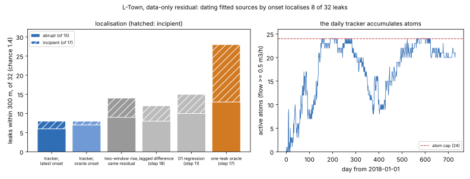

**Step 21 (2026-11-16): the same tracker on a residual with demand removed finds 13 of 32 leaks within 300 m and dates 9 of the 17 slow leaks to their start, so step 20's failure was the residual's drift.** Run unchanged on step 19's demand-oracle residual (published pressure minus the generator's leak-free run), the daily tracker keeps a median **8 sources active instead of 20**, places **13 of 32 leaks within 300 m (slow leaks 3 of 17)** against 8 on the data-only residual, and gives **9 of the 17 slow leaks a source dated to their own start** (4 before). Five of six pre-registered predictions held; the one that failed is the paired test against step 20 (9 against 4 leaks, P = 0.27), so on 32 leaks the gain is not significant, and 13 is level with D1's 15, far from the oracle's 28. The slow leaks are now in the dated set but their sources enter a median 18 days late, behind newer ones, so "pick the newest" still misses them ([step 21](#step-21-the-same-tracker-on-the-demand-oracle-residual-experimentsstep21-tracker-d)).

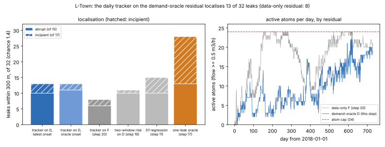

**Step 22 (2026-11-16): choosing the fastest-rising recent source instead of the newest doubles the slow leaks found, at the cost of two bursts.** On the same demand-oracle residual and tracker as step 21, the estimate becomes the source dated within the last 30 days whose fitted flow rose fastest over two weeks. It places **14 of 32 leaks within 300 m and 6 of the 17 slow leaks** (step 21's newest source: 13 and 3; the regression residual D1: 15 and 5), but only 8 of the 15 abrupt leaks against 10 (our reading, not tested: a burst's source jumps once and goes flat, so a concurrent ramp outruns it). Two of five pre-registered predictions held, and the net gain is one leak (5 against 4, P = 1.0). The two rules hit different leaks and together cover 18 of 32, so the next estimate should test each source's shape, a step or a ramp ([step 22](#step-22-the-steepest-rising-dated-source-experimentsstep22-steepest)).

**Step 23 (2026-11-17): a step-or-ramp fit labels the slow leaks right, but timing the change undoes it.** On the same residual and tracker, each source dated within 30 days gets a one-change fit, a step or a ramp, and the estimate is the source whose change is timed nearest the alarm (a step at its start, a ramp at its half level). **Every slow leak's nearby source is fitted as a ramp (8 of 8)**, yet the rule places **13 of 32 within 300 m and 3 of the 17 slow leaks**, step 21's newest-source result again, against step 22's 6. A slow leak is still rising at the alarm, so its ramp's half-level day falls a median 4 days before it, and the newest source wins. Three of five pre-registered predictions failed. What carries forward is the label, not the timing: candidates are mostly steps (a median 1 ramp among 6), so the next test is to use the shape to choose the score ([step 23](#step-23-a-step-or-ramp-fit-per-dated-source-experimentsstep23-shape)).

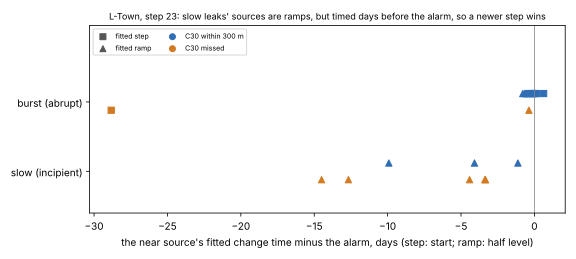

**Step 24 (2026-11-17): letting the fitted shape choose the score finds 15 of 32 leaks within 300 m and keeps both the slow leaks and the bursts.** On the same demand-oracle residual and tracker, the estimate is the steepest fitted ramp among the sources dated within 30 days when any of them fits as a ramp, and the newest source otherwise. It places **15 of 32 within 300 m, 6 of the 17 slow leaks and 9 of the 15 bursts** (step 22's steepest source: 14, 6, 8; step 21's newest: 13, 3, 10), and where a ramp source lies within 300 m it places the leak within 300 m for 11 of 13. Four of five pre-registered predictions held; the paired test against the newest source failed (3 against 1, P = 0.63), the rule was chosen after seeing step 23's per-leak shapes on these same leaks, and 15 is only level with the plain regression residual D1 (15), 13 short of the one-leak oracle. The remaining misses are the 15 leaks with no ramp source at all, where the rule is the newest source by construction ([step 24](#step-24-the-shape-chooses-the-score-experimentsstep24-shape-chosen)).

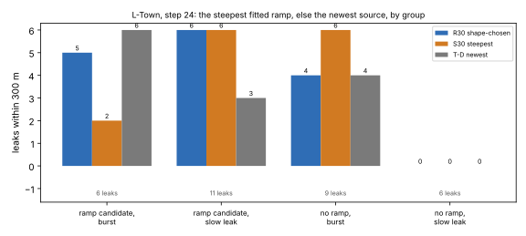

**Step 25 (2026-11-17): on 64 new leaks it had never seen, step 24's rule beats the newest-source rule, 25 against 16 within 300 m (P = 0.022).** To test step 24's rule out of sample, 64 new leaks were simulated through the benchmark's own generator model (`L-TOWN_Real.inp`), each copying the type, size, rise and duration of one of BattLeDIM's 33 leaks but at a new junction (more than 300 m from every real leak) and a new start time, and their pressure effect was added to the published 2018-19 pressures, so the real leaks, demand mismatch and rounding all stay in. With the tracker and every setting frozen, the steepest fitted ramp, else the newest source (R30), places **25 of 64 within 300 m (chance 2.1; median error 475 m), 13 of the 37 slow leaks and 12 of the 27 bursts**; the newest source (T-D) places 16 (5 slow, 11 bursts). Paired, **R30 alone hits 11 and T-D alone 2 (exact sign test P = 0.022)**; R30 also leads the steepest rise (21) and the shape-timed rule (19), though not significantly. All six pre-registered predictions held. Where a ramp-shaped source lies within 300 m, R30 picks within 300 m for 21 of 23. Three things remain: the residual is still the demand oracle D, the alarm hour is still the oracle's, and the 21 leaks with no ramp source are where the rule is weakest (4 hits). Adding eight leaks to the year also moved the real 32 leaks' result a lot: 6 to 15 within 300 m by set ([step 25](#step-25-a-held-out-check-on-64-injected-leaks-experimentsstep25-heldout)).

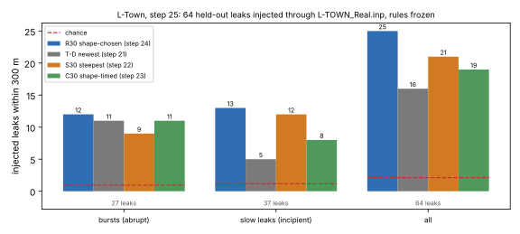

**Step 26 (2026-11-17): with a real detector's alarm in place of the oracle hour, the localiser keeps about half of its hits.** Steps 15 to 25 localised each leak on the day its own flow first reached half its peak, a time no utility knows. Here the project's own pressure detector (D1, thresholds frozen from 2018) raises the alarm and step 24's rule (R30) localises on the alarm day. **On the 30 of 64 injected leaks D1 detects, R30 places 8 within 300 m at the alarm day against 15 at the oracle day** (2 against 9 discordant, P = 0.065). That is still far above chance (1.0 expected, P = 4e-6), and the newest-source rule does no better (7). On the 10 real 2019 leaks it detects, R30 places 2 at the alarm day against 6 at the oracle day. End to end, detect-then-localise places **8 of 64 injected and 2 of 19 real 2019 leaks** within 300 m. Two of the six pre-registered predictions held and four failed. A sweep after the run shows why: **moving the oracle day by one day already costs 2 to 6 hits** (real leaks 15 to 13 or 10, injected 25 to 19 or 22). So the localisation figures of steps 21 to 25 are upper bounds for a pipeline, tuned to an exact day that no detector supplies ([step 26](#step-26-a-detectors-alarm-in-place-of-the-oracle-hour-experimentsstep26-alarm-timed)).

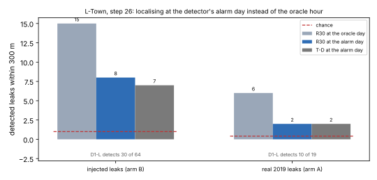

**Step 27 (2026-11-19): no fixed offset from the detector's alarm recovers the oracle day.** Step 26 lost half of R30's hits by localising on the alarm day instead of the oracle half-peak day. Seventeen re-timing rules (localise a set number of days before or after the alarm, or take the location picked most often over a window of days around it) were compared on the 28 leaks D1-L detects in 2018, real and injected together. The best there, a vote over the four days before the alarm and the alarm day (10 against 8), was frozen and scored on the 22 detected 2019 leaks. **It places 4 within 300 m, against 3 for the plain alarm day and 12 at the oracle day** (chance 0.8, P = 0.007). Three of five pre-registered predictions held (more hits than the alarm day, above chance, the 2018 gain kept per leak), but the gain is one leak (1 against 0 discordant), and the rules' 2018 ranking does not carry to 2019 (Spearman 0.09). The oracle day's advantage is leak-specific timing the alarm does not carry, so the next detector should run on the residual D, where a leak shows within hours ([step 27](#step-27-re-timing-r30-to-the-alarm-experimentsstep27-retimed)).

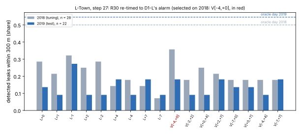

**Step 28 (2026-11-19): a leak detector on the clean residual alarms early, but a slow leak is too small to localise then.** Step 27 blamed the detector's timing. So the same CUSUM detector was run on the residual D (published pressures minus the leak-free simulation), with its threshold set on 2018 by step 1's rule (h = 40). It detects more leaks, **28 of the 48 that start in 2019 against 22**, but it places **4 within 300 m end to end, no more than before**, and it raises 5 false alarms in 2019 against 3. Five of six pre-registered predictions failed. A post-hoc split shows why. Measured from the leak's onset, both detectors alarm at a steady point, 3 to 6 days in. An incipient (slowly growing) leak only reaches half its peak flow about 35 days after onset, so at the alarm it is still small. R30 at the alarm places **11 of 29 abrupt leaks but 2 of 27 incipient ones**. Detection is early enough; localisation has to wait for the leak to grow ([step 28](#step-28-a-detector-on-the-residual-d-experimentsstep28-detector-on-d)).

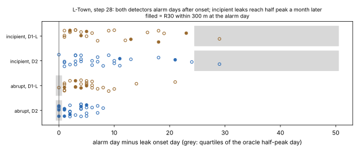

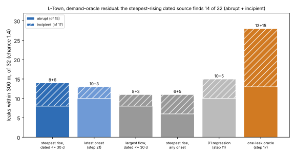

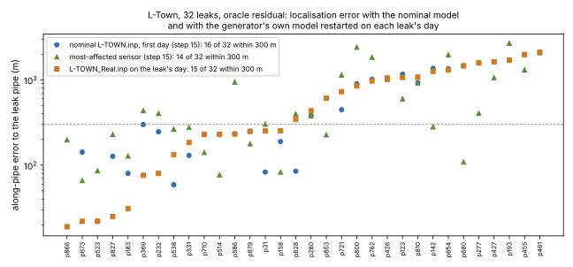

We also found that **the released LILA identification code is not a blind detector**: its notebook writes in, for each known 2019 leak, the pipe, its most affected sensor and the calibration windows, and then dates that one leak (it prints a 0 h delay for p523). Our automatic version runs LILA's identification over a whole year without those inputs; we know of no earlier such run.

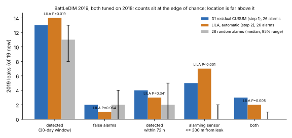

## Why this question

Every L-Town result we could read reports true-positive rates and false-alarm counts (Melnikov 2025, Table 2, gathers the top BattLeDIM teams: 43 to 74% of 23 leaks, 1 to 4 false alarms) and none a chance level. L-Town's 2019 has 23 leaks, many running for months, so a generous matching window covers much of the year. The competition's own rule needed a reported pipe within 300 m, which is what gives its score teeth; our step 1 measures how much. The programme then asks for a detector whose false-alarm rate is fixed before the year is seen (an e-process threshold), and for localisation on the nominal model ([`PROPOSAL.md`](PROPOSAL.md), H1 to H4).

**Builds on.** The BattLeDIM benchmark (Vrachimis et al. 2022, [doi:10.1061/(ASCE)WR.1943-5452.0001601](https://doi.org/10.1061/(ASCE)WR.1943-5452.0001601); data [doi:10.5281/zenodo.4017659](https://doi.org/10.5281/zenodo.4017659)); the data-driven entries LILA (Daniel et al. 2022, [doi:10.1061/(ASCE)WR.1943-5452.0001535](https://doi.org/10.1061/(ASCE)WR.1943-5452.0001535)) and SICAMS (Melnikov 2025, [arXiv:2512.15685](https://arxiv.org/abs/2512.15685)), whose leak-onset table our ground truth matches; Page's (1954) CUSUM ([doi:10.1093/biomet/41.1-2.100](https://doi.org/10.1093/biomet/41.1-2.100)). LILA's released identification code ([SWN-group-at-TU-Berlin/LILA](https://github.com/SWN-group-at-TU-Berlin/LILA), GPL-3.0), read for step 2. Our own [`infra-waterloss`](../infra-waterloss) and [`infra-leakpdd`](../infra-leakpdd). Full related work: [`PROPOSAL.md`](PROPOSAL.md).

## Method (step 1)

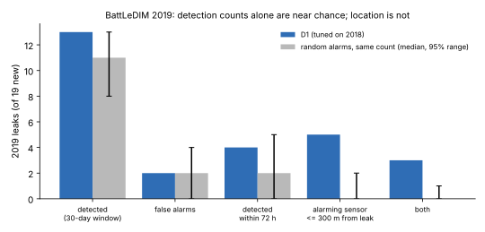

- **Data (`src/water_leaks/data.py`).** Fetched from Zenodo record 4017659 (or, when Zenodo is unreachable, from two public GitHub copies pinned to a commit, accepted only if the SHA-256 matches Zenodo's) into a cache (`$WATER_LEAKS_CACHE`, default `~/.cache/water-leaks`), checked by SHA-256; not copied into the repository. Hourly means of the 5-minute data.
- **Ground truth (`score.py`).** A leak's onset is the first non-zero flow in `<year>_Leakages.csv` (it matches the onsets in Melnikov 2025's appendix table; the configuration file's start times differ for incipient leaks). The four leaks running from 2018 into 2019 (p257, p427, p654, p810) keep their 2018 onset, so 2019 has 19 new leaks.
- **Detector D1 (`detect.py`).** For each pressure sensor and day, least squares on 48 hour-of-day × weekday/weekend indicators, the tank level and (variant F) the three inlet flows, fitted on the days [d − 21, d − 7) so a new leak is not absorbed for a week; residuals standardised by the window's residual sd; a one-sided CUSUM per sensor on the negative residuals (k = 0.5); an alarm resets every CUSUM and re-anchors the window at the alarm day, so the declared leak becomes baseline, and scoring resumes once the window holds 7 days (14 days blind after an alarm).
- **Tuning.** On 2018 only: the threshold h with the most 2018 detections at no more than 2 false alarms (13 values from 10 to 480). 2018's labels are used, which BattLeDIM's competitors did not have (they had repair times).
- **Matching.** An alarm counts for the running, unmatched leak with the latest onset if it falls within 30 days of that onset; any other alarm is false. Detection only: no pipe is reported, so this is not the competition's score.
- **Chance level.** The same number of alarms over the same 2018-19 period, at random hours at least 14 days apart (D1's blind time; drawn uniformly over such spaced sets), each from a random sensor, scored identically; 1,000 seeded draws.
- **Distances (`network.py`).** From the alarming sensor's node to the leak pipe's midpoint, straight and along the pipe graph (pumps and valves as zero-length links), from `L-TOWN.inp`.

## Results (`experiments/step1-baseline/results.txt`; deterministic)

| 2019, 19 new leaks | D1-F (with flows, h = 240) | chance, same 26 alarms: median (95%) | P(chance ≥ D1) |
|---|---|---|---|
| detected (30-day window) | 13 | 11 (8 to 13) | 0.105 |
| false alarms | 2 | 2 (0 to 4) | 0.778 |
| detected within 72 h | 4 | 2 (0 to 5) | 0.145 |
| alarming sensor ≤ 300 m along pipes | 5 | 0 (0 to 2) | < 0.001 |
| both | 3 | 0 (0 to 1) | < 0.001 |

- **Per leak.** The first big burst is caught within a day (p523, 28 m³/h peak, at +22 h by n506, 86 m away), and the small abrupt p680 (5.4 m³/h) at +11 h by a sensor 288 m away. The second burst, p827 (26 m³/h), starts 9 days after p523's alarm, inside the 14-day blind time the re-anchoring costs, and is caught only at +146 h: the price of that design, and a target for the next one. Median delay over the 13 is 104 h (11 to 341). Missed: p277, p586, p653, p710, p721, p762 (5.6 to 20.5 m³/h peak). Full table in `results.txt`.
- **On BattLeDIM's 23-leak count**, adding the 3 of 4 carried-over leaks D1 found in 2018: 16 of 23 detected, without localisation. The published 15 to 17 of 23 (Steffelbauer et al. 2022, SICAMS, Barros et al. 2025, as tabulated by Melnikov 2025) required a pipe within 300 m, so they are not comparable with this number.
- **Without flows (variant L, h = 80):** 10 of 19 with 3 false alarms, below chance on the count (P = 0.878) but 6 within 300 m (P < 0.001).
- **Water.** 64% of the 2019 new leaks' volume (285,791 of 444,340 m³) flows after D1's alarms: the share an instant repair on alarm would save. An upper bound on value, since repairs take days.
- **Pre-registered H1-step1** (at least 9 of 19 with at most 4 false alarms): held, and is uninformative, since chance alone reaches 11. Logged in [`LOG.md`](LOG.md) with the design change made after a first look at 2019.

### Checks (`tests/`, 44)
Decimal-comma SCADA parsing; leak list from the configuration file; hourly means; weekday/weekend columns; a synthetic 10-sd step on one of three sensors gives residuals below −5 and one alarm within a day (and the old hold-off version alarms twice); CUSUM ignores upward shifts; matching picks the latest onset and closes the 30-day window; carried-over leaks keep their 2018 onset; graph and straight distances on a three-link network. Step 2: pairwise models reconstruct leak-free data and predict each sensor itself exactly; a 1 m drop at one sensor gets every model's vote, while other sensors tie with it in more than half the steps and the norm tie-break finds it every time; automatic LILA raises one alarm for a step, at that sensor, within a day; a sensor rarely the MAS keeps a finite sd. Step 6: the water balance removes the tank's storage change; the night minimum uses hours 00 to 05 only; a 5-sd step in synthetic night minima alarms once within three nights and is then absorbed. Step 7: weekday offsets recover a planted weekly pattern and ignore nights outside the training set.

## Step 2: LILA, automatic (`src/water_leaks/lila.py`, `experiments/step2-lila/`)

**Method.** LILA's leakage identification (Daniel et al. 2022) reimplemented under MIT from the paper and from reading the authors' GPL-3.0 code (no code copied): LI-1, for every ordered pair of the 33 pressure sensors, a regression of p<sub>j</sub> on p<sub>i</sub> and the main inlet flow PUMP_1; LI-2, at each hour the most affected sensor (MAS) is the one the most models find lower than predicted, and its reconstruction error (MRE) is the norm of its errors; LI-3, Montgomery's tabular CUSUM on each sensor's MRE with slack delta/2 sd and threshold C_thr sd. To run it blind, the reference period is D1's trailing window (two weeks ending a week back, re-anchored after each alarm). One change from the released code, fixed before any score: a sensor rarely the MAS in its window gets the median sd, not NaN, which would switch it off for good. Grid: delta in {1, 2, 4} by C_thr in {3 ... 300} and the 2018 selection rule of step 1, written in [`LOG.md`](LOG.md) before any score was seen.

**Results** (`experiments/step2-lila/results.txt`, deterministic). Chosen on 2018: delta = 1, C_thr = 20 (2018: 11 of 13, 0 false alarms).

| 2019, 19 new leaks | LILA-auto | D1-F (step 1) | chance, 26 alarms: median (95%) | P(chance ≥ LILA) |
|---|---|---|---|---|
| detected (30-day window) | 14 | 13 | 11 (8 to 13) | 0.019 |
| false alarms | 1 | 2 | 2 (0 to 4) | 0.964 |
| detected within 72 h | 3 | 4 | 2 (0 to 5) | 0.341 |
| alarming sensor ≤ 300 m along pipes | 7 | 5 | 0 (0 to 2) | < 0.001 |
| both | 2 | 3 | 0 (0 to 1) | 0.005 |

- **Per leak.** p523 (28 m³/h) and p680 (5.4 m³/h) at +2 h, each with the MAS within 300 m; median delay 138 h (2 to 301). Missed: p123, p142, p193, p586, p653 (9 to 27 m³/h). On BattLeDIM's 23-leak count, 16 of 23 with the 2 carried-over leaks found in 2018, the same as D1 and, again, without a reported pipe.
- **H1 (pre-registered) is refuted on its letter**: the 2018-chosen LILA setting raises 26 alarms and its detection count has P = 0.019. The refutation is thin. Across the grid, 2 of the 13 settings with 20 or more alarms have P < 0.05 (300 draws each), and the margin is one leak above chance's 97.5th percentile.
- **LI-2's vote ties often.** In 46% of the hours from 15 January to 14 February 2018, more than one sensor has the top vote count: the inlet flow drives every sensor, so all models agree on the sign of a sensor's own noise. The pre-registered rule takes the lowest sensor index (an argmax). **Ablation added after seeing 2019:** breaking ties by the largest error norm, same grid and 2018 rule, gives 13 of 19 with 2 false alarms and 28 alarms, P = 0.265 on the count, 6 within 300 m (P < 0.001). The count's significance depends on a tie-break; the location result does not.

## Step 6: minimum night flow (`src/water_leaks/mnf.py`, `experiments/step6-mnf/`)

Plan, set before any night-flow series was computed: [`LOG.md`](LOG.md), 2026-11-13.

**Question (H4).** For incipient leaks, does a minimum-night-flow (MNF) statistic on the district water balance detect sooner than pressure CUSUM? MNF is how water-loss practitioners track leakage between surveys: at night, legitimate use is lowest, so a rise in the minimum flow is read as new leakage.

**Method.** From `L-TOWN.inp`: reservoirs R1 and R2 feed the network through the metered pipes p227 and p235, and PUMP_1 lifts water into tank T1 (16 m diameter), which drains back into the network, so the pump flow is internal. District demand plus leakage is Q = p227 + p235 − 201.06 · dL/dt (hourly means). Each night's statistic is the least hourly Q from 00:00 to 06:00, time-stamped 06:00. Detector M1 standardises it by the median and 1.4826 × MAD of D1's trailing window (two weeks ending a week back, re-anchored after an alarm) and runs an upward CUSUM (k = 0.5) with threshold h from {1, 2, 3, 5, 8, 12, 20, 30, 50}, chosen on 2018 by step 1's rule. The incipient set is the 9 new 2019 leaks with peak under 12 m³/h (the leak-type list in the configuration file was unreachable). Misses count as infinite delay.

**Results** (`experiments/step6-mnf/results.txt`, deterministic). Chosen on 2018: h = 3 (8 of 13, no false alarm).

| 2019, 9 leaks under 12 m³/h | M1 (MNF) | D1-F (pressure CUSUM) | LILA-auto |
|---|---|---|---|
| detected | 3 | 7 | 7 |
| median delay (misses infinite) | missed | 154 h | 142 h |
| M1 earlier / later / both missed | | 1 / 6 / 2 | 1 / 6 / 2 |

- **H4 refuted.** M1's median delay on the 9 is a miss; a bootstrap over the leaks puts it below D1's in 0.3% of 2,000 resamples. Its one win is p331 (11 m³/h): 20 h against D1's 71 h.
- **Why.** The nightly minimum's robust sd over a two-week window is 10.7 m³/h at the median in 2018 (5 to 95%: 5.6 to 20.5), so a 5 m³/h leak is half a standard deviation and a 10 m³/h leak about one. Rough CUSUM arithmetic (not a measurement): at a shift of k = 0.5 sd the statistic has no drift, so the 5 m³/h leaks are not expected to be found at all, and at 1 sd it gains about 0.5 a night and needs about 6 full-size nights to pass h = 3. **Diagnostic, after the 2019 scores** (`experiments/step6-mnf/weekly.py`, 2018 only): the nightly minimum has a strong weekday pattern. Against a 7-night running median, Friday and Saturday early mornings sit +9.6 and +14.6 m³/h higher and Monday to Thursday 3 to 6 m³/h lower; removing the weekday means takes the spread from 10.1 to 7.1 m³/h. M1's median baseline does not model this, so that is the first fix to try, though 7 m³/h is still larger than the smallest leaks.
- **All 19 new leaks.** 10 detected, 6 false alarms, 25 alarms over both years; chance with 25 alarms detects a median 11 (P = 0.80), and its false-alarm count is above chance's (P = 0.003). On the 10 leaks of 12 m³/h and above, M1 finds 7 (median 211 h), D1 6 (134 h), LILA 7 (229 h).
- **Without the tank term** (ablation declared in the plan): the spread rises to 13.9 m³/h, the 2018 rule picks h = 5, and it detects 7 of 19 with 3 false alarms and the same 3 of the 9 small leaks. The tank correction is needed but does not rescue MNF.

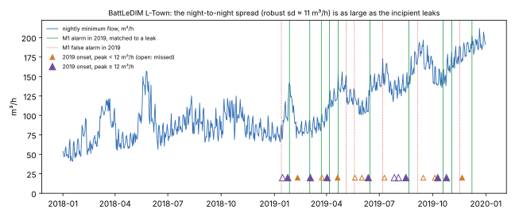

## Step 7: weekday and AMR-net night flow (`experiments/step7-mnf2/`)

Plan, set before either variant was computed and before any AMR value was read: [`LOG.md`](LOG.md), 2026-11-13 (step 7). It was written after step 6's 2019 scores and its post-hoc weekday diagnostic had been seen; 2019 has now been looked at through four night-flow detectors, and the results say so.

**Method.** Three series, each into step 6's detector, grid and 2018 selection rule unchanged. M2: the nightly minimum less weekday offsets fixed from 2018 (`mnf.weekday_offsets`: each night minus the median of the 7 nights centred on it, averaged by weekday). M3: the night balance net of the 82 AMR demands of `<year>_SCADA_Demands.csv` (hourly means, L/h to m³/h; a units check fixed in the plan: their 2018 median must be below the district balance's, and it is, 17.9 against 216.6 m³/h, 8.2%). M4: both, declared primary. Both Demands files came from Zenodo (reachable this time; the GitHub mirrors do not carry them) and are checked by SHA-256.

**Results** (`experiments/step7-mnf2/results.txt`, deterministic; reran byte-identical apart from one relabelled line).

| | M1 (step 6) | M2 weekday | M3 AMR-net | **M4 both** | D1-F | LILA-auto |
|---|---|---|---|---|---|---|
| night-to-night robust sd, 2018 median (m³/h) | 10.7 | 6.43 | 9.48 | **5.13** | | |
| h chosen on 2018 | 3 | 12 | 3 | 3 | | |
| 9 leaks < 12 m³/h detected | 3 | 2 | 6 | **3** | 7 | 7 |
| median delay on the 9 (misses infinite) | missed | missed | 473 h | **missed** | 154 h | 142 h |
| all 19: detected / false alarms | 10 / 6 | 7 / 1 | 13 / 5 | 10 / 4 | 13 / 2 | 14 / 1 |
| P(chance ≥ detected) | 0.80 | 0.56 | 0.32 | 0.80 | 0.105 | 0.019 |

- **H4 refuted for all three**, M4 by the pre-registered test (bootstrap: M4's median below D1-F's in 7.4% of resamples). Three tries were made; none held.
- **Why (post-hoc, `visible.py`, using the leak flows; not a detector).** Five of the nine are incipient ramps (p123, p193, p277, p455, p879): their own night flow is 0.1 to 0.5 m³/h a week in and 1.3 to 6.0 m³/h at day 30, so the largest step a trailing-baseline detector can see inside the 30-day window is 0.07 to 0.39 of M4's local spread. The four abrupt ones (p280, p331, p680, p710, 5.3 to 10.9 m³/h) are 0.3 to 2.4 local spreads; M4 finds two of them, D1-F three, LILA all four.
- **The comparator's hits on the ramps are luck.** At the hour they were credited, the leak carried 0.10 (p123), 0.22 (p193) and 0.02 m³/h (p455) for D1-F, and 0.21 (p277) and 0.01 (p455) for LILA: far below anything a pressure sensor resolves on a network drawing 200 m³/h. D1-F's 154 h median on the 9 rests on them. Under a 30-day match, the incipient leaks of BattLeDIM reward chance, which is the programme's H1 in miniature.

## Step 8: flow-gated matching (`experiments/step8-gated/`)

Plan, set before any gated score was computed: [`LOG.md`](LOG.md), 2026-11-13 (step 8). Detectors are not re-tuned; this step changes only how alarms are scored.

**Method.** For each leak, the gate g(&phi;) is the first hour its hourly-mean flow in `<year>_Leakages.csv` reaches &phi; m³/h (`score.gate_events`); an alarm at t can match the leak only if g(&phi;) &le; t &le; min(end, g(&phi;) + 30 d), greedy as before; years are still assigned by the true onset (`harness.evaluate(..., onsets=)`). Primary &phi; = 1 m³/h, sweep 0, 0.5, 2, 5. Every detector's full 2018-19 alarm list is regenerated at its own step's 2018 setting, and the 2019 part is checked equal to that step's `alarms.tsv` before scoring (all six equal). The chance level uses the same gated rule. The gate is 0 to 1 h after onset for the abrupt leaks and 107 to 603 h for the ramps (p123 573 h, p193 463 h, p277 603 h, p455 497 h, p879 280 h at &phi; = 1).

**Results** (`experiments/step8-gated/results.txt`, deterministic). 2019 new leaks detected of 19 / false alarms, and P(chance &ge; detected), 1,000 draws:

| detector (alarms) | &phi; = 0 (steps 1-7) | 0.5 | **1 (primary)** | 2 | 5 |
|---|---|---|---|---|---|
| D1-F (26) | 13/2, 0.105 | 12/3, 0.160 | **11/4, 0.319** | 10/5, 0.498 | 12/3, 0.072 |
| LILA-auto (26) | 14/1, 0.019 | 15/0, 0.000 | **13/2, 0.013** | 12/3, 0.057 | 12/3, 0.072 |
| M1 night flow (25) | 10/6, 0.796 | 13/3, 0.015 | **13/3, 0.013** | 12/4, 0.031 | 11/5, 0.189 |
| M2 weekday (15) | 7/1, 0.570 | 7/1, 0.441 | **8/0, 0.131** | 8/0, 0.110 | 8/0, 0.110 |
| M3 AMR-net (29) | 13/5, 0.317 | 15/3, 0.003 | **15/3, 0.001** | 15/3, 0.001 | 15/3, 0.002 |
| M4 both (25) | 10/4, 0.796 | 13/1, 0.015 | **12/2, 0.058** | 12/2, 0.031 | 12/2, 0.051 |

- **Pre-registered predictions.** (a) D1-F and LILA-auto drop to 5 or fewer of the 9 small leaks: D1-F 7 &rarr; 5, LILA-auto 7 &rarr; 7, **failed** (LILA's ramp hits were re-matched by later alarms). (b) LILA-auto not below chance under the gate: P = 0.013, **failed**. (c) H4 still refuted (median delay from the gate on the 9 small leaks: M4 689 h against D1-F 115 h; M4 earlier on 3, later on 4; bootstrap 0.24): **held**.
- **The ranking flips.** Ungated, the pressure detectors led and no night-flow variant beat chance. Gated, D1-F is never below 0.05 at any &phi;, while M3 is below 0.005 at every &phi; &gt; 0 (six detectors at one &phi; is six tests; M3's 0.001 survives a Bonferroni factor of 6, LILA's 0.013 does not). Why, alarm by alarm (`gated.tsv`): at &phi; = 1 D1-F loses p123 and p193 (alarms 154 and 197 h after onset, before the gate) and p426 (its alarm now goes to p455, whose gate is later), and gains p721. M3's 2019-08-11 alarm moves from p721 to p586 (whose gate is now later), and 2019-09-08, false before, takes p721 36 days after its onset; 2019-10-26 moves from p426 to p455, and 11-10, false before, takes p426; 11-24 now falls before p879's gate and 12-08, false before, takes it. Net: two more leaks and two fewer false alarms. The gate moves each ramp's window to when it leaks; it also reshuffles which of two overlapping leaks an alarm credits, and on 19 leaks a reshuffle of two or three decides the P value.
- **What does not change.** Location: the alarming pressure sensor is within 300 m for 5 to 8 detected leaks against a chance median of 0 at every &phi; (P &lt; 0.001). Speed: M3 detects slowly (median 160 h from the gate on the 9 small leaks, D1-F 115 h; within 72 h of the gate: 5 of 19, P = 0.052).
- **Caveat.** The gate uses ground-truth leak flows, so it is a scoring rule, not something a detector sees; &phi; = 1 m³/h is a round figure (about 0.5% of L-Town's mean inflow), and the conclusion for M3 and D1-F holds over 0.5 to 5. The detectors were tuned on 2018 under the ungated rule; re-selecting under the gate is next.

## Step 9: matching-window ablation and paired tests (`experiments/step9-windows/`)

Plan, set before any windowed or paired score was computed: [`LOG.md`](LOG.md), 2026-11-13 (step 9). Scoring only; the six alarm lists are regenerated and checked equal to each step's `alarms.tsv` (all equal), and the 30-day cells reproduce step 8's numbers exactly.

**Method.** Match window w &isin; {14, 30, 60} days (`harness.evaluate(..., window=)`, default unchanged) &times; flow gate &phi; &isin; {0, 1} m³/h; chance under the same rule (1,000 draws, seed 0, alarms 14 days apart). P values Holm-adjusted across the six detectors within each rule. At the primary rule (30 d, &phi; = 1), per-leak detection for every pair of detectors, an exact two-sided sign (McNemar) test on the discordant leaks, Holm across the 15 pairs (`stats.sign_test`, `stats.holm`), and a bootstrap over the 19 leaks of the detection difference (2,000, seed 9).

**Results** (`experiments/step9-windows/results.txt`, `cells.tsv`, deterministic). 2019 new leaks detected of 19 / false alarms, P(chance &ge; detected):

| detector (alarms) | 14 d, ungated | 30 d, ungated | 60 d, ungated | 14 d, gated | **30 d, gated** | 60 d, gated | rules with P &lt; 0.05 |
|---|---|---|---|---|---|---|---|
| D1-F (26) | 12/3, 0.030 | 13/2, 0.105 | 15/0, 0.011 | 10/5, 0.060 | **11/4, 0.319** | 12/3, 0.437 | 2 |
| LILA-auto (26) | 14/1, 0.000 | 14/1, 0.019 | 15/0, 0.011 | 12/3, 0.001 | **13/2, 0.013** | 14/1, 0.030 | 6 (Holm: 2) |
| M1 night flow (25) | 7/9, 0.825 | 10/6, 0.796 | 14/2, 0.048 | 10/6, 0.045 | **13/3, 0.013** | 14/2, 0.013 | 4 |
| M2 weekday (15) | 7/1, 0.137 | 7/1, 0.570 | 8/0, 0.395 | 7/1, 0.052 | **8/0, 0.131** | 8/0, 0.327 | 0 |
| M3 AMR-net (29) | 11/7, 0.261 | 13/5, 0.317 | 15/3, 0.130 | 12/6, 0.012 | **15/3, 0.001** | 16/2, 0.006 | 3 (Holm: 2) |
| M4 both (25) | 10/4, 0.186 | 10/4, 0.796 | 13/1, 0.213 | 9/5, 0.174 | **12/2, 0.058** | 13/1, 0.084 | 0 |

Chance medians: 7 to 9 leaks at 14 days, 10 to 12 at 30, 11 to 13 at 60 (M2, with 15 alarms, 4 to 7).

- **Pre-registered predictions.** (a) M3 below 0.05 gated at every window (0.012, 0.001, 0.006): **held**. (b) D1-F never below 0.05: **failed** (0.030 at 14 d and 0.011 at 60 d ungated; with the gate it is never below 0.05). (c) No pair separable at Holm 0.05: **held** (smallest adjusted P 0.586, M2 against M3, 1 against 8 discordant leaks, raw P = 0.039). (d) Chance medians rise with the window: **held**.
- **Paired.** D1-F against M3: D1-F alone finds 1 leak, M3 alone 5 (P = 0.219); bootstrap of TP(M3) &minus; TP(D1-F) +4, 95% interval 0 to +8. LILA-auto against D1-F: +2 (&minus;3 to +7). The per-leak table is in `results.txt`: p762 is missed by all six; p331, p455, p514, p800 are found by all six.
- **What it means for the paper.** On 19 leaks, a detection count under one matching rule cannot rank these detectors, and a "beats chance" verdict for three of six flips with the rule. A chance-corrected protocol has to report the window and gate it used, the chance level under that rule, a multiplicity correction across the methods compared, and a paired test before claiming one method beats another. Under that protocol, LILA-auto and M3 are the two that survive Holm under some rule; nothing is shown to beat anything else.
- **Caveat.** Thresholds were still chosen on 2018 under the 30-day ungated rule; this step asks how the scores move with the rule, not what each detector would do tuned for it. Six rules were reported, not chosen among; the primary was fixed in step 8.

## Step 10: cross-fitted thresholds and pooled tests (`experiments/step10-crossfit/`)

Plan, set before any reverse-fold score was computed: [`LOG.md`](LOG.md), 2026-11-13 (step 10).

**Method.** Forward fold: each detector at the setting its own step chose on 2018, scored on 2019's 19 new leaks (alarm lists checked against each step's `alarms.tsv`). Reverse fold: the same grids (D1-F 13 values of h; LILA-auto 3 &times; 9; M1 to M4 9 values of h, M2 and M4's weekday offsets from 2019 nights), the same rule with the years swapped (most 2019 detections at &le; 2 2019 false alarms, ungated 30-day match), scored once on 2018's 13 leaks that start after the first scored hour. Pooled over 32 leaks: chance per fold with that fold's alarm count (1,000 draws, seeds 0 and 1), summed draw by draw; Holm across the six detectors; per-leak sign tests for the 15 pairs (Holm) and a bootstrap of the detection difference (2,000, seed 9).

**Results** (`experiments/step10-crossfit/results.txt`, `grid.tsv`, `pooled.tsv`; deterministic). Detected / false alarms:

| detector | forward setting &rarr; reverse | 2019 (fwd), gated | 2018 (rev), gated | **pooled, gated** (chance median; P; Holm) | pooled, ungated (P; Holm) |
|---|---|---|---|---|---|
| D1-F | h 240 &rarr; 240 | 11/19, 4 | 8/13, 2 | **19/32** (18; 0.307; 0.921) | 22/32 (0.023; 0.115) |
| LILA-auto | &delta; 1, C 20 &rarr; &delta; 2, C 10 | 13/19, 2 | 9/13, 3 | **22/32** (19; 0.049; 0.270) | 24/32 (0.004; **0.024**) |
| M1 | h 3 &rarr; 5 | 13/19, 3 | 6/13, 2 | **19/32** (16; 0.099; 0.396) | 17/32 (0.451; 1.000) |
| M2 | h 12 &rarr; 3 | 8/19, 0 | 7/13, 2 | **15/32** (14; 0.337; 0.921) | 14/32 (0.506; 1.000) |
| M3 | h 3 &rarr; 8 | 15/19, 3 | 6/13, 1 | **21/32** (17; 0.045; 0.270) | 20/32 (0.145; 0.580) |
| M4 | h 3 &rarr; 30 | 12/19, 2 | 2/13, 0 | **14/32** (14; 0.504; 0.921) | 12/32 (0.916; 1.000) |

- **Pre-registered predictions.** (a) M3 pooled beats chance at Holm 0.05: **failed** (0.270). (b) D1-F pooled P &ge; 0.05: **held** (0.307). (c) No pair separable at Holm 0.05: **held** (smallest 0.861, LILA-auto vs M4, 11 vs 3 discordant). (d) The reverse fold changes the setting of at least three detectors: **held** (five).
- **Paired.** TP(M3) &minus; TP(D1-F) +2 (95% &minus;4 to +8); TP(LILA-auto) &minus; TP(D1-F) +3 (&minus;3 to +9). p427, p654 (2018, both carried into 2019) and p762 (2019) are missed by all six.
- **What it means for the paper.** A detection-only ranking on BattLeDIM from one tuning year does not survive swapping the years: thresholds move, and the step-8 winner falls to the bottom half on the other year. The protocol needs a cross-fit clause next to the rule, chance level, multiplicity correction and paired test.
- **Caveat.** Cross-fitting removes label use from the thresholds only. The detector designs (M2 to M4 especially) were made after 2019 scores were seen, and 2018's tuning counts were printed by every earlier step.

## Step 11: model-based localisation on the nominal model (`src/water_leaks/localise.py`, `experiments/step11-localise/`)

Plan, set before any simulation or localisation was computed: [`LOG.md`](LOG.md), 2026-11-13 (step 11).

**Question.** Once a detector alarms, can the leak be placed within BattLeDIM's 300 m using the nominal hydraulic model `L-TOWN.inp`, and does that beat simply naming the sensor whose pressure fell most?

**Method.** WNTR 1.5.0 (Klise et al. 2017) runs EPANET on `L-TOWN.inp` for 24 h, once as given and once per junction (782) with a constant extra demand q at that junction; the signature is the 24 h mean pressure change at the 33 sensor nodes (q = 5 m³/h primary; 1 and 20 as a linearity check). The observed residual is each sensor's mean (pressure &minus; prediction) over the 24 h from the localisation hour, the prediction being step 1's regression without flows fitted on days [d &minus; 21, d &minus; 7). The estimate is the junction whose signature has the highest Pearson correlation with the residual (cosine as a secondary). Error is the along-pipe distance to the leak pipe; chance is a uniformly drawn junction (exact Poisson-binomial tail over the leaks' own 300 m shares, median 4.3%). Baseline without a model: the most-affected sensor (most negative residual). Localisation hours: (i) each 2019 leak's alarm from D1-F (step 1) and LILA-auto (step 2), for H3; (ii) every scored leak of both years at the first hour its flow reaches half its peak (oracle timing, 32 leaks).

**Results** (`experiments/step11-localise/results.txt`, `leaks.tsv`; deterministic):

| leaks localised | nominal model, within 300 m (P chance) | median error | most-affected sensor, within 300 m | median error | chance expects |
|---|---|---|---|---|---|
| D1-F's 13 detected (at alarm) | **4/13, 31%** (0.002) | 573 m | 5/13 (0.0001) | 705 m | 0.57 |
| LILA-auto's 14 detected (at alarm) | **5/14, 36%** (0.0002) | 468 m | 5/14 (0.0002) | 731 m | 0.59 |
| all 32 scored leaks (oracle, half-peak) | **15/32, 47%** (&lt; 0.0001) | 436 m | 13/32 (&lt; 0.0001) | 420 m | 1.40 |

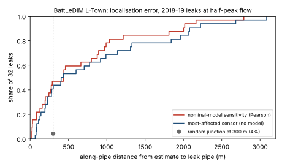

- **H3 is inconclusive**: 31% and 36% of detected 2019 leaks within 300 m, inside the proposal's 30 to 50% band. Both are about ten times chance.
- **The model does not beat the sensor.** On the 32 oracle-timed leaks, model-only hits 6, sensor-only 4 (sign test P = 0.75); the model's median error is 436 m against 420 m. LILA's own alarming sensor (its MAS) is within 300 m for 7 of its 14.
- **Pre-registered predictions.** (a) H3 not held: **held**. (b) Oracle-timed localisation beats chance: **held**. (c) Model's median error below the sensor's: **failed**. (d) Same junction for q = 1, 5, 20 on &ge; 80% of leaks: **failed** (12%): signatures grow faster than q (largest 0.04, 0.32, 2.8 m) and neighbouring junctions look alike at 33 sensors, so the argmax moves between neighbours.
- **Where it works and where it does not.** Of the 15 leaks that reach half their peak within an hour of onset, 10 are localised within 300 m (p523 22 m, p673 22 m, p426 25 m, p183 31 m); the slow ramps (p193, p277, p455, p123, p654) are 0.6 to 2.8 km off for every method.

## Step 12: time-resolved and size-matched signatures (`experiments/step12-timesize/`)

Plan, set before any new signature or localisation was computed: [`LOG.md`](LOG.md), 2026-11-14 (step 12).

**Question.** Step 11's localiser averaged the leak signature over 24 h and assumed a 5 m³/h leak, and its argmax moved with the assumed size. Does keeping the signature hour by hour, or sizing the leak from the flow balance, put more leaks within 300 m?

**Method.** As step 11, with each junction's pressure change at the 33 sensors kept for each of the 24 hours, at q = 1, 2, 5, 10, 20, 30 m³/h (4,692 EPANET runs). Time-resolved scoring correlates the 24 &times; 33 residual with each 24 &times; 33 signature, aligned by hour of day, each hour centred across sensors. Leak size q&#770;: the 24 h mean residual of the two reservoir inflows (p227 + p235) under the same regression, rounded to the nearest grid size in log scale. Methods: A (step 11: 24 h mean, q = 5), B (time-resolved, q = 5), C (24 h mean, q&#770;), **D (time-resolved, q&#770;; primary)**. A gate required A to reproduce step 11.

**Results** (`experiments/step12-timesize/results.txt`, `leaks.tsv`; deterministic):

| leaks localised | A | B | C | **D** | most-affected sensor | chance expects |
|---|---|---|---|---|---|---|
| D1-F's 13 detected (at alarm) | 4 | 2 | 3 | **3 (23%)** | 5 | 0.57 |
| LILA-auto's 14 detected (at alarm) | 5 | 3 | 4 | **4 (29%)** | 5 | 0.59 |
| all 32 scored leaks (oracle, half-peak) | 15 | 11 | 14 | **12** | 13 | 1.40 |
| median error on the 32 | 437 m | 712 m | 613 m | 746 m | 420 m | |

- **H3 refuted under D** (below the 30% line for both detectors); inconclusive under A, as in step 11. No method separates from the most-affected sensor (smallest Holm-adjusted sign-test P 1.000 in every set).
- **Pre-registered predictions.** (a) q&#770; within a factor of 2 of the leak's flow for &ge; 70% of the 32: **failed** (12 of 32; q&#770; is negative for 6, because day-to-day inflow noise is the size of the leaks). (b) D beats A: **failed** (12 against 15). (c) No method beats the sensor: **held**. (d) H3 not held under D: **held**.
- **Why** (after-the-run diagnostic, `diag_switch.txt`). In the nominal model PUMP_1 switches on tank T1's level. A leak at any of 92 junctions shifts the switch by an hour, which puts up to 0.87 m on sensor n54 at hour 17 even for a 1 m³/h leak (every other hour: at most 0.10 m). Leaving hours 15 to 17 out lowers B's and D's median errors to 581 and 563 m but not their 300 m hits (10 and 12). The rest is demand timing: the real network's hours do not follow the nominal patterns, and the 24 h mean averages that mismatch out.
- **Scoring fix.** Junction n111's signature is a uniform shift at every sensor, so its Pearson score is undefined, and float32 rounding (~1e-5 m) decided it. `localise.scores` now scores signatures below 1e-4 m RMS as 0. Step 11 reruns with every count unchanged; only its D1-F stability-in-q line moves (23% to 31%). The first run is kept as `results_firstrun.txt`.

## Step 13: SICAMS reimplemented, and its published times chance-corrected (`src/water_leaks/sicams.py`, `experiments/step13-sicams/`)

Plan, set before any SICAMS statistic was computed: [`LOG.md`](LOG.md), 2026-11-14 (step 13). Milestone 2's second half; arXiv was unreachable in earlier sessions.

**Question.** Melnikov (2025, [arXiv:2512.15685](https://arxiv.org/abs/2512.15685)) reports SICAMS at 69.6% true positives and 1 false alarm on BattLeDIM 2019, the best of the entries with per-leak times. How much of that is above chance, and what does the method score when the choices the paper made by hand (training periods, area C retraining, PELT penalty) are made by rule?

**Method.** From the paper's sections 3.2 to 3.5: per temporal cluster (hour of day in area A, 2-hour blocks in C, one in B) the training mean and covariance, and Hotelling's T&sup2; rescaled to F (eqs. 9, 10). Area A: 29 pressures, flows p227 and p235, tank T1 (s = 32), trained on the 1,682 hours of 2018 when only p257 and p427 leak (the paper's rule); PELT on the 12 h moving average, then Algorithm 2's paired t-tests label change points "anomaly start" (an alarm) or "end". Areas B (n215) and C (n1, n4, n31, T1): Algorithm 1's hysteresis filter with the F-quantile threshold (eq. 13). The alarm's sensor is the one with the largest mean z&sup2;, which is where the paper's Laplacian pre-localisation peaks (its section 5.2). PELT penalty, slope threshold and filter &alpha; (8 &times; 3 &times; 4) were chosen on 2018 by step 2's rule. Hourly means; offline PELT per year, as the paper ran it and as BattLeDIM was scored. Separately, the paper's Table 1 detection times were scored as alarms on the same harness.

**Results** (`experiments/step13-sicams/results.txt`, `alarms.tsv`; deterministic apart from the seeded chance draws):

| 2019, 19 new leaks | alarms (2018-19) | detected | chance median (95%) | P(chance &ge;) | within 72 h (P) | sensor &le; 300 m (P) | 2019 false alarms |
|---|---|---|---|---|---|---|---|
| published SICAMS times, Table 1 | 27 | 13 | 10 (6 to 13) | 0.057 | 9 (&lt; 0.001) | n/a (no sensor given) | 1 |
| published, plus its stated false alarm | 28 | 14 | 10 (6 to 14) | 0.026 | 9 (&lt; 0.001) | n/a | 1 |
| **SICAMS-auto (primary)**: c = 100, no retraining | 48 | **13** | 14 (11 to 17) | **0.82** | 9 (0.001) | 5 (&lt; 0.001) | **26** |
| SICAMS-auto, B and C re-anchored after alarms | 53 | 13 | 15 (11 to 18) | 0.93 | 9 (0.009) | 4 (&lt; 0.001) | 28 |

- **The paper's own times sit at the edge of chance on the detection-only count.** Under our 30-day greedy match they give 13 of 19, not the paper's 14: the p721 alarm (19-08-21) is credited to p800 (onset 08-16, later), and the p800 alarm (09-07) falls outside p721's 30-day window and counts as the one false alarm. Adding the paper's stated 2019 false alarm (p426, mislocalised) as one more alarm turns it into a hit on p762 (onset 10-10, inside the window). One alarm moves P across 0.05. Timeliness is the robust part: 9 within 72 h, P &lt; 0.001.
- **SICAMS-auto is no better than random on the detection count**, though it detects the abrupt leaks fast (p523, p827, p514, p142 at +5 to +9 h, each with its alarming sensor within 300 m) and finds p123 and p762, which the paper missed. Its 26 false alarms are PELT "starts" at 02:00 to 04:00 every few days from September: the T&sup2; series' daily swing grows with the leak load (figure), and a penalty tuned on 2018 (1 false alarm) does not hold for a year with more concurrent leaks. Across the grid, no setting's detection count beats chance (P from 0.107 at 16 alarms to 0.99); every setting's location count does (P &le; 0.01).
- **Pre-registered predictions.** (a) SICAMS-auto detects fewer than the paper's 14: **held** (13). (b) The published times beat chance at P &lt; 0.05: **held under the primary specification** (with the stated false alarm, P = 0.026), not on Table 1's times alone (P = 0.057). (c) SICAMS-auto's location count beats chance at P &lt; 0.01: **held** (P &lt; 0.001). (d) SICAMS-auto's detection count does not beat chance: **held** (P = 0.82).
- **For H1:** a third method, and the first published entry's own times, confirm the restated claim: detection-only counts on L-Town sit at or near chance, and location and timeliness carry the signal. For H2: a false-alarm rate tuned on 2018 does not transfer to 2019 (1 to 26 here), which is the case for a rate certified on leak-free operation.
- **Not reproduced:** the paper's manual retraining of area C before p31 and p277, its hand-picked training intervals beyond the stated rule, its 5-minute resolution, and Algorithm 2's unstated &alpha; and &delta; (fixed here at 0.05 and a grid). p680's detection time is misprinted in the paper's Table 1 (before onset); its &Delta;t (2 h) was used.

## Step 28: a detector on the residual D (`experiments/step28-detector-on-d/`)

Plan, set before any detector was run on D: [`LOG.md`](LOG.md), 2026-11-19 (step 28). Milestone 3, H3.

**Question.** Step 27 found that no fixed lag or vote around D1-L's alarm recovers the oracle half-peak day, and blamed the alarm's timing scatter (43 days before to 21 after). On the residual D a leak shows within hours (step 15). Does the same detector run on D alarm at a fixed point of the leak's rise, so that R30 at a lag set on 2018 places the 2019 leaks?

**Method.** D2 is step 1's D1 with D1-L's design (hour of day by weekend, tank level) and every setting frozen except the input: hourly D for the real leaks, each injected set's D<sub>inj</sub> for step 25's 64 injected leaks. Its threshold is step 1's rule on the 13 real 2018 leaks (most detected with at most 2 false alarms). Step 27's 17 re-timing rules were scored on D2's 28 detected 2018 leaks, one was frozen, and only then were the 2019 leaks scored.

**Results** (`experiments/step28-detector-on-d/results.txt`, `hgrid.tsv`, `rules.tsv`, `leaks.tsv`; deterministic; seconds once step 26's inputs are cached).

| | D1-L on raw pressures (steps 26 and 27) | D2 on the residual D |
|---|---|---|
| threshold h (set on 2018) | 80 | 40 |
| 2019 leaks detected (of 48: 19 real, 29 injected) | 22 | **28** |
| 2019 false alarms, published data | 3 | 5 |
| rule selected on 2018 | V[&minus;4, 0] | L0 (the alarm day) |
| 2019 end to end, detected and within 300 m | 4 | **4** (P = 0.017 against chance 1.0) |
| median \|alarm day &minus; half-peak day\| | 6.5 days | 5.0 days |

- **Pre-registered predictions.** (a) median gap to the half-peak day at most 3 days: **failed** (5.0). (b) at least 22 of 48 detected: **held** (28). (c) more than 4 end to end: **failed** (4), the primary. (d) at least 8: **failed**. (e) above chance at P &lt; 0.01: **failed** (0.017). (f) at most 3 false alarms in 2019: **failed** (5).
- **No verdicts.** The 17 rules' 2018 and 2019 counts are anti-correlated (Spearman &minus;0.44); with step 27's 0.09, no re-timing rule has carried from 2018 to 2019 for either detector.
- **Post hoc (declared after the registered output was read).** Measured from onset, both detectors alarm at a steady point:

| detector, leak kind | detected | alarm day minus onset (median) | half-peak day minus onset (median) | R30 within 300 m at the alarm | at the oracle day |
|---|---|---|---|---|---|
| D2, abrupt | 29 | +3 | 0 | **11** | 17 |
| D2, incipient | 27 | +6 | +35 | **2** | 11 |
| D1-L, abrupt | 26 | +4.5 | 0 | 5 | 16 |
| D1-L, incipient | 24 | +5.5 | +30 | 6 | 10 |

- **What it means.** The half-peak day, not the alarm, is what moves: for an incipient leak it comes about a month after onset, so "alarm minus half-peak" mostly measured the leak's rise time. Detection on D is early and regular. Localisation at the alarm works for bursts (11 of 29) and fails for slowly growing leaks (2 of 27), which are still a few percent of their peak flow when the alarm fires. A pipeline should therefore detect early and localise later: keep re-running the localiser after the alarm until the tracker holds a dated, rising source near its pick. That online rule is the next step.
- **Caveats.** D removes demand with the generator's model (an oracle), so D2 is not a field detector. The threshold is set on 13 real leaks, and 2018 is also where R30's settings were set. 28 detected leaks a year give little power, and the injected leaks of both years share eight trackers. The by-kind table is post hoc.

## Step 27: re-timing R30 to the alarm (`experiments/step27-retimed/`)

Plan, set before R30 was run at any day other than step 26's alarm and oracle days: [`LOG.md`](LOG.md), 2026-11-19 (step 27). Milestone 3, H3.

**Question.** Step 26 found that R30 loses about half its hits when it runs on D1-L's alarm day instead of the oracle half-peak day. Is that a fixed offset, which a lag or a vote over days around the alarm recovers when it is chosen on 2018 and tested on 2019, or leak-specific timing the alarm does not carry?

**Method.** Step 26's detector, matching and trackers, unchanged (`build()` is now shared; step 26's `results.txt` and `leaks.tsv` rebuild byte for byte). Seventeen rules, each a function of the alarm day k<sub>al</sub> and the tracker only: **L&delta;**, R30's pick on day k<sub>al</sub> + &delta; for &delta; in {&minus;7, &minus;4, &minus;2, &minus;1, 0, +1, +2, +4, +7}; **V[a, b]**, the node R30 picks on the most days of [k<sub>al</sub> + a, k<sub>al</sub> + b], ties to the latest day's pick, for eight windows. The rule with the most hits on the 28 leaks D1-L detects in 2018 (10 real, 18 injected) was frozen; only then were the 22 detected 2019 leaks (10 real new 2019 leaks, 12 injected) scored.

**Results** (`experiments/step27-retimed/results.txt`, `rules.tsv`; deterministic; seconds once step 26's inputs are cached). Within 300 m:

| rule | 2018 (of 28, tuning) | 2019 (of 22, test) | 2019 real / injected |
|---|---|---|---|
| R30 at the oracle day (reference) | 14 | 12 | 6 / 6 |
| **V[&minus;4, 0], selected on 2018** | **10** | **4** (chance 0.8, P = 0.007) | 3 / 1 |
| L0, the alarm day (step 26) | 8 | 3 | 2 / 1 |
| L&minus;1 | 9 | 6 | 4 / 2 |
| L+4, L+7, V[+2, +7], V[&minus;7, +7] | 4 to 6 | 4 | 2 or 3 / 1 or 2 |
| the other ten rules | 2 to 8 | 2 or 3 | |

- **Pre-registered predictions.** (a) S beats L0 in 2019: **held** (4 against 3). (b) S reaches 8 of 22, half the gap to the oracle day: **failed** (4). (c) S beats chance at P &lt; 0.01: **held** (P = 0.007). (d) S beats L0 at P &lt; 0.05: **failed** (1 against 0 discordant, P = 1.0), as the plan expected. (e) S keeps at least half its 2018 gain per leak: **held** (+0.045 against 0.5 &times; 0.071).
- **No verdicts.** The rules' 2018 and 2019 hit counts barely correlate (Spearman 0.09, P = 0.73); the best rule in 2019 alone is L&minus;1 (6). D1-F selects the same rule on its own 2018 leaks (11 of 32 against 8), and it scores 5 of 21 in 2019 (alarm day 4, oracle day 8). End to end, detect-then-localise places 4 of the 48 leaks that start in 2019.
- **What it means.** By the plan's fixed reading, (a) holding with (b) failing: re-timing gains about one leak, and most of the oracle day's advantage (12 against 3 or 4) is leak-specific information that a fixed offset from a raw-pressure alarm does not carry. D1-L's alarms fall from 43 days before to 21 after the half-peak day (step 26), and no window of days around them lands on the right one. A pipeline needs an alarm tied to a fixed point of the leak's rise. That means a detector on the residual D, where step 15 showed every leak is visible within hours.
- **Caveats.** D and D<sub>inj</sub> still remove demand with the generator's model (an oracle). 28 and 22 leaks give little power, and the injected leaks of both years share the eight trackers. The real 2018 leaks are where D1's threshold and the tracker's settings were set.

## Step 26: a detector's alarm in place of the oracle hour (`experiments/step26-alarm-timed/`)

Plan, set before R30 was run at any alarm day: [`LOG.md`](LOG.md), 2026-11-17 (step 26). Milestone 3, H3.

**Question.** Every localisation result since step 15 is computed on day k, the day the leak's own flow first reaches half its peak, which is an oracle. R30 uses only that day. If a real detector's alarm day is used instead, does R30 still place the leaks, and how many does a detect-then-localise pipeline place end to end?

**Method.** Step 1's D1 residual CUSUM, both variants at the thresholds step 1 chose on 2018 (D1-L: hour-of-week and tank level, h = 80, the primary; D1-F: with the three inlet flows, h = 240), matched to leaks by step 1's 30-day rule. Arm A: the published pressures (the run asserts that both variants reproduce step 1's recorded 2019 alarms) with LILA-auto's recorded alarms as a reference, and R30 and the newest source (T-D) on step 21's tracker on D at the alarm day, hour index div 24 + 1. Arm B: step 25's eight injected sets, unchanged, through the same detectors with the published regressors, matched against the real and injected leaks together, and R30 and T-D on step 25's trackers. In each arm the comparison is R30 at the oracle day on the same detected leaks.

**Results** (`experiments/step26-alarm-timed/results.txt`; deterministic; about 5 minutes on 4 cores from a cold step 25 cache). Within 300 m:

| leaks, detector | detected | R30, oracle day | R30, alarm day | T-D, alarm day | end to end |
|---|---|---|---|---|---|
| injected (64), D1-L | 30 | 15 | **8** (chance 1.0) | 7 | 8 of 64 |
| injected (64), D1-F | 31 | 14 | 10 | 9 | 10 of 64 |
| real 2019 (19), D1-L | 10 | 6 | **2** (chance 0.4) | 2 | 2 of 19 |
| real 2019 (19), D1-F | 13 | 5 | 2 | 3 | 2 of 19 |
| real 2019 (19), LILA-auto | 14 | 6 | 2 | 4 | 2 of 19 |

- **Pre-registered predictions.** (a) At the alarm day R30 keeps at least 80% of its oracle-day hits on the detected injected leaks: **failed** (8 against 15). (b) It beats chance at P &lt; 0.001: **held** (P = 4e-6). (c) It beats T-D at the alarm day: **held**, by one (8 against 7). (d) At least 15 of 64 end to end: **failed** (8). (e) Real 2019 leaks, at most one fewer: **failed** (2 against 6). (f) Most of the lost leaks were alarmed early: **failed** (5 of 14; losses come from both early and late alarms).
- **The timing.** D1-L alarms the injected leaks a median 2 days before the oracle day (43 days before to 21 after) and the real 2019 leaks a median 4 days after it.
- **A sweep after the run (no verdicts).** R30 at the oracle day moved by &delta; days, on all leaks:

| &delta; (days) | &minus;14 | &minus;7 | &minus;2 | &minus;1 | 0 | +1 | +2 | +7 | +14 |
|---|---|---|---|---|---|---|---|---|---|
| injected, of 64 | 7 | 14 | 11 | 19 | **25** | 22 | 21 | 17 | 16 |
| real, of 32 | 2 | 5 | 6 | 13 | **15** | 10 | 11 | 6 | 8 |

- **What it means.** The oracle half-peak day did part of the work in steps 21 to 25. Their figures are upper bounds for a pipeline, sharper on the real leaks the rules were developed on than on the held-out ones. A detector on raw pressures alarms days away from that day in either direction. R30 still beats chance by a wide margin at a real alarm, and the next rule should be defined against what an alarm means (first visible), set on 2018 leaks only.
- **Caveats.** D and D<sub>inj</sub> still remove demand with the generator's model (an oracle). In arm B the regressors are the published tank level and inlet flows, which miss the injected leaks' effect, so those leaks may be easier to detect than in the field; the detection rate (30 of 64) is close to arm A's (10 of 19). D1's thresholds were tuned on 2018 with the real leaks only. False alarms (30 over the 8 sets for D1-L) are not scored.

## Step 25: a held-out check on 64 injected leaks (`experiments/step25-heldout/`)

Plan, set before any leak was injected: [`LOG.md`](LOG.md), 2026-11-17 (step 25). Milestone 3, H3.

**Question.** Step 24's rule was chosen after seeing step 23's per-leak shapes on the same 32 leaks, and 32 leaks gave its paired test no power. Does it beat the newest-source rule on leaks it has never seen?

**Method.** Eight sets of eight leaks (seeds 1 to 8). Each leak resamples one of the 33 leaks in BattLeDIM's `dataset_configuration.yaml` and keeps its type, diameter, rise and duration. It gets a junction drawn uniformly among those more than 300 m along the pipes from every real leak and from the set's other leaks, and a start time drawn uniformly over the scored period. It is an EPANET emitter whose coefficient follows an orifice with discharge coefficient 0.75 (`simulate.emitter_coef`; assumed). Incipient leaks grow with the square of time, because the published incipient flows sit at 0.25 of peak at mid-rise, so the diameter grows linearly (`simulate.leak_shape`). Each set is one continuous two-year run of `L-TOWN_Real.inp`, with coefficients set every 5 minutes (`simulate.run_injected`; with no leak active it reproduces the leak-free run exactly). The injected residual is D<sub>inj</sub> = hourly(round(P<sub>published</sub> + P<sub>inj</sub> &minus; P<sub>free</sub>, 0.01 m)) &minus; the leak-free run. Step 21's tracker and step 24's rules run unchanged. The alarm hour is the injected leak's half-peak hour, as for the real leaks. Score: along-pipe distance from the injected node to the estimate, hit within 300 m, chance from each node's share of junctions within 300 m.

**Results** (`experiments/step25-heldout/results.txt`; deterministic; about 3 minutes on 4 cores from a warm step 14 cache; the run first asserts that it rebuilds step 24's R30, T-D, S30 and C30 errors on the real leaks). Injected peak flows: median 16.2 m&sup3;/h (4.0 to 34.9), against 15.7 (5.1 to 35.4) for the 33 published leaks. Within 300 m, of 64 (chance expects 2.1):

| estimate (on D<sub>inj</sub>, frozen) | within 300 m | abrupt (27) | incipient (37) | median error |
|---|---|---|---|---|
| steepest fitted ramp, else newest (R30, step 24) | **25** | 12 | 13 | 475 m |
| ramp ranked by 14-day slope / by day-k level | 25 / 24 | 12 / 12 | 13 / 12 | 475 / 475 m |
| onset within 14 / 60 days | 22 / 28 | 12 / 13 | 10 / 15 | 679 / 405 m |
| shape-timed (step 23's C30) | 19 | 11 | 8 | 672 m |
| steepest rise (step 22's S30) | 21 | 9 | 12 | 591 m |
| latest onset (step 21's T-D) | 16 | 11 | 5 | 848 m |

- **Pre-registered predictions, all held.** (a) beats chance at P &lt; 0.001: P = 7e-21. (b) at least 19 of 64: 25. (c) more hits than T-D: 25 against 16. (d) beats T-D at P &lt; 0.05: R30 alone 11, T-D alone 2, **P = 0.022**. (e) slow-leak share above T-D's: 0.35 against 0.14. (f) bursts at most 3 below T-D: 12 against 11. R30 hits more than T-D in 6 of the 8 sets and ties in the other 2.
- **Against the other rules (no verdicts).** R30 against S30: 6 against 2 (P = 0.29). Against C30: 8 against 2 (P = 0.11). S30 against T-D: 9 against 4 (P = 0.27). The 60-day window (28) is the best variant here, as it tied R30 in step 24; it was not the primary and is not adopted on this evidence.
- **Where it works.** A source within 300 m is active on day k for 34 of the 64; for 23 of them that source fits as a ramp, and R30 picks within 300 m for 21 of those 23. For the 21 leaks with no ramp candidate at all, R30 is T-D by construction and hits 4. The ceiling is set by the tracker, not the rule: 30 of 64 leaks have no candidate within 300 m.
- **Control, no verdict.** The 32 real leaks, scored on each set's tracker, keep R30 above T-D in total (86 against 65 hits over the 8 sets), but per set they range from 6 to 15 for R30 (15 on D alone). Eight more leaks in a year visibly crowd the tracker: this is the cost of density, and it means step 24's 15 of 32 was the result at BattLeDIM's own leak density.
- **What it means.** By the plan's fixed reading, (c) and (d) holding make the gain out of sample: R30 replaces T-D as this tracker's estimate on D. The open problem is again the residual (a data-only one as clean as D) and the alarm (a detector's, not the oracle's half-peak hour).
- **Caveats.** D removes demand with the generator's model (an oracle). The alarm hour is an oracle. Injected leaks sit at junctions (BattLeDIM's sit on pipes). The discharge coefficient is assumed, though the injected sizes match the published ones. The injection is additive, ignoring the second-order interaction between new and real leaks. The resampled shapes are the 33 leaks the earlier steps were tuned on; only their places and times are new. The leak set is a resample, not a model of a utility's leak population.

## Step 24: the shape chooses the score (`experiments/step24-shape-chosen/`)

Plan, set before any output of this rule was computed: [`LOG.md`](LOG.md), 2026-11-17 (step 24). Milestone 3, H3.

**Question.** Step 23's fit labels every slow leak's nearby source a ramp, while candidates are mostly steps, but timing changes against the alarm threw the label away. Does using the label to choose the score, the steepest ramp when one exists and the newest source otherwise, combine step 22's slow leaks with step 21's bursts?

**Method.** Step 21's D and tracker, step 22's candidates (active on day k, onset within 30 days) and step 23's `shape_fit` on each candidate's daily flow over [k &minus; 29, k]. `localise.shape_chosen` (**R30**): if any candidate fits as a ramp, the ramp with the largest fitted slope b, ties by flow; else the latest onset, ties by flow. No alarm time is used beyond the day k.

**Results** (`experiments/step24-shape-chosen/results.txt`; deterministic, seconds from a warm cache; the run asserts that its rebuilt tracker gives step 23's C30 error for every leak). Within 300 m, of 32 (chance expects 1.4):

| estimate (on D) | within 300 m | abrupt (15) | incipient (17) | median error |
|---|---|---|---|---|
| steepest fitted ramp, else newest (R30) | **15** | 9 | 6 | 417 m |
| ramp ranked by 14-day slope / by day-k level | 15 / 14 | 7 / 7 | 8 / 7 | 459 / 540 m |
| onset within 14 / 60 days | 13 / 15 | 9 / 8 | 4 / 7 | 430 / 388 m |
| shape-timed (step 23's C30) | 13 | 10 | 3 | 394 m |
| steepest rise (step 22's S30) | 14 | 8 | 6 | 517 m |
| latest onset (step 21's T-D) | 13 | 10 | 3 | 521 m |
| D1 regression residual (step 11) | 15 | 10 | 5 | 436 m |
| one-leak oracle (step 17) | 28 | 13 | 15 | 68 m |

- **Pre-registered predictions.** (a) more than 14: **held** (15). (b) at least 6 of 17 incipient: **held** (6). (c) at least 9 of 15 abrupt: **held** (9). (d) of the 13 leaks with a ramp candidate within 300 m, at least 9 placed within 300 m: **held** (11). (e) beats T-D at P &lt; 0.05: **failed** (3 against 1, P = 0.63). Against S30 5 against 4, against D1 7 against 7 (both P = 1.0).
- **Where the gains and losses are.** 17 leaks have a ramp candidate; R30 hits 11 of them (T-D 9). On the 15 with none it is T-D by construction (4 hits), and that is where S30 keeps two bursts R30 misses (p866, p142; C30 keeps p866). The one burst lost to a ramp is p514, whose only ramp is a slow source elsewhere. R30 hits two slow leaks no earlier tracker rule found (p461, p653).
- **What it means.** By the plan's fixed reading, (a), (b) and (c) holding say the shape label combines the two rules without an alarm time: the best tracker estimate on D so far, and the open problem is again the residual (a data-only one as clean as D). It is not yet a method claim: the rule was named after step 23's per-leak table was seen, on the same 32 leaks, so the gain is in-sample, and on 32 leaks none of the differences is significant. The ceiling on this tracker is the 15 leaks with no ramp source, where the newest source is right for 4.
- **Caveats.** D uses the generator's leak-free model; day k comes from the oracle half-peak hour; the leak type is the generator's configuration; 32 leaks give little power.

## Step 23: a step-or-ramp fit per dated source (`experiments/step23-shape/`)

Plan, set before any shape fit of a tracked source was computed: [`LOG.md`](LOG.md), 2026-11-17 (step 23). Milestone 3, H3.

**Question.** Step 22's steepest-rising source found 6 of 17 slow leaks but lost 2 bursts to the newest-source rule; together they hit 18 of 32. Does fitting each source's flow with its own shape, a step or a ramp, and timing its change by that shape combine them?

**Method.** Step 21's D and tracker, step 22's candidates (active on day k, onset within 30 days). `localise.shape_fit`: each candidate's daily fitted flow over [k &minus; 29, k] is fitted by a one-change step (a from day &tau;) and a one-change ramp (b (d &minus; &tau; + 1) from &tau;), non-negative least squares over every &tau;, the smaller error wins (ties to the step). `localise.shape_timed` (**C30**): the change time is &tau; for a step and the half-level day &tau; &minus; 1 + (k &minus; &tau; + 1)/2 for a ramp; pick the candidate whose change time is nearest the alarm t/24, ties by flow, fallback the latest onset.

**Results** (`experiments/step23-shape/results.txt`; deterministic, under a minute from a warm cache). Within 300 m, of 32 (chance expects 1.4):

| estimate (on D) | within 300 m | abrupt (15) | incipient (17) | median error |
|---|---|---|---|---|
| shape-timed change nearest the alarm (C30) | **13** | 10 | 3 | 394 m |
| both shapes timed at their start | 12 | 10 | 2 | 430 m |
| every candidate a step / a ramp | 13 / 13 | 10 / 10 | 3 / 3 | 394 m |
| onset within 14 / 60 days | 14 / 13 | 11 / 10 | 3 / 3 | 388 / 394 m |
| steepest rise (step 22's S30) | 14 | 8 | 6 | 517 m |
| latest onset (step 21's T-D) | 13 | 10 | 3 | 521 m |
| D1 regression residual (step 11) | 15 | 10 | 5 | 436 m |
| one-leak oracle (step 17) | 28 | 13 | 15 | 68 m |

- **Pre-registered predictions.** (a) more than 14: **failed** (13). (b) at least 10 of 15 abrupt: **held**. (c) at least 6 of 17 incipient: **failed** (3). (d) the near source's shape matches the leak type for at least 15 of the 20 leaks with one: **held** (15: incipient as ramps 8 of 8, abrupt as steps 7 of 12). (e) beats T-D at P &lt; 0.05: **failed** (1 against 1).
- **Seen after the run.** A slow leak's near source is a ramp whose half-level day is a median 4.2 days before the alarm; a burst's is timed 0.4 days before. On day k the slow leak is still rising, so half its day-k level comes before t, the half-peak hour of a peak still ahead, and the newest source sits nearer the alarm. C30 differs from T-D by one leak each way. The five bursts fitted as ramps have sources one or two days old, too short to tell the shapes apart.
- **What it means.** The shape labels are right where it matters (every slow leak's source is a ramp, and ramps are rare among candidates, a median 1 of 6), but timing changes against an oracle half-peak hour throws that away. Next: let the shape choose the score (the steepest ramp when one exists, else the newest step), registered before it is run, and time changes against a detector's alarm, which marks when a leak became visible.
- **Caveats.** D uses the generator's leak-free model; t is the oracle half-peak hour; the leak type in (d) is the generator's configuration; 32 leaks give little power.

## Step 22: the steepest-rising dated source (`experiments/step22-steepest/`)

Plan, set before any output of this rule was computed: [`LOG.md`](LOG.md), 2026-11-16 (step 22). Milestone 3, H3.

**Question.** On the demand-oracle residual D, step 21's tracker holds a slow leak's source for 12 of 17 and dates it to the leak's start for 9, but "pick the newest" chooses it for 3, because slow leaks' sources enter a median 18 days late. A slow leak is a ramp: does picking the recently dated source whose flow is rising fastest find them?

**Method.** Step 21's D and tracker, unchanged. **S30** (`localise.steepest_dated`): on the first whole day k after the oracle hour t, among the active atoms with onset in [k &minus; 30, k], the one whose daily fitted flow over [k &minus; 13, k] (0 on inactive days) has the largest least-squares slope; ties by flow, fallback the latest onset. References from steps 11, 17, 20 and 21's `leaks.tsv`; 300 m rule, Poisson-binomial chance, exact sign tests.

**Results** (`experiments/step22-steepest/results.txt`; deterministic, about a minute from a warm cache). Within 300 m, of 32 (chance expects 1.4):

| estimate (on D unless noted) | within 300 m | abrupt (15) | incipient (17) | median error |
|---|---|---|---|---|
| steepest rise, onset within 30 days (S30) | **14** | 8 | **6** | 517 m |
| steepest rise, within 14 days | 15 | 9 | 6 | 411 m |
| steepest rise, within 60 days | 12 | 8 | 4 | 781 m |
| steepest rise, any onset | 11 | 6 | 5 | 907 m |
| steepest rise over 7 days, within 30 | 14 | 10 | 4 | 403 m |
| largest flow, onset within 30 days | 11 | 8 | 3 | 632 m |
| latest onset (step 21's T-D) | 13 | 10 | 3 | 521 m |
| two-window rise on data-only F (step 20) | 14 | 9 | 5 | 397 m |
| D1 regression residual (step 11) | 15 | 10 | 5 | 436 m |
| one-leak oracle (step 17) | 28 | 13 | 15 | 68 m |

- **Pre-registered predictions.** (a) more than 13: **held** (14). (b) more than 3 of 17 incipient: **held** (6). (c) at least 15: **failed**. (d) at least 9 of 15 abrupt: **failed** (8). (e) beats T-D at P &lt; 0.05: **failed** (5 against 4, P = 1.0). The rows below S30 are variants with no verdicts.
- **The candidate set.** A median 6 atoms are dated within 30 days on day k; one within 300 m is among them for 20 of 32 leaks, and S30 picks it for 14.
- **Seen after the run.** S30 and T-D share 9 hits; S30 alone has 5 (3 incipient, 2 abrupt), T-D alone 4 (all abrupt), so together they cover 18 of 32. No rule choosing between them has been scored.
- **What it means.** By the reading fixed in the plan, the flow slope trades bursts for ramps; the likely reason, not yet tested, is that a burst's source jumps once and stays flat, so a concurrent ramp outruns it. The estimate should match each source's shape (step or ramp) to the change being localised, which a detector's alarm time can anchor. None of the differences is significant on 32 leaks.
- **Caveats.** D uses the generator's leak-free model, which a utility does not have; t is the oracle localisation hour; the 30-day and 14-day settings were set in the plan, and the sweep shows the count moves between 11 and 15 with them.

## Step 21: the same tracker on the demand-oracle residual (`experiments/step21-tracker-d/`)

Plan, set before any tracker output on D was computed: [`LOG.md`](LOG.md), 2026-11-16 (step 21). Milestone 3, H3.

**Question.** Step 20's tracker failed on a data-only residual with a median 20 atoms active. Was that the residual's drift (the frozen regression leaves demand change in it) or the latest-onset rule itself? Run the tracker, with no setting changed, on step 19's D, where demand is removed by the generator's own leak-free run.

**Method.** D = published hourly pressure minus step 14's leak-free `L-TOWN_Real.inp` run (rounded 0.01 m), exactly step 19's residual. Daily means tracked by `localise.track` with step 20's settings (nominal q = 5 signatures, active at 0.5 m&sup3;/h, 2-day gap, link r &ge; 0.95). **T-D** = the active atom with the latest onset on the first whole day after the oracle hour t. References read from steps 11, 17, 19 and 20's `leaks.tsv`. 300 m rule, Poisson-binomial chance, exact sign tests.

**Results** (`experiments/step21-tracker-d/results.txt`; deterministic, under two minutes from a warm cache). Within 300 m, of 32 (chance expects 1.4):

| residual, estimate | within 300 m | abrupt (15) | incipient (17) | median error |
|---|---|---|---|---|
| D, tracker, latest onset (T-D) | **13** | 10 | 3 | 521 m |
| D, tracker, onset nearest the true onset (oracle) | 13 | 11 | 2 | 574 m |
| F, tracker, latest onset (step 20) | 8 | 6 | 2 | 862 m |
| F, two-window rise (step 20's J) | 14 | 9 | 5 | 397 m |
| D, two-window rise (step 19) | 11 | 10 | 1 | 447 m |
| D1 regression residual (step 11) | 15 | 10 | 5 | 436 m |
| one-leak oracle (step 17) | 28 | 13 | 15 | 68 m |

- **Pre-registered predictions.** (a) more than 8: **held** (13). (b) more than 11: **held**. (c) more than 2 of 17 incipient: **held** (3). (d) at least 8 of 17 incipient leaks dated: **held** (9; abrupt 11 of 15). (e) median active atoms per day below 15: **held** (8). (f) T-D beats step 20's T on F at P &lt; 0.05: **failed** (9 against 4, P = 0.27).
- **Sweep (no verdicts).** Active threshold 0 or 1.0 m&sup3;/h: 8 and 7; link correlation 0.90, 0.99 or none: 12, 12, 11.
- **The tracker.** A median 8 atoms active per day (never at the 24 cap; on F 20, at the cap on 89 days), fit RMS 0.0066 m of 0.169 m; 350 tracks, median 4 days. On the leaks' scoring day a median 12 atoms are active while 6 leaks run at 1 m&sup3;/h or more. An atom within 300 m is active for 24 of 32 (chance 12.3) and is the newest for 13.
- **What it means.** By the reading fixed in the plan, F's drift was what filled step 20's tracker: on a residual without demand change the active set shrinks and slow leaks get dated. The open problem moves to the residual: a data-only residual as clean as D. The gain is not significant on 32 leaks, and slow leaks are dated a median 18 days after onset, so they are rarely the newest source at the alarm.
- **Caveats.** D uses the generator's leak-free model, which a utility does not have. The localisation hour is an oracle. The estimate uses up to 48 h after t (T-D-0, without the extra day, gives 11).

## Step 20: a daily tracker that dates each fitted source (`experiments/step20-tracker/`)

Plan, set before any tracker output was computed: [`LOG.md`](LOG.md), 2026-11-16 (step 20). Milestone 3, H3.

**Question.** Step 19's joint fit had an atom near 10 of the 17 slow leaks, but its two-window rise rule picked 1 of them. If every day's fit starts from the previous day's atoms, each atom enters when its leak becomes visible: does dating atoms by entry, and picking the newest at the alarm, find the slow leaks?

**Method.** `L-TOWN_Real.inp` (Zenodo only) was unreachable in this session, so the residual is data only: **F** = published hourly pressure minus step 11's no-flow regression (hour of day &times; weekday/weekend, tank level) fitted once on 2018's first 14 days and frozen. `localise.track` fits each day's mean of F by step 19's non-negative pursuit over the nominal q = 5 signatures, starting from the previous day's active atoms (flow &ge; 0.5 m&sup3;/h). An atom keeps its onset while active (gaps up to 2 days rejoin), inherits a dropped atom's onset if their centred signatures correlate at &ge; 0.95, else its onset is today. **T** = the active atom with the latest onset on the first whole day after the oracle hour t. Reference on the same residual: **J**, step 19's rise from t &minus; 168 h. 300 m rule, Poisson-binomial chance, exact sign tests.

**Results** (`experiments/step20-tracker/results.txt`; deterministic, under a minute). Within 300 m, of 32 (chance expects 1.4):

| residual, estimate | within 300 m | abrupt (15) | incipient (17) | median error |
|---|---|---|---|---|
| F, tracker, latest onset (T) | **8** | 6 | 2 | 862 m |
| F, tracker, onset nearest the true onset (oracle) | 8 | 7 | 1 | 815 m |
| F, two-window rise vs 168 h (J, step 19's rule) | 14 | 9 | 5 | 397 m |
| P-lag(168), data only (step 18) | 12 | 8 | 4 | 841 m |
| D1 regression residual (step 11) | 15 | 10 | 5 | 436 m |
| one-leak oracle (step 17) | 28 | 13 | 15 | 68 m |

- **Pre-registered predictions.** (a) more than 12: **failed** (8). (b) more than 15: **failed**. (c) more than 3 of 17 incipient: **failed** (2). (d) at most 27: **held**. (e) T beats J on the same residual at P &lt; 0.05: **failed** (J ahead 9 against 3, P = 0.15). (f) at least 8 of 17 incipient leaks get an atom within 300 m dated to their own start: **failed** (4; abrupt 8 of 15).
- **Sweep (no verdicts).** Active threshold 0 or 1.0 m&sup3;/h: 6 and 9; link correlation 0.90, 0.99 or none: 9, 7, 7; a 28-day training window: 9.
- **The tracker.** A median 20 atoms active per day (at the 24 cap on 89 of 730 days), fit RMS 0.0043 m of 0.217 m. Post hoc: 221 tracks, median length 6 days, 0.29 new tracks a day; where an atom within 300 m of the leak is active (21 of 32, chance 17.1), it is the newest for 8.
- **What it means.** The dating rule loses to the two-window rise on the same data. By the plan's fixed reading, atoms accumulate to absorb the frozen regression's drift and other leaks, and a new track every three to four days buries the leak's own. Not tested but worth noting: step 19's rise on this data-only residual finds 14 of 32 (slow leaks 5), level with D1 and above its 11 on the demand-oracle D.
- **Caveats.** The localisation hour is an oracle. The tracker's estimate uses up to 24 h more data than J's (T-0, without it, gives 7). Every threshold was fixed in the plan; the sweep shows none reaches J.

## Step 19: a joint multi-source fit (`experiments/step19-joint/`)

Plan, set before any joint fit was computed: [`LOG.md`](LOG.md), 2026-11-16 (step 19). Milestone 3, H3.

**Question.** Step 18 found that no fixed-lag difference separates a slow leak from the 20-odd other leaks running in 2019. If each leak's effect is attributed to its own place by a multi-source fit, do the other leaks stop contaminating the target's?

**Method.** D = published minus step 14's leak-free `L-TOWN_Real.inp` run (removes demand; no leak list). The 24 h mean of D over a baseline window is fitted by **non-negative greedy pursuit** (`localise.nn_pursuit`) over step 11's nominal q = 5 signatures at the 782 junctions, scaled per m&sup3;/h and centred across the 33 sensors: add the atom most correlated with the residual, refit all flows by NNLS, stop when the RMS gain is under 5%, the RMS under 0.005 m, or 24 atoms are in. The window [t, t + 24) is then fitted starting from the baseline's atoms (`localise.rise`: the estimate is the junction whose flow rose most). Primary: baseline t &minus; 168 h (**J-lag(168)**); J-on uses the 24 h before onset (an oracle onset). 300 m rule, Poisson-binomial chance, exact sign tests.

**Results** (`experiments/step19-joint/results.txt`; deterministic, 8 s from the cache). Within 300 m, of 32 (chance expects 1.4):

| residual, estimate | within 300 m | abrupt (15) | incipient (17) | median error |
|---|---|---|---|---|
| joint fit, rise vs 168 h (J-lag(168)) | **11** | 10 | 1 | 447 m |
| joint fit, rise vs onset (J-on, oracle onset) | 12 | 9 | 3 | 502 m |
| D-lag(168), nominal model (step 18) | 11 | 8 | 3 | 742 m |
| D1 regression residual (step 11) | 15 | 10 | 5 | 436 m |
| O-inc onset residual (step 15) | 16 | 11 | 5 | 340 m |
| one-leak oracle (step 17) | 28 | 13 | 15 | 68 m |

- **No gain.** J-lag(168) against D-lag(168): 4 against 4 discordant leaks (P = 1.0); against D1 3 against 7 (P = 0.34); against the oracle 1 against 18 (P &lt; 0.0001). Lags 24, 72 and 336 h give 9, 7 and 13; stopping at 2% or 10% RMS gain gives 10 and 11 (no verdicts).
- **The fit itself is good.** A median 10 atoms (1 to 16) leave a median 0.0124 m of a 0.212 m centred signal (4.6%). Of the leaks running at t (median 6), a fitted atom lies within 300 m of 147 of 250 (59%).
- **Seen after the run (post hoc).** The window fit has an atom within 300 m of the target for 21 of 32 leaks (abrupt 11 of 15, **incipient 10 of 17**), against 10.9 expected if as many atoms were drawn at random (P = 0.0001; incipient 5.5, P = 0.016). The largest-rise rule picks 10 of the 11 abrupt ones and **1 of the 10 incipient ones**.
- **Pre-registered predictions.** (a) more than 11: **failed** (11). (b) more than 15: **failed**. (c) more than 3 of 17 incipient: **failed** (1). (d) at most 27: **held**. (e) beats D-lag(168) at P &lt; 0.05: **failed** (P = 1.0).
- **What it means.** By the plan's fixed reading, (a) failing with a low fit RMS points to what 33 sensors can separate with nominal signatures. The post-hoc split narrows that: for slow leaks the sensors and the fit already place an atom near the leak more often than chance, and what fails is the decision of which atom is the new leak. A slow leak already sits in the baseline fit and grows only a little within a week, so the largest one-week rise goes to whichever atom absorbs the other leaks' changes. The next step is a tracker that follows each atom's flow over time and names a leak when an atom's flow trends up from zero (an onset per atom), scored on all 32 at once, rather than a two-window difference.
- **Caveats.** The localisation hour and D's leak-free model are oracles; the fit itself uses only the nominal model. Superposition is linear in flow while head loss is not; the 4.6% residual says it holds to that degree here. The atom-set result was found after the run and its chance level was added then; it has no verdict.

## Step 18: a lagged tracking baseline with no leak list (`experiments/step18-lagged/`)

Plan, set before any lagged residual was computed: [`LOG.md`](LOG.md), 2026-11-15 (step 18). Milestone 3, H3.

**Question.** Step 17's one-leak residual is an oracle. The simplest residual a utility could compute that drops old leaks is a change against a recent window. Does it recover part of the gap between D1's regression residual (15 of 32) and the oracle (28)?

**Method.** For each of the 32 oracle-timed leaks at hour t: **P-lag(L)** = mean published pressure over [t, t + 24) minus the same over [t &minus; L, t &minus; L + 24) (`localise.lagged_change`; no model, no leak list); **D-lag(L)**, the same on published minus step 14's leak-free run (removes demand change between the windows). Primary L = 168 h (same weekday and hours); 24, 72 and 336 h as a sweep. Localised with step 11's nominal signatures at q = 5 (A) and the most-affected sensor (M); 300 m rule, Poisson-binomial chance, exact sign tests. Contamination is measured from the published leak flows: the target's own mean-flow change between the windows and the summed absolute change of every other leak.

**Results** (`experiments/step18-lagged/results.txt`; deterministic). Within 300 m, of 32 (chance expects 1.4):

| residual, estimate | within 300 m | abrupt (15) | incipient (17) | median error |
|---|---|---|---|---|
| P-lag(168), A (data only) | **12** | 8 | 4 | 841 m |
| D-lag(168), A (demand removed) | 11 | 8 | 3 | 742 m |
| P-lag(168), M | 12 | 10 | 2 | 402 m |
| D1 regression residual, A (step 11) | 15 | 10 | 5 | 436 m |
| one-leak oracle, A (step 17) | 28 | 13 | 15 | 68 m |

| lag L | 24 h | 72 h | 168 h | 336 h |
|---|---|---|---|---|
| A on P-lag(L), of 32 | 12 | 8 | 12 | 11 |
| abrupt / incipient | 11 / 1 | 7 / 1 | 8 / 4 | 8 / 3 |

- **No better than D1, far from the oracle.** A on P-lag(168) against D1: 2 against 5 discordant leaks (P = 0.45); against the oracle 0 against 16 (P &lt; 0.0001); against the most-affected sensor 3 against 3 (P = 1.0).
- **Not demand.** Removing demand change with the leak-free model moves 12 to 11; the loss is other leaks.
- **Why no lag works.** Over 168 h a slow leak's own flow changes a median 2.34 m&sup3;/h and the other leaks' by a summed 2.66; only 0.32 of its own change since onset is left in the window. A short lag keeps abrupt leaks (11 of 15 at 24 h) but drops the slow ones' growth (1 of 17); a long lag lets other leaks back in. The best correlation has median 0.896 (oracle 0.9986).
- **Pre-registered predictions.** (a) more than 15: **failed** (12). (b) more than 5 of 17 incipient on D-lag: **failed** (3). (c) demand costs at most 3 leaks: **held** (&minus;1). (d) at most 23: **held**. (e) beats the most-affected sensor at P &lt; 0.05: **failed** (P = 1.0).
- **What it means.** On a network with many overlapping leaks, differencing against any fixed window cannot isolate a slow leak. The other leaks have to be modelled: a sequential localiser that subtracts leaks already found, or a joint multi-source fit over the 782 signatures, scored against step 17's 28 of 32.
- **Caveats.** The localisation hour is still an oracle (half the leak's peak flow). One network, 32 leaks; the sweep's lags carry no verdicts.

## Step 17: a per-leak oracle residual, the other leaks replayed (`src/water_leaks/replay.py`, `experiments/step17-replay/`)

Plan, set before any replayed residual was computed: [`LOG.md`](LOG.md), 2026-11-15 (step 17). Milestone 3, H3.

**Question.** Step 16 found the exact model localises no better than the nominal one (15 of 32) and, post hoc, that the slow leaks' residual is mostly other leaks' changes. A residual holding one leak tests that reading directly: if localisation rises, contamination was the limit; if it stays put with a near-perfect fit, the 33 sensors are.

**Method.** `replay.Replay` opens `L-TOWN_Real.inp` in the EPANET 2.2 toolkit, splits every leak pipe of 2018-19 at its midpoint (new junction at the mean end elevation, two halves at the pipe's diameter and roughness), and sets the junction's demand to the pipe's published 5-minute leak flow before every hydraulic solve. Each 24 h window restarts at the published T1 level and PUMP_1 status. For each of the 32 oracle-timed leaks, the localisation window [t, t + 24) and the pre-onset window are run with ALL leaks and with OTHERS (the target left out): 128 day runs, under a minute on 4 cores. **O-one** = mean over [t, t + 24) of published minus OTHERS (rounded to 0.01 m). Localised with step 16's real-day signatures (R), step 11's nominal signatures at q = 5 (A) and the most-affected sensor (M); argmax Pearson, 300 m rule, Poisson-binomial chance, exact sign tests.

**Results** (`experiments/step17-replay/results.txt`; deterministic). Gate: ALL equals the published pressures to a median 0.0000 m in both windows of every leak. Within 300 m, of 32 (chance expects 1.4):

| estimate | within 300 m | abrupt (15) | incipient (17) | median error |
|---|---|---|---|---|
| R, generator's model on the leak's day, on O-one | **27** | 13 | **14** | 56 m |
| R on O-one less its pre-onset mean | 27 | 13 | 14 | 34 m |
| A, nominal model q = 5, on O-one | **28** | 13 | 15 | 67 m |
| M, most-affected sensor, on O-one | 20 | 11 | 9 | 228 m |
| R on step 15's O-inc (step 16) | 15 | 11 | 4 | 389 m |

- **The residual was the limit.** R on O-one against R on O-inc: 14 leaks gained, 2 lost (P = 0.004). The best correlation has median 0.9986 (step 16: 0.966), and the leak pipe's better end node ranks first for 16 of 32 (step 16: 5; median rank 2). For 21 leaks no junction over 300 m away scores within 0.001 of the best.
- **The model is not.** With a one-leak residual the nominal model at a fixed 5 m&sup3;/h matches the exact one (28 against 27, P = 1.0).
- **Pre-registered predictions.** (a) more than 15: **held** (27). (b) more than 4 of 17 incipient: **held** (14). (c) at least 20: **held**. (d) median best correlation &ge; 0.99: **held** (0.9986). (e) beats the most-affected sensor at P &lt; 0.05: **failed** (9 against 2 discordant, P = 0.065).
- **What is left.** Five leaks miss at 325 to 964 m; two of them (p277, p653) have 17 distant junctions within 0.001 of the best score, the places 33 sensors cannot tell apart.
- **What it means.** On L-Town, model-based correlation localisation is limited by what else is in the residual. A utility does not have the other leaks' flows, so the practical target is a residual that tracks them: a baseline that moves with the network, or a sequential localiser that subtracts the modelled effect of leaks already found.
- **Caveats.** Every input is an oracle (generator's model, leak list, flows, times): an upper bound, not a method. The replay draws each leak as a demand at its pipe's midpoint; the exact gate shows the generator's leaks behave so on this data. Candidates are the 782 junctions.

## Step 16: the generator's model on each leak's day (`experiments/step16-realday/`)

Plan, set before any signature was computed: [`LOG.md`](LOG.md), 2026-11-15 (step 16). Milestone 3, H3.

**Question.** Step 15 found a perfect residual gains the nominal-model localiser one leak and read that as the model limiting localisation. The nominal `L-TOWN.inp` differs from the generator's `L-TOWN_Real.inp` in every pipe (diameters a median 2.1% smaller, roughness within &plusmn;9%, lengths within &plusmn;5%) and in its demands, and step 11's signatures come from the model's first day rather than the leak's. Signatures from the generator's model on each leak's own day remove both.

**Method.** For each of the 32 oracle-timed leaks, `L-TOWN_Real.inp` through the EPANET 2.2 toolkit, restarted at the leak's localisation hour t (pattern start t; tank T1's level and PUMP_1's status from step 14's continuous leak-free run), 24 h at 5-minute steps, once leak-free and once per junction with a constant extra demand of the leak's own mean flow (`realsig.window_signatures`: each worker opens the 177 MB file once and adds a zero-demand category at every junction, so a run only sets one base demand). 25,056 runs, about 17 minutes on 4 cores. Step 15's O-inc residual, argmax Pearson, 300 m rule, Poisson-binomial chance, exact sign tests.

**Results** (`experiments/step16-realday/results.txt`; deterministic). Gate: the restarted leak-free runs equal the continuous run to 0.00000 m. Within 300 m, of 32 (chance expects 1.4):

| estimate (O-inc unless named) | within 300 m | median error |
|---|---|---|
| generator's model on the leak's day, true size | **15** | 389 m |
| the same on step 11's D1 residual | 12 | 548 m |
| nominal model, q = 5 (step 15) | 16 | 340 m |
| most-affected sensor (step 15) | 14 | 390 m |

- **The exact model changes nothing at 300 m.** Generator's model against nominal: 0 leaks gained, 1 lost (P = 1.0); against the sensor 4 against 3 (P = 1.0). The best correlation has the same median as the nominal model's (0.966), and the leak pipe's better end node scores best for only 5 of 32 (median rank 65 of 782).
- **Pre-registered predictions.** (a) more than 16: **failed** (15). (b) at least 24: **failed**. (c) beats the sensor at P &lt; 0.05: **failed** (P = 1.0). (d) median best correlation &ge; 0.99: **failed** (0.966). (e) an end node of the leak pipe best for at least 16: **failed** (5).
- **Post hoc (seen after the run, no verdict): abrupt against incipient.** Abrupt leaks: **11 of 15** within 300 m for the generator's model, 11 for the nominal one, 12 for the sensor. Incipient leaks: **4 of 17**, 5 and 2. An incipient leak is localised at half its peak flow, a median 906 h after onset, so O-inc (taken against the 24 h before onset) also holds every other leak's change over those weeks: a median 17.8 m&sup3;/h of other leaks' flow change against its own 6.7 (abrupt: 0.3 against 20.3). Leaks at or below the median ratio of the two localise 12 of 16, those above 3 of 16 (Fisher exact P = 0.004).
- **What it means.** Step 15's conclusion is withdrawn: on L-Town the nominal model's parameter error does not cost localisation; for abrupt leaks with a clean residual it already matches the exact model. The residual decides, and for slow leaks among many other leaks a baseline fixed at onset goes stale. Next: a per-leak oracle (the other leaks replayed in the generator's model), to tell residual contamination from what 33 sensors can resolve.
- **Caveats.** Every input but the D1 row is an oracle (model, time, size, leak list): an upper bound, not a method. The candidates are junctions while the generator's leaks sit on pipes. The abrupt/incipient split was chosen after seeing the per-leak table.

## Step 15: localisation on the oracle residual (`experiments/step15-oracle/`)

Plan, set before any oracle residual was computed: [`LOG.md`](LOG.md), 2026-11-15 (step 15). Milestone 3, H3.

**Question.** Steps 11 and 12 could not say whether the nominal-model localiser lost to the most-affected sensor because its residual (D1's trailing regression) was poor or because the nominal `L-TOWN.inp` is the wrong model. Step 14 found the published pressures equal the leak-free `L-TOWN_Real.inp` simulation to 0.01 m, so D = published &minus; simulated is the leaks' own effect. Localising on D with the same signatures leaves only model error (and other leaks changing at the same time).

**Method.** Step 14's continuous two-year leak-free run, rounded to 0.01 m, hourly means. Step 11's 32 oracle-timed leaks (each at the first hour its flow reaches half its peak). Residuals over the 24 h from that hour: step 11's D1 residual; O-all, the mean of D; **O-inc (primary)**, the mean of D minus its mean over the 24 h before the leak's onset. Estimates: step 11's nominal signatures at q = 5 m&sup3;/h (argmax Pearson), the same at the grid size nearest the leak's true flow, and the most-affected sensor; step 11's 300 m along-pipe rule, Poisson-binomial chance, exact sign tests. Visibility: the first hour from onset at which D is at least 0.05 m below its pre-onset level at some sensor for 3 hours running (`localise.visible_from`).

**Results** (`experiments/step15-oracle/results.txt`; deterministic). Within 300 m, of 32 (chance expects 1.4):

| estimate | D1 residual (step 11) | O-all | O-inc (primary) |
|---|---|---|---|
| nominal model, q = 5 | 15 (median 436 m) | 2 (923 m) | **16** (340 m) |
| nominal model, true leak size | 14 (449 m) | 5 (934 m) | 15 (401 m) |
| most-affected sensor | 13 (420 m) | 5 (1,208 m) | 14 (390 m) |

- **The residual is not the bottleneck** (step 16 withdraws this: the generator's own model does no better, 15 of 32, and the misses are slow leaks whose O-inc carries other leaks' changes). O-inc against the D1 residual for the model: 3 leaks gained, 2 lost (P = 1.0). Model against sensor on O-inc: 5 against 3 (P = 0.73). The true leak size does not help either.
- **Shape fits, place does not.** The best signature correlates with O-inc at a median 0.966 (0.55 to 1.00), but 16 leaks are still placed more than 300 m off: at 33 sensors, the signatures of distant junctions are nearly collinear.
- **Other leaks must be taken out.** Without the pre-onset baseline (O-all), 2 of 32 are within 300 m, no better than chance (P = 0.41): in 2019, 23 overlapping leaks swamp each new one.
- **Detection delay is in the residual.** All 32 leaks are visible at 0.05 m within a median 0 h of onset (0 to 20 h). D1-F's 13 and LILA-auto's 14 detected 2019 leaks were alarmed a median 104 h and 138 h after onset, every one after it was visible.
- **Pre-registered predictions.** (a) more than 15 within 300 m: **held** (16). (b) at least 16 (H3's 50% bar): **held**, exactly. (c) model not separable from sensor: **held** (P = 0.73). (d) median best correlation &ge; 0.9: **held** (0.966).
- **Caveats.** O-inc uses the leak list and the generator's model, so these are oracle bounds, not methods; the visibility rule counts any sensor's drop, so a neighbouring leak's change can trigger it.

## Step 14: leak-free L-Town from `L-TOWN_Real.inp`, and the frozen detectors on it (`src/water_leaks/simulate.py`, `experiments/step14-leakfree/`)

Plan, set before any simulation was run (with one amendment before any detector ran on it): [`LOG.md`](LOG.md), 2026-11-14 (step 14). Milestone 4.

**Question.** Steps 1 to 13 could compare a detector only with alarms at random times. BattLeDIM's README says `L-TOWN_Real.inp` (Zenodo 4017659, 177 MB) is "the model of the network used to generate the datasets" and "does not contain any leakages". Simulated, it is the benchmark's own no-leak year. What does each detector do on it, and what would the harness credit those alarms with?

**Method.** EPANET 2.2 through WNTR 1.5.0's toolkit wrapper, the file's own options and its PUMP_1/T1 control, stepped hydraulically and read at the 33 pressure sensors, the three SCADA flows and T1 every 5 minutes (`simulate.run_year`; a test checks it on a reservoir-pipe-junction case against Hazen-Williams). The file holds one year of 5-minute patterns per node; each year runs from the file's initial state (primary), or as one continuous two-year run (`--continuous`, a sensitivity added after the results). Rounded to the published files' 0.01 resolution, then hourly means. Step 8's six detectors at their frozen 2018 settings, first on the real data (reproducing step 8's alarm lists), then on the simulation. Null alarms are scored by step 1's harness against the real leak list (30-day window, ungated).

**Results** (`experiments/step14-leakfree/results.txt`; deterministic apart from the seeded chance draws):

| detector | real alarms (per 90 d) | leak-free alarms (per 90 d) | leak-free alarms credited, of 19 new 2019 leaks | random alarms at that count: median (95%) | real 2019 detections | real alarms within 48 h of a leak-free one |
|---|---|---|---|---|---|---|
| D1-F (pressure CUSUM) | 26 (3.3) | **0** (0.0) | 0 | n/a | 13 | 0 of 26 |
| LILA-auto | 26 (3.3) | **1** (0.1) | 0 | 0 (0 to 1) | 14 | 0 of 26 |
| M1 (night flow) | 25 (3.1) | 28 (3.5) | 9 | 12 (9 to 14) | 10 | 6 of 25 |
| M2 (M1, weekday) | 15 (1.9) | 4 (0.5) | 1 | 2 (0 to 4) | 7 | 1 of 15 |
| **M3** (night flow less AMR) | 29 (3.6) | **31** (3.9) | **14** | 13 (10 to 15) | 13 | 8 of 29 |
| M4 (M3, weekday) | 25 (3.1) | 18 (2.3) | 8 | 8 (5 to 11) | 10 | 4 of 25 |

- **Fidelity.** Over the 336 low-leak hours of 2018 (total leak flow under 1 m&sup3;/h), the median hourly |published &minus; simulated| pressure is at most 0.0008 m at every sensor; flows agree to 0.015 m&sup3;/h and T1 to 0.001 m. Over all hours, the published pressures sit a median 0.5 to 0.6 m below the leak-free ones at the most affected sensors (n229, n429, n54, n410): the leaks' signature. The published data carry no measurement noise beyond rounding.
- **Pressure detectors are silent without leaks.** Every one of D1-F's 26 alarms and LILA-auto's 26 disappears when the leaks are removed (LILA-auto's one leak-free alarm, 2019-01-10 at n31, matches none of its real ones). Their unmatched alarms on the real data respond to leaks the 30-day matching does not credit, which is why their detection-only counts sit near chance.
- **Night-flow detectors alarm on the demand year itself.** M1 and M3 raise more alarms with no leaks than with them, and their leak-free alarms earn the same credit random alarms do. The null alarms recur on the same calendar dates in 2018 and 2019 (one year of demand patterns, repeated). Steps 6 to 10's night-flow scores therefore carry no evidence of detection on this benchmark.
- **The New Year restart does not matter.** The published T1 level is continuous across New Year, but the continuous two-year run gives identical alarm lists for all six detectors (`results_continuous.txt`).
- **Pre-registered predictions.** (a) fidelity under 0.1 m at 30 or more sensors: **held** (33). (b) both pressure detectors raise at least one leak-free alarm: **failed** (D1-F 0). (c) every detector's leak-free count below its real count: **failed** (M1, M3). (d) some detector's leak-free alarms credited with 3 or more leaks: **held** (M3, 14).
- **For H2:** without demand uncertainty, L-Town's leak-free false-alarm rate for the residual detectors is close to zero at their 2018 thresholds, so a certified &alpha; on this null is easy and says little. A useful null needs demand and parameter uncertainty that the generator did not add (next steps). Interpretation, not tested: a residual against the public `L-TOWN_Real.inp` would be an oracle detector, and L-Town results that used that file are not comparable with blind ones.

## Reproduce

```bash
pip install numpy matplotlib pytest
cd research/water-leaks
python -m pytest -q tests                                    # no network, no WNTR
PYTHONPATH=src python experiments/step1-baseline/run.py      # downloads ~75 MB once; about 4 min (the chance draws)
python experiments/step1-baseline/figure.py                  # experiments/step1-baseline/chance.svg
PYTHONPATH=src python experiments/step2-lila/run.py          # about 5 min
python experiments/step2-lila/figure.py                      # experiments/step2-lila/lila_vs_chance.svg
PYTHONPATH=src python experiments/step6-mnf/run.py           # under a minute
python experiments/step6-mnf/figure.py                       # experiments/step6-mnf/night_flow.svg
PYTHONPATH=src python experiments/step7-mnf2/run.py          # downloads the 2 x 56 MB AMR files once (Zenodo); about a minute after
PYTHONPATH=src python experiments/step7-mnf2/visible.py      # post-hoc: each small leak's visible step and its flow when credited
PYTHONPATH=src python experiments/step7-mnf2/figure.py       # experiments/step7-mnf2/small_leaks.svg
PYTHONPATH=src python experiments/step8-gated/run.py         # every detector rescored under the flow gate; about 3 min
python experiments/step8-gated/figure.py                     # experiments/step8-gated/gated_chance.svg
PYTHONPATH=src python experiments/step9-windows/run.py       # 3 windows x 2 gates x 6 detectors, paired tests; about 5 min
python experiments/step9-windows/figure.py                   # experiments/step9-windows/window_chance.svg
PYTHONPATH=src python experiments/step10-crossfit/run.py     # reverse-fold grids, pooled chance and paired tests; about 5 min
python experiments/step10-crossfit/figure.py                 # experiments/step10-crossfit/pooled_chance.svg
pip install wntr==1.5.0                                      # steps 11 and 12 only
PYTHONPATH=src python experiments/step11-localise/run.py     # 2,346 EPANET runs, about 6 min on 4 cores (cached after)
python experiments/step11-localise/figure.py                 # experiments/step11-localise/localisation_error.svg
PYTHONPATH=src python experiments/step12-timesize/run.py     # 4,692 EPANET runs, about 4 min on 4 cores (cached after)
PYTHONPATH=src python experiments/step12-timesize/diag_switch.py  # after-the-run pump-switch diagnostic
python experiments/step12-timesize/figure.py                 # experiments/step12-timesize/localisation_error.svg
pip install scipy                                            # step 13
PYTHONPATH=src python experiments/step13-sicams/run.py       # SICAMS-auto grid and the published times; about 2 min
PYTHONPATH=src python experiments/step13-sicams/figure.py    # experiments/step13-sicams/sicams_2019.svg
pip install wntr==1.5.0                                      # step 14: EPANET via the toolkit; fetches L-TOWN_Real.inp (177 MB) once
PYTHONPATH=src python experiments/step14-leakfree/run.py     # two simulated years (about 4 min, cached) and the six detectors (about 3 min)
PYTHONPATH=src python experiments/step14-leakfree/run.py --continuous   # the continuous two-year sensitivity
PYTHONPATH=src python experiments/step14-leakfree/figure.py  # experiments/step14-leakfree/null_alarms.svg
PYTHONPATH=src python experiments/step15-oracle/run.py       # oracle-residual localisation; reuses step 14 and step 11 caches (about 16 min cold)
PYTHONPATH=src python experiments/step15-oracle/figure.py    # experiments/step15-oracle/localisation_error.svg
PYTHONPATH=src python experiments/step16-realday/run.py     # 25,056 day runs of L-TOWN_Real.inp, about 17 min on 4 cores (cached after)
PYTHONPATH=src python experiments/step16-realday/figure.py  # experiments/step16-realday/localisation_error.svg
PYTHONPATH=src python experiments/step17-replay/run.py      # 128 replayed day runs (needs step 16 first), about 1 min on 4 cores
PYTHONPATH=src python experiments/step17-replay/figure.py   # experiments/step17-replay/localisation_error.svg
PYTHONPATH=src python experiments/step18-lagged/run.py      # lagged residuals (reuses steps 14 and 11's caches, about 7 min to rebuild them)
python experiments/step18-lagged/figure.py                  # experiments/step18-lagged/lag_sweep.svg
PYTHONPATH=src python experiments/step24-shape-chosen/run.py  # steps 21 to 24 rebuild from the step 14 and 11 caches (about 4 min cold)
PYTHONPATH=src python experiments/step25-heldout/run.py     # 8 injected two-year runs of L-TOWN_Real.inp, about 3 min on 4 cores (cached after)
python experiments/step25-heldout/figure.py                 # experiments/step25-heldout/heldout.svg
PYTHONPATH=src python experiments/step26-alarm-timed/run.py  # D1 alarms, then R30 at the alarm day; reuses step 25's cached runs (about 5 min cold)
python experiments/step26-alarm-timed/figure.py               # experiments/step26-alarm-timed/alarm_timed.svg
PYTHONPATH=src python experiments/step27-retimed/run.py       # 17 re-timing rules, one selected on 2018, scored on 2019 (reuses step 26)
python experiments/step27-retimed/figure.py                    # experiments/step27-retimed/retimed.svg
```

## Limitations

- L-Town is a **simulated** network with simulated leaks; step 14 found its SCADA data carry no sensor noise beyond 0.01 m rounding, so every result here is on noise-free data; nothing here is a field result or an operational recommendation (drinking-water decisions need licensed engineers and the operator).
- Localisation (steps 11 and 12) uses the uncalibrated nominal model with its T1/PUMP_1 control and 1 h hydraulic steps; step 12 tried hourly signatures and a flow-balance leak size, neither of which helped; LILA's own model-based localisation (LL-1 to LL-3) is not reimplemented. The 300 m rule is along pipes to the leak pipe's midpoint, our reading of BattLeDIM's rule.
- LILA-auto is our automation of LILA's identification, not the authors' procedure, which used per-leak inputs; its numbers are not the paper's. Hourly means, not 5-minute data. The paper's own 2019 figures were not read (paywalled), so this step does not check against them.
- One tuning rule (2018, 30-day ungated match). Step 9 shows the chance level and three detectors' verdicts move with the window and gate; each detector's threshold has not yet been re-chosen under the rule it is scored by. Step 10 cross-fits thresholds across the two years (32 test leaks), still too few to separate detectors by a paired test.
- MNF (steps 6 and 7) is tested with a two-week median/MAD baseline, a fixed 2018 weekday profile and the 82 AMR meters; other baselines (seasonal, regression on temperature) are untried. The H4 comparison is on 9 leaks, defined by peak flow, not the configuration file's leak types, and 2019 has now been seen through four night-flow detectors. The step-7 diagnosis of why uses the ground-truth leak flows and was done after the scores.
- 2019 results were seen once before the re-anchoring fix (`LOG.md`); the fix came from a unit test, and its one new parameter (7-day minimum window) was not tuned.

## Next steps

Step 15 bounds detection delay with an oracle: every leak is visible within hours, the detectors alarm after four to six days. Step 16 withdraws step 15's reading of localisation: the generator's exact model on each leak's day finds 15 of 32, no better than the nominal model, and the misses are the incipient leaks, whose residual carries weeks of other leaks' changes. Step 17 settles it: with the other leaks replayed out of the residual, 27 of 32 leaks localise within 300 m (nominal model 28), so contamination of the residual, not the model or the sensors, was the limit. Step 18 closes the moving baseline: the change against the same hours a week earlier finds 12 of 32 (slow leaks 4 of 17), no better than D1, at every lag from 24 h to two weeks, because other leaks change by as much as a slow leak inside any window. Step 19 models them instead: a joint non-negative fit over the 782 signatures, refitted a week later, also finds 11 of 32 (slow leaks 1 of 17), though its atom set lands within 300 m of 10 of the 17 slow leaks (chance 5.5): the slow leak is in the fit, but a two-window rise cannot tell it from the other leaks. Step 20 tried that tracker on a data-only residual: dating atoms by onset finds 8 of 32 (slow leaks 2), below the two-window rise on the same residual (14), because the tracker keeps about 20 atoms active and a new one starts every few days. Step 21 ran the same tracker on the demand-oracle D: 8 atoms active instead of 20, 13 of 32 within 300 m and 9 of the 17 slow leaks dated to their start, so F's drift was what sank it (the gain over F is not significant on 32 leaks, P = 0.27). Step 22 used the dated set: the steepest-rising source dated within 30 days finds 14 of 32 and 6 of the 17 slow leaks (newest source: 3) but loses two bursts, so the two rules hit different leaks (18 of 32 together). Step 23 fitted each source's shape: slow leaks' sources are ramps (8 of 8), but timing each change against the oracle hour returns the newest-source result (13 of 32, slow leaks 3), because a still-rising ramp's half level comes days early. Step 24 let the fitted shape choose the score (steepest ramp, else newest source): 15 of 32, slow leaks 6 and bursts 9, four of five predictions held, but in-sample and level with D1. Step 25 checked it out of sample on 64 leaks injected through `L-TOWN_Real.inp` into the published pressures: 25 of 64 within 300 m against the newest source's 16 (11 against 2 discordant, P = 0.022), all six predictions held, so R30 is now the tracker's estimate on D. Step 26 replaced the oracle hour with D1's alarm: R30 keeps about half of its hits (8 against 15 of the 30 injected leaks D1 detects; real 2019 leaks 2 against 6), and one day off the oracle day already costs 2 to 6, so steps 21 to 25 are upper bounds for a pipeline. Step 27 re-timed R30 to the alarm with 17 lag and vote rules chosen on 2018: the selected four-day vote places 4 of 22 detected 2019 leaks against 3 at the alarm day and 12 at the oracle day, and the rules' ranking does not carry from 2018 to 2019, so the oracle day's advantage is leak-specific timing. Step 28 ran the detector on D: it detects 28 of 48 2019 leaks (22 before) but still places 4 end to end, because it alarms 3 to 6 days after onset, when an incipient leak is still far from its half-peak (about 35 days in): R30 at the alarm places 11 of 29 bursts and 2 of 27 incipient leaks. Next for H3: detect early, localise later (re-run R30 each day after the alarm until a dated rising source sits near its pick); and a data-only residual as clean as D (AMR demands as regressors, or a regression refitted on a rolling window). Step 14 (milestone 4) gives the exact leak-free counterfactual: next, a null with the uncertainty the generator left out (demand multipliers perturbed per node and day, roughness and diameters within the README's 10%, sensor noise), seeded 20 or more times, for the e-process threshold (milestone 5, H2); and the oracle residual (published minus leak-free) as an upper bound on detection delay and on localisation for each leak. H4 is closed for this network as stated, under both rules. Steps 8 and 9 show that the detection-only verdict on L-Town turns on the matching rule and that 19 leaks cannot rank the detectors; next in the harness: re-select each detector's threshold under the rule it is scored by, and pool evidence across more leaks than BattLeDIM's 32 (step 10 cross-fitted both years and still could not separate any pair), with simulated leak years from `L-TOWN_Real.inp`, so a paired test has power. Milestone 2 is done (step 13: SICAMS reimplemented and its published times chance-corrected); next for SICAMS, an online (causal) PELT and retraining after each declared leak, and its 2018 FP rate measured on leak-free simulated years. Then localisation on the nominal model with the 300 m confusion matrix as BattLeDIM scored it, and leak-free simulated years for an e-process threshold ([`PROPOSAL.md`](PROPOSAL.md), Milestones). H1 should be restated as a protocol claim: a detection-only count is reported with its rule, its chance level and a multiplicity correction; location-aware counts beat chance under every rule tried.

AI-assisted research (Claude); no affiliation with the BattLeDIM organisers is implied. Code MIT; BattLeDIM data CC-BY-4.0 (Vrachimis et al.), not redistributed here.
