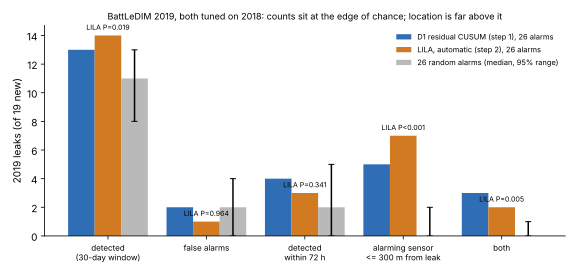
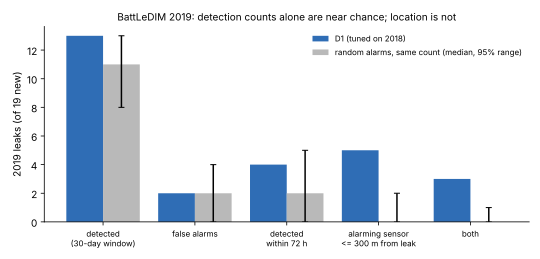

# water-leaks: does a water-leak detector on the BattLeDIM benchmark beat random alarms?

A research programme ([`PROPOSAL.md`](PROPOSAL.md), [`LOG.md`](LOG.md)) on leak detection and localisation in water distribution networks, run on the real **BattLeDIM 2020 L-Town benchmark**: 33 pressure sensors, 3 inlet flows and a tank level at 5-minute steps for 2018 and 2019, and the published leak schedule (Vrachimis et al. 2022; dataset on Zenodo, CC-BY-4.0). Track 21 (`infra`); it picks up the L-Town milestone that [`infra-waterloss`](../infra-waterloss) had to run on Net3 because the data host was unreachable then.

**Live page:** https://marisstella.app/research/water-leaks/

**Headline (steps 1 and 2, 2026-11-12; a simulated benchmark network, not a utility).** Two data-driven detectors with no hydraulic model, each tuned on 2018 only and scored once on 2019, raise 26 alarms over the two years. Our residual CUSUM (D1) detects **13 of the 19 leaks that start in 2019 with 2 false alarms**; an automatic reimplementation of the published **LILA** method (Daniel et al. 2022) detects **14 with 1 false alarm**. **The same 26 alarms placed at random detect a median 11** (95% range 8 to 13): D1's count is within chance (P = 0.105) and LILA's just outside it (P = 0.019), but a disclosed change of LILA's tie-break rule puts it back inside (13 of 19 with 28 alarms, P = 0.265), and only 2 of the 13 LILA settings with 20 or more alarms clear P < 0.05. Where both clearly beat chance is location: the sensor that raises the alarm is within 300 m of the leak along the pipes for **5 of 13 (D1) and 7 of 14 (LILA), against a chance median of 0** (P < 0.001 in every one of the 27 LILA settings). On L-Town, a detection count says little; the location-aware score is the one that separates methods from luck.

We also found that **the released LILA identification code is not a blind detector**: its notebook writes in, for each known 2019 leak, the pipe, its most affected sensor and the calibration windows, and then dates that one leak (it prints a 0 h delay for p523). Our automatic version runs LILA's identification over a whole year without those inputs; we know of no earlier such run.



## Why this question

Every L-Town result we could read reports true-positive rates and false-alarm counts (Melnikov 2025, Table 2, gathers the top BattLeDIM teams: 43 to 74% of 23 leaks, 1 to 4 false alarms) and none a chance level. L-Town's 2019 has 23 leaks, many running for months, so a generous matching window covers much of the year. The competition's own rule needed a reported pipe within 300 m, which is what gives its score teeth; our step 1 measures how much. The programme then asks for a detector whose false-alarm rate is fixed before the year is seen (an e-process threshold), and for localisation on the nominal model ([`PROPOSAL.md`](PROPOSAL.md), H1 to H4).

**Builds on.** The BattLeDIM benchmark (Vrachimis et al. 2022, [doi:10.1061/(ASCE)WR.1943-5452.0001601](https://doi.org/10.1061/(ASCE)WR.1943-5452.0001601); data [doi:10.5281/zenodo.4017659](https://doi.org/10.5281/zenodo.4017659)); the data-driven entries LILA (Daniel et al. 2022, [doi:10.1061/(ASCE)WR.1943-5452.0001535](https://doi.org/10.1061/(ASCE)WR.1943-5452.0001535)) and SICAMS (Melnikov 2025, [arXiv:2512.15685](https://arxiv.org/abs/2512.15685)), whose leak-onset table our ground truth matches; Page's (1954) CUSUM ([doi:10.1093/biomet/41.1-2.100](https://doi.org/10.1093/biomet/41.1-2.100)). LILA's released identification code ([SWN-group-at-TU-Berlin/LILA](https://github.com/SWN-group-at-TU-Berlin/LILA), GPL-3.0), read for step 2. Our own [`infra-waterloss`](../infra-waterloss) and [`infra-leakpdd`](../infra-leakpdd). Full related work: [`PROPOSAL.md`](PROPOSAL.md).

## Method (step 1)



- **Data (`src/water_leaks/data.py`).** Fetched from Zenodo record 4017659 (or, when Zenodo is unreachable, from two public GitHub copies pinned to a commit, accepted only if the SHA-256 matches Zenodo's) into a cache (`$WATER_LEAKS_CACHE`, default `~/.cache/water-leaks`), checked by SHA-256; not copied into the repository. Hourly means of the 5-minute data.
- **Ground truth (`score.py`).** A leak's onset is the first non-zero flow in `<year>_Leakages.csv` (it matches the onsets in Melnikov 2025's appendix table; the configuration file's start times differ for incipient leaks). The four leaks running from 2018 into 2019 (p257, p427, p654, p810) keep their 2018 onset, so 2019 has 19 new leaks.
- **Detector D1 (`detect.py`).** For each pressure sensor and day, least squares on 48 hour-of-day × weekday/weekend indicators, the tank level and (variant F) the three inlet flows, fitted on the days [d − 21, d − 7) so a new leak is not absorbed for a week; residuals standardised by the window's residual sd; a one-sided CUSUM per sensor on the negative residuals (k = 0.5); an alarm resets every CUSUM and re-anchors the window at the alarm day, so the declared leak becomes baseline, and scoring resumes once the window holds 7 days (14 days blind after an alarm).
- **Tuning.** On 2018 only: the threshold h with the most 2018 detections at no more than 2 false alarms (13 values from 10 to 480). 2018's labels are used, which BattLeDIM's competitors did not have (they had repair times).
- **Matching.** An alarm counts for the running, unmatched leak with the latest onset if it falls within 30 days of that onset; any other alarm is false. Detection only: no pipe is reported, so this is not the competition's score.
- **Chance level.** The same number of alarms over the same 2018-19 period, at random hours at least 14 days apart (D1's blind time; drawn uniformly over such spaced sets), each from a random sensor, scored identically; 1,000 seeded draws.
- **Distances (`network.py`).** From the alarming sensor's node to the leak pipe's midpoint, straight and along the pipe graph (pumps and valves as zero-length links), from `L-TOWN.inp`.

## Results (`experiments/step1-baseline/results.txt`; deterministic)

| 2019, 19 new leaks | D1-F (with flows, h = 240) | chance, same 26 alarms: median (95%) | P(chance ≥ D1) |
|---|---|---|---|
| detected (30-day window) | 13 | 11 (8 to 13) | 0.105 |
| false alarms | 2 | 2 (0 to 4) | 0.778 |
| detected within 72 h | 4 | 2 (0 to 5) | 0.145 |
| alarming sensor ≤ 300 m along pipes | 5 | 0 (0 to 2) | < 0.001 |
| both | 3 | 0 (0 to 1) | < 0.001 |

- **Per leak.** The first big burst is caught within a day (p523, 28 m³/h peak, at +22 h by n506, 86 m away), and the small abrupt p680 (5.4 m³/h) at +11 h by a sensor 288 m away. The second burst, p827 (26 m³/h), starts 9 days after p523's alarm, inside the 14-day blind time the re-anchoring costs, and is caught only at +146 h: the price of that design, and a target for the next one. Median delay over the 13 is 104 h (11 to 341). Missed: p277, p586, p653, p710, p721, p762 (5.6 to 20.5 m³/h peak). Full table in `results.txt`.
- **On BattLeDIM's 23-leak count**, adding the 3 of 4 carried-over leaks D1 found in 2018: 16 of 23 detected, without localisation. The published 15 to 17 of 23 (Steffelbauer et al. 2022, SICAMS, Barros et al. 2025, as tabulated by Melnikov 2025) required a pipe within 300 m, so they are not comparable with this number.
- **Without flows (variant L, h = 80):** 10 of 19 with 3 false alarms, below chance on the count (P = 0.878) but 6 within 300 m (P < 0.001).
- **Water.** 64% of the 2019 new leaks' volume (285,791 of 444,340 m³) flows after D1's alarms: the share an instant repair on alarm would save. An upper bound on value, since repairs take days.
- **Pre-registered H1-step1** (at least 9 of 19 with at most 4 false alarms): held, and is uninformative, since chance alone reaches 11. Logged in [`LOG.md`](LOG.md) with the design change made after a first look at 2019.

### Checks (`tests/`, 13)
Decimal-comma SCADA parsing; leak list from the configuration file; hourly means; weekday/weekend columns; a synthetic 10-sd step on one of three sensors gives residuals below −5 and one alarm within a day (and the old hold-off version alarms twice); CUSUM ignores upward shifts; matching picks the latest onset and closes the 30-day window; carried-over leaks keep their 2018 onset; graph and straight distances on a three-link network. Step 2: pairwise models reconstruct leak-free data and predict each sensor itself exactly; a 1 m drop at one sensor gets every model's vote, while other sensors tie with it in more than half the steps and the norm tie-break finds it every time; automatic LILA raises one alarm for a step, at that sensor, within a day; a sensor rarely the MAS keeps a finite sd.

## Step 2: LILA, automatic (`src/water_leaks/lila.py`, `experiments/step2-lila/`)

**Method.** LILA's leakage identification (Daniel et al. 2022) reimplemented under MIT from the paper and from reading the authors' GPL-3.0 code (no code copied): LI-1, for every ordered pair of the 33 pressure sensors, a regression of p<sub>j</sub> on p<sub>i</sub> and the main inlet flow PUMP_1; LI-2, at each hour the most affected sensor (MAS) is the one the most models find lower than predicted, and its reconstruction error (MRE) is the norm of its errors; LI-3, Montgomery's tabular CUSUM on each sensor's MRE with slack delta/2 sd and threshold C_thr sd. To run it blind, the reference period is D1's trailing window (two weeks ending a week back, re-anchored after each alarm). One change from the released code, fixed before any score: a sensor rarely the MAS in its window gets the median sd, not NaN, which would switch it off for good. Grid: delta in {1, 2, 4} by C_thr in {3 ... 300} and the 2018 selection rule of step 1, written in [`LOG.md`](LOG.md) before any score was seen.

**Results** (`experiments/step2-lila/results.txt`, deterministic). Chosen on 2018: delta = 1, C_thr = 20 (2018: 11 of 13, 0 false alarms).

| 2019, 19 new leaks | LILA-auto | D1-F (step 1) | chance, 26 alarms: median (95%) | P(chance ≥ LILA) |
|---|---|---|---|---|
| detected (30-day window) | 14 | 13 | 11 (8 to 13) | 0.019 |
| false alarms | 1 | 2 | 2 (0 to 4) | 0.964 |
| detected within 72 h | 3 | 4 | 2 (0 to 5) | 0.341 |
| alarming sensor ≤ 300 m along pipes | 7 | 5 | 0 (0 to 2) | < 0.001 |
| both | 2 | 3 | 0 (0 to 1) | 0.005 |

- **Per leak.** p523 (28 m³/h) and p680 (5.4 m³/h) at +2 h, each with the MAS within 300 m; median delay 138 h (2 to 301). Missed: p123, p142, p193, p586, p653 (9 to 27 m³/h). On BattLeDIM's 23-leak count, 16 of 23 with the 2 carried-over leaks found in 2018, the same as D1 and, again, without a reported pipe.
- **H1 (pre-registered) is refuted on its letter**: the 2018-chosen LILA setting raises 26 alarms and its detection count has P = 0.019. The refutation is thin. Across the grid, 2 of the 13 settings with 20 or more alarms have P < 0.05 (300 draws each), and the margin is one leak above chance's 97.5th percentile.
- **LI-2's vote ties often.** In 46% of the hours from 15 January to 14 February 2018, more than one sensor has the top vote count: the inlet flow drives every sensor, so all models agree on the sign of a sensor's own noise. The pre-registered rule takes the lowest sensor index (an argmax). **Ablation added after seeing 2019:** breaking ties by the largest error norm, same grid and 2018 rule, gives 13 of 19 with 2 false alarms and 28 alarms, P = 0.265 on the count, 6 within 300 m (P < 0.001). The count's significance depends on a tie-break; the location result does not.

## Reproduce

```bash
pip install numpy matplotlib pytest
cd research/water-leaks
python -m pytest -q tests                                    # 13 tests, no network
PYTHONPATH=src python experiments/step1-baseline/run.py      # downloads ~75 MB once; about 4 min (the chance draws)
python experiments/step1-baseline/figure.py                  # experiments/step1-baseline/chance.svg
PYTHONPATH=src python experiments/step2-lila/run.py          # about 5 min
python experiments/step2-lila/figure.py                      # experiments/step2-lila/lila_vs_chance.svg
```

## Limitations

- L-Town is a **simulated** network with simulated leaks and sensor noise; nothing here is a field result or an operational recommendation (drinking-water decisions need licensed engineers and the operator).
- Detection only. The 300 m figure uses the alarming sensor (LILA's MAS) as a crude location, not a localisation method; LILA's model-based localisation (LL-1 to LL-3) is not reimplemented yet.
- LILA-auto is our automation of LILA's identification, not the authors' procedure, which used per-leak inputs; its numbers are not the paper's. Hourly means, not 5-minute data. The paper's own 2019 figures were not read (paywalled), so this step does not check against them.
- One detector, one tuning rule, one matching window. The chance level depends on the window (14 and 60 days are next) and on the alarm count.
- 2019 results were seen once before the re-anchoring fix (`LOG.md`); the fix came from a unit test, and its one new parameter (7-day minimum window) was not tuned.

## Next steps

Milestone 2 continues with SICAMS (Melnikov 2025; arXiv was unreachable from this session) and a paired bootstrap between detectors. Then localisation on the nominal model with the 300 m confusion matrix as BattLeDIM scored it, and leak-free simulated years for an e-process threshold ([`PROPOSAL.md`](PROPOSAL.md), Milestones). H1 should be restated as a claim about margins: detection counts sit within about one leak of chance's upper range, location-aware counts far above it.

AI-assisted research (Claude); no affiliation with the BattLeDIM organisers is implied. Code MIT; BattLeDIM data CC-BY-4.0 (Vrachimis et al.), not redistributed here.
