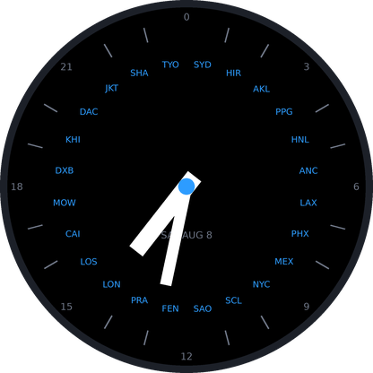

# World Traveler — a Garmin Connect IQ watch face

A worldtimer-bezel watch face, in the style of classic GMT/world-time
travel watches: a fixed 24-hour ring runs around the rim, and the 24
major cities of the world — one per standard time zone — sit at whatever
position on that ring matches their current local hour. Analog hands read
your own local time off the same ring.



*(The image above is a design mockup rendered outside the Connect IQ
simulator, to preview the intended layout before a real build. See
[Building & testing](#building--testing) for how to generate real
simulator screenshots.)*

## Features

- A fixed 24-hour reference ring around the rim (0 at top/midnight,
  clockwise, hour numbers every 3 hours, tick marks every hour in between)
  that never moves — it's what everything else is read against.
- All 24 standard whole-hour time zones (UTC-11 through UTC+12) shown at
  once, each as a 3-letter city code positioned at the angle matching that
  city's *own current local hour* on the fixed ring — so as the day
  progresses, the whole ring of cities visually sweeps around together,
  the same way a real worldtimer watch bezel does.
- Analog hour + minute hands, pivoting at the center, reading your local
  time off that same 24-hour scale.
- Automatic, self-contained DST handling for zones that need it (US, EU,
  Australia, New Zealand) — no network access or bundled timezone database
  needed. Unlike a real mechanical worldtimer (which can only rotate one
  ring uniformly and drifts out of alignment during mixed DST periods),
  each city here is computed independently, so it "hops" a notch on its
  own DST transition day instead of throwing off any other city.
- Four selectable color themes (Midnight, Aurora, Sand, Mono).
- Draws everything programmatically from screen dimensions, so one
  codebase adapts to round, semi-round and rectangular displays without
  per-device layout resources.
- No permissions requested — the face only reads the system clock and
  device settings. No location, no network, no background service.

## The city list

Exactly one city per standard whole-hour UTC offset, from -11 to +12 (24
zones — UTC-12 is skipped, it has no permanent population). Each pick is
the *largest* city that observes that offset as standard time, not
necessarily the most touristed one — see `source/CityData.mc` for the
full list and reasoning (e.g. Lagos outsizes Paris at UTC+1, Shanghai
outsizes Beijing at UTC+8, Jakarta outsizes Bangkok at UTC+7). UTC-2 has
no real city (mid-Atlantic islands only); Fernando de Noronha is used as
the token IANA-recognized anchor for that zone. This is a fixed reference
list, not user-configurable per slot — the point of the design is to show
the whole world at once, like a real worldtimer bezel.

## Project layout

```
manifest.xml                    App metadata, target device list
monkey.jungle                   Build configuration
source/
  WorldTravelerApp.mc            App entry point
  WorldTravelerView.mc            Radial ring + hands drawing logic
  CityData.mc                    24-zone catalog + timezone/DST math
  Themes.mc                      Color themes
resources/
  drawables/                     Launcher icon
  strings/                       App name + settings labels
  settings/                      properties.xml (defaults) + settings.xml (on-device settings UI)
docs/
  design-mockup.png              Layout preview (not a simulator capture)
```

## How it works

**The ring mechanic.** The rim carries a *fixed* 24-hour scale (0 at top,
clockwise, matching a classic 24-hour dial layout). For each of the 24
cities, `CityData.localInfoAt()` computes that city's current local hour
and minute (fully DST-aware), and `WorldTravelerView` converts that
fractional hour into an angle on the same fixed scale via
`angleFor24Hour()`. Because every city's angle is recomputed from its own
current time on every draw — not from a single shared "ring rotation"
variable — the whole set of labels moves together in the aggregate (all
24 hours advance at the same real-world rate) while still being exactly
correct through individual DST transitions, which a single rotating disc
cannot represent.

**The hands.** The hour hand reads local time on the *same* 0-24 scale as
the ring (`angleFor24Hour(hour + minute/60)`), so it always points at
(roughly) your own city's position in the ring. The minute hand uses an
ordinary 60-minute scale. Both are drawn as tapered polygons via a
rotation matrix applied to a template pointing straight up — the standard
technique for analog hands in Connect IQ (see `drawHand()`).

**Timezone math.** Connect IQ devices don't ship a general IANA timezone
database, so every city's offset is computed by hand: each city stores a
**standard** (winter) UTC offset plus a symbolic DST rule (`:none`,
`:us`, `:eu`, `:au`, `:nz`), and `effectiveOffsetSeconds()` derives the
*current* offset from the UTC instant on every draw. The technique for
rendering an arbitrary offset: take `Time.now()` (a UTC-referenced
`Moment`), add the target offset as a `Time.Duration`, then read it back
with `Gregorian.utcInfo()`, which reports the moment's calendar fields
without re-applying the device's own timezone. DST windows are computed
from the legal rule definitions (2nd Sunday of March / 1st Sunday of
November for the US; last Sunday of March / October at 01:00 UTC for the
EU; first Sunday of October / April for Australia; last Sunday of
September / first Sunday of April for New Zealand) rather than
hard-coded dates, so it stays correct year over year.

**Known limitation:** with 24 labels sharing a rim, city codes can sit
close together, especially on smaller round displays — real watch bezels
with this many markers are tightly packed too. `FONT_XTINY` and the
accent color are used throughout for maximum legibility at that density;
if it's still too tight on a given device, the fix is lowering
`numberRadius`/`radius` a touch in `WorldTravelerView` or dropping to
every-4th-hour numbering, not adding more visual elements.

## Customizing the theme

Users edit the `Color Theme` setting from the Garmin Connect mobile app
(or Garmin Express) once the face is installed, same as any Connect IQ
app setting. The city ring itself isn't user-configurable (see "The city
list" above); if you want a different city for a given offset, edit
`CityData.CITIES` directly.

## Building & testing

This repo contains source only — building requires the Garmin Connect IQ
SDK, which isn't installed in this environment.

1. Install the [Connect IQ SDK Manager](https://developer.garmin.com/connect-iq/sdk/)
   and the [Monkey C VS Code extension](https://marketplace.visualstudio.com/items?itemName=garmin.monkey-c),
   or use the legacy Eclipse-based IDE.
2. Open this directory (`ventures/garmin-world-traveler-watchface`) as the
   Connect IQ project root — it's where `manifest.xml` lives.
3. Generate a developer certificate the first time (VS Code command
   "Monkey C: Generate Developer Key Pair") if you don't already have one.
4. Build and run in the simulator: VS Code command "Monkey C: Run Current
   Project in the Simulator" (or `monkeydo` from the CLI once you've built
   a `.prg` with `monkeyc`). Pick a target device from the picker — try a
   round AMOLED device (e.g. `venu3`) and a round MIP device (e.g.
   `fenix7`) to sanity-check both display types, and check legibility on
   a smaller-screen device (e.g. `venusq`) given the label density.
5. In the simulator, use the time-travel controls to spot-check: the hour
   hand should point at roughly "now" on the 24-hour ring, and stepping
   the simulated date across a DST boundary (e.g. the second Sunday of
   March) should snap the affected city (e.g. NYC) one tick over without
   moving any other city.
6. Take your Connect IQ Store screenshots directly from the simulator
   (File → Save Screenshot) once the face looks right — those are the
   images that must accompany the store listing, not `docs/design-mockup.png`.

### Expanding device support

`manifest.xml` ships with a conservative, long-established set of device
ids across the fenix, epix, venu, vivoactive, forerunner, marq and descent
families. Garmin adds/renames device ids over time, so before your first
real build, use the VS Code extension's "Edit Application" / product
picker (or `connectiq --generate` device list) to refresh the `<iq:products>`
list against your installed SDK's current device catalog, and add any
newer watches (or drop ones you don't want to support).

## Publishing to the Connect IQ Store

1. **Developer account** — register at
   [apps.garmin.com](https://apps.garmin.com) / Connect IQ developer portal
   if you haven't already.
2. **App registration** — create a new "App" listing in the developer
   dashboard; this issues the Store-side app id (separate from the local
   `id` UUID in `manifest.xml`, which only matters for sideloading/builds).
3. **Signed release build** — build a release `.iq` package signed with
   your developer certificate (not the debug key used for simulator/device
   testing): VS Code command "Monkey C: Export Project" or `monkeyc -e`
   with your release `.der` key.
4. **Store listing assets** you'll need to prepare:
   - App name/description/keywords (this repo's working name is "World
     Traveler" — check availability in the store before finalizing).
   - Simulator screenshots for each supported device (or device family
     group) — see step 6 above.
   - The launcher icon is already bundled (`resources/drawables/launcher_icon.png`);
     the store may also ask for a larger promotional image — regenerate at
     a higher resolution from the same motif with Pillow if so (the
     original generator script wasn't checked into the repo).
   - Category: Watch Faces.
   - Price/monetization tier, if any.
5. **Privacy** — this app requests no permissions and collects no data, so
   the store's privacy questionnaire should be the simplest path (no
   privacy policy URL should be required, but confirm against the current
   Connect IQ Store submission form, since Garmin's requirements do
   change).
6. **Submit for review** and watch for Garmin's automated + manual review
   feedback; common rejection reasons for watch faces are missing device
   coverage for popular models, low-battery-impact violations (not a
   concern here — no `onPartialUpdate`/always-on ticking is implemented),
   and icon/screenshot mismatches with the actual running app.

## Roadmap / possible follow-ups

- Always-on (AOD) support via `onPartialUpdate` for AMOLED devices, with a
  clipped low-power redraw region.
- A second hand, or a small day/night shading arc behind the city ring.
- Tap/menu-button interaction to temporarily highlight one city's label
  (useful when the ring gets crowded).
- Localized city names for non-English markets.

## License

Not yet chosen — add a `LICENSE` file before publishing if you want an
explicit open-source license; the Connect IQ Store itself does not require
one.
