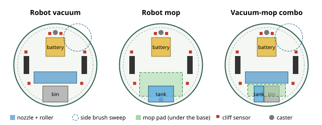

# Open Floor Robots: build your own robot vacuum, robot mop, or vacuum-mop combo

Open-source hardware and software for three home cleaning robots that
share one 330 mm round chassis (base, drive, battery, lidar, cliff
sensors, electronics) and swap only the rear module:

- **Robot vacuum.** Roller brush, side brush, dust bin, 60 mm brushless fan.
- **Robot mop.** Water tank, peristaltic pump, vibrating microfibre pad on
  a lift, and a second caster to carry the water.
- **Robot vacuum-mop combo.** The vacuum's nozzle and side brush, a split
  bin and tank, and a narrower pad behind the nozzle.

**Try the cleaning simulator in your browser** (pick a room, add
furniture, see what each robot reaches):
https://duncan-haywood.github.io/monorepo-projects/open-floor-robots/

Everything is MIT-licensed. You can build it, change it, and sell it
under your own brand; if you sell one, you are the manufacturer
([safety.md](hardware/safety.md), "No compliance claim").



## Manufacture it

A parametric CAD model in code ([`cad/`](cad/README.md), build123d)
generates a complete fab package for each robot. They are committed under
[`manufacturing/`](manufacturing/) (GitHub renders the STLs in 3D):

| Robot | Package | Browse |
| --- | --- | --- |
| Robot vacuum | [`vacuum-package.zip`](manufacturing/vacuum-package.zip) | [`manufacturing/vacuum/`](manufacturing/vacuum/) |
| Robot mop | [`mop-package.zip`](manufacturing/mop-package.zip) | [`manufacturing/mop/`](manufacturing/mop/) |
| Vacuum-mop combo | [`combo-package.zip`](manufacturing/combo-package.zip) | [`manufacturing/combo/`](manufacturing/combo/) |

Each has `laser/*.dxf` (a 3 mm aluminium 5052 base and a 3 mm cast-acrylic
deck, no bends or tapped holes), `print/*.stl` (PETG, every part fits a
220 x 220 mm bed), `step/*.step` (every part and the assembly), `bom.csv`
(every part and fastener), `cut_list.csv`, drawings and a manifest.

Every build checks, and fails if any check fails:

- no two parts intersect, bought-in parts included as envelopes; nor with
  the mop pad lifted, nor with the bumper pressed in head-on or from 45
  degrees;
- every heat-set insert hole in a printed part sits over a clearance hole
  in the plate it bolts to;
- the wheels, casters and pad touch the floor, and the centre of mass sits
  between them (a full tank behind the axle is why mop builds have a rear
  caster);
- the cliff sensors lead the wheels by more than the stopping distance at
  the firmware's speed cap, and the side brush never sweeps under one;
- the packages are byte-reproducible, and CI fails if the committed ones
  go stale.

> **Status:** design v0.1. The CAD, planner, power model and firmware logic
> are tested in simulation and in CAD; **no robot has been built yet**.
> Lidar mapping and scan matching are not written yet (roadmap). Builders:
> please open issues with what you find.

## What's here

| Path | What it is |
| --- | --- |
| [`hardware/chassis.md`](hardware/chassis.md) | The shared platform: layers, and why the wheels, casters and cliff sensors sit where they do |
| [`hardware/vacuum.md`](hardware/vacuum.md), [`mop.md`](hardware/mop.md), [`combo.md`](hardware/combo.md) | Each cleaning module, its sizing and its trade-offs |
| [`hardware/electronics.md`](hardware/electronics.md) | Block diagram, ESP32-S3 pin map, PWM channels, power budget, wiring |
| [`hardware/safety.md`](hardware/safety.md) | What the design does about each hazard, the lithium battery, and the builder's responsibilities |
| [`hardware/bom-*.csv`](hardware/) | Bills of materials with rough cost estimates: ~$420 vacuum, ~$400 mop, ~$470 combo |
| [`src/floorbots/`](src/floorbots/) | Python package for the Pi: room grids, coverage planner, noisy simulator, pure pursuit, battery and return-to-dock planning, fan and mop-water sizing, serial protocol |
| [`firmware/esp32/`](firmware/esp32/README.md) | MicroPython firmware: watchdog, stop button, bumper, cliff back-off, wheel drop, battery and temperature faults, no-puddle pump interlock |
| [`cad/`](cad/README.md), [`manufacturing/`](manufacturing/) | Parametric CAD (build123d) and the generated packages |
| `index.html`, `sim.mjs` | The browser simulator (a port of the Python planner, tested to give the identical path) |

## Quick start (software)

```
pip install "git+https://github.com/duncan-haywood/oss-monorepo#subdirectory=ventures/open-floor-robots"

floorbots compare --room living                  # vacuum vs mop vs combo: coverage, time, runtime, dock trips
floorbots plan --room-json room.example.json --variant combo   # your own room (rectangles in metres)
floorbots simulate --room apartment --pose-sigma 0.05          # drive the plan with slip and localisation error
floorbots size-fan --gap 4                       # fan curve vs nozzle and filter losses
floorbots mop-dose --target 3                    # pump duty for 3 ml/m^2, and how far a tank goes
floorbots runtime                                # battery runtime per build
```

Coordinates are metres, origin at the room's lower-left corner. The robot
frame (CAD) has x forward, y left, origin on the floor under the axle.

## What the simulation says

Planner output for the three preset rooms at 10% lane overlap
(`floorbots compare --room <room>`). Coverage is the share of the floor
each tool reaches, assuming the robot drives its plan exactly:

| Room | Floor | Vacuum covers | Mop pad covers | Vacuum / mop time | Combo time |
| --- | ---: | ---: | ---: | ---: | ---: |
| Bedroom (bed, bedside table, wardrobe) | 7.4 m^2 | 99.7% | 77.0% | 5.9 min | 7.4 min |
| Living room (sofa, tables, armchair, 4 table legs) | 15.7 m^2 | 95.5% | 79.8% | 13.7 min | 16.2 min |
| L-shaped flat (island, wall stub, sofa) | 29.6 m^2 | 99.4% | 87.0% | 20.1 min | 25.5 min |

Then the plan driven by a simulated robot: 3% wheel slip, localisation
error that wanders with a 5 s time constant, walls that stop the body (it
slides along them). Living room, mean of 5 seeds
(`floorbots study --room living --variant vacuum --overlap 0 --overlap 0.3
--pose-sigma 0 --pose-sigma 0.02 --pose-sigma 0.05 --pose-sigma 0.10
--seeds 5`, and the same with `--variant mop`):

| Build, lane overlap | Exact pose | 2 cm error | 5 cm error | 10 cm error | Planned time |
| --- | ---: | ---: | ---: | ---: | ---: |
| Vacuum, 0-10% | 95.5% | 93.7% | 89.4% | 86.6% | 13.7 min |
| Vacuum, 30% | 95.5% | 94.7% | 91.5% | 88.2% | 16.2 min |
| Mop, 0-10% | 79.8% | 77.8% | 74.0% | 71.0% | 13.7 min |
| Mop, 30% | 79.8% | 79.4% | 77.2% | 73.9% | 16.2 min |

Read it as:

- **A round mop-only robot leaves a strip along every wall.** The pad is
  under the body and the body keeps 165 mm from the wall, so in these
  rooms the pad reaches 77-87% of the floor while the vacuum's side brush
  (which reaches past the bumper) gets 95-100%.
- **Localisation is worth more than overlap.** Ten centimetres of
  wandering pose error costs the vacuum about 9 points; tripling the
  overlap wins back under 2 of them for 18% more time. Good scan matching
  is the first thing to get right.
- **The combo pays for its narrower pad in time**: 0.10 m lanes instead
  of 0.15 m on the 5 cm grid, about a quarter longer than the vacuum in
  the flat.
- The vacuum's missing 4.5% in the living room is floor the 330 mm body
  cannot reach at all: the 0.3 m gap beside the sofa and the corner
  behind the armchair.

These are simulation results under stated assumptions (grid, noise model,
wall model), not measurements. On the 5 cm grid, 0% and 10% overlap give
the same 0.15 m lane spacing, so they share a row. A first build should
measure real coverage (a floor dusted with flour and photographed is
enough) and real localisation error.

## How the pieces fit

```
lidar + odometry + IMU --> pose --> floorbots.coverage.plan (edge pass, boustrophedon lanes, links)
                                         |                     \
                         power.mission (go home when the battery only just covers the trip)
                                         |
                    drive.PurePursuit / segment follower --> protocol.encode --UART--> ESP32
                                                     (controller.py: cliff back-off, bumper, wheel drop,
                                                      watchdog, faults, fan-needs-bin, pump-only-while-moving)
```

## Develop

```
cd ventures/open-floor-robots
PYTHONPATH=src python3 -m unittest discover -s tests   # planner, simulator, power, airflow, mop, firmware logic, CAD agreement
node --test sim.test.mjs page.test.mjs usage.test.mjs  # browser port vs Python fixtures, page checks, usage counter
PYTHONPATH=src python3 -m floorbots.fixtures           # regenerate fixtures after changing the planner
cd cad && python3 -m unittest discover -s tests         # CAD checks (needs pip install -r cad/requirements.txt)
```

## Roadmap (long-term project)

1. **Build the vacuum first.** It tests the chassis, drive, cliff
   handling and the planner without water near the electronics.
2. Lidar mapping and scan matching on the Pi, starting from existing
   open-source SLAM; measure real localisation error and rerun the study
   with it.
3. Measure the real loads, fan operating point and stopping distance, and
   replace the assumptions in `variants.py`, `airflow.py` and the CAD
   cliff check.
4. The dock: charger, sprung contacts, IR beacon, CAD.
5. Sprung wheel pods for uneven floors; a taller lift for carpet.
6. A way to mop to the wall (a D-shaped front or a pad that swings out),
   since the simulation says that is where a round mop loses most.
7. A phone page for maps, no-go zones and schedules served by the Pi.

## Safety, warranty, privacy

**No warranty.** This tool is provided free and as-is, without warranty of
any kind, express or implied. It is not engineering, electrical or safety
advice, and it does not replace a qualified professional. **You are
responsible for reviewing and verifying its output before relying on
it**, and for building and operating any robot safely and lawfully. To the
maximum extent permitted by law, the authors accept no liability for any
loss, damage or injury arising from its use. Read
[`hardware/safety.md`](hardware/safety.md) before building: lithium
batteries, mains chargers and spinning brushes can cause fire and injury.

**Best-effort hosting, no SLA.** The web page is free and experimental and
may move or go offline without notice. Clone the repository to keep a copy.

**Privacy.** The web page runs entirely in your browser. Nothing you type
or draw is uploaded, and there are no accounts, cookies or analytics
vendor. Anonymous feature counts stay in your browser's local storage and
can be switched off on the page. The CLI sends nothing anywhere.

Not affiliated with any robot vacuum maker.
Sponsor the work: https://github.com/sponsors/Duncan-Haywood
