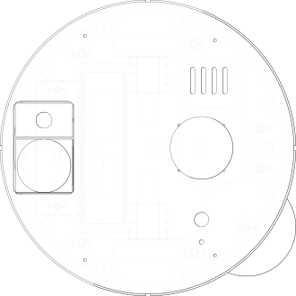

# Chassis: the shared platform

All three robots are the same machine from the base plate up. Only the
rear cleaning module and what hangs under the base change.

| | |
| --- | --- |
| Footprint | 330 mm round (bumper outer radius 165 mm) |
| Height | 98 mm to the deck, 136 mm over the lidar |
| Ground clearance | 18 mm under the base plate (13 mm casters on 5 mm spacers) |
| Drive | two 25 mm encoder gearmotors (JGA25-370 class), 72 mm wheels, 230 mm track |
| Speed cap | 0.35 m/s in firmware, set by the cliff sensors (below) |
| Battery | 4S2P 18650 Li-ion, 14.4 V nominal, 75 Wh rated, with BMS |
| Brains | Raspberry Pi Zero 2 W (planning, lidar) + ESP32-S3 (motors, safety) |
| Mass | 2.3-2.6 kg estimated (CAD volumes plus typical bought-in masses; not weighed) |

Numbers come from [`cad/ofr_cad/params.py`](../cad/ofr_cad/params.py) and
the generated `manufacturing/<variant>/README.txt`. Change a parameter and
rebuild; the build re-runs every check below.

## Layers

1. **Base plate**: 3 mm aluminium 5052, laser cut, 300 mm diameter. Every
   other part bolts to it with M3 screws from underneath into heat-set
   inserts. Holes are clearance holes; nothing is tapped.
2. **On the base**: wheel pods (printed pillow blocks round each gearbox),
   the battery (strapped through two slots), the electronics carrier on
   6 mm standoffs, six cliff-sensor mounts, four deck posts, and the
   cleaning module.
3. **Bumper and skirt**: four printed quarter arcs, 60 mm tall. The two
   front quarters are the bumper. Each rides on two M3 shoulder screws in
   radial slots, sprung outward, with a microswitch behind it. It can
   travel 5 mm, and the build checks that, pressed fully head-on or from
   45 degrees, it hits nothing inside. The rear quarters are fixed.
4. **Top deck**: 3 mm cast acrylic on the four posts, with the lidar on
   top, a hatch to lift the bin or tank out, the stop button and a status
   LED.

## Why the numbers are what they are

- **Wheels on the centre line.** A round robot that turns on the spot
  about its own centre can always turn its way out of a corner it drove
  into. The wheel axle sits on the diameter for that reason.
- **Front caster, and a rear one for mop builds.** The vacuum's centre of
  mass sits 12 mm ahead of the axle (estimated), so it rests on its front
  caster. A full water tank sits behind the axle: the mop's centre of
  mass moves to 7 mm behind it, and with the pad lifted it would sit back
  on its tail. Mop and combo builds get a second caster at the rear. The
  build computes the centre of mass and fails if it falls outside the
  casters.
- **Cliff sensors 52 mm ahead of the wheels.** The outer front cliff
  windows (at plus and minus 66 degrees) are the ones a wheel reaches
  first when the robot meets an edge at an angle. At 0.35 m/s, 20 ms of
  loop and driver latency plus braking at an assumed 2 m/s^2 takes 38 mm,
  so the wheel stops before the edge. That margin is why the firmware caps
  speed at 0.35 m/s; the build fails if a change to the sensor angles
  breaks it.
- **Side brush clear of the cliff windows.** A side brush that sweeps
  under a cliff sensor makes it read "no floor" every revolution. The
  build checks the sweep circle against every window.
- **18 mm clearance.** Enough for door thresholds and rug edges of about
  10-12 mm (wheel radius permitting); the vacuum nozzle uses a silicone
  lip down to 4 mm to keep air speed up (see [vacuum.md](vacuum.md)).

## Localisation

The lidar (a 360-degree robot-vacuum unit with a UART output) feeds the Pi.
The planner works on an occupancy grid at 5 cm. The Pi fuses wheel
odometry and IMU yaw with lidar scan matching, then runs the coverage
plan. The simulator shows why that matters: with 10 cm of slowly
wandering localisation error the vacuum's coverage of the living-room
preset drops from 95.5% to 86.6% (README, "What the simulation says"). The
mapping and scan-matching code is not written yet: it is the largest open
item on the roadmap, and existing open-source SLAM is the obvious start.

## Not modelled yet

- Wire routing and the charging contacts under the front edge.
- The dock: a charger, two sprung contacts and an IR beacon. The BOM
  names the parts; there is no dock CAD.
- Wheel suspension. The pods are rigid; wheel drop is sensed by two
  microswitches (robot lifted). A sprung swing-arm pod would ride
  uneven floors better and is a v0.2 candidate.
