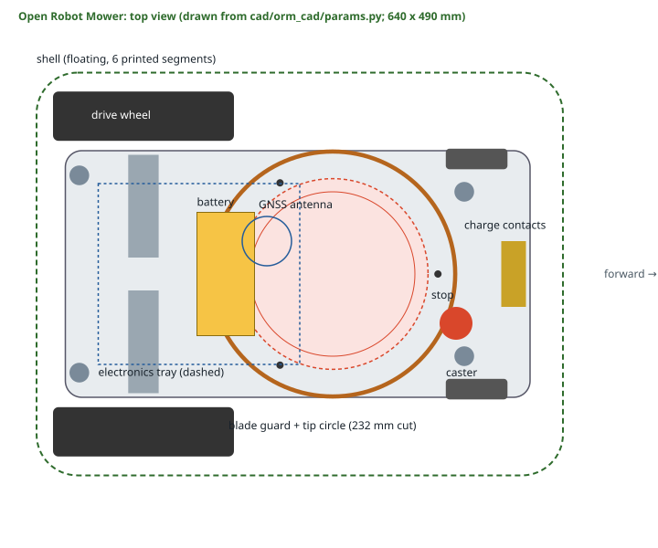
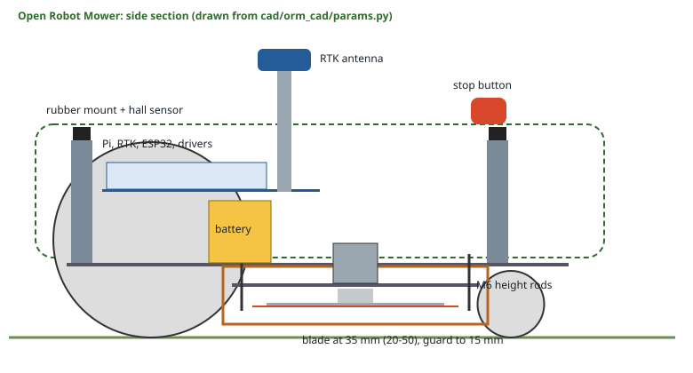

# The mower

Design v0.1. Every dimension below comes from
[`cad/orm_cad/params.py`](../cad/orm_cad/params.py), and the generated
package in [`manufacturing/mower/`](../manufacturing/mower/) is the
authority: if this page and `manifest.json` disagree, the manifest is right.
Nothing here has been built yet.

## Overall

| | |
| --- | --- |
| Footprint | 640 x 490 mm (shell), 325 mm to the antenna top |
| Track / wheelbase | 384 mm / 405 mm (rear axle to caster contact) |
| Cut width | 232 mm (blade-tip circle) |
| Cut height | 20-50 mm in 5 mm steps |
| Mass | ~8.5 kg estimated from the CAD (made parts by volume, bought-in parts at typical weights); allow ~9.5 kg with wiring |
| Centre of mass | 133 mm ahead of the rear axle, 123 mm up (estimate) |
| Battery | 7S Li-ion, 25.2 V nominal, 5 Ah (126 Wh), with BMS |
| Navigation | RTK GNSS (no boundary wire), IMU heading, wheel odometry |

## Chassis

One flat 4 mm 5052 aluminium plate, 565 x 300 mm, 80 mm off the ground.
Everything bolts to it through clearance holes: no tapping, no bends. The
printed parts carry M4 heat-set inserts, so every joint is a screw from the
other side into brass.

## Drive

Two 37 mm 24 V gearmotors (90-110 rpm, quadrature encoders) in printed
pillow-block clamps on the chassis top drive 220 mm treaded lawn wheels
through printed hubs (6 mm D bore, M3 grub screw insert, four M4 to the
wheel). At 100 rpm a 220 mm wheel moves at 1.15 m/s; the planner uses
0.35 m/s while cutting and the firmware caps commands at 0.6 m/s.

Two 75 mm casters at the front run in printed forks on M8 stems with
flanged bushings, trailing 45 mm. Their swept circle clears the blade guard
(a design rule in `params.check()`).

Rear drive with front casters is the cheap, simple layout, and the slope
model says it is also the weak point: on wet grass the rear wheels lose
grip on a climb of about 5 degrees (`mowerbot slope`). Moving the battery
back over the axle helps; the rule of thumb is to keep the centre of mass
as far back as stability allows.

## Cutting system

- **Disc**: 200 mm, 3 mm 5052, laser-cut with three lightening holes, on a
  printed hub clamped to the outrunner's 8 mm shaft. Balance it.
- **Blades**: three pivoting razor blades, the replaceable kind sold for
  robotic mowers (30 x 18 x 1 mm, M3 hole), on M3 shoulder screws at a
  92 mm radius. They swing out under centrifugal force to a 116 mm tip
  radius and fold back if they hit a stone or a root, instead of
  transmitting the shock. Replace them every few weeks of mowing.
- **Motor**: a ~50 mm 24 V outrunner (about 140 kv) mounted upside down on
  the height plate, its can spinning above the plate through a hole in the
  chassis, with a 30 A ESC that supports active braking.
- **Speed**: 2,800 rpm, 34 m/s at the tips (`mowerbot blade-stop`).

### Height adjustment

The blade motor sits on the **height plate**, a laser-cut disc with three
lobes that hangs on three M6 threaded rods from the chassis, outside the
blade-tip circle and inside the guard. Two nuts per rod clamp the plate.
The printed **height gauge** has one step per setting (20, 25 ... 50 mm):
stand it between the chassis underside and the plate at each rod and run
the nuts to it. The CAD build checks the assembly for collisions at every
one of the seven heights.

### Guard

A printed ASA ring, 145 mm inside radius, 4 mm wall, in four identical
quarters bolted up into the chassis. It reaches from the chassis down to
15 mm above the ground, which is below the blade plane at every cut height
(5 mm below at the lowest). The blade tips run 29 mm inside it. With the
shell on top, the blade tips are at least 129 mm in from the shell's outer
edge. See [safety.md](safety.md) for what this does and does not protect.

## Floating shell and sensors

The shell is printed in six segments (3 x 2, each at most 214 x 245 x
150 mm, so each fits a 256 mm bed), bolted through ribs along the inside
seams and then solvent-welded. It rests on four **rubber anti-vibration
mounts** on printed posts. Each post holds a **3-axis hall sensor** under
a magnet in the shell: lifting the shell moves the magnets up (lift), a
push moves them sideways (bump). The CAD build pushes the shell 8 mm in
each direction and checks it touches nothing.

| Sensor | Where | What happens (firmware) |
| --- | --- | --- |
| Stop button | top of the shell | latched stop of everything; also opens the blade relay in hardware |
| Lift | 4 hall sensors | latched stop |
| Bump | same sensors | blade off, forward drive refused, reversing allowed |
| Tilt | IMU on the tray | blade off past 20 degrees; latched stop past 35 |
| Rain | board on the shell | blade off, telemetry tells the Pi to go home |
| Blade speed | hall sensor on the hub | latches a fault if the disc has not stopped 1.5 s after a stop |
| Battery | divider to the ESP32 | go home at 24.0 V; stop at 21.0 V; the BMS is the backstop |

## Electronics

On a 3 mm aluminium tray on four 80 mm standoffs: Raspberry Pi (planning,
RTK fusion), the RTK GNSS receiver, ESP32 (motors and safety), dual motor
driver, blade ESC and relay, IMU and buck converter. The GNSS antenna sits
on a 16 mm mast above the shell. Details: [electronics.md](electronics.md).

## Not yet designed

- Cable routing and connectors (the chassis has pass-through slots).
- A sealed electronics box: the shell keeps rain off, but splash and
  condensation need a proper enclosure (or conformal coating) before the
  mower lives outside.
- Tyre tread: buy treaded wheels, or print a rim and a TPU tyre.
- A blade-disc balancing jig.
