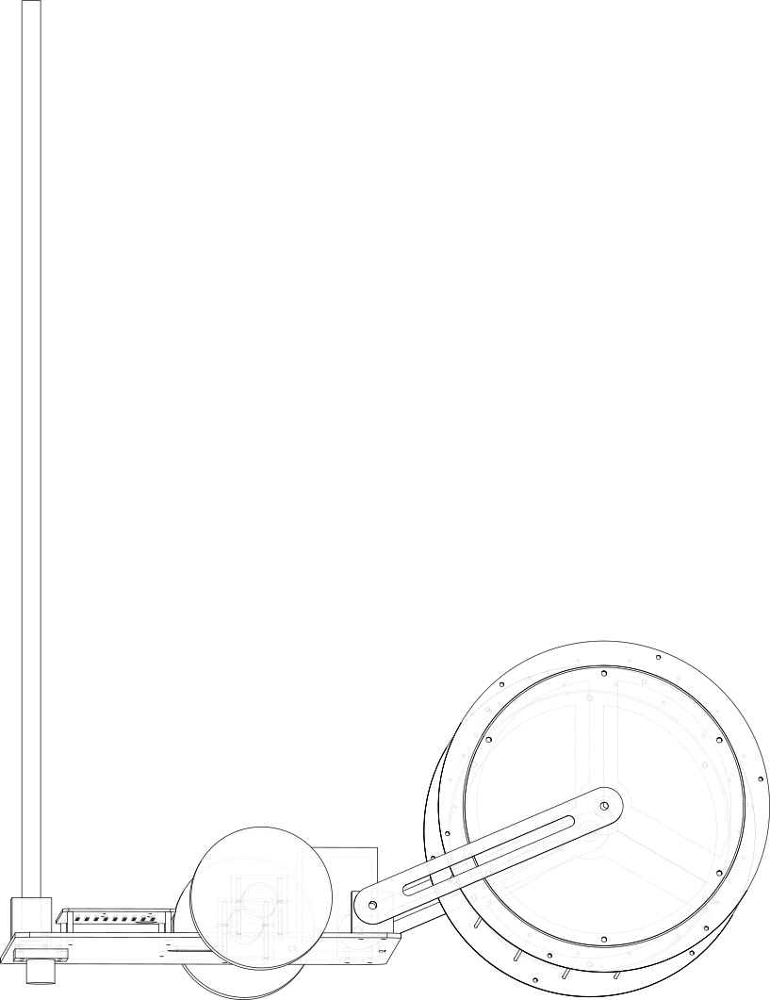

# Ball-collecting rover

A small robot that roams the court and picks up tennis balls while you
practise with a ball machine or a coach, and stays out of the way while it
does. Think robot vacuum, but for tennis balls on a hard court.

Status: **design v0.2, with a complete manufacturing package but not yet
built.** Every part is generated by [`../cad/`](../cad/README.md). The
ready-to-order files are in
[`../manufacturing/collector-package.zip`](../manufacturing/collector-package.zip):
DXFs for laser cutting, STLs for printing, STEP for any CAD tool, a cut
list and a full BOM. The route planner, path follower and firmware logic
are tested in simulation.

## How it picks up balls

The front of the robot is a **rod-cage drum**: two laser-cut aluminium
discs joined by 18 spring-steel wires, rolling on the court. It is the
mechanism used by hand-pushed "ball mower" pickers. As the drum rolls over
a ball, the ball is pressed between two wires (52 mm gap for a 67 mm
ball), squeezes through, and is trapped inside. No pickup motor and no
ramp are needed. The drum holds ~118 balls (loose packing, computed from
the geometry). To empty it, undo the thumb-screw hatch on one side and tip
it into a basket.

The drum hangs on two yoke arms that pivot on the base. It rides on its
own weight, so it follows uneven courts. If the drum is pushed back hard
(someone's foot, a net post), the arms lift and a microswitch on the pivot
stops the drive. That is the front bumper.

v0.1 proposed a powered paddle roller and a curved ramp. The CAD showed
that the ramp could not reliably drop balls into a hopper above it, and
the drum needs fewer parts, no motor and no fine tolerances. So v0.2
switched to the drum.

## How it works (software)

1. **See.** A wide-angle camera on a 1 m mast finds optic-yellow balls.
   The court-line homography (`vision.Homography`) turns pixels into court
   positions.
2. **Plan.** `collector.Planner.collect` orders the pickups (nearest
   first, then 2-opt), routes around keep-out zones, and schedules a trip
   to the dump point when the drum is full. With no camera it drives
   `Planner.sweep` lanes one drum-width apart.
3. **Drive.** Pure pursuit (`drive.PurePursuit`) follows each leg. The
   ESP32 closes the wheel-speed loops and enforces the watchdog, e-stop
   and bumper.
4. **Stay out of the way.** Keep-out zones cover the player's back court
   and the feeder (`collector.practice_zones`), or a coach's area you draw.

## Main dimensions (v0.2, from `cad/otr_cad/params.py`)

| Part | Value |
| --- | --- |
| Overall | 802 mm long x 592 mm wide; mast 1 m |
| Drum | 450 mm wide (pickup width), discs Ø352 mm, 18 x Ø3 mm music wire on R158 mm |
| Drive | 2 x 37 mm gearmotors with encoders, 150 x 40 mm non-marking wheels, track 552 mm |
| Base | 5 mm aluminium plate, 410 x 500 mm, 35 mm ground clearance; ball caster at the rear |
| Electronics | Pi 5 + ESP32 + motor driver on a 3 mm tray with an M3 grid; 22 mm e-stop on the tray |
| Battery | 24 V LiFePO4 10 Ah class, strapped through slots in the base |
| Made-part mass | ~7.1 kg (estimate; bought-in parts extra) |

## Making it

1. Send `laser/*.dxf` to a laser or waterjet service (quantities and
   thickness are in `laser_parts.csv`): 6 parts, 10 pieces, all 5052
   aluminium. There are no bends or tapped holes.
2. Print `print/*.stl` in PETG (8 pieces).
3. Cut 18 lengths of 3 mm music wire to 460 mm, and the 20 mm mast tube to
   1 m.
4. Buy the rest from `bom.csv`, fasteners included.
5. Assemble: see the STEP assembly and the three drawings. The order is
   base → motor clamps → wheels → caster → pivot blocks → drum (discs,
   wires, clamp rings, covers) → yoke arms → tray and electronics.

## Open questions (good first issues)

- **Wire gap.** 52 mm is the starting point. The right gap depends on wire
  stiffness and ball wear. It is one parameter (`rod_gap_target`): make two
  drums and compare.
- **Drum weight.** The 5 mm discs make the drum heavy (good for pickup,
  bad for battery). Try 3 mm discs with a ring stiffener.
- **Clay and artificial grass.** The drum works on hard courts. On softer
  surfaces, test whether it presses balls in or just pushes them.
- **Auto-dump.** A hatch that a servo opens over a basket would make
  emptying unattended.
