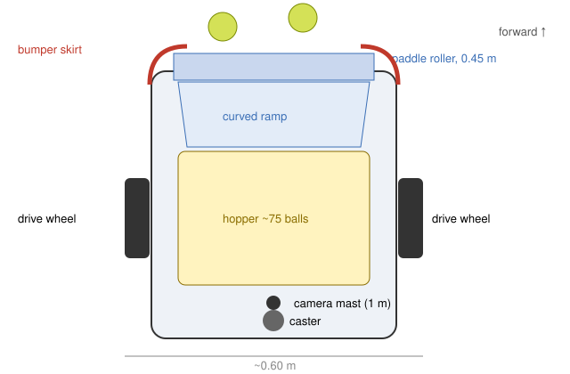

# Ball-collecting rover

A small robot that roams the court and picks up tennis balls while you
practise with a ball machine or a coach, and stays out of the way while it
does. Think robot vacuum, but for tennis balls on a hard court.

Status: **design v0.1, not yet built.** The route planner, path follower
and firmware logic are written and tested in simulation; the mechanism
below has not been built yet.

## How it works

1. **See.** A wide-angle camera on a ~1 m mast looks ahead and down. An
   optic-yellow blob detector finds balls; the court-line homography
   (`vision.Homography`) turns each pixel into a court position.
2. **Plan.** `collector.Planner.collect` orders the pickups (nearest-first,
   then 2-opt), routes around keep-out zones, and schedules a trip to the
   dump point whenever the hopper is full. With no camera, or nothing in
   view, `Planner.sweep` drives a lawn-mower pattern one pickup width apart,
   so the rover works blind too.
3. **Drive.** Pure pursuit (`drive.PurePursuit`) follows each leg; the
   ESP32 closes the wheel-speed loops.
4. **Pick up.** A powered paddle roller across the front rolls each ball up
   a curved ramp into the hopper.
5. **Stay out of the way.** Keep-out zones cover the player's back court
   and the feeder (`collector.practice_zones`, or draw your own around a
   coach). A bumper skirt stops forward motion on contact (reverse is
   still allowed so it can back off), and a 300 ms watchdog stops it if the
   planner goes quiet.

## Main dimensions (v0.1)

| Part | Value | Why |
| --- | --- | --- |
| Overall footprint | ~0.60 m wide x 0.55 m long | Fits through a court gate; small enough to slip between practice zones |
| Pickup width | 0.45 m | Sweep lane spacing in blind mode |
| Drive | 2 x 24 V DC gearmotors with encoders, 150-200 mm non-marking wheels, rear caster | Differential drive turns on the spot |
| Cruise speed | 0.6 m/s (1.0 m/s max) | Slow enough to be predictable around people |
| Hopper | ~75 balls, with a "full" IR beam | One standard basket |
| Camera mast | ~1.0 m | Sees ~6-8 m ahead at a usable ball size |
| Mass | target < 12 kg | Light enough to lift into a car |

## Pickup mechanism

The paddle roller is a 45 cm horizontal rotor with 4-6 soft rubber
paddles, turning so the bottom edge moves toward the robot. It sweeps each
ball up a curved polycarbonate ramp whose lip sits ~5 mm above the court.
A 12-24 V gearmotor at ~150-250 rpm through a MOSFET is enough. The
alternative is a passive wire-cage roller like hand-pushed ball pickers
(balls squeeze between flexible wires and a comb strips them out). It
needs no motor, but it is harder to empty automatically.

## Electronics

Same ESP32 board and protocol as the feeder, in the `collector` role:
two wheel-speed loops, roller on/off, bumpers, hopper-full sensor, e-stop,
battery monitor. Pi 5 (or Pi 4) on top runs detection and planning. Pin
map: [`electronics.md`](electronics.md).

## Localisation

v0.1 uses wheel odometry plus IMU yaw, corrected whenever the camera sees
a court-line intersection it can match. Indoor or night courts may want
UWB anchors at the net posts (see the roadmap in the README).

## Bill of materials

[`bom-collector.csv`](bom-collector.csv). Prices there are rough estimates
for planning, not quotes.

## Open questions (good first issues)

- Ramp lip height vs court surface (hard, clay, artificial grass).
- Does the roller push balls away before it grabs them at 0.6 m/s?
- Dust and clay: sealing the drive and the camera.
- Dumping: a tilting hopper over a standard ball basket, or a docking chute?
