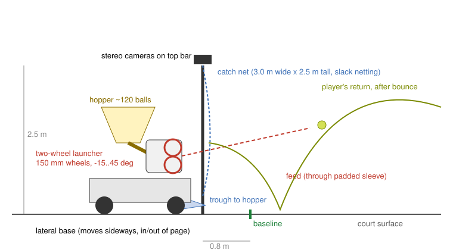

# Feeder with a moving catch net

A tennis ball machine that also catches your returns. It stands behind one
baseline, feeds balls to you with a two-wheel launcher, watches your shot
come back with a pair of cameras, and slides sideways so a 3 m catch net is
where the ball arrives. Caught balls roll down a funnel into the hopper and
get fed again, so a session needs far fewer balls and far less pickup.

Status: **design v0.1, not yet built.** Every dimension below is a starting
point chosen by calculation and simulation (`tennisbots catch-study`), not
a tested build. Open an issue with what you change and why.

## How it works

1. **Feed.** The planner picks the next shot from the drill
   (`tennisbots drill drill.json`), solves elevation, azimuth and the two
   wheel speeds (`launcher.aim`, `WheelLauncher.wheel_rpm`), and sends them
   to the ESP32. The ESP32 holds both wheels at speed (closed loop on a
   once-per-rev tachometer) and opens the feed gate only when both are
   within 5 % of target.
2. **Track.** Two global-shutter cameras on a bar across the top of the net
   frame see the player's half. Each frame, an optic-yellow blob detector
   finds the ball in both images; triangulation gives an (x, y, z) fix; the
   Kalman tracker (`tracker.BallTracker`) turns fixes into position and
   velocity.
3. **Predict and move.** About 20 times a second the planner predicts where
   the ball will cross the net plane (full drag, lift and bounce model) and
   sends the base a new lateral target. The base drives there time-optimally
   (accelerate, cruise, brake).
4. **Catch and recycle.** The ball hits the slack netting, drops into the
   sloped trough along the bottom of the frame, and rolls into the hopper.

## Main dimensions (v0.1)

| Part | Value | Why |
| --- | --- | --- |
| Catch net, usable area | 3.0 m wide x 2.5 m tall | 91 % simulated catch rate at 2.5 m/s, against 96 % for 4 m (see README); no simulated return went over 2.5 m |
| Net plane | 0.8 m behind the baseline | Room for the ball to drop after the bounce without the base on the court |
| Lateral travel | +/- 4.0 m from the centre mark | Covers the singles court plus the angle a crosscourt return carries past the baseline |
| Base speed / accel | 2.5 m/s, 5 m/s^2 | 4 m/s lifts the simulated catch rate from 91 % to 97 %, but needs much more motor; 5 m/s^2 is a guess at what non-marking wheels can do on hard court without wheelspin (measure yours) |
| Launch height | 1.0 m | Typical feed height; adjustable |
| Launcher wheels | 2 x 150 mm, polyurethane tread, stacked vertically | 7,000 rpm is ~55 m/s surface speed |
| Wheel gap | ball diameter minus 10-15 mm (52-56 mm) | Grip without crushing; make it adjustable |
| Elevation range | -15 to +45 deg | Flat drives to lobs |
| Azimuth range | +/- 30 deg | The base moves too, so the head only aims within the court |
| Hopper | ~120 balls | Plus whatever the net recycles |
| Footprint (base) | ~0.9 x 0.7 m with outriggers | Net frame is a sail: outriggers and ballast keep it upright |

## Mechanical

**Base.** 2040 aluminium extrusion rectangle. Four fixed, non-marking
polyurethane wheels (~125-200 mm) with axles along the court (x), so the base
rolls only sideways (y). Two wheels driven by 24 V DC gearmotors with
quadrature encoders through a dual H-bridge; the other two idle. Outrigger
feet with skids stop it tipping when the net catches wind. A rail (two
lengths of extrusion laid behind the baseline) is the higher-precision
alternative; wheels are simpler and need no setup.

**Launcher head.** Two outrunner BLDC motors (the 50-63 mm class sold for
e-skateboards) each driving a 150 mm wheel directly. Stack them vertically
so the speed difference becomes topspin or backspin; tilt the whole head
for elevation (linear actuator or high-torque servo on a pivot) and rotate
it on a small turntable for azimuth. A reflective IR sensor on each hub
counts revolutions. Put a guard over both wheels: they hold a lot of energy
at 7,000 rpm.

**Hopper and feed.** A sloped funnel (sheet PETG or a cut storage tub) with
a slowly turning agitator over a single-ball outlet. A servo-driven gate
releases one ball at a time down a 70 mm ID tube into the wheels.

**Catch net.** A frame of fibreglass or aluminium poles (tent-pole style
sections for transport) holds knotless polyester netting, 25-35 mm mesh,
hung with 10-15 cm of slack so it absorbs the ball rather than bouncing it
back. The launcher fires through a padded sleeve in the net. Along the
bottom, a trough sloped toward the centre feeds a flexible chute into the
hopper inlet. Keep the net taut at the edges so balls do not snag.

## Sensing

- 2 x global-shutter cameras (e.g. the Raspberry Pi Global Shutter Camera,
  run at a reduced resolution for ~120 fps) on a stereo bar 0.6-1.0 m wide
  at the top of the frame, both looking at the player's half. A wider
  baseline gives better depth.
- Calibrate each camera against the court lines (`vision.Homography`) and
  the pair with a checkerboard (OpenCV `stereoCalibrate`).
- Base position: wheel encoders, corrected against the centre mark when the
  cameras see it.

## Software and firmware

- Raspberry Pi 5 runs `tennisbots`: drill planning, detection, tracking,
  catch planning; talks to the ESP32 over UART with
  [`protocol.py`](../src/tennisbots/protocol.py).
- ESP32 runs [`firmware/esp32`](../firmware/esp32/README.md) in the
  `feeder` role: wheel speed loops, aim servos, feed gate, base position
  loop, e-stop and a 300 ms watchdog that stops everything if the Pi goes
  quiet.

## Bill of materials

[`bom-feeder-catcher.csv`](bom-feeder-catcher.csv). Prices there are rough
estimates for planning, not quotes; check current suppliers.

## Open questions (good first issues)

- Netting energy absorption at 30+ m/s: does 10-15 cm of slack stop
  rebounds, or does it need a second, looser curtain?
- Wheel tread: solid polyurethane vs foam-filled; wear and grip.
- Will the stereo pair hold calibration on a frame that moves at 5 m/s^2?
  If not, mount the cameras on a separate tripod and track the base too.
- Wind: measure tipping force on a 7.5 m^2 net and size the ballast.
