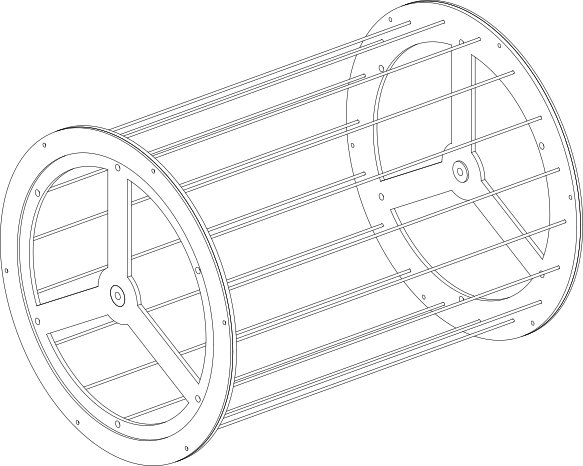
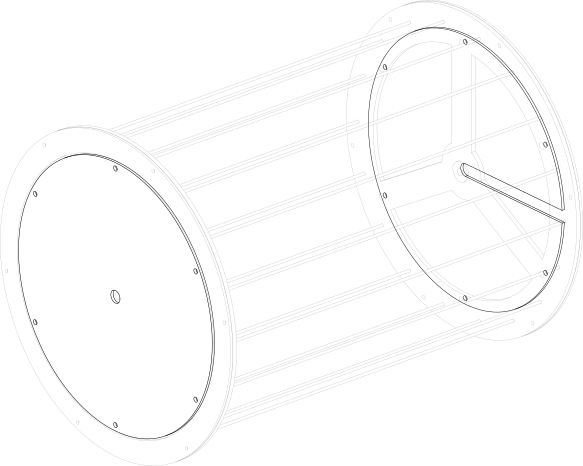
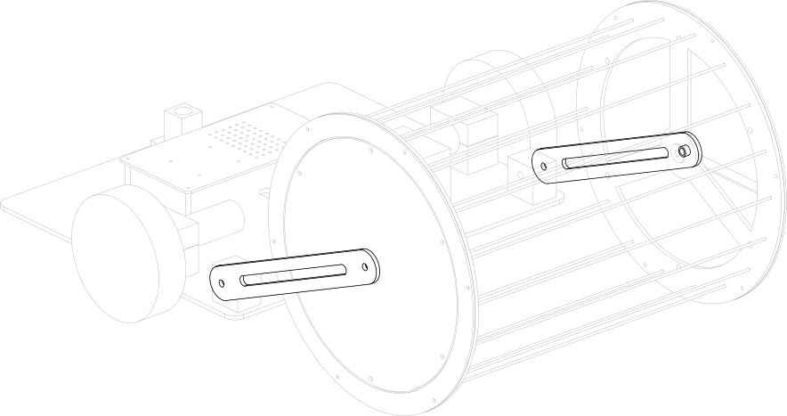

# Collector assembly guide

Generated from the CAD (`python -m otr_cad collector`), with the parts list, the drawings and the
checks below, so it changes when the design does. Design v0.2: **nobody has built one yet.** Read
`hardware/safety.md` first. Report what you find: https://github.com/duncan-haywood/oss-monorepo/issues

Each drawing shows the parts that step adds in black over what is already built in grey.

## Steps

### 1. Prepare the printed parts and the drum discs

| Fastener or part | Qty |
| --- | --- |
| M4 heat-set insert, 5.7 mm long | 20 |
| M5 rivet nut (blind insert), aluminium | 12 |

Tools: soldering iron with an M4 insert tip, M5 rivet nut tool.

Melt one M4 insert into each 5.6 mm pocket: 4 in the top face of each motor clamp cradle (where the cap meets it), 2 in the underside of each cradle, 2 in the underside of each pivot block, and 4 in the underside of the mast socket's flange. Press each one flush and square. Set an M5 rivet nut in each of the six 7 mm holes of both drum discs, flange on the outer face (the face away from the rods). A standard 1 mm flange holds the cover that far off the disc; the arm gap allows for it.

### 2. Lay out the base plate

| Part | Qty | File or what to buy |
| --- | --- | --- |
| base_plate | 1 | laser/base_plate__aluminium_5mm.dxf |

Deburr every hole. The plate's top face is the side the motors sit on; the strap slots are nearest the front (drum) end.

### 3. Mast socket, caster adapter and ball caster

| Part | Qty | File or what to buy |
| --- | --- | --- |
| mast_socket | 1 | print/mast_socket.stl |
| caster_adapter | 1 | print/caster_adapter.stl |
| ball_caster | 1 | ball caster, 25 mm mounting height (e.g. 3/4-1 in ball) |

| Fastener or part | Qty |
| --- | --- |
| M4 x 20 socket cap screw | 4 |
| Ball caster mounting screws | 1 |

Tools: 3 mm hex key.

Stand the mast socket on the top face over the four rear holes, hold the caster adapter under the plate with its counterbores facing down, and drive the four M4 x 20 screws up through adapter and plate into the socket's inserts. Their heads sit in the counterbores, so the caster can then be screwed flat to the adapter: mark and drill its own holes clear of the four heads.

### 4. Drive motors

| Part | Qty | File or what to buy |
| --- | --- | --- |
| motor_clamp_cradle | 2 | print/motor_clamp_cradle.stl |
| gearmotor | 2 | 37 mm gearmotor, 24 V, ~150-200 rpm, 6 mm D shaft, quadrature encoder |
| motor_clamp_cap | 2 | print/motor_clamp_cap.stl |

| Fastener or part | Qty |
| --- | --- |
| M4 x 12 socket cap screw | 4 |
| M4 x 50 socket cap screw | 8 |

Tools: 3 mm hex key.

Screw each cradle down with two M4 x 12 from under the plate. Lay a gearmotor in each cradle, output shaft outward, its face 5 mm inside the plate's edge, and clamp it with a cap and four M4 x 50. Tighten the caps evenly until the motor cannot turn in the clamp; do not crush the gearbox. Route the motor and encoder leads toward the electronics tray.

### 5. Wheels

| Part | Qty | File or what to buy |
| --- | --- | --- |
| wheel | 2 | 150 x 40 mm non-marking wheel + 6 mm D-shaft hub |

Tools: hex key for the hub's grub screw.

Push a hub and wheel onto each 6 mm D shaft, flat side to the grub screw, leaving 6 mm between the wheel and the plate's edge.

### 6. Pivot blocks

| Part | Qty | File or what to buy |
| --- | --- | --- |
| pivot_block | 2 | print/pivot_block.stl |

| Fastener or part | Qty |
| --- | --- |
| M4 x 12 socket cap screw | 4 |

Tools: 3 mm hex key.

Screw both pivot blocks down from below with two M4 x 12 each, bores across the robot.

### 7. Electronics tray on its standoffs

| Part | Qty | File or what to buy |
| --- | --- | --- |
| standoff | 4 | M3 x 30 mm female-female hex standoff |
| electronics_tray | 1 | laser/electronics_tray__aluminium_3mm.dxf |

| Fastener or part | Qty |
| --- | --- |
| M3 x 10 screw | 4 |
| M3 x 8 screw | 4 |

Tools: 2.5 mm hex key.

Screw the four 30 mm standoffs on from under the plate with M3 x 10, then the tray onto them with M3 x 8. The e-stop hole is at the tray's front corner.

### 8. Battery

| Part | Qty | File or what to buy |
| --- | --- | --- |
| battery | 1 | 24 V LiFePO4 10 Ah with BMS, max 80 x 180 x 100 mm |

| Fastener or part | Qty |
| --- | --- |
| 25 mm hook-and-loop strap, 600 mm | 1 |
| 15 A blade fuse + holder | 1 |

Strap the pack down through the two slots in front of the motors. Put the fuse holder on the positive lead within 100 mm of the terminal, and leave the fuse out until the last step.

### 9. Drum cage (a sub-assembly on the bench)

| Part | Qty | File or what to buy |
| --- | --- | --- |
| drum_disc | 2 | laser/drum_disc__aluminium_5mm.dxf |
| drum_bearing | 2 | 608 (or F608) bearing, 8 x 22 x 7 |
| drum_rod | 18 | 3 mm music wire, cut 460 mm |
| rod_clamp_ring | 2 | laser/rod_clamp_ring__aluminium_3mm.dxf |

| Fastener or part | Qty |
| --- | --- |
| M4 x 16 button head + nyloc nut | 12 |

Tools: arbor press or vice, 2.5 mm hex key, 7 mm spanner.

Press a 608 bearing into each disc's bore, flush with the outer face (it stands 2 mm proud on the rod side). Stand one disc outer face down, push the 18 rods through, lower the second disc over them, and check every rod end is flush with both outer faces: the rods set the 450 mm between the discs. Bolt a clamp ring over the rod ends on each side, six M4 x 16 button heads with nylocs inside the drum. Spin the cage on a rod through the bearings: it should run true to about 2 mm at the rim.

### 10. End covers

| Part | Qty | File or what to buy |
| --- | --- | --- |
| drum_cover | 1 | laser/drum_cover__aluminium_3mm.dxf |
| drum_hatch | 1 | laser/drum_hatch__aluminium_3mm.dxf |

| Fastener or part | Qty |
| --- | --- |
| M5 x 12 button head | 6 |
| M5 thumb screw, 12 mm | 6 |

Tools: 3 mm hex key.

Bolt the plain cover to one end with six M5 button heads into the rivet nuts. The slotted cover is the emptying hatch: fit it to the other end with the six thumb screws.

### 11. Hang the drum on the yoke

| Part | Qty | File or what to buy |
| --- | --- | --- |
| yoke_arm | 2 | laser/yoke_arm__aluminium_5mm.dxf |
| axle_spacer | 2 | spacer 8.1 mm ID x 12 mm OD x 7 mm, aluminium or steel (through the cover's 14 mm hole, onto the 608's inner race only) |

| Fastener or part | Qty |
| --- | --- |
| 8 mm x 40 mm shoulder bolt (ISO 7379, M6 thread) + M6 nyloc nut | 2 |
| M8 x 30 hex bolt + M8 nyloc nut | 2 |

Tools: 4 mm hex key, two 10 mm and two 13 mm spanners.

Fit each arm to its pivot block with a shoulder bolt from outside and an M6 nyloc inside the block. Tighten it onto the shoulder: the arm must still swing freely. Stand the drum between the arms, put an axle spacer through each cover's centre hole onto the bearing's inner race, and bolt each arm end to it with an M8 x 30 from outside, nyloc on the inner race (reach it between the rods). The drum should roll freely and the arms lift and drop on their own weight.

### 12. Mast and camera

| Part | Qty | File or what to buy |
| --- | --- | --- |
| mast_tube | 1 | 20 mm OD x 1.5 mm wall aluminium tube, cut 1000 mm |

| Fastener or part | Qty |
| --- | --- |
| Wide-angle camera module + 1 m ribbon/USB | 1 |

Push the tube into the socket (an M4 grub screw if it rattles) and mount the camera at the top, looking forward and down over the drum.

### 13. Electronics

| Fastener or part | Qty |
| --- | --- |
| Raspberry Pi 5 (4 GB) or Pi 4 | 1 |
| M2.5 x 6 screw + 6 mm standoff | 4 |
| ESP32 dev board (ESP32-WROOM-32) | 1 |
| Dual DC motor driver, 10 A/ch, PWM+DIR | 1 |
| 5 V 5 A buck converter | 1 |
| 22 mm NC mushroom e-stop + 24 V contactor | 1 |
| BNO085 (or similar) IMU | 1 |
| Lever microswitch | 2 |

Tools: screwdrivers, crimp tool, multimeter.

Mount the Pi on its M2.5 pattern and the ESP32, motor driver, buck converter and IMU on the 10 mm M3 grid. Fit the e-stop in its hole and the contactor beside it. Wire to hardware/electronics.md (pin map, power budget, e-stop chain). The two lever switches sense the yoke lifting over an obstacle: their mounting is not in the CAD yet, so place them where each arm's lower edge closes them when the drum rises about 10 mm.

### 14. Before the first power-up

Tools: multimeter.

With the fuse out: check the e-stop opens the contactor's coil circuit, and that there is no short from battery positive to the frame. Then fit the fuse with the wheels off the ground and the e-stop pressed, release it, and flash firmware/esp32. Read hardware/safety.md before the robot drives on its own.

## Fastener lengths, checked against the CAD

Each length is measured from the head's face through the parts the model puts under it.

| Joint | Fastener | Stack (mm) | Grip | Length | Spare | Rule | |
| --- | --- | --- | --- | --- | --- | --- | --- |
| motor clamp cap | M4 x 50 socket cap screw | motor_clamp_cap 26.5 | 26.5 | 50 | 23.5 | 5.7 to 29 mm past the face, the insert's length to the pocket's depth | pass |
| cradle to base | M4 x 12 socket cap screw | base_plate 5 | 5 | 12 | 7 | 5.7 to 12 mm past the face, the insert's length to the pocket's depth | pass |
| pivot block to base | M4 x 12 socket cap screw | base_plate 5 | 5 | 12 | 7 | 5.7 to 12 mm past the face, the insert's length to the pocket's depth | pass |
| caster adapter + plate to mast socket | M4 x 20 socket cap screw | caster_adapter 5.5 + base_plate 5 | 10.5 | 20 | 9.5 | 5.7 to 10.5 mm past the face, the insert's length to the pocket's depth | pass |
| rod clamp ring | M4 x 16 button head + nyloc nut | rod_clamp_ring 3 + drum_disc 5 | 8 | 16 | 8 | needs 6.4 mm past the stack for the nyloc and two threads | pass |
| fixed cover | M5 x 12 button head | drum_cover 3 + 1 flange | 4 | 12 | 8 | 5-11 mm into the rivet nut | pass |
| hatch | M5 thumb screw, 12 mm | drum_hatch 3 + 1 flange | 4 | 12 | 8 | 5-11 mm into the rivet nut | pass |
| yoke pivot | 8 mm x 40 mm shoulder bolt (ISO 7379, M6 thread) + M6 nyloc nut | yoke_arm 5 + pivot_block 34.5 | 39.5 | 40 | 0.5 | shoulder 0-1 mm longer than the stack, so the arm swings | pass |
| drum axle | M8 x 30 hex bolt + M8 nyloc nut | yoke_arm 5 + axle_spacer 7 + drum_bearing 7 | 19 | 30 | 11 | needs 10.5 mm past the stack for the nyloc and two threads | pass |
| standoff to base | M3 x 10 screw | base_plate 5 | 5 | 10 | 5 | at least 4.5 mm into the standoff | pass |
| tray to standoff | M3 x 8 screw | electronics_tray 3 | 3 | 8 | 5 | at least 4.5 mm into the standoff | pass |

## Other checks

- Every placed part is fitted in exactly one step, and the steps use every bought line of the BOM
  to the unit.
- Every part a step adds touches something fitted before it (two steps start sub-assemblies).
- The hatch comes off a hung drum: turn the drum until the hatch's slot points down, undo the six
  thumb screws, pull the hatch 3 mm out of its seat and lift it up off the axle spacer.

Result when this package was built: all pass.
