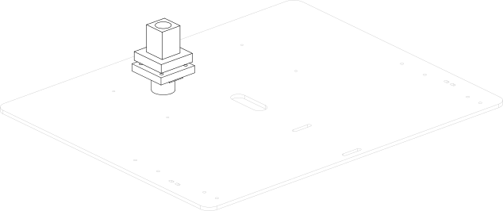
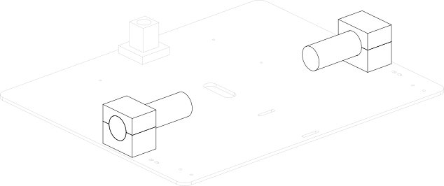
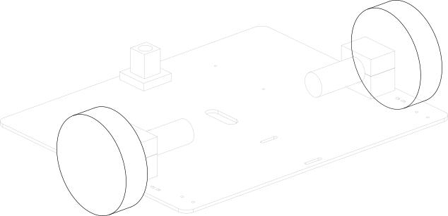
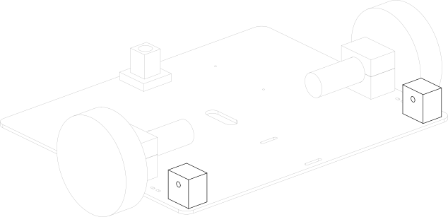
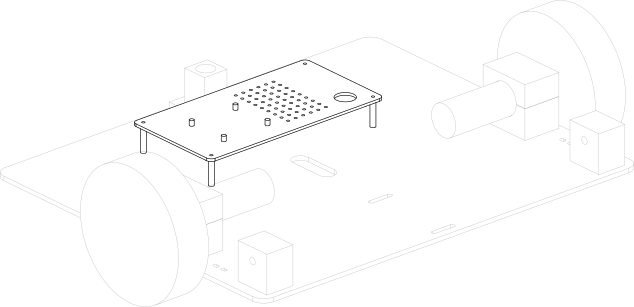
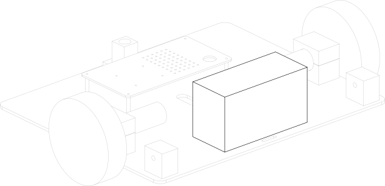
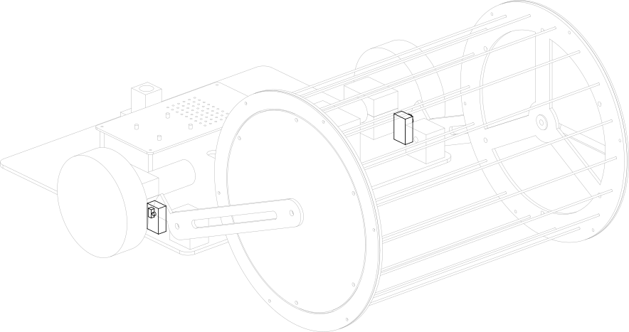
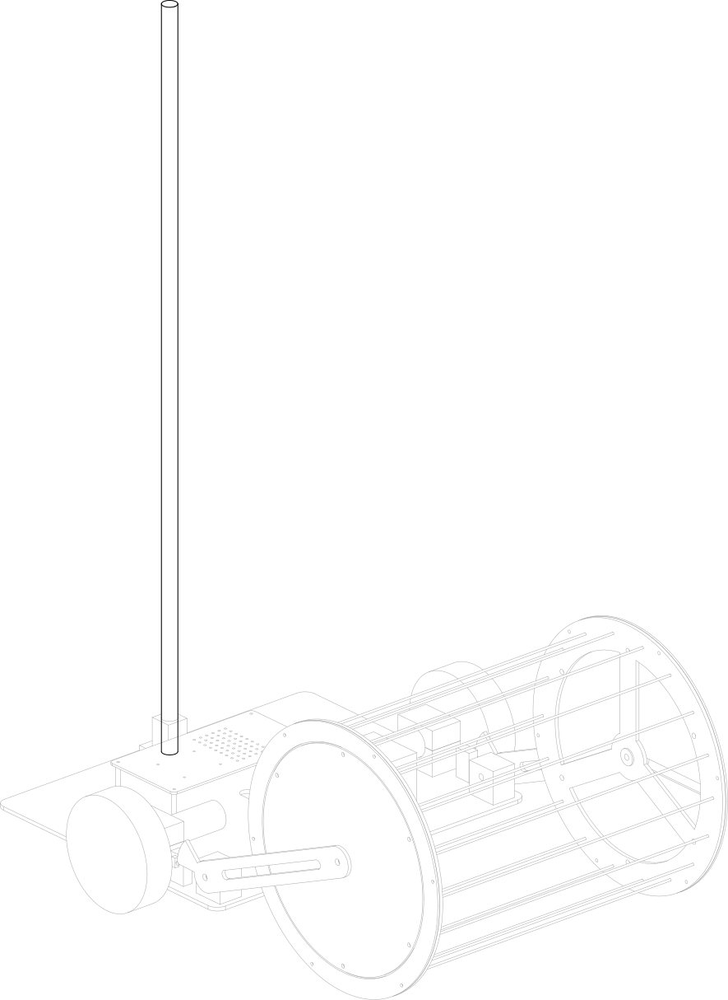

# Collector assembly guide

Generated from the CAD (`python -m otr_cad collector`), with the parts list, the drawings and the
checks below, so it changes when the design does. Design v0.2: **nobody has built one yet.** Read
`hardware/safety.md` first. Report what you find: https://github.com/duncan-haywood/oss-monorepo/issues

Each drawing shows the parts that step adds in black over what is already built in grey.

## Steps

### 1. Prepare the printed parts and the drum discs

| Fastener or part | Qty |
| --- | --- |
| M4 heat-set insert, 5.7 mm long | 26 |
| M5 rivet nut (blind insert), aluminium | 12 |

Tools: soldering iron with an M4 insert tip, M5 rivet nut tool.

Melt one M4 insert into each 5.6 mm pocket: 4 in the top face of each motor clamp cradle (where the cap meets it), 2 in the underside of each cradle, 2 in the underside of each pivot block, 2 in the underside of each yoke-lift switch tower, 4 in the underside of the mast socket's flange, and 2 in the underside of the caster adapter (the two pockets on its centre line). Press each one flush and square. Set an M5 rivet nut in each of the six 7 mm holes of both drum discs, flange on the outer face (the face away from the rods). A standard 1 mm flange holds the cover that far off the disc; the arm gap allows for it.

### 2. Lay out the base plate

| Part | Qty | File or what to buy |
| --- | --- | --- |
| base_plate | 1 | laser/base_plate__aluminium_5mm.dxf |

Deburr every hole. The plate's top face is the side the motors sit on; the strap slots are nearest the front (drum) end.

### 3. Mast socket, caster adapter and ball caster

| Part | Qty | File or what to buy |
| --- | --- | --- |
| mast_socket | 1 | print/mast_socket.stl |
| caster_adapter | 1 | print/caster_adapter.stl |
| ball_caster | 1 | ball caster, 25 mm mounting height (e.g. 3/4-1 in ball), two-hole flange: M4 clearance on 38 mm, 3 mm thick |

| Fastener or part | Qty |
| --- | --- |
| M4 x 20 socket cap screw | 4 |
| M4 x 10 socket cap screw | 2 |

Tools: 3 mm hex key.

Stand the mast socket on the top face over the four rear holes, hold the caster adapter under the plate with its counterbores facing down, and drive the four M4 x 20 screws up through adapter and plate into the socket's inserts. Their heads sit in the counterbores, below the caster's seat. Then hold the caster's flange to the adapter and drive an M4 x 10 up through each of its two holes into the adapter's inserts. The adapter is drawn for holes on 38 mm: measure your caster's, and if they differ set `caster_hole_pitch` (and `caster_flange`) and rebuild before printing.

### 4. Drive motors

| Part | Qty | File or what to buy |
| --- | --- | --- |
| motor_clamp_cradle | 2 | print/motor_clamp_cradle.stl |
| gearmotor | 2 | 37 mm gearmotor, 24 V, ~150-200 rpm, 6 mm D shaft, quadrature encoder |
| motor_clamp_cap | 2 | print/motor_clamp_cap.stl |

| Fastener or part | Qty |
| --- | --- |
| M4 x 12 socket cap screw | 4 |
| M4 x 50 socket cap screw | 8 |

Tools: 3 mm hex key.

Screw each cradle down with two M4 x 12 from under the plate. Lay a gearmotor in each cradle, output shaft outward, its face 5 mm inside the plate's edge, and clamp it with a cap and four M4 x 50. Tighten the caps evenly until the motor cannot turn in the clamp; do not crush the gearbox. Route the motor and encoder leads toward the electronics tray.

### 5. Wheels

| Part | Qty | File or what to buy |
| --- | --- | --- |
| wheel | 2 | 150 x 40 mm non-marking wheel + 6 mm D-shaft hub |

Tools: hex key for the hub's grub screw.

Push a hub and wheel onto each 6 mm D shaft, flat side to the grub screw, leaving 6 mm between the wheel and the plate's edge.

### 6. Pivot blocks

| Part | Qty | File or what to buy |
| --- | --- | --- |
| pivot_block | 2 | print/pivot_block.stl |

| Fastener or part | Qty |
| --- | --- |
| M4 x 12 socket cap screw | 4 |

Tools: 3 mm hex key.

Screw both pivot blocks down from below with two M4 x 12 each, bores across the robot.

### 7. Electronics tray on its standoffs

| Part | Qty | File or what to buy |
| --- | --- | --- |
| standoff | 4 | M3 x 30 mm female-female hex standoff |
| electronics_tray | 1 | laser/electronics_tray__aluminium_3mm.dxf |
| pi_standoff | 4 | M2.5 x 6 mm female-female hex standoff, brass |

| Fastener or part | Qty |
| --- | --- |
| M3 x 10 screw | 4 |
| M3 x 8 screw | 4 |
| M2.5 x 5 screw | 4 |

Tools: 2.5 mm and 2 mm hex keys, 5 mm spanner.

On the bench first, while both faces of the tray can be reached: screw the Pi's four 6 mm standoffs to the top face over its M2.5 holes (the 49 x 58 mm pattern) with an M2.5 x 5 up through each, and tighten with a spanner on the hex. Then screw the four 30 mm standoffs on from under the plate with M3 x 10, and the tray onto them with M3 x 8. The e-stop hole is at the tray's front corner.

### 8. Battery

| Part | Qty | File or what to buy |
| --- | --- | --- |
| battery | 1 | 24 V LiFePO4 10 Ah with BMS, max 80 x 180 x 100 mm |

| Fastener or part | Qty |
| --- | --- |
| 25 mm hook-and-loop strap, 600 mm | 1 |
| 15 A blade fuse + holder | 1 |

Strap the pack down through the two slots in front of the motors. Put the fuse holder on the positive lead within 100 mm of the terminal, and leave the fuse out until the last step.

### 9. Drum cage (a sub-assembly on the bench)

| Part | Qty | File or what to buy |
| --- | --- | --- |
| drum_disc | 2 | laser/drum_disc__aluminium_5mm.dxf |
| drum_bearing | 2 | 608 (or F608) bearing, 8 x 22 x 7 |
| drum_rod | 18 | 3 mm music wire, cut 460 mm |
| rod_clamp_ring | 2 | laser/rod_clamp_ring__aluminium_3mm.dxf |

| Fastener or part | Qty |
| --- | --- |
| M4 x 16 button head + nyloc nut | 12 |

Tools: arbor press or vice, 2.5 mm hex key, 7 mm spanner.

Press a 608 bearing into each disc's bore, flush with the outer face (it stands 2 mm proud on the rod side). Stand one disc outer face down, push the 18 rods through, lower the second disc over them, and check every rod end is flush with both outer faces: the rods set the 450 mm between the discs. Bolt a clamp ring over the rod ends on each side, six M4 x 16 button heads with nylocs inside the drum. Spin the cage on a rod through the bearings: it should run true to about 2 mm at the rim.

### 10. End covers

| Part | Qty | File or what to buy |
| --- | --- | --- |
| drum_cover | 1 | laser/drum_cover__aluminium_3mm.dxf |
| drum_hatch | 1 | laser/drum_hatch__aluminium_3mm.dxf |

| Fastener or part | Qty |
| --- | --- |
| M5 x 12 button head | 6 |
| M5 thumb screw, 12 mm | 6 |

Tools: 3 mm hex key.

Bolt the plain cover to one end with six M5 button heads into the rivet nuts. The slotted cover is the emptying hatch: fit it to the other end with the six thumb screws.

### 11. Hang the drum on the yoke

| Part | Qty | File or what to buy |
| --- | --- | --- |
| yoke_arm | 2 | laser/yoke_arm__aluminium_5mm.dxf |
| axle_spacer | 2 | spacer 8.1 mm ID x 12 mm OD x 7 mm, aluminium or steel (through the cover's 14 mm hole, onto the 608's inner race only) |

| Fastener or part | Qty |
| --- | --- |
| 8 mm x 40 mm shoulder bolt (ISO 7379, M6 thread) + M6 nyloc nut | 2 |
| M8 x 30 hex bolt + M8 nyloc nut | 2 |

Tools: 4 mm hex key, two 10 mm and two 13 mm spanners (the one on the nut 200 mm or longer).

Fit each arm to its pivot block with a shoulder bolt from outside and an M6 nyloc inside the block. Tighten it onto the shoulder: the arm must still swing freely. Stand the drum between the arms, put an axle spacer through each cover's centre hole onto the bearing's inner race, and bolt each arm end to it with an M8 x 30 from outside, nyloc on the inner race: hold it with the long spanner put in straight between two rods, so your fingers are outside the rods, and turn the head outside the arm. The drum should roll freely and the arms lift and drop on their own weight.

### 12. Yoke-lift switches (the front bumper)

| Part | Qty | File or what to buy |
| --- | --- | --- |
| bump_switch_tower | 2 | print/bump_switch_tower.stl |
| bump_switch | 2 | Subminiature roller-lever microswitch (D2F-01L3 class), about 12.8 x 5.8 x 6.5 mm; normally-open contact to GPIO 13 (left) / 14 (right) and GND: it closes when the drum rises 10 mm |
| bump_switch_lever | 2 | the switch's roller lever (free position), part of bump_switch |

| Fastener or part | Qty |
| --- | --- |
| M4 x 12 socket cap screw | 4 |
| M4 washer (ISO 7089) | 4 |
| M2 x 10 self-tapping screw (for plastic) | 4 |

Tools: 3 mm hex key, small Phillips screwdriver, multimeter, a 10 mm block.

On the bench (the wheel hides the screws once it is on), screw each switch to the outboard face of its tower with two M2 self-tappers, roller toward the pivot and lever in the arm's plane. Stand each tower behind its pivot block, outboard face to the arm, and fit two M4 x 12 with washers up through the base plate's slots, finger tight, tower in the middle of its slots. With a meter on the switch, stand both drum discs on a 10 mm block and slide each tower along its slots until its switch just clicks closed; tighten. Off the block, both read open. The lobe on each arm then holds its switch closed from 10 mm of drum rise to the yoke's stop, where the lobe lands on the plate.

### 13. Mast and camera

| Part | Qty | File or what to buy |
| --- | --- | --- |
| mast_tube | 1 | 20 mm OD x 1.5 mm wall aluminium tube, cut 1000 mm |

| Fastener or part | Qty |
| --- | --- |
| Wide-angle camera module + 1 m ribbon/USB | 1 |

Push the tube into the socket (an M4 grub screw if it rattles) and mount the camera at the top, looking forward and down over the drum.

### 14. Electronics

| Part | Qty | File or what to buy |
| --- | --- | --- |
| raspberry_pi | 1 | Raspberry Pi 5 (4 GB) or Pi 4 |

| Fastener or part | Qty |
| --- | --- |
| M2.5 x 4 screw | 4 |
| ESP32 dev board (ESP32-WROOM-32) | 1 |
| Dual DC motor driver, 10 A/ch, PWM+DIR | 1 |
| 5 V 5 A buck converter | 1 |
| 22 mm NC mushroom e-stop + 24 V contactor | 1 |
| BNO085 (or similar) IMU | 1 |

Tools: screwdrivers, crimp tool, multimeter.

Screw the Pi onto its standoffs with four M2.5 x 4, nothing longer: the standoff is threaded right through and the screw from below fills its lower half. Mount the ESP32, motor driver, buck converter and IMU on the 10 mm M3 grid. Fit the e-stop in its hole and the contactor beside it. Wire to hardware/electronics.md (pin map, power budget, e-stop chain). Run each yoke-lift switch's common and normally-open tags to GND and GPIO 13 (left) or 14 (right): the switch closes when its arm lifts, which the firmware reads as the bumper.

### 15. Before the first power-up

Tools: multimeter.

With the fuse out: check the e-stop opens the contactor's coil circuit, and that there is no short from battery positive to the frame. Then fit the fuse with the wheels off the ground and the e-stop pressed, release it, and flash firmware/esp32. Read hardware/safety.md before the robot drives on its own.

## Fastener lengths, checked against the CAD

Each length is measured from the head's face through the parts the model puts under it.

| Joint | Fastener | Stack (mm) | Grip | Length | Spare | Rule | |
| --- | --- | --- | --- | --- | --- | --- | --- |
| motor clamp cap | M4 x 50 socket cap screw | motor_clamp_cap 26.5 | 26.5 | 50 | 23.5 | 5.7 to 29 mm past the face, the insert's length to the pocket's depth | pass |
| cradle to base | M4 x 12 socket cap screw | base_plate 5 | 5 | 12 | 7 | 5.7 to 12 mm past the face, the insert's length to the pocket's depth | pass |
| pivot block to base | M4 x 12 socket cap screw | base_plate 5 | 5 | 12 | 7 | 5.7 to 12 mm past the face, the insert's length to the pocket's depth | pass |
| caster adapter + plate to mast socket | M4 x 20 socket cap screw | caster_adapter 5.5 + base_plate 5 | 10.5 | 20 | 9.5 | 5.7 to 10.5 mm past the face, the insert's length to the pocket's depth | pass |
| rod clamp ring | M4 x 16 button head + nyloc nut | rod_clamp_ring 3 + drum_disc 5 | 8 | 16 | 8 | needs 6.4 mm past the stack for the nyloc and two threads | pass |
| fixed cover | M5 x 12 button head | drum_cover 3 + 1 flange | 4 | 12 | 8 | 5-11 mm into the rivet nut | pass |
| hatch | M5 thumb screw, 12 mm | drum_hatch 3 + 1 flange | 4 | 12 | 8 | 5-11 mm into the rivet nut | pass |
| yoke pivot | 8 mm x 40 mm shoulder bolt (ISO 7379, M6 thread) + M6 nyloc nut | yoke_arm 5 + pivot_block 34.5 | 39.5 | 40 | 0.5 | shoulder 0-1 mm longer than the stack, so the arm swings | pass |
| drum axle | M8 x 30 hex bolt + M8 nyloc nut | yoke_arm 5 + axle_spacer 7 + drum_bearing 7 | 19 | 30 | 11 | needs 10.5 mm past the stack for the nyloc and two threads | pass |
| switch tower to base | M4 x 12 socket cap screw | base_plate 5 + 0.8 washers | 5.8 | 12 | 6.2 | 5.7 to 12 mm past the face, the insert's length to the pocket's depth | pass |
| switch to tower | M2 x 10 self-tapping screw (for plastic) | bump_switch 5.8 | 5.8 | 10 | 4.2 | 2 to 8 mm into the part's tapped hole (its thread depth) | pass |
| caster flange to adapter | M4 x 10 socket cap screw | ball_caster 3 | 3 | 10 | 7 | 5.7 to 8.5 mm past the face, the insert's length to the pocket's depth | pass |
| Pi standoff to tray | M2.5 x 5 screw | electronics_tray 3 | 3 | 5 | 2 | 2 to 3 mm into the standoff (1.5 d, or its thread less 1 mm; never past it) | pass |
| Pi to standoff | M2.5 x 4 screw | raspberry_pi 1.6 | 1.6 | 4 | 2.4 | 2 to 3 mm into the standoff (1.5 d, or its thread less 1 mm; never past it) | pass |
| standoff to base | M3 x 10 screw | base_plate 5 | 5 | 10 | 5 | at least 4.5 mm into the standoff | pass |
| tray to standoff | M3 x 8 screw | electronics_tray 3 | 3 | 8 | 5 | at least 4.5 mm into the standoff | pass |

## Other checks

- Every placed part is fitted in exactly one step, and the steps use every bought line of the BOM
  to the unit.
- Every part a step adds touches something fitted before it (two steps start sub-assemblies).
- The hatch comes off a hung drum: turn the drum until the hatch's slot points down, undo the six
  thumb screws, pull the hatch 3 mm out of its seat and lift it up off the axle spacer.
- Every screw goes in along its axis at every one of its holes, both sides of the robot: a
  cylinder the head's size (a finger and thumb's, 20 mm across, for the hatch's thumb screws),
  60 mm back from the seat, misses the parts the screw clamps, and misses everything already on
  the work when its step comes (the bench steps: everything that step adds).
- With the hatch's slot down, a finger reaches all six thumb screws: the yoke arm hides one
  screw over 24 degrees of every 60 of drum turn, and the slot-down turn is 11 degrees from that
  (stop the drum by hand within that and the arm is clear).

## Service access

On the finished robot these screws are hidden behind other parts; take those off first.

| Joint | Fastener | Hidden holes | Behind |
| --- | --- | --- | --- |
| fixed cover | M5 x 12 button head | 1 of 6 | yoke_arm |
| hatch | M5 thumb screw, 12 mm | 1 of 6 | yoke_arm |
| switch to tower | M2 x 10 self-tapping screw (for plastic) | 4 of 4 | wheel |
| Pi standoff to tray | M2.5 x 5 screw | 4 of 4 | base_plate |

The drum's covers turn with the drum: turn it until the arm is clear of the screw.

## Spanners on the nuts

Each nut, at every one of its holes, when its step comes: a ring spanner of the nut's size (its length assumed: 5.5 mm, 85 long, 7 mm, 100 long, 8 mm, 110 long, 10 mm, 130 long, 13 mm, 165 long, unless the step asks for another) and
the hand on its end (35 mm of fingers, then 150 mm of hand and wrist along the shank, 25 mm deep) are laid on the nut and
turned about the bolt 5 degrees at a time. "Nut" is the widest arc that is clear at the worst hole; a nut needs one clear angle to be held,
and 30 degrees (a 12-point ring's step) to be turned. A hex head turned with a spanner is swung the same way ("Head").

| Joint | Fastener | Step | Spanner on the nut | Holes | Nut (deg) | Head (deg) | Turn | |
| --- | --- | --- | --- | --- | --- | --- | --- | --- |
| rod clamp ring | M4 x 16 button head + nyloc nut | 9 | 7 mm, 100 long | 12 | 205 | - | head (key) or nut | pass |
| yoke pivot | 8 mm x 40 mm shoulder bolt (ISO 7379, M6 thread) + M6 nyloc nut | 11 | 10 mm, 130 long | 2 | 90 | - | head (key) or nut | pass |
| drum axle | M8 x 30 hex bolt + M8 nyloc nut | 11 | 13 mm, 200 long | 2 | 15 | 330 | head | pass |

## A deep socket on an extension

The other way onto each nut: a deep socket along the bolt's axis, so the bolt's tail runs up inside
it, on the shortest bar of a set (0, 50, 75, 100, 150, 250 mm) that clears the work, with a ratchet on the bar's end and the hand on the ratchet's handle as on a spanner.
Sizes are typical of 1/4" drive deep sockets (3/8" for 13 mm), assumed. "Arc" is the widest clear arc of the handle at the worst hole; 15 degrees turns the nut. A report, not a
check: the steps ask for the spanners above. "Way on" is how the tool gets to the nut in two
straight moves from wholly outside the work: straight down the bolt's axis ("axis"), or in sideways
along the handle, head first, then down the axis ("sideways"), the socket's mouth starting past the
bolt's end; "none" means no straight way at some hole (a curved one may still exist).

| Joint | Socket | Tail past the nut (mm) | Bar (mm) | Arc (deg) | Way on | Socket turns it |
| --- | --- | --- | --- | --- | --- | --- |
| rod clamp ring | 7 mm deep | 3 | 0 | 195 | sideways | yes |
| yoke pivot | 10 mm deep | - | 0 | 100 | sideways | yes |
| drum axle | 13 mm deep | 3 | 0 | 15 | sideways | yes |

Result when this package was built: all pass.
