# Feeder assembly guide

Generated from the CAD (`python -m otr_cad feeder`), with the parts list, the drawings and the
checks below, so it changes when the design does. Design v0.2: **nobody has built one yet.** Read
`hardware/safety.md` first. Report what you find: https://github.com/duncan-haywood/oss-monorepo/issues

Each drawing shows the parts that step adds in black over what is already built in grey.

The feeder is about 3 m wide and 2.7 m tall with the net poles up: build the base on the floor where it will
stand, and have a second person for the hopper posts, the lift column and the poles. The steps go base first,
then the mast and turntable, the head (on the bench), the hopper, the net and trough, the lift and the wiring.

## Steps

### 1. Prepare the printed parts and the test print

| Part | Qty | File or what to buy |
| --- | --- | --- |
| lift_bearing_fit_ring | 1 | print/lift_bearing_fit_ring.stl |

| Fastener or part | Qty |
| --- | --- |
| M4 heat-set insert, 5.7 mm long | 8 |
| M4 heat-set insert, 5.7 mm long (azimuth) | 3 |
| M4 heat-set insert, 5.7 mm long (stops) | 4 |
| M4 heat-set insert, 5.7 mm long (feed) | 12 |
| M4 heat-set insert, 5.7 mm long (servo) | 6 |
| M4 heat-set insert, 5.7 mm long (agitator) | 3 |
| M4 heat-set insert, 5.7 mm long (spring bracket) | 2 |

Tools: soldering iron with an M4 insert tip.

Print the bearing fit ring first, press a spare F626 into each bore and run `python -m otr_cad fit-ring` (cad/README.md, "Bearing fit test ring"): it sets the lift boot's bearing pockets before you print the boot. Then melt one M4 insert into each 5.6 mm pocket, flush and square: two in each cheek foot (the underside and the face toward the cheek), three in the top of the gear sector, two in the underside of each azimuth stop block, one in each side of the feed floor and the feed roof at each screw (eight), four in the sleeve socket's flange, one in each servo bracket leg and tab (five), one in the shuttle's +y side, three in the top of the agitator's motor mount and two in the top of the take-up spring's bracket. The feed floor's inserts sit 1.2 mm under the face the shuttle slides on: if setting one lifts that face, sand it flat.

### 2. Base frame

| Part | Qty | File or what to buy |
| --- | --- | --- |
| net_beam | 1 | 2040 T-slot, cut 3000 mm |
| rear_rail | 1 | 2040 T-slot, cut 900 mm |
| side_rail | 2 | 2040 T-slot, cut 660 mm |
| mast_rail | 2 | 2040 T-slot, cut 860 mm |

| Fastener or part | Qty |
| --- | --- |
| M5 x 30 button head (frame) | 16 |
| M5 x 50 button head (mast posts) | 8 |

Tools: M5 tap, 5.5 mm drill, 3 mm hex key, square.

Tap both core bores of each end of the side rails and mast rails M5, at least 15 mm deep. Lay the net beam (front, 3 m), the rear rail and the two side rails on a flat floor and drill 5.5 mm through the net beam and the rear rail where each side rail's two bores meet them: two M5 x 30 through each into the side rail's end. Fit the two mast rails between the side rails the same way, through the side rails from outside. Square the frame corner to corner before the last screw is tight. While the mast rails are loose, drill 5.5 mm down through each one at the four mast posts' core bores (step 5) and push the eight M5 x 50 up through from below: their heads bear on the bottom slot's lips.

### 3. Levelling feet

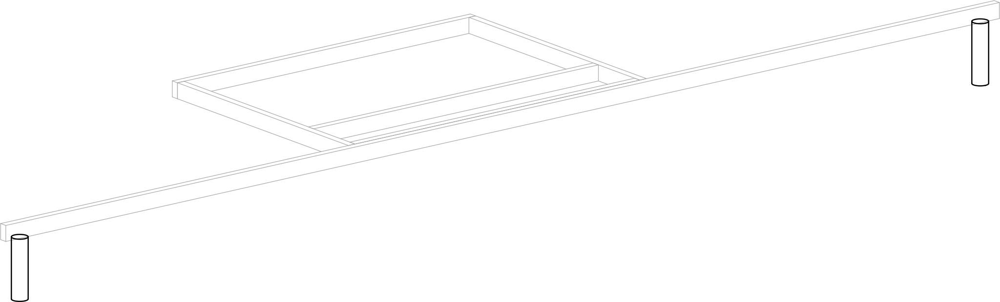

| Part | Qty | File or what to buy |
| --- | --- | --- |
| foot_block | 2 | print/foot_block.stl |
| levelling_foot | 2 | M6 x 80 swivel levelling foot, 40 mm rubber pad about 25 mm tall, up into the captive nut of a printed foot block under the beam, with a thin jam nut (155 mm of stud into a T-nut, as listed until 2026-11-22: 4 mm of travel and a stud that bent in the design wind; cad/README.md, "Levelling feet") |

| Fastener or part | Qty |
| --- | --- |
| M5 x 12 button head + T-nut (levelling feet) | 4 |
| M6 nut + M6 thin jam nut (levelling feet) | 2 |

Tools: 3 mm hex key, 10 mm spanner.

Slide two M5 T-nuts into the net beam's bottom slot at each end, 1450 mm either side of the middle, 60 mm apart, and screw a foot block up to them (two M5 x 12 up through its flange), its nut slot facing the rear. Slide an M6 nut into each block's slot, run the jam nut onto the foot's stud and screw the stud up through the captive nut. Set the feet to take the beam's ends just off the ground once the wheels carry the rest, then hold the pad and run the jam nut up tight under the block with the 10 mm spanner. Each pad rises 50 mm or drops 38 mm from level ground.

### 4. Drive and idler wheels

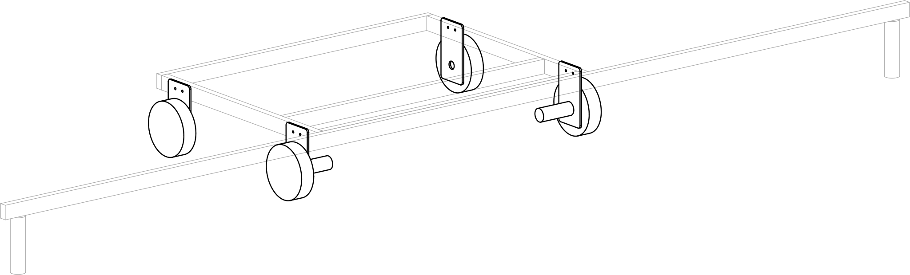

| Part | Qty | File or what to buy |
| --- | --- | --- |
| drive_bracket | 2 | laser/drive_bracket__aluminium_5mm.dxf |
| idler_bracket | 2 | laser/idler_bracket__aluminium_5mm.dxf |
| gearmotor | 2 | 37 mm gearmotor, 24 V, ~200 rpm, 6 mm D shaft, quadrature encoder |
| wheel | 4 | 150 x 40 mm non-marking wheel, 40 mm hub: 6 mm D hub (drive) or two 608 bearings and a spacer tube in the hub, 8 mm bore (idler, as a scooter wheel's) |
| idler_axle_spacer | 4 | Steel bearing spacer, 8.2 x 12 x 2 mm (a 608's inner-race spacer): one between the idler bracket and the hub's inner race, one under the nyloc |

| Fastener or part | Qty |
| --- | --- |
| M5 x 12 button head | 8 |
| M5 T-nut (slot 6) | 8 |
| M3 x 8 screw | 12 |
| M8 x 65 hex bolt + nyloc nut (idler axle) | 2 |

Tools: 3 mm and 2.5 mm hex keys, two 13 mm spanners.

Screw each gearmotor's face to the inside of a drive bracket (six M3 x 8), shaft out through the 14 mm hole. Bolt the drive brackets near the net beam and the idler brackets near the rear rail to the side rails' outer slots (two M5 x 12 into T-nuts each). The idler axles are fixed: push an M8 x 65 out through each idler bracket's 8.4 mm hole from the inside, then a spacer, the wheel (its own two 608s turn) and a second spacer, and tighten the nyloc outside with the head held: it clamps the hub's inner races, so the bolt does not turn. Spin the wheel: it should run free with no end play. Push the drive wheels' hubs onto the 6 mm D shafts, flat to the grub screw, 2 mm off the bracket.

### 5. Mast posts and cable crossbar

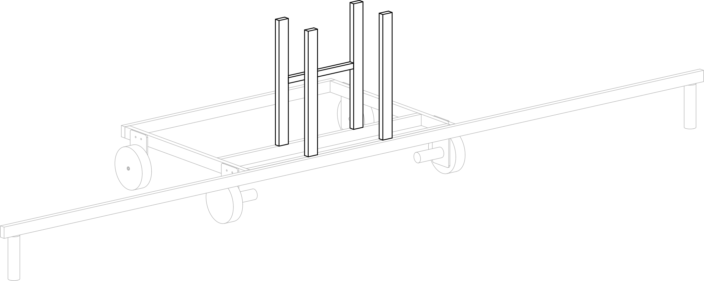

| Part | Qty | File or what to buy |
| --- | --- | --- |
| mast_post | 4 | 2040 T-slot, cut 445 mm, M5 tapped both ends |
| cable_crossbar | 1 | 2020 T-slot, cut 280 mm |

| Fastener or part | Qty |
| --- | --- |
| 2020 corner bracket with M5 screws and T-nuts (cable crossbar) | 2 |

Tools: 4 mm and 3 mm hex keys.

Tap both core bores of each end of the four posts M5. Stand each post on its mast rail over two of the M5 x 50s from step 2 and screw them up into its bores (the post's 40 mm side runs along the net). Fit the 2020 crossbar between the two rear posts' inner faces with a corner bracket at each end, its top 430 mm off the ground.

### 6. Mast plate, azimuth stepper, home switch and hard stops

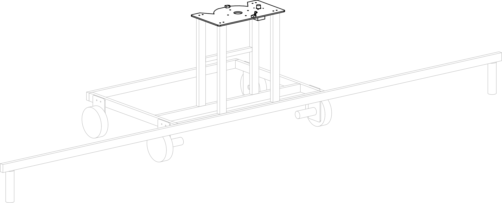

| Part | Qty | File or what to buy |
| --- | --- | --- |
| mast_plate | 1 | laser/mast_plate__aluminium_5mm.dxf |
| az_stepper | 1 | NEMA 17 stepper, 0.4 N m holding (17HS4401 class), 5 mm shaft at least 20 mm long, flange up under the mast plate |
| az_pinion | 1 | Spur pinion, module 1.5, 15 teeth, 20 deg, 5 mm bore, steel, set screw (drawn at its root circle so the mesh is not a clash) |
| home_switch_bracket | 1 | print/home_switch_bracket.stl |
| home_switch | 1 | Subminiature roller-lever microswitch (D2F-01L3 class), about 12.8 x 5.8 x 6.5 mm; normally open, wired to GPIO 22 and GND (firmware AZ_HOME_DEG -32) |
| home_switch_lever | 1 | the switch's roller lever (free position), part of home_switch |
| az_stop_block | 2 | print/az_stop_block.stl |
| az_stop_pad | 2 | Polyurethane sheet, Shore 70A, 5 mm, cut 12 x 6 mm (two); glued to the stop blocks' faces (modulus about 5.5 MPa assumed: check your sheet) |

| Fastener or part | Qty |
| --- | --- |
| M5 x 12 button head | 8 |
| M3 x 8 screw (azimuth stepper) | 4 |
| M3 x 12 socket cap screw + washer + nut (home switch) | 2 |
| M2 x 10 self-tapping screw | 2 |
| M4 x 12 socket cap screw (stops) | 4 |
| Contact adhesive (polyurethane to PETG) | 1 |

Tools: 3 mm, 2.5 mm and 1.5 mm hex keys.

Screw the mast plate onto the posts' top ends, two M5 x 12 into each post's bores. Hang the stepper under it, shaft up through the 23 mm hole, with four M3 x 8 from above (a NEMA 17's flange threads are about 4.5 mm deep: a longer screw bottoms before it clamps). Push the pinion on the shaft with its teeth's top face 0.5 mm over the plate, set screw on the flat. Glue a polyurethane pad on each stop block's face toward the gear sector and screw the blocks up from under the plate (two M4 x 12 each). Screw the home switch to its bracket (two M2) and the bracket to the plate through its slots (M3 x 12, washer and nut under the plate), set mid-slot for now; the last step sets it. (The pinion rides 5.5 mm over the stepper's face on its shaft, which is not modelled.)

### 7. Turntable bearing

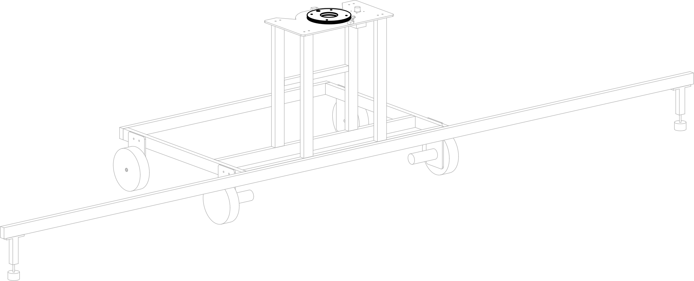

| Part | Qty | File or what to buy |
| --- | --- | --- |
| turntable_bearing | 1 | Lazy-susan bearing, 150 mm round, 10 mm tall, 60 mm open centre: two stacked 2 mm steel flanges with the balls between, each with 4 x 5.5 mm holes on a 120 mm circle and one 12 mm access hole on it; at least 6 mm between the flanges at the holes (assumed: read yours) |
| turntable_bearing_ring | 1 | The lazy-susan's turning (upper) ring: comes with the bearing above, not bought on its own |

| Fastener or part | Qty |
| --- | --- |
| M5 x 16 button head + nyloc nut (turntable bearing) | 4 |

Tools: 3 mm hex key, 8 mm spanner.

Set the bearing on the mast plate with the fixed (lower) ring's access hole over the plate's 12 mm access hole and its four holes over the plate's. Turn the upper ring until its access hole is over one of them, drop an M5 x 16 through both, head down on the fixed ring, and run a nyloc on under the plate, the head held with the key through the access hole. Turn the upper ring 90 deg to the next hole and repeat. The heads sit in the gap between the rings, where the upper ring's heads will pass over them.

### 8. Turntable plate and gear sector

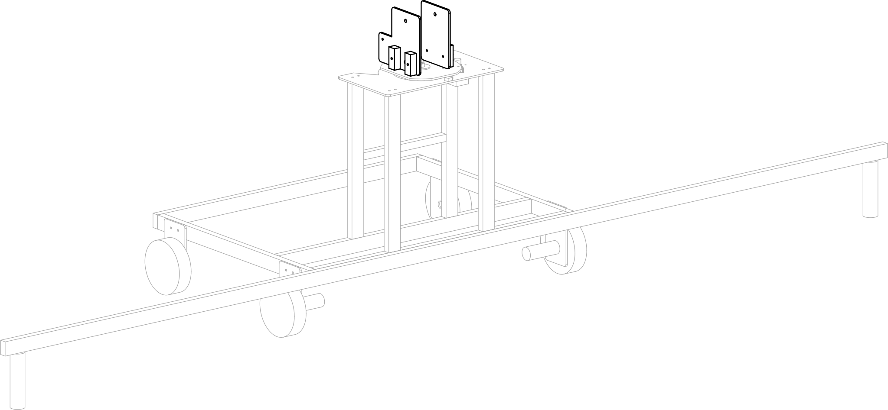

| Part | Qty | File or what to buy |
| --- | --- | --- |
| az_gear_sector | 1 | print/az_gear_sector.stl |
| turntable_plate | 1 | laser/turntable_plate__aluminium_5mm.dxf |
| cable_gland | 1 | print/cable_gland.stl |

| Fastener or part | Qty |
| --- | --- |
| M5 x 16 button head + nyloc nut (turntable bearing) | 4 |
| M4 x 12 socket cap screw (azimuth) | 3 |

Tools: 3 mm hex key, 8 mm spanner.

Lay the turntable plate on the upper ring, its four 5.5 mm holes over the ring's (the gear sector is not on yet, so plate and ring turn all the way round). Turn them until one hole is over the mast plate's access hole, push an M5 x 16 up from under the mast plate through the access holes and the upper ring and plate, head in the gap, and run a nyloc on above, the head held with the key from below. Turn 90 deg and repeat for the other three. Then screw the gear sector up under the plate's +y edge, three M4 x 12 from above. Turn the plate by hand through +-35 deg: the sector meshes with the pinion all the way and stops on the pads. Push the cable gland into the plate's centre hole from above.

### 9. Trunnion cheeks

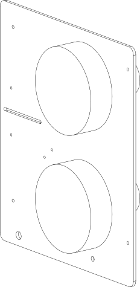

| Part | Qty | File or what to buy |
| --- | --- | --- |
| cheek_foot | 4 | print/cheek_foot.stl |
| trunnion_cheek | 1 | laser/trunnion_cheek__aluminium_5mm.dxf |
| trunnion_cheek_elev | 1 | laser/trunnion_cheek_elev__aluminium_5mm.dxf |

| Fastener or part | Qty |
| --- | --- |
| M4 x 12 socket cap screw | 8 |
| Snap-in grommet for a 10 mm hole, 6 mm bore or more | 1 |

Tools: 3 mm hex key.

Screw two feet to the outer face of each cheek (M4 x 12 through the cheek into the face inserts), then stand the cheeks on the turntable plate and screw the feet down from under it (M4 x 12 into the underside inserts). The cheek with the rear tab goes on the -y (guard) side. Snap the grommet into that cheek's small hole under the pivot.

### 10. Head: motor plate, launcher motors and wheels (on the bench)

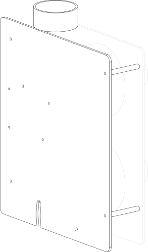

| Part | Qty | File or what to buy |
| --- | --- | --- |
| head_motor_plate | 1 | laser/head_motor_plate__aluminium_5mm.dxf |
| launcher_motor | 2 | BLDC outrunner, 63 mm class, 8 mm shaft, 24 V, ~1 kW peak |
| launcher_wheel | 2 | 150 x 45 mm polyurethane-tread wheel on an 8 mm shaft hub |

| Fastener or part | Qty |
| --- | --- |
| M4 x 12 socket cap screw (motors) | 8 |
| Snap-in grommet for a 14 mm hole | 1 |

Tools: 3 mm hex key.

Lay the motor plate outer face up. Screw each outrunner to it (four M4 x 12 on the 25 mm square; check that a screw reaches no further into your motor than its mounting threads go, or it can touch the windings). Fit each wheel's hub on its shaft from the plate's inner face. Snap the 14 mm grommet into the plate's wiring hole.

### 11. Head: feed floor, roof column, shuttle and guard plate

| Part | Qty | File or what to buy |
| --- | --- | --- |
| head_standoff | 4 | M5 female-female standoff, 80 mm |
| cable_clip | 1 | print/cable_clip.stl |
| feed_floor | 1 | print/feed_floor.stl |
| feed_roof_column | 1 | print/feed_roof_column.stl |
| feed_shuttle | 1 | print/feed_shuttle.stl |
| head_guard_plate | 1 | laser/head_guard_plate__aluminium_5mm.dxf |

| Fastener or part | Qty |
| --- | --- |
| M5 x 12 button head | 8 |
| M4 x 12 socket cap screw (feed) | 8 |

Tools: 3 mm hex key.

Slide the cable clip onto the rear lower standoff. Screw the four standoffs to the motor plate's inner face (M5 x 12), the feed floor and the roof column to it (M4 x 12 into their inserts), drop the shuttle on the floor under the column (insert side toward the motor plate), and close the head with the guard plate (four M5 x 12 into the standoffs, four M4 x 12 into the floor and roof). The shuttle must slide its full stroke by hand.

### 12. Head: shuttle drive

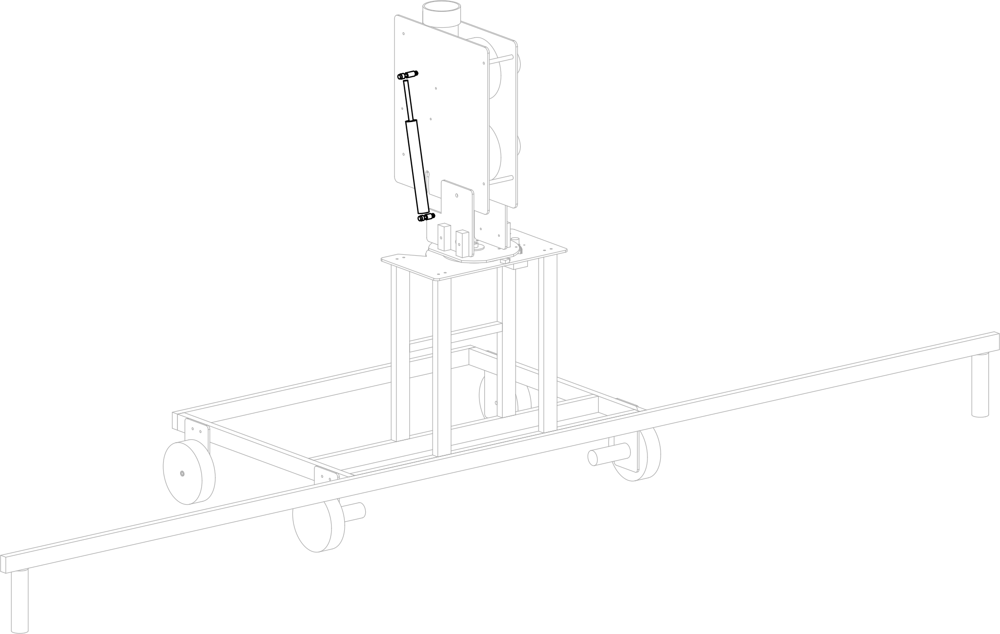

| Part | Qty | File or what to buy |
| --- | --- | --- |
| shuttle_servo_bracket | 1 | print/shuttle_servo_bracket.stl |
| shuttle_servo | 1 | Standard-size digital servo, 18 kg cm class (1.75 N m stall), 0.16 s per 60 deg, 180 deg between the gate pulses, metal gears, round aluminium horn (drawn 40.5 x 20 x 40.5 mm, tabs 54 mm) |
| shuttle_crank | 1 | print/shuttle_crank.stl |
| shuttle_rod | 1 | print/shuttle_rod.stl |
| shuttle_pin | 1 | M4 shoulder bolt, 5 x 12 mm shoulder, 5 mm thread: through the rod and the motor plate's slot into the shuttle's insert; its shoulder ends on the shuttle's face |
| crank_pin | 1 | M4 shoulder bolt, 5 x 6 mm shoulder, 5 mm thread: through the crank into the rod's insert (the crank turns on the shoulder); medium threadlocker |

| Fastener or part | Qty |
| --- | --- |
| M4 x 12 socket cap screw (servo legs) | 3 |
| M4 x 10 socket cap screw (servo tabs) | 2 |
| M4 heat-set insert, 4 mm long (crank pin) | 1 |

Tools: 3 mm and 2.5 mm hex keys, soldering iron with an insert tip.

Press the short M4 insert into the rod's crank-end pocket from the side that will face the crank, flush with that face. Screw the servo bracket's three legs to the motor plate (M4 x 12 from inside the head into the leg inserts) and the servo into the cradle by its tabs (two M4 x 10). Centre the servo, screw the crank to its horn, and join crank and shuttle with the rod (insert toward the crank): the 12 mm shoulder bolt through the rod and the plate's slot into the shuttle's insert, tight, so its shoulder seats on the shuttle; the 6 mm one through the crank into the rod's insert with a drop of threadlocker, tight, so its shoulder seats on the insert and the crank turns on it. Neither takes a nut: there is 1 mm between the rod and the plate. Turn the servo by hand through its range: the shuttle runs its stroke without binding.

### 13. Hang the head and fit the elevation actuator

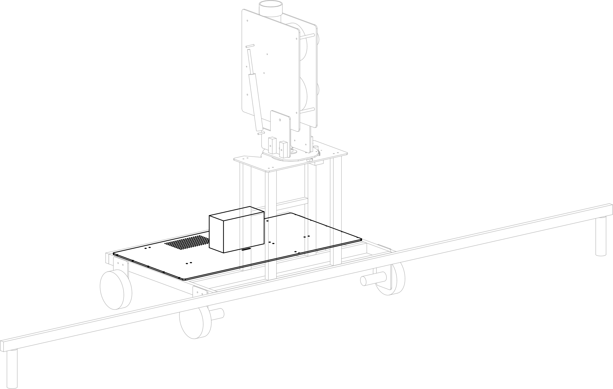

| Part | Qty | File or what to buy |
| --- | --- | --- |
| elev_actuator | 1 | Linear actuator, 12-24 V, 150 mm stroke, 220 N class, clevis eyes for M6, retracted 246 mm hole to hole (drawn at 0 deg; posed per pose in the sweeps) |
| elev_actuator_rod | 1 | The elev_actuator's own rod (not bought separately), drawn at 0 deg |
| elev_pin | 1 | Shoulder bolt, ISO 7379, 6 x 40 mm shoulder, M5 thread, + M5 thin nut (DIN 439, 2.7 mm) + medium threadlocker: through two spacers, the actuator's rod eye and the guard plate (nut inside the head) |
| elev_pin_spacer_outer | 1 | print/elev_pin_spacer_outer.stl |
| elev_pin_spacer_inner | 1 | print/elev_pin_spacer_inner.stl |
| elev_anchor_bolt | 1 | Shoulder bolt, ISO 7379, 6 x 30 mm shoulder, M5 thread, + M5 thin nut (DIN 439, 2.7 mm) + medium threadlocker: through two spacers, the actuator's anchor eye and the guard-side cheek's tab (nut inboard) |
| elev_anchor_spacer_outer | 1 | print/elev_anchor_spacer_outer.stl |
| elev_anchor_spacer_inner | 1 | print/elev_anchor_spacer_inner.stl |

| Fastener or part | Qty |
| --- | --- |
| M8 x 120 bolt + nyloc nut + 4 washers | 1 |
| Medium-strength threadlocker | 1 |

Tools: 13 mm and 8 mm spanners, 5 mm, 4 mm and 3 mm hex keys.

Lift the head between the cheeks and push the M8 pivot bolt through cheek, washer, head plate, head plate, washer and cheek, with a washer under the head and the nyloc. Tighten until the head swings freely with no end play. Fit the actuator's anchor eye to the guard cheek's tab and its rod eye to the guard plate's pin, each on its 6 mm shoulder bolt (M5 thread) with the short printed spacer under the head and the long one between the eye and the aluminium, and a thin M5 nut with threadlocker inside: the shoulder seats on the plate, and the eye turns between the spacers. (The bolt's 9.5 mm thread leaves 4.5 mm past a 5 mm plate, too little for a nyloc and two threads.) Drive it to the head's level position before you let go: the head is nose-heavy or tail-heavy depending on the pose.

### 14. Deck, battery and stepper driver carrier

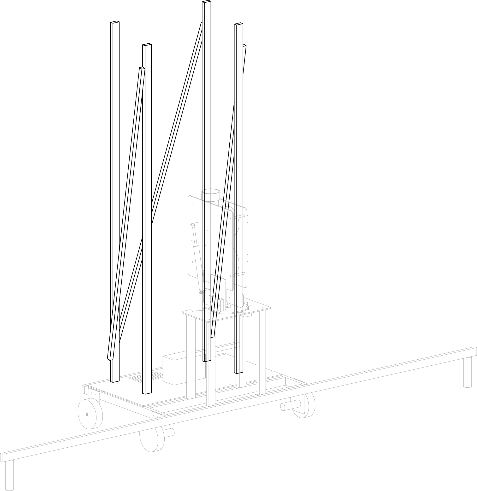

| Part | Qty | File or what to buy |
| --- | --- | --- |
| base_deck | 1 | laser/base_deck__aluminium_5mm.dxf |
| battery | 1 | 24 V (8S) LiFePO4 20 Ah with BMS, max 90 x 200 x 130 mm |
| stepper_driver_carrier | 1 | print/stepper_driver_carrier.stl |

| Fastener or part | Qty |
| --- | --- |
| M5 x 12 button head | 10 |
| M5 T-nut (slot 6) | 10 |
| 25 mm hook-and-loop strap, 600 mm (battery) | 1 |
| M3 x 20 screw + nut (stepper driver carrier) | 4 |

Tools: 3 mm and 2.5 mm hex keys, 5.5 mm spanner.

Bolt the deck onto the side rails' top slots (ten M5 x 12 into T-nuts). Strap the battery down through the two slots, terminals toward the electronics. Screw the stepper driver carrier to the deck's M3 grid (four M3 x 20 down through the block and its standoffs, nuts under the deck, held with a spanner from below), terminals to +y.

### 15. Hopper posts and braces

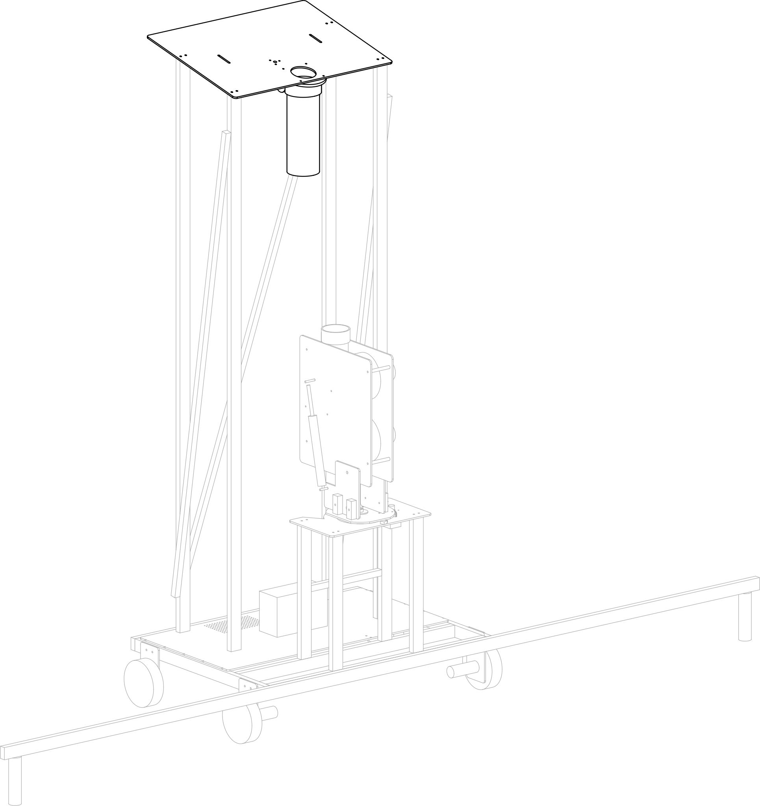

| Part | Qty | File or what to buy |
| --- | --- | --- |
| hopper_post_rear | 2 | 2040 T-slot, cut 1871 mm, M5 tapped both ends |
| hopper_post_front | 2 | 2040 T-slot, cut 1816 mm, M5 tapped both ends |
| hopper_brace_x | 2 | 2020 T-slot, cut 1600 mm, ends mitred to 9 deg |
| hopper_brace_y | 1 | 2020 T-slot, cut 1734 mm, ends mitred to 20 deg |

| Fastener or part | Qty |
| --- | --- |
| M5 x 16 button head (hopper) | 8 |
| 2020 corner bracket with M5 screws and T-nuts | 6 |

Tools: 3 mm hex key, a second person.

Tap both core bores of each end of the four posts M5. Stand each on the deck and screw it down from under the deck (two M5 x 16 into its bores); the rear pair are the taller ones. Bolt the two x braces outside each side pair and the y brace behind the rear pair with a corner bracket at each end; leave them finger-tight until the shelf is on.

### 16. Hopper shelf, sleeve socket and take-up sleeve

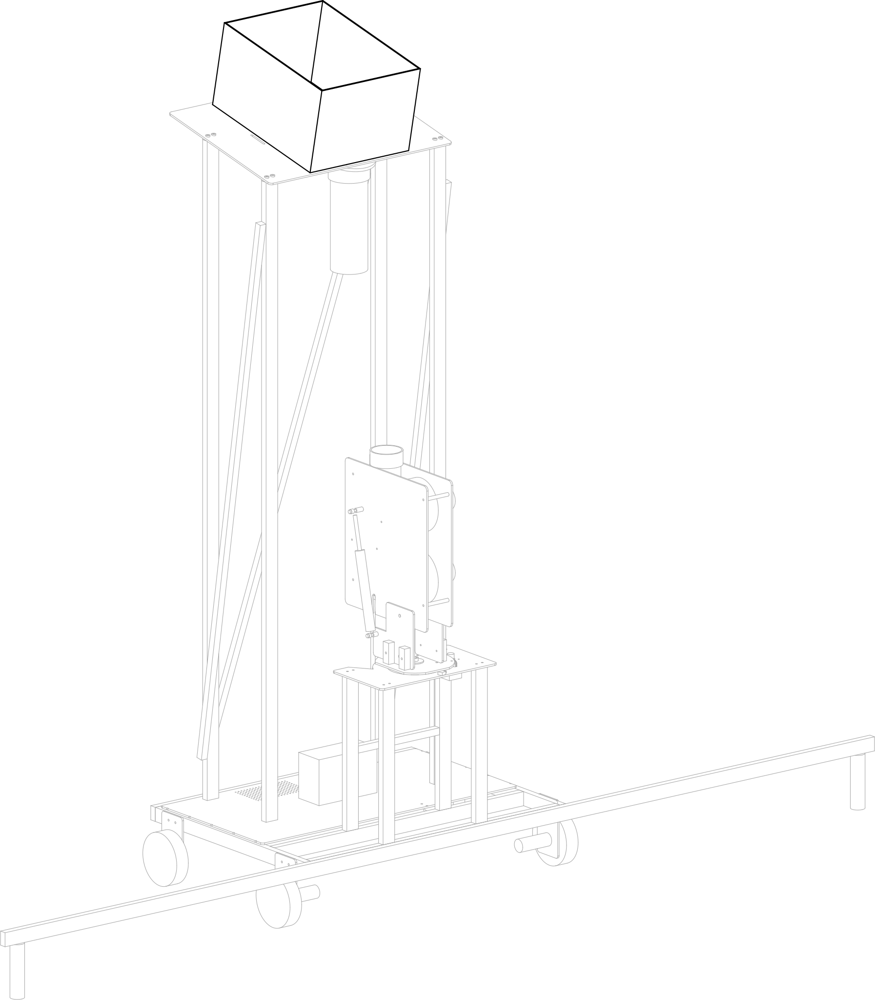

| Part | Qty | File or what to buy |
| --- | --- | --- |
| hopper_post_wedge | 4 | print/hopper_post_wedge.stl |
| hopper_shelf | 1 | laser/hopper_shelf__aluminium_5mm.dxf |
| hopper_post_washer | 8 | print/hopper_post_washer.stl |
| hopper_spigot | 1 | print/hopper_spigot.stl |
| take_up_sleeve | 1 | Rigid round tube, 96 mm bore, about 102 mm OD, cut 300 mm; slot 10 mm wide in the rear wall from the top end down 262 mm |
| take_up_spring_bracket | 1 | print/take_up_spring_bracket.stl |
| take_up_spool | 1 | print/take_up_spool.stl |
| take_up_spring | 1 | Constant-force spring, 5 N (assumed: holds the hose's top end against a 5 N hose pull), 12.7 mm band, natural bore about 17 mm, coil under 30 mm across, at least 361 mm of band, a hole in its free end |

| Fastener or part | Qty |
| --- | --- |
| M5 x 25 button head (hopper shelf) | 8 |
| M4 x 12 socket cap screw (spigot) | 4 |
| M4 x 12 button head (spring bracket) | 2 |
| M4 x 40 socket cap screw + nyloc nut (spring axle) | 1 |

Tools: 3 mm and 2.5 mm hex keys, 7 mm spanner.

Screw the sleeve socket under the shelf's outlet hole (four M4 x 12 from above into its flange). Seat the constant-force spring's coil on the printed spool, band leaving the coil's front at the bottom, and hold the spool between the spring bracket's cheeks while the M4 axle goes through both cheeks and the spool; snug the nyloc so the spool still spins. Screw the bracket up under the shelf behind the socket (two M4 x 12 button heads from above into its inserts): the band should hang straight down past the socket's rear, clear of it. Set a post wedge on each post's top, thick edge away from the net, holes over the core bores. Lift the shelf onto the wedges, set a taper washer over each of its eight post holes with its thin side uphill, and screw straight down through washer, shelf and wedge into the posts' bores (two M5 x 25 each, vertical, not square to the shelf). Now tighten the braces. Push the take-up sleeve up into the socket, slot to the rear, and tape the band to the sleeve for now.

### 17. Agitator and tub

| Part | Qty | File or what to buy |
| --- | --- | --- |
| hopper_agitator_mount | 1 | print/hopper_agitator_mount.stl |
| agitator_motor | 1 | Planetary gearmotor, 25 mm class, concentric 6 mm D shaft at least 25 mm long, about 20 rpm and 1.5 N m rated at 24 V, four M3 face holes on 17 mm (all assumed: check yours against the mount) |
| hopper_agitator | 1 | print/hopper_agitator.stl |
| hopper_tub | 1 | Storage tub about 440 x 340 x 250 mm outside; cut a 75 mm hole at the low end over the outlet and a 12 mm hole for the agitator's shaft (match them to the shelf's). Holds about 125 balls at 0.55 packing. |

| Fastener or part | Qty |
| --- | --- |
| M3 x 10 socket cap screw (agitator) | 4 |
| M4 x 12 button head (agitator) | 3 |
| M3 x 6 set screw + M3 heat-set insert | 1 |
| 25 mm strap, 1 m | 2 |

Tools: 2.5 mm and 1.5 mm hex keys, soldering iron.

Screw the gearmotor's face to the mount (four M3 x 10 from the counterbores) and bolt the mount up under the shelf's small hole (three M4 x 12 from above). Cut the tub's two holes to match the shelf's, set it on and strap it down. Melt the M3 insert into the agitator's boss, push the agitator on the shaft through the tub's hole, a ball's radius over the floor, and tighten the set screw on the flat.

### 18. Feed hose and take-up collar

| Part | Qty | File or what to buy |
| --- | --- | --- |
| feed_hose | 1 | 72 mm ID smooth-bore flexible hose (82 mm OD), cut 810 mm |
| take_up_collar | 1 | print/take_up_collar.stl |

| Fastener or part | Qty |
| --- | --- |
| Flexible-PVC adhesive or epoxy | 1 |
| Hose clamp, 80-90 mm | 1 |
| M3 x 8 pan head screw (spring band) | 1 |

Tools: screwdriver.

Bond the hose's top end 25 mm into the collar and let it cure. Slide the collar up the sleeve, tab through the slot, pull the spring's band down to the tab and screw its end to the tab's rear face (one M3 x 8 pan head into a 2.5 mm pilot). Push the hose's lower end over the roof column's socket and clamp it. Swing the head through its whole range: the hose must not kink or pull the collar out of the sleeve's bottom.

### 19. Net poles and camera bar

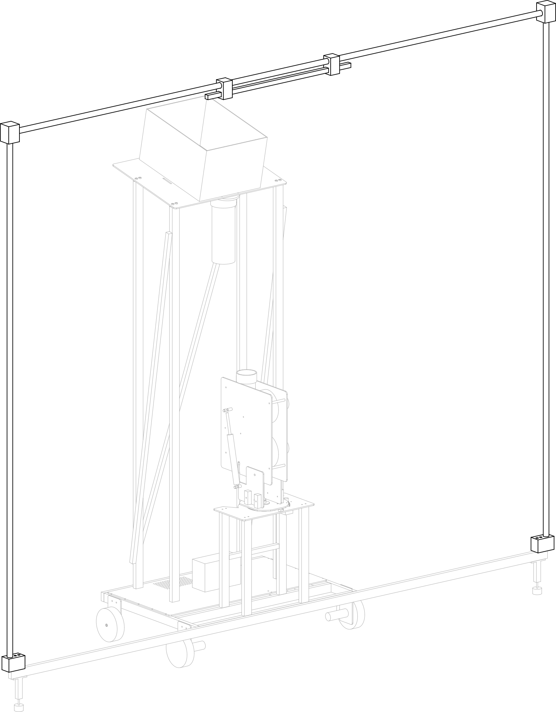

| Part | Qty | File or what to buy |
| --- | --- | --- |
| pole_foot | 2 | print/pole_foot.stl |
| net_pole_vertical | 2 | 25 mm OD x 1.5 mm aluminium tube (or fibreglass), cut 2437 mm |
| pole_elbow | 2 | print/pole_elbow.stl |
| net_pole_top | 1 | 25 mm OD x 1.5 mm aluminium tube, cut 3020 mm |
| camera_clamp | 2 | print/camera_clamp.stl |
| camera_bar | 1 | 2020 T-slot, cut 800 mm |

| Fastener or part | Qty |
| --- | --- |
| M5 x 12 button head (pole feet) | 4 |
| M5 T-nut (slot 6) | 4 |
| M4 x 25 socket cap screw (camera clamps) | 2 |
| Knotless netting, 25-35 mm mesh | 1 |
| Global-shutter camera module + cable | 2 |

Tools: long 3 mm hex key, 3.3 mm drill, a second person.

Screw each pole foot onto the net beam's top slot at its end (two M5 x 12 down the counterbores into T-nuts). Join the poles with the elbows on the ground, thread the two camera clamps onto the top pole, and stand the frame up into the feet. Slide the camera bar into the clamps; drill 3.3 mm through each clamp's wall into the pole socket and drive an M4 x 25 in as a pinch screw. Hang the netting from the top pole, mount the two cameras on the bar, and leave the net's bottom edge free for the trough.

### 20. Catch trough

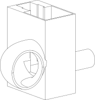

| Part | Qty | File or what to buy |
| --- | --- | --- |
| trough_hanger_a | 1 | print/trough_hanger_a.stl |
| trough_hanger_b | 1 | print/trough_hanger_b.stl |
| trough_hanger_c | 1 | print/trough_hanger_c.stl |
| trough_hanger_d | 1 | print/trough_hanger_d.stl |
| trough_hanger_e | 1 | print/trough_hanger_e.stl |
| trough_hanger_f | 1 | print/trough_hanger_f.stl |
| trough_hanger_g | 1 | print/trough_hanger_g.stl |
| trough_sump | 1 | print/trough_sump.stl |
| trough_gutter_a | 1 | 125 mm (5 in class) half-round gutter, cut 1636 mm (both runs come from one 3.05 m length: 2884 mm together); one end cap at the outer end |
| trough_gutter_b | 1 | 125 mm (5 in class) half-round gutter, cut 1248 mm (both runs come from one 3.05 m length: 2884 mm together); one end cap at the outer end |

| Fastener or part | Qty |
| --- | --- |
| M5 x 12 button head + T-nut (trough) | 14 |
| M5 x 40 button head + T-nut (sump) | 2 |
| Half-round gutter end cap, 125 mm class | 2 |
| Zip ties, 4.8 mm (trough) | 7 |

Tools: long 3 mm hex key.

Each hanger is its own height: match its letter to the y in its notes. Bolt the hangers to the net beam's front slots (two M5 x 12 down each counterbore into T-nuts) and the sump by its rear tab (two M5 x 40, heads in the cavity). Cap each gutter run's outer end, lay the runs in the saddles with their low ends in the sump's saddles, and zip-tie each into its hanger. Lace the net's bottom edge to the gutters' back lips.

### 21. Lift boot and drive (on the bench)

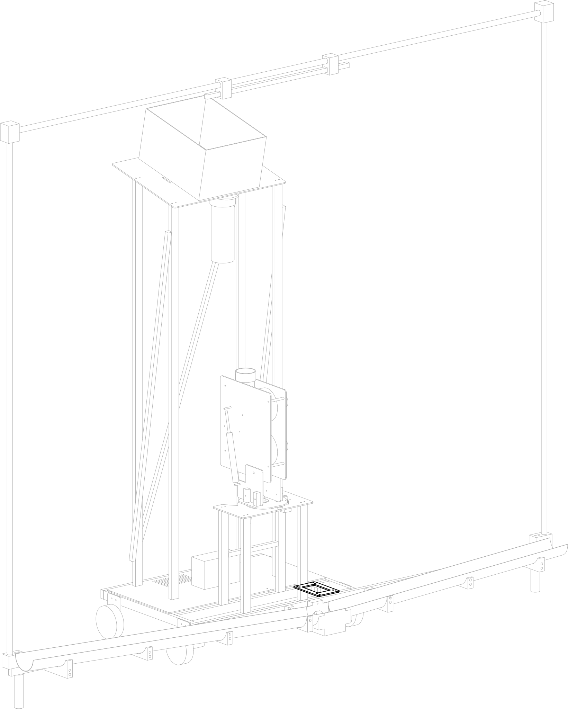

| Part | Qty | File or what to buy |
| --- | --- | --- |
| lift_boot | 1 | print/lift_boot.stl |
| lift_shaft_bearing | 2 | Flanged ball bearing F626-2Z, 6 x 19 x 6 mm, flange 22 x 1.5 mm (static rating about 1000 N assumed) |
| lift_shaft | 1 | 6 mm D shaft (0.5 mm flat), stainless, cut 84 mm; deburr both ends |
| lift_slip_collar | 2 | Shaft collar, 6 mm bore, 12 mm OD x 6 mm, M3 set screw onto the shaft's flat |
| lift_slip_plate | 2 | laser/lift_slip_plate__steel_2mm.dxf |
| lift_slip_facing | 2 | Friction facing washer 20 x 6.5 x 1.5 mm, cut from clutch or brake lining sheet or cork-rubber gasket sheet (oil-free; friction about 0.3 assumed) |
| lift_slip_spring | 4 | Disc spring DIN 2093 12.5 x 6.2 x 0.5 mm, free height 0.85 mm (B series), 4 stacked in series (alternating, cone to cone): about 363 N flat by DIN 2093's formula; the hub needs 208 N at 0.67 mm of the stack's 1.40 mm (cad/README.md "Slip hub wear") |
| lift_pulley (1 of 2) | 1 | AT5 timing pulley, 16 teeth (pitch diameter 25.5 mm), flanged, for 25 mm belt: one with a plain 6 mm bore and no grub screws (the gearmotor's, driven through the slip hub on the lift's drive shaft), one with 8 mm bearings on an axle (drawn at the belt's tooth-tip circle) |
| lift_shaft_coupler | 1 | Jaw (spider) shaft coupling, 6 mm to 6 mm, 20 mm OD x 25 mm, set-screw or clamp hubs (rated 2 N m or more) |
| lift_motor_spacer | 1 | print/lift_motor_spacer.stl |
| lift_motor | 1 | 37 mm gearmotor, 24 V, ~200 rpm, 6 mm D shaft (the base drive's class; 0.6 N m rated assumed), no encoder, at most 75 mm face to back (the spacer sets it out; a longer one meets the drive bracket), on a MOSFET from GPIO 12 |

| Fastener or part | Qty |
| --- | --- |
| M3 x 8 screw (lift) | 6 |
| M3 x 8 socket cap screw + M3 heat-set insert, 4 mm long (lift) | 2 |

Tools: arbor press or vice, 2.5 and 1.5 mm hex keys, luggage scale.

Press the two flanged bearings into the boot (cad/README.md, "Lift drive shaft"). Build the slip hub on the drive shaft through the boot: collar, plate, facing, the pulley, facing, plate, four disc springs cone to cone, collar; set it to slip at 0.9 N m as the slip plates' notes say. Screw the gearmotor's face to the spacer's end wall (six M3 x 8 from inside), fit the coupling, and fix the spacer's ears to the boot (two M3 x 8 into inserts).

### 22. Lift base plate and boot on the mast rails

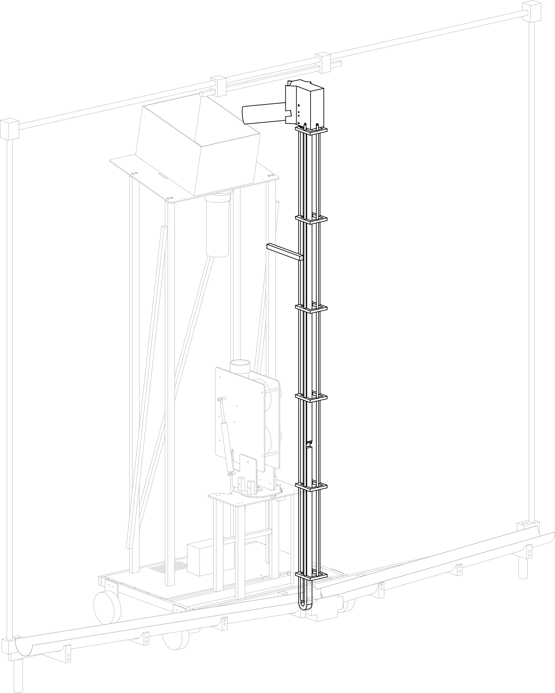

| Part | Qty | File or what to buy |
| --- | --- | --- |
| lift_base_plate | 1 | laser/lift_base_plate__aluminium_5mm.dxf |

| Fastener or part | Qty |
| --- | --- |
| M5 x 12 button head + T-nut (lift) | 8 |
| 2040 corner bracket with M5 screws and T-nuts (lift) | 2 |

Tools: 3 mm hex key.

Bolt the base plate across the mast rails at the lift (four M5 x 12 into T-nuts), then hang the boot under it on the four inner M5s. The boot's inlet arm butts against the sump's outlet stub at the net beam's rear face: glue or strap the joint.

### 23. Lift column, belt, head and chute

| Part | Qty | File or what to buy |
| --- | --- | --- |
| lift_spine | 1 | 2040 T-slot, cut 2322 mm |
| lift_rod | 3 | 10 mm aluminium rod, cut 2141 mm |
| lift_clip | 6 | print/lift_clip.stl |
| lift_belt | 1 | AT5 polyurethane timing belt, steel cords, 25 mm wide, 959 teeth (4795 mm), welded endless; 32 straight PU cleats welded to its back every 149.8 mm by the belt supplier, 12 mm high, 3 mm thick, cut to the belt's width, with two 3.4 mm holes drilled through each 7.5 mm off the belt and 14 mm apart (a screw through the belt does not fit: its head would sit on the tooth side, which runs on the pulleys' teeth and the spine's strip, and an M3 countersunk head, 6 mm across, is wider than an AT5 tooth); each cleat carries a printed lift_flight_cap |
| lift_flight_cap | 32 | print/lift_flight_cap.stl |
| lift_pulley (2 of 2) | 1 | AT5 timing pulley, 16 teeth (pitch diameter 25.5 mm), flanged, for 25 mm belt: one with a plain 6 mm bore and no grub screws (the gearmotor's, driven through the slip hub on the lift's drive shaft), one with 8 mm bearings on an axle (drawn at the belt's tooth-tip circle) |
| lift_head | 1 | print/lift_head.stl |
| lift_jack_screw | 2 | M5 x 25 hex bolt + M5 nut (captive in the head) + M5 jam nut: the top pulley's jack screws |
| lift_strut | 1 | 2020 T-slot, cut 241 mm |
| lift_chute | 1 | Rigid round tube, 72 mm bore, about 80 mm OD, cut 223 mm (the take-up sleeve's tube) |

| Fastener or part | Qty |
| --- | --- |
| M5 x 12 button head + T-nut (lift) | 16 |
| 2020 corner bracket with M5 screws and T-nuts (lift) | 2 |
| 8 mm axle, 60 mm, + two 608 bearings + e-clips | 1 |
| PU cleat welding by the belt supplier (flights) | 32 |
| M3 x 14 countersunk screw (ISO 10642) + washer + nyloc nut (flight caps) | 64 |
| UHMW-PE tape, 25 mm wide, self-adhesive | 1 |

Tools: 3 mm and 2 mm hex keys, 8 mm and 5.5 mm spanners, a second person.

Stick the UHMW tape on both 20 mm faces of the spine. Stand the spine in the boot's slot through the base plate and square it with the two 2040 corner brackets. Screw a flight cap to each welded cleat (two M3 x 14 countersunk, a washer and a nyloc on the cleat's back, 64 in all). Loop the belt over the bottom pulley and up the spine, fit the 6 rod clips up the spine with the three rods through them, then the head on the spine's top with the top pulley on its axle inside the belt loop. Tension with the jack screws to the figure in their notes, then tighten the head's four side M5s. Brace the spine to the front hopper post with the strut and push the chute into the head's socket over the tub.

### 24. Wiring: deck-side cables and the elevation lead

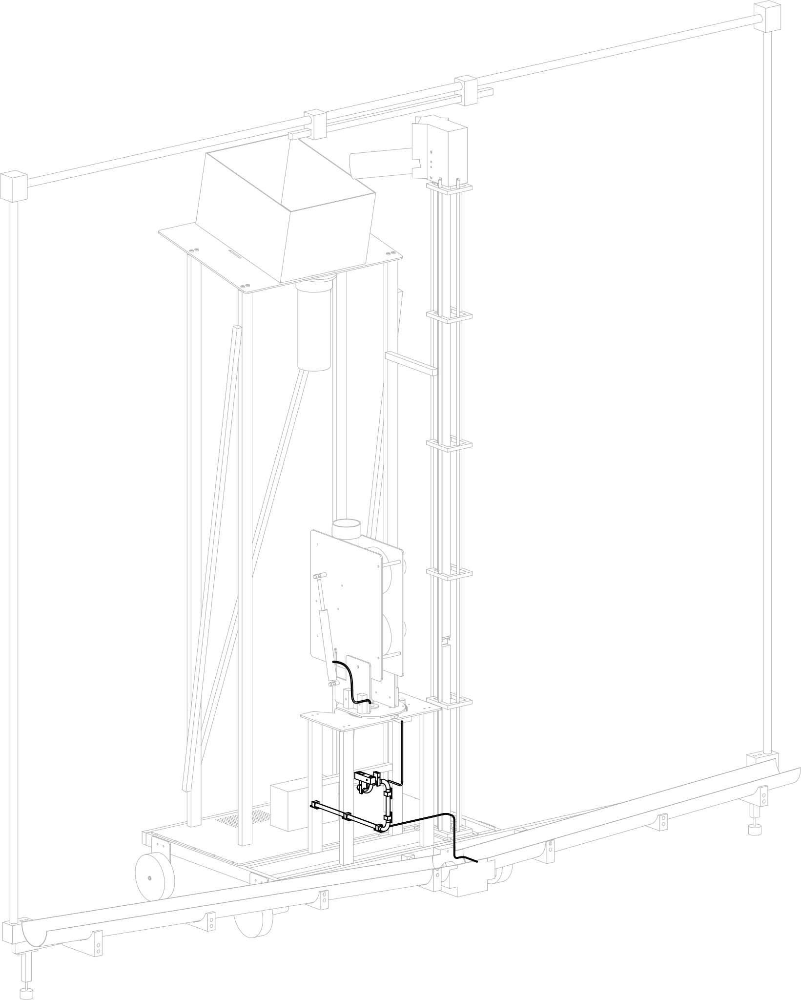

| Part | Qty | File or what to buy |
| --- | --- | --- |
| cable_clamp | 1 | print/cable_clamp.stl |
| deck_cable_main | 1 | Deck-side run, electronics to the axis clamp: 6 launcher motor phases 14 AWG, 6 wheel tachometers 26 AWG, 1 shuttle servo signal 26 AWG, 2 shuttle servo supply and return 20 AWG, 2 elevation actuator 18 AWG, 3 elevation feedback pot 26 AWG (11.5 mm bundle; 12.7 mm on the deck with the stepper's and lift's leads), 729 mm routed; cut the head's wires 789 mm from their deck terminals to the clamp, plus the twisting run, the loop and the head's run. Spiral wrap; bends 30 mm |
| deck_cable_stepper | 1 | Azimuth stepper and home switch: 4 azimuth stepper coils 22 AWG, 2 azimuth home switch 26 AWG, 874 mm from the driver carrier on the deck (leaves the main run under the crossbar and rises to the stepper's underside); coil leads add 6.2% to the coil's resistance |
| deck_cable_lift | 1 | Lift gearmotor: 2 lift gearmotor 20 AWG, 913 mm from its MOSFET on the deck (leaves the main run on the deck, drops off the deck's front edge and runs under the side rail to the motor's back); 0.33 V drop at an assumed 5.5 A stall |
| deck_cable_saddle | 5 | print/deck_cable_saddle.stl |
| deck_cable_hanger | 3 | print/deck_cable_hanger.stl |
| elev_lead_fixed | 1 | Elevation actuator's lead, tied run: 2 elevation actuator 18 AWG, 3 elevation feedback pot 26 AWG (4.4 mm), out of the gland's bore on its -y wall, 12 mm bend, straight across the turntable under the pivot and through the guard-side cheek's grommet (55 mm) |
| elev_lead | 1 | Elevation actuator's lead, free span: cut 220 mm from the cheek's grommet to a zip tie on the actuator's body 70 mm from its anchor eye, on the pivot side (drawn at 0 deg; posed per pose in the sweeps) |

| Fastener or part | Qty |
| --- | --- |
| M5 x 16 button head + nyloc nut (deck cables) | 6 |
| M5 x 10 button head + T-nut (deck cables) | 6 |
| M5 x 12 button head + T-nut (cable clamp) | 1 |

Tools: 3 mm hex key, 8 mm spanner, crimp tool.

Bolt the axis cable clamp to the crossbar's front slot (one M5 x 12 into a T-nut; the head drops into the pocket on top). Route the deck-side run as the manifest's cables line says: deck saddles (nylocs under the deck), the rear post's saddles, the crossbar hangers, up into the clamp's bore, then the twisting run to the gland with no ties on it. Run the elevation lead out of the gland's -y wall, across under the pivot and through the cheek's grommet to its tie on the actuator's body.

### 25. Electronics

| Fastener or part | Qty |
| --- | --- |
| Logic-level N-MOSFET module, 24 V 5 A, + flyback diode | 1 |
| Logic-level N-MOSFET module, 24 V 2 A, + flyback diode | 1 |
| Raspberry Pi 5 (4 GB) | 1 |
| ESP32 dev board (ESP32-WROOM-32) | 1 |
| 50 A+ BLDC ESC, servo-pulse input | 2 |
| Dual DC motor driver, 10 A/ch | 1 |
| 6 V 5 A buck converter (servo supply) | 1 |
| Spiral wrap, 10 mm, 1 m | 1 |
| Zip ties, 2.5 mm | 14 |
| Stepper driver, 2 A class (TMC2209 or A4988), StepStick format, + heatsink | 1 |
| 1x8 female header, 2.54 mm, + 2.54 mm perfboard scrap | 2 |
| Screw terminal blocks, 5.08 mm, 4-way and 2-way | 1 |
| Electrolytic capacitor 100 uF 35 V | 1 |
| Silicone wire 22 AWG (4 colours) and 26 AWG pair | 1 |
| Silicone wire 20 AWG pair | 1 |
| Spiral wrap, 12 mm, 1 m | 1 |
| TCRT5000 reflective sensor | 2 |
| 22 mm NC mushroom e-stop + 24 V coil contactor, 30 A DC or more | 1 |
| Precharge resistor 4.7 ohm, aluminium-housed 50 W class | 1 |
| 24 V relay, 10 A contacts | 1 |
| 24 V relay, 10 A contacts (SPDT or better) | 1 |
| 22 mm momentary push button, 1 NO + 1 NC, flush, blue, labelled RESET | 1 |
| 24 V on-delay timer relay module, set 0.5 s | 1 |
| PC817 optocoupler + 10k 0.5 W resistor | 1 |
| 4.7k resistor | 1 |
| Current-sense resistor 0.01 ohm 1 W 1% (2512, four-terminal if you can) | 1 |
| INA186A2 current-sense amplifier, 50 V/V (SOT-23 on an adapter) + 100 nF decoupling | 1 |
| LM393 dual comparator (DIP-8 or SOIC on an adapter) + 100 nF decoupling | 1 |
| Resistors 1%: 100k, 33k, two 10k; capacitor 100 nF | 1 |
| Schottky diode, 45 V 20 A or more (TO-220 class) | 1 |
| Wireless e-stop relay remote, latching | 1 |
| 5 V 5 A buck converter | 1 |
| 30 A fuse (ATO/ATC blade or MIDI) + inline holder | 1 |
| Blade fuse block, 8-way, with a negative bus | 1 |
| ATO blade fuses: 15 A x2, 7.5 A, 3 A, 2 A x2, 1 A x2 | 1 |
| Inline ATO fuse holder | 1 |
| Silicone wire 12 AWG red and black, 1 m each | 1 |
| Ballast (sand bags or water cells), see manifest | 1 |

Tools: screwdrivers, crimp tool, multimeter, soldering iron.

Mount and wire everything to hardware/electronics.md (pin map, power budget, fuses, e-stop, reset and precharge chain, lift jam cutoff) and the manifest's power and cables lines. Set the stepper driver's current and microsteps as the carrier's notes say. Put the ballast where the manifest's tip-over line says.

### 26. Before the first power-up

Tools: multimeter.

With the main fuse out: check the e-stop and the wireless remote each open the contactor's coil circuit, that RESET must be pressed and let go before anything moves, and that there is no short from battery positive to the frame. Then fit the fuse with the head level and nobody in front of the wheels, home the azimuth (the bracket's slots let you move the switch so it clicks mid-lobe), and run the lift empty. Read hardware/safety.md before it throws a ball.

## Fastener lengths, checked against the CAD

Each length is measured from the head's face through the parts the model puts under it.

| Joint | Fastener | Stack (mm) | Grip | Length | Spare | Rule | |
| --- | --- | --- | --- | --- | --- | --- | --- |
| head standoff | M5 x 12 button head | head_motor_plate 5 | 5 | 12 | 7 | 7 to 8 mm into the standoff (1.5 d, or its thread less 1 mm; never past it) | pass |
| feed floor through the head plate | M4 x 12 socket cap screw (feed) | head_motor_plate 5 | 5.8 | 12 | 6.2 | 5.7 to 12 mm past the face, the insert's length to the pocket's depth | pass |
| feed roof through the head plate | M4 x 12 socket cap screw (feed) | head_motor_plate 5 | 5.8 | 12 | 6.2 | 5.7 to 12 mm past the face, the insert's length to the pocket's depth | pass |
| servo bracket leg | M4 x 12 socket cap screw (servo legs) | head_motor_plate 5 | 5 | 12 | 7 | 5.7 to 10 mm past the face, the insert's length to the pocket's depth | pass |
| servo tab | M4 x 10 socket cap screw (servo tabs) | shuttle_servo 14.5 | 2.5 | 10 | 7.5 | 5.7 to 8 mm past the face, the insert's length to the pocket's depth | pass |
| cheek foot to turntable plate | M4 x 12 socket cap screw | turntable_plate 5 | 5 | 12 | 7 | 5.7 to 25 mm past the face, the insert's length to the pocket's depth | pass |
| cheek to cheek foot | M4 x 12 socket cap screw | trunnion_cheek 5 | 5 | 12 | 7 | 5.7 to 20 mm past the face, the insert's length to the pocket's depth | pass |
| gear sector under the turntable plate | M4 x 12 socket cap screw (azimuth) | turntable_plate 5 | 5 | 12 | 7 | 5.7 to 8.5 mm past the face, the insert's length to the pocket's depth | pass |
| azimuth stop block | M4 x 12 socket cap screw (stops) | mast_plate 5 | 5 | 12 | 7 | 5.7 to 7.5 mm past the face, the insert's length to the pocket's depth | pass |
| azimuth stepper flange | M3 x 8 screw (azimuth stepper) | mast_plate 5 | 5 | 8 | 3 | 3 to 4.5 mm into the part's tapped hole (its thread depth) | pass |
| home switch bracket | M3 x 12 socket cap screw + washer + nut (home switch) | home_switch_bracket 2 + mast_plate 5 + 0.5 washers | 7.5 | 12 | 4.5 | needs 3.4 mm past the stack for the nut and two threads | pass |
| head pivot | M8 x 120 bolt + nyloc nut + 4 washers | trunnion_cheek 5 + head_motor_plate 5 + head_guard_plate 5 + trunnion_cheek_elev 5 + 3.2 washers (+ 85 open) | 108.2 | 120 | 11.8 | needs 10.5 mm past the stack for the nyloc and two threads | pass |
| deck to side rail | M5 x 12 button head | base_deck 5 | 5 | 12 | 7 | 4 to 8 mm past the extrusion's face: catches the T-nut, short of the slot floor | pass |
| drive bracket to side rail | M5 x 12 button head | drive_bracket 5 | 5 | 12 | 7 | 4 to 8 mm past the extrusion's face: catches the T-nut, short of the slot floor | pass |
| mast post to mast rail | M5 x 50 button head (mast posts) | mast_rail 40 | 40 | 50 | 10 | 5 to 15 mm into the part's tapped hole (its thread depth) | pass |
| mast plate to mast post | M5 x 12 button head | mast_plate 5 | 5 | 12 | 7 | 5 to 15 mm into the part's tapped hole (its thread depth) | pass |
| hopper post to deck | M5 x 16 button head (hopper) | base_deck 5 | 5 | 16 | 11 | 5 to 15 mm into the part's tapped hole (its thread depth) | pass |
| shelf to hopper post | M5 x 25 button head (hopper shelf) | hopper_post_washer 3.785 + hopper_shelf 7.131 + hopper_post_wedge 6.136 | 13.01 | 25 | 11.99 | 5 to 15 mm into the part's tapped hole (its thread depth) | pass |
| sleeve socket under the shelf | M4 x 12 socket cap screw (spigot) | hopper_shelf 5 | 5 | 12 | 7 | 5.7 to 8 mm past the face, the insert's length to the pocket's depth | pass |
| spring bracket under the shelf | M4 x 12 button head (spring bracket) | hopper_shelf 5 | 5 | 12 | 7 | 5.7 to 8 mm past the face, the insert's length to the pocket's depth | pass |
| agitator motor mount under the shelf | M4 x 12 button head (agitator) | hopper_shelf 5 | 5 | 12 | 7 | 5.7 to 7 mm past the face, the insert's length to the pocket's depth | pass |
| trough hanger to net beam | M5 x 12 button head + T-nut (trough) | trough_hanger_a 6 | 6 | 12 | 6 | 4 to 8 mm past the extrusion's face: catches the T-nut, short of the slot floor | pass |
| sump tab to net beam | M5 x 40 button head + T-nut (sump) | trough_sump 34 | 34 | 40 | 6 | 4 to 8 mm past the extrusion's face: catches the T-nut, short of the slot floor | pass |
| pole foot to net beam | M5 x 12 button head (pole feet) | pole_foot 6 | 6 | 12 | 6 | 4 to 8 mm past the extrusion's face: catches the T-nut, short of the slot floor | pass |
| cable clamp to crossbar | M5 x 12 button head + T-nut (cable clamp) | cable_clamp 6 | 6 | 12 | 6 | 4 to 8 mm past the extrusion's face: catches the T-nut, short of the slot floor | pass |
| elevation pin (rod eye) through the guard plate | Shoulder bolt 6 x 40, M5, + thin nut | elev_pin_spacer_outer 9 + elev_pin_spacer_inner 22.5 (+ 8.5 open) | 40 | 40 | 0 | shoulder ends on the face (+-0.3); 0.5 mm open on it (0 to 1); its 9.5 mm thread 4.5 mm past the 5 mm part, 4.3 for the nut and two threads | pass |
| elevation anchor (anchor eye) through the cheek's tab | Shoulder bolt 6 x 30, M5, + thin nut | elev_anchor_spacer_outer 6.5 + elev_anchor_spacer_inner 15 (+ 8.5 open) | 30 | 30 | 0 | shoulder ends on the face (+-0.3); 0.5 mm open on it (0 to 1); its 9.5 mm thread 4.5 mm past the 5 mm part, 4.3 for the nut and two threads | pass |
| shuttle pin through the rod and the plate's slot | M4 shoulder bolt, 5 x 12 | shuttle_rod 5 + head_motor_plate 5 (+ 1 open) | 12 | 12 | 0 | shoulder ends on the face (+-0.3); 2 mm open on it (0 to 2.2); its 5 mm thread 4 to 10 mm into the part | pass |
| crank pin through the crank | M4 shoulder bolt, 5 x 6 + short insert | shuttle_crank 5 | 6 | 6 | 0 | shoulder ends on the face (+-0.3); 1 mm open on it (0 to 1); its 5 mm thread 4 to 5 mm into the part | pass |
| launcher motor to the motor plate | M4 x 12 socket cap screw (motors) | head_motor_plate 5 | 5 | 12 | 7 | 4 to 8 mm into the part's tapped hole (its thread depth) | pass |
| lift gearmotor face to its spacer | M3 x 8 screw (lift) | lift_motor_spacer 4 | 4 | 8 | 4 | 3 to 5 mm into the part's tapped hole (its thread depth) | pass |
| lift spacer ear to the boot | M3 x 8 socket cap screw + M3 heat-set insert, 4 mm long (lift) | lift_motor_spacer 3 | 3 | 8 | 5 | 4 to 6 mm past the face, the insert's length to the pocket's depth | pass |
| lift flight cap through its cleat | M3 x 14 countersunk screw + washer + nyloc nut (flight caps) | lift_flight_cap 4.301 + lift_belt 3 + 0.5 washers | 8.5 | 14 | 5.5 | needs 5 mm past the stack for the nyloc and two threads | pass |
| deck cable saddle | M5 x 16 button head + nyloc nut (deck cables) | deck_cable_saddle 1.5 + base_deck 5 | 6.5 | 16 | 9.5 | needs 6.6 mm past the stack for the nyloc and two threads | pass |
| idler axle | M8 x 65 hex bolt + nyloc nut (idler axle) | idler_bracket 5 + idler_axle_spacer 2 + wheel 40 + idler_axle_spacer 2 | 49 | 65 | 16 | needs 10.5 mm past the stack for the nyloc and two threads | pass |
| take-up spool axle | M4 x 40 socket cap screw + nyloc nut (spring axle) | take_up_spring_bracket 6 + take_up_spool 16.7 + take_up_spring_bracket 6 (+ 1 open) | 29.7 | 40 | 10.3 | needs 6.4 mm past the stack for the nyloc and two threads | pass |
| driver carrier to deck | M3 x 20 screw + nut (stepper driver carrier) | stepper_driver_carrier 10 + base_deck 5 | 15 | 20 | 5 | needs 3.4 mm past the stack for the nut and two threads | pass |
| levelling foot block to net beam | M5 x 12 button head + T-nut (levelling feet) | foot_block 6 | 6 | 12 | 6 | 4 to 8 mm past the extrusion's face: catches the T-nut, short of the slot floor | pass |
| levelling foot jam nut | M6 nut + M6 thin jam nut (levelling feet) | foot_block 5 | 5 | 35 | 30 | needs 5.2 mm past the stack for the nut and two threads | pass |
| bearing fixed ring to the mast plate | M5 x 16 button head + nyloc nut (turntable bearing) | turntable_bearing 2 + mast_plate 5 | 7 | 16 | 9 | needs 6.6 mm past the stack for the nyloc and two threads | pass |
| turntable plate to the bearing's turning ring | M5 x 16 button head + nyloc nut (turntable bearing) | turntable_bearing_ring 2 + turntable_plate 5 | 7 | 16 | 9 | needs 6.6 mm past the stack for the nyloc and two threads | pass |

## Other checks

- Every placement of every placed part is fitted in exactly one step, and the steps use every bought line
  of the BOM to the unit.
- Every part a step adds touches something fitted before it, within the step's allowance where a link is not
  modelled (a motor shaft, a clevis eye, a sliding fit). Two steps start sub-assemblies on the bench; the
  take-up spring is named as not yet mounted in the CAD.
- The screws marked access go in along their axis: nothing of the parts they clamp lies within 60 mm
  behind their heads (a counterbore closed at its far end fails).
- Every screw into an extrusion's end lands on one of its core bores, 10 mm either side of the
  end's centre along the 40 mm side.

## Spanners on the nuts

Each nut, at every one of its holes, when its step comes: a ring spanner of the nut's size (its length assumed: 5.5 mm, 85 long, 7 mm, 100 long, 8 mm, 110 long, 10 mm, 130 long, 13 mm, 165 long, unless the step asks for another) and
the hand on its end (35 mm of fingers, then 150 mm of hand and wrist along the shank, 25 mm deep) are laid on the nut and
turned about the bolt 5 degrees at a time. "Nut" is the widest arc that is clear at the worst hole; a nut needs one clear angle to be held,
and 30 degrees (a 12-point ring's step) to be turned. A hex head turned with a spanner is swung the same way ("Head").

| Joint | Fastener | Step | Spanner on the nut | Holes | Nut (deg) | Head (deg) | Turn | |
| --- | --- | --- | --- | --- | --- | --- | --- | --- |
| home switch bracket | M3 x 12 socket cap screw + washer + nut (home switch) | 6 | 5.5 mm, 85 long | 1 | 145 | - | head (key) or nut | pass |
| head pivot | M8 x 120 bolt + nyloc nut + 4 washers | 13 | 13 mm, 165 long | 1 | 165 | 115 | head or nut | pass |
| elevation pin (rod eye) through the guard plate | Shoulder bolt 6 x 40, M5, + thin nut | 13 | 8 mm, 110 long | 1 | 55 | - | head (key) or nut | pass |
| elevation anchor (anchor eye) through the cheek's tab | Shoulder bolt 6 x 30, M5, + thin nut | 13 | 8 mm, 110 long | 1 | 85 | - | head (key) or nut | pass |
| lift flight cap through its cleat | M3 x 14 countersunk screw + washer + nyloc nut (flight caps) | 23 | 5.5 mm, 85 long | 1 | 15 | - | head (key) | pass |
| deck cable saddle | M5 x 16 button head + nyloc nut (deck cables) | 24 | 8 mm, 110 long | 1 | 225 | - | head (key) or nut | pass |
| idler axle | M8 x 65 hex bolt + nyloc nut (idler axle) | 4 | 13 mm, 165 long | 2 | 360 | 225 | head or nut | pass |
| take-up spool axle | M4 x 40 socket cap screw + nyloc nut (spring axle) | 16 | 7 mm, 100 long | 1 | 110 | - | head (key) or nut | pass |
| driver carrier to deck | M3 x 20 screw + nut (stepper driver carrier) | 14 | 5.5 mm, 85 long | 4 | 205 | - | head (key) or nut | pass |
| levelling foot jam nut | M6 nut + M6 thin jam nut (levelling feet) | 3 | 10 mm, 130 long | 2 | 360 | - | head (key) or nut | pass |
| bearing fixed ring to the mast plate | M5 x 16 button head + nyloc nut (turntable bearing) | 7 | 8 mm, 110 long | 4 | 95 | - | head (key) or nut | pass |
| turntable plate to the bearing's turning ring | M5 x 16 button head + nyloc nut (turntable bearing) | 8 | 8 mm, 110 long | 4 | 305 | - | head (key) or nut | pass |

Result when this package was built: all pass.
